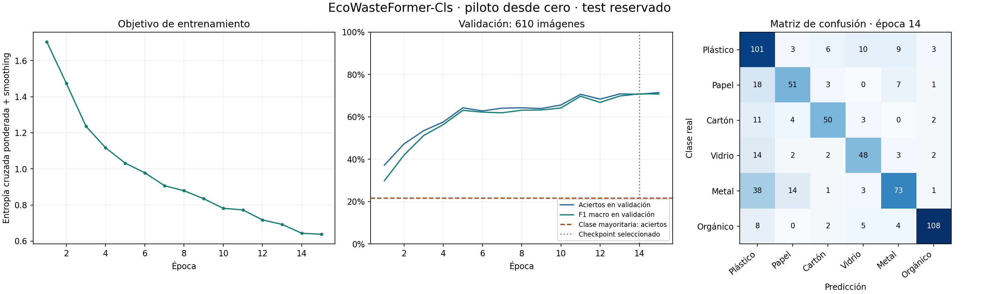

# Clasificador visual: implementación y piloto desde cero

Fecha: 19/11/2026. Estado: clasificador implementado, pruebas superadas y piloto completado. El conjunto de prueba permanece reservado. El detector y la aplicación de video siguen pendientes.

## Qué hace este componente

EcoWasteFormer-Cls recibe una fotografía con un residuo predominante y predice plástico, papel, cartón, vidrio, metal u orgánico. Clasifica la imagen completa; no localiza objetos ni los cuenta. Un detector será el encargado de obtener cajas cuando una escena tenga varios residuos.

Una imagen se divide en 196 regiones de 16×16 píxeles. Cada región se convierte en un vector de 128 números: un token visual. Cuatro bloques de atención relacionan esos tokens para formar la predicción. Por ejemplo, permiten combinar información de distintas partes de una botella. Esta implementación utiliza conceptos conocidos de Transformers, con capas y proyecciones escritas en el proyecto; no importa una arquitectura completa ni carga pesos externos.

## Arquitectura ejecutada

| Componente | Forma o configuración | Parámetros |
|---|---|---:|
| Entrada | RGB 224×224, letterbox y normalización fija a [-1,1] | 0 |
| Extracción de patches | [B,196,768], sin convoluciones | 0 |
| Proyección lineal | 768 → 128 | 98.432 |
| Posición | Sinusoidal 2D fija, sin token CLS | 0 |
| Cuatro bloques | Atención global, cuatro cabezas, MLP 128→256→128 | 529.920 |
| Promedio + LayerNorm | [B,128] | 256 |
| Cabezal | 128 → 6 logits | 774 |
| **Total comprobado** | | **629.382** |

Código: `ecowaste/clasificador.py` y bloques compartidos en `ecowaste/transformer.py`. El asistente reutiliza esos bloques conservando los nombres de pesos y compatibilidad del checkpoint anterior. La normalización de entrada es fija, no se calculó con validación o prueba. Las matrices usan la inicialización aleatoria de PyTorch y las normalizaciones su inicialización estándar; no se cargaron pesos preentrenados.

## Comprobaciones antes del piloto

Las once pruebas de `pruebas/` pasaron. Incluyen orden espacial de patches, conteo exacto de parámetros, formas de salida, gradientes presentes y finitos, restauración exacta de pesos, reproducción de un paso tras restaurar optimizador/RNG y cálculo de métricas sobre un caso conocido. También se conservaron las pruebas anteriores de geometría y asistente.

El diagnóstico seleccionó tres imágenes de entrenamiento por clase: 18 en total. La pérdida descendió de su valor inicial hasta 0,0047, con 100 % de aciertos en esas mismas imágenes en el paso 60 y tres comprobaciones consecutivas satisfactorias. Esto demuestra capacidad de ajuste, no generalización. Sus pesos se descartaron y el piloto comenzó nuevamente desde inicialización aleatoria.

Evidencia: `resultados/diagnostico_clasificador.json`.

## Experimento piloto

Configuración completa: `configuracion/entrenamiento_clasificador.json`.

- Datos: 2.714 imágenes de entrenamiento y 610 de validación, con los grupos de adquisición ya establecidos. Las 615 imágenes de prueba no se evaluaron.
- Semilla 42, máximo de 15 épocas, lote 32, AdamW con learning rate 0,0005, warmup de dos épocas y weight decay 0,01.
- Entropía cruzada con smoothing 0,05 y pesos inversos a la raíz del conteo de cada clase, calculados exclusivamente con entrenamiento.
- Aumentos solo en entrenamiento: inversión horizontal, brillo y contraste moderados. Validación usa el preprocesamiento fijo.
- Entrenamiento con precisión mixta FP16 y escalado de gradientes; clipping de norma 1. Se siguió el patrón de [AMP documentado por PyTorch](https://docs.pytorch.org/docs/2.14/notes/amp_examples.html).
- Selección del checkpoint por F1 macro de validación; paciencia de seis épocas. En este piloto se completaron las quince épocas.
- Caché en RAM de imágenes uint8: aproximadamente 389,6 MiB para entrenamiento y 87,6 MiB para validación, sin copiar todo el dataset a VRAM.
- Se guardan pesos, optimizador, scaler, estado aleatorio, historial, configuración y hashes de manifiestos para reanudar una ejecución interrumpida.

La pérdida de entrenamiento es un objetivo ponderado con aumentos y smoothing; no debe compararse directamente con la pérdida CE sin ponderar de evaluación.

## Resultados medidos

El checkpoint seleccionado corresponde a la **época 14**, que obtuvo el mejor F1 macro. La época 15 alcanzó 71,5 % de aciertos, pero un F1 macro ligeramente menor; no se escogió por tener más aciertos globales.

| Evaluación | Aciertos | F1 macro |
|---|---:|---:|
| Entrenamiento, sin aumentos, checkpoint seleccionado | 84,49 % | 0,847 |
| **Validación, checkpoint seleccionado** | **70,66 %** | **0,709** |
| Referencia: siempre plástico, clase más frecuente de train, sobre val | 21,64 % | 0,059 |
| Prueba final | Reservada | Reservada |

| Clase en validación | Precision | Recall | F1 | Imágenes |
|---|---:|---:|---:|---:|
| Plástico | 0,532 | 0,765 | 0,627 | 132 |
| Papel | 0,689 | 0,638 | 0,662 | 80 |
| Cartón | 0,781 | 0,714 | 0,746 | 70 |
| Vidrio | 0,696 | 0,676 | 0,686 | 71 |
| Metal | 0,760 | 0,562 | 0,646 | 130 |
| Orgánico | 0,923 | 0,850 | 0,885 | 127 |

El resultado supera la referencia y muestra aprendizaje útil. La diferencia de aproximadamente 13,8 puntos entre entrenamiento y validación indica una pérdida de rendimiento sobre grupos nuevos. Una confusión importante es metal→plástico: 38 de 130 imágenes de metal en validación recibieron esa predicción. La siguiente mejora debe investigarse con experimentos controlados y datos más diversos, sin ajustar decisiones mirando la prueba reservada.

En la RTX 4060 Laptop se midieron unos 39 segundos para el entrenamiento, checkpoints y evaluaciones de este piloto, excluyendo la carga inicial de imágenes a RAM. El pico de memoria asignada por PyTorch fue **153,0 MiB**. Esta cifra excluye el contexto CUDA, memoria reservada y otros procesos: no representa la ocupación total de la GPU ni el entrenamiento del futuro detector.



Las figuras también están disponibles en SVG: `resultados/figuras/clasificador_piloto_v1.svg`. El gráfico de aprendizaje representa el objetivo de entrenamiento por separado de las métricas de validación.

## Uso con una imagen

Desde `EcoWasteFormer`, en PowerShell:

```powershell
$pythonEco = Join-Path $env:USERPROFILE '.venvs\EcoWasteFormer\Scripts\python.exe'
& $pythonEco scripts/clasificar_imagen.py 'C:\ruta\mi_residuo.jpg'
```

Devuelve el material predicho, la categoría operativa y las puntuaciones de las seis clases. La puntuación no está calibrada y el modelo es de clases cerradas: puede asignar un material incluso si la imagen contiene algo fuera de esas seis categorías.

Se ejecutó la consulta sobre la primera imagen del manifiesto de validación, `Cardboard_100.jpg`, como comprobación de funcionamiento de la herramienta. **La etiqueta original es cartón y el modelo predijo vidrio con puntuación 0,729.** Se conserva el error en `resultados/ejemplo_clasificacion_val.json`; no se sustituyó por un ejemplo favorable. Este caso muestra por qué una puntuación alta no garantiza un acierto.

## Reproducción y archivos

```powershell
& $pythonEco -m unittest discover -s pruebas -v
& $pythonEco scripts/diagnosticar_clasificador.py
& $pythonEco scripts/entrenar_clasificador.py
```

El script evita sobrescribir un experimento existente. Para reanudar una ejecución interrumpida con la misma configuración y datos:

```powershell
& $pythonEco scripts/entrenar_clasificador.py --reanudar checkpoints/clasificador_piloto_v1_ultimo.pt
```

Para iniciar otro experimento, copiar la configuración, cambiar su nombre y pasar `--config ruta_config.json`. Registrar la hipótesis y modificar una variable principal cada vez. Una ampliación del entrenamiento también debe conservarse como un experimento explícito.

Para recrear las gráficas, usar `python scripts/graficar_clasificador.py` con el Python base, donde Matplotlib ya estaba disponible. Matplotlib es opcional para entrenamiento e inferencia; `requirements-graficas.txt` permite instalarlo en otro entorno si se necesita. Su versión queda registrada en `resultados/figuras/procedencia_graficas.json`.

- `checkpoints/clasificador_piloto_v1_mejor.pt`: modelo seleccionado por F1 de validación y estado de entrenamiento de esa época.
- `checkpoints/clasificador_piloto_v1_ultimo.pt`: estado al terminar la última época ejecutada.
- `resultados/clasificador_piloto_v1.json`: métricas por clase, matrices, historial, configuración, memoria y hashes.
- `resultados/diagnostico_clasificador.json`: prueba de memorización previa.

## Límites y siguiente componente

La validación participa en la selección del modelo; estos valores no sustituyen una prueba final independiente. El corpus proviene de RealWaste y no acredita funcionamiento fiable sobre webcam, otros fondos o varios objetos. El clasificador no conoce la limpieza o aprovechabilidad del residuo.

El siguiente componente es EcoWasteFormer-Det: tokenización de detalle/contexto, atención local/global, asignación de cajas y pérdidas con regiones ignoradas. Su diseño debe verificarse con las anotaciones preparadas antes de entrenar. La escasez de ocho cajas orgánicas de TACO sigue siendo una limitación de **detección**, aunque el clasificador sí disponga de más imágenes orgánicas en RealWaste.
