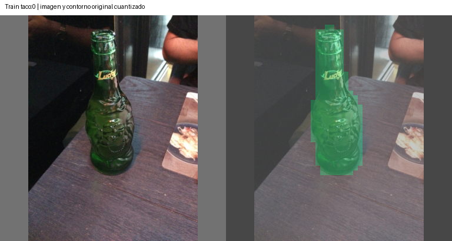
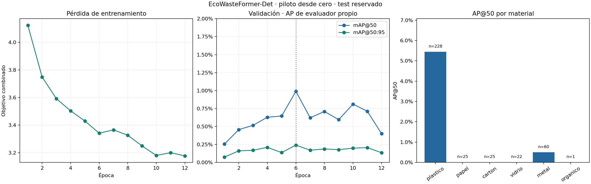
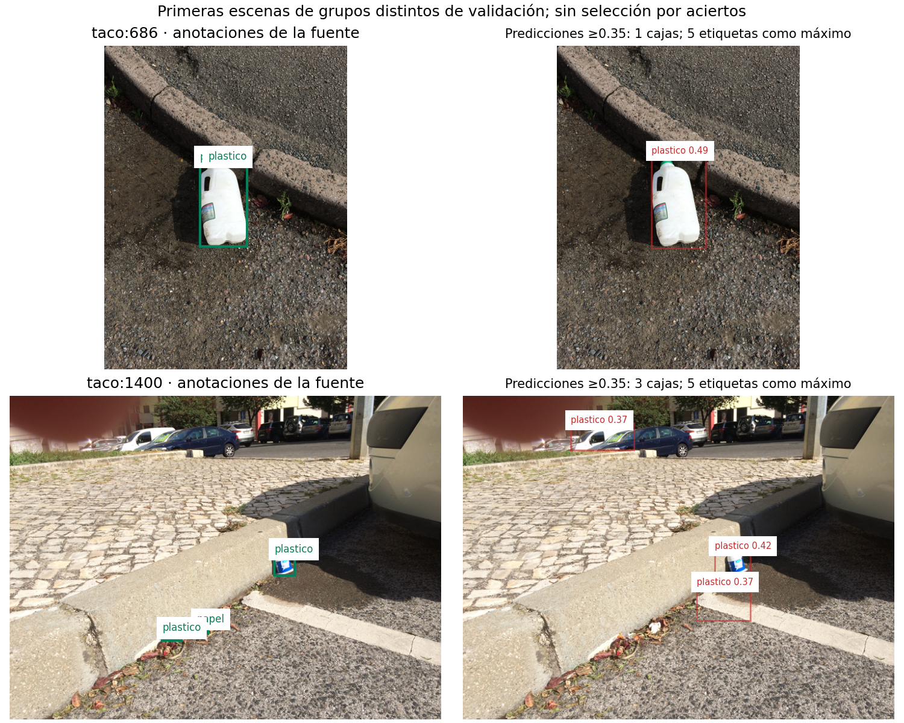

# Contornos originales y detector por mapas de materiales

**Estado: calidad insuficiente.** Los errores de preparación de objetivos y padding se corrigieron; el piloto sigue sin detectar de forma fiable. La selección siguiente es experimental.

## Qué cambió

Se implementó una salida alternativa del Transformer: siete probabilidades por celda (fondo y seis materiales) en una rejilla 48×48. Usa tokenización lineal, atención local/global y fusión propia. Conserva el extractor de características del detector en código, pero cada piloto comienza con pesos aleatorios nuevos. No carga el clasificador ni los pesos de otros pilotos. Cuenta con 438.727 parámetros; difiere de los 440.182 de la cabeza original de cajas. No incorpora convoluciones ni modelos externos.

El primer piloto de mapas empleó cobertura rectangular débil derivada de cajas. No es segmentación precisa ni una implementación de BoxSup. Después se localizaron los contornos de instancia ya presentes en las anotaciones originales TACO y se usaron para supervisar materiales. Las cajas originales siguen siendo el objetivo de evaluación.

## Auditoría de contornos

Se verificaron los 2.505 objetos train y 361 val: índice interno de anotación, ID original, categoría, bbox original, dimensiones y vértices finitos. Los IDs originales repetidos se resuelven por índice interno. Una anotación positiva fusionada procede de una imagen duplicada con hash de píxeles y grupo idénticos. Si falta un contorno o no coincide la procedencia, la carga falla; no se fabrica una máscara rectangular.

Se aplica la misma geometría letterbox que a la imagen y se rellenan los polígonos a 384×384. Tres vértices train caen fuera del lienzo original; el rasterizador los recorta al lienzo. No se cambian archivos originales ni particiones. Los hashes de anotaciones, inventario y manifiestos se guardan con el entrenamiento.

La primera reducción exigía 25 % de cobertura de una celda: 229 objetos train y 28 val quedaban sin celda positiva al rasterizarlos individualmente. El ensayo de memorización falló y no se entrenó ese candidato completo.

La versión usada considera positivo cualquier píxel del contorno rasterizado dentro de una celda (1/64 del bloque 8×8). Esto conserva al menos una celda al rasterizar individualmente cada objeto auditado. Los materiales distintos superpuestos se ignoran; los de igual material se unen. Los solapes pueden ocultar objetivos semánticos. En la evaluación de cajas se conservan todos los objetos, incluidos los pequeños. Las categorías fuera de alcance mantienen sus regiones ignoradas.



## Corrección al formar componentes

El padding se ignoraba en la pérdida, pero podía formar componentes al inferir. Recortar la caja después no impide unir regiones reales con predicciones del relleno. Ahora se excluyen celdas fuera del contenido real antes de calcular componentes; después se recortan las cajas. La decisión usa solo dimensiones y padding, sin consultar cajas o máscaras GT. Una prueba específica cubre falsas regiones y conexiones a través del relleno.

El diagnóstico final aprobó en 75 pasos sobre seis escenas fáciles train y 7 objetos: AP50, recall y precisión de 100.0%, 100.0% y 100.0%. No demuestra generalización ni se reutilizan sus pesos. Se conservan los dos diagnósticos rechazados anteriores.

## Resultados de validación

Mismas 181 imágenes, 361 objetos y evaluador propio de AP interpolado a 101 puntos, con IoU de 0,50 a 0,95 y regiones ignoradas. No es el ejecutable oficial COCOeval. Umbral de evaluación 0,05 y tamaño mínimo de componentes de dos celdas para mapas. Test no se evalúa.

| Candidato | Supervisión | Épocas | Mejor época | mAP@50 | mAP@50:95 |
|---|---|---:|---:|---:|---:|
| detector_piloto_v6 | Cajas | 24 | 24 | 0.932% | 0.120% |
| detector_mapas_v1 | Cajas | 14 | 8 | 0.731% | 0.250% |
| detector_mapas_poligonos_v2 | Contornos | 12 | 6 | 0.989% | 0.241% |

El checkpoint elegido por mAP@50 es **detector_mapas_poligonos_v2**, con 0.989%. La diferencia respecto al anterior no demuestra una mejora robusta. La ruta por defecto se actualizó en configuracion/arquitectura.json y sigue marcada como experimental.

La tabla usa la reevaluación del checkpoint de mapas V1 con padding corregido, sin entrenamiento nuevo. Su resultado histórico se conserva por separado. Los dos pilotos de mapas comparten arquitectura, presupuesto máximo de 16 épocas, mínimo ocho, paciencia seis, lote ocho y semilla. Se elige la mejor época por AP50 val. Cambian la supervisión y el filtrado de padding; no se puede atribuir la diferencia solo a los polígonos. Los pesos de clase se calculan únicamente con train.

| Material | Objetos val | AP50 elegido |
|---|---:|---:|
| plastico | 228 | 5.439% |
| papel | 25 | 0.000% |
| carton | 25 | 0.000% |
| vidrio | 22 | 0.000% |
| metal | 60 | 0.495% |
| organico | 1 | 0.000% |





## Qué queda por resolver

Las pruebas de componentes y la memorización pasan, pero la detección en escenas nuevas sigue fallando. Cuatro materiales tienen AP50 cero en el candidato seleccionado. Solo hay cinco objetos orgánicos train y uno val: no permite una conclusión fiable sobre esa clase. La cuantización puede perder objetos pequeños y los componentes unen instancias próximas del mismo material.

Usar el mapa GT cuantizado como si fuera una predicción da AP50 36.4% en val. Es un diagnóstico de representación y posproceso con anotaciones conocidas, no una medición del modelo ni un límite absoluto. No se usa como calidad declarada del detector.

El siguiente cambio justificado es preparar recortes multiescala a partir de imágenes originales de entrenamiento, conservando todos los contornos visibles y su geometría, para aumentar el tamaño efectivo de objetos pequeños. Debe mantenerse la validación completa y evitar mezclar escenas entre particiones. Se necesitan orgánicos reales más diversos, escenas vacías y videos independientes. No se ha activado la cámara ni se presenta una demo en vivo como fiable.

La consulta por imagen permite ambos tipos de checkpoint y exporta la advertencia de calidad junto a las detecciones. El asistente conserva esa advertencia al recibir el JSON. Son conexiones técnicas verificables; no acreditan aciertos visuales.

En la primera imagen val, taco:686, la consulta por defecto produce una caja de plástico que corresponde a la botella y omite la tapa. No se escogió la imagen por el acierto. Con ese JSON y la pregunta «Resume los materiales detectados», el asistente se abstiene con puntuación 0,574, por debajo de su umbral 0,65. La abstención y la advertencia del detector quedan registradas en resultados/integracion_poligonos_val_686.json.

Se han usado repetidamente los resultados val para desarrollar el método. No equivalen a una evaluación final independiente. El test queda reservado para una versión estabilizada.

## Evidencias y reproducción

- datos/reportes/poligonos.json y poligonos_bordes.json: auditorías, hashes y diagnóstico GT.
- resultados/diagnostico_detector_mapas_poligonos*.json: fallos previos y diagnóstico aprobado.
- resultados/detector_mapas_v1.json, detector_mapas_v1_padding_v2.json y detector_mapas_poligonos_v2.json: resultados reales.
- pruebas/test_poligonos.py y test_detector_mapas.py: geometría, procedencia, pérdidas y padding.

```powershell
$pythonEco = Join-Path $env:USERPROFILE '.venvs\EcoWasteFormer\Scripts\python.exe'
& $pythonEco -m unittest discover -s pruebas
& $pythonEco scripts/auditar_poligonos.py --cobertura-minima 0.015625 --nombre poligonos_bordes
& $pythonEco scripts/diagnosticar_detector_mapas.py --fuente poligonos --cobertura-minima 0.015625 --nombre diagnostico_detector_mapas_poligonos_padding
& $pythonEco scripts/entrenar_detector_mapas.py --config configuracion/entrenamiento_detector_mapas_poligonos.json
```

Los diagnósticos y entrenamientos existentes se protegen contra sobrescritura: para repetir, usar nombres nuevos y ajustar la ruta del diagnóstico en la configuración. Los entrenamientos completos conservan optimizador, estados aleatorios y hashes para reanudación.

Fuente de los datos y contornos: [repositorio de los autores de TACO](https://github.com/pedropro/TACO), [artículo TACO](https://arxiv.org/abs/2003.06975).
