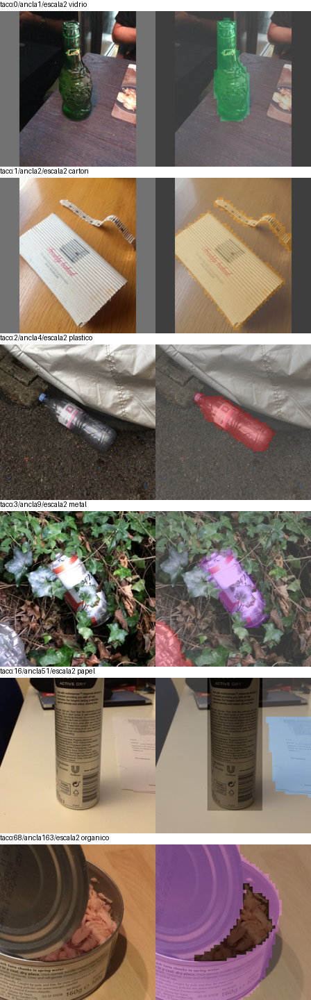
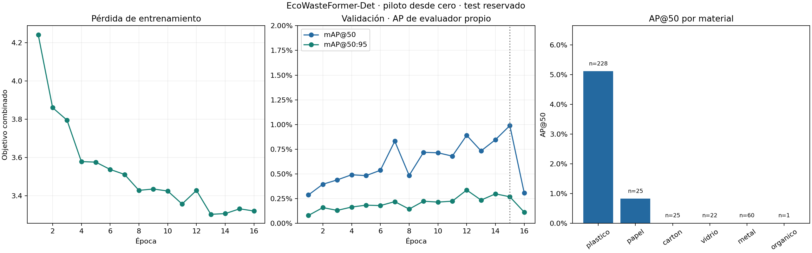
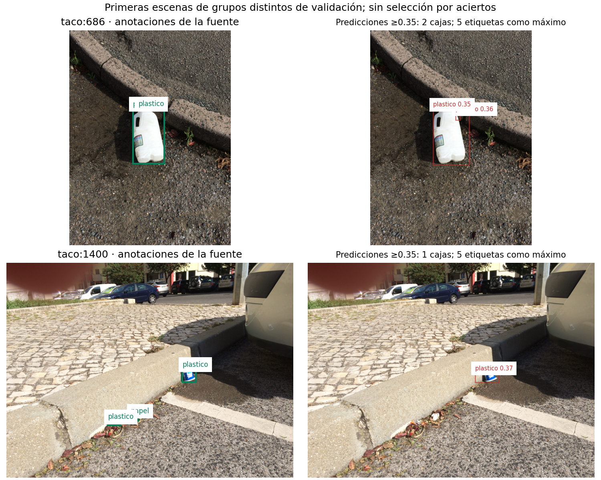

# Recortes multiescala desde los originales de entrenamiento

**Estado: experimento completado; calidad de detección todavía insuficiente.** Se conservan los pilotos anteriores y el test permanece reservado.

## Preparación y geometría

Se generaron dos vistas por objeto positivo de entrenamiento, con ventanas centradas en su bbox y lados de 2 o 3,5 veces su dimensión mayor. La ventana mínima mide 64 píxeles de la imagen original; se limita a los bordes de la foto. Después se aplica letterbox a 384×384. Las vistas se extraen de las imágenes originales o normalizadas, sin partir de la imagen previamente reducida a 384 píxeles. Los hashes de los archivos se comprueban antes de leerlos.

La caché contiene **5,010 recortes**, 4,822 ventanas distintas y 2,505 anotaciones centrales únicas, procedentes de 964 escenas train. No son objetos nuevos. Se mantienen las ventanas repetidas para conservar dos vistas por ancla; el muestreo las trata como ejemplos distintos.

Se desplazan todos los contornos visibles, se recortan las cajas a la ventana y se conserva su material. Los polígonos se rasterizan dentro del contenido real; no pintan el padding. Los objetos vecinos y las categorías ignoradas se mantienen. No se asigna la clase central a toda la imagen ni se fabrica una máscara a partir de su bbox. Los manifiestos originales no cambian.

La caché conserva imagen uint8 y máscara uint8 en archivos NumPy accesibles por memoria mapeada, junto a un plan JSONL con imagen, grupo, ancla, contexto, ventana y anotaciones visibles. Esto evita cargar de golpe los aproximadamente 2,2 GB de vistas en RAM. La carga comprueba versión, hashes, formas y etiquetas.

El lado menor mediano del ancla a la entrada del modelo pasa de **22.5 a 101.1 píxeles**. Entre las 5.010 vistas planificadas, las anclas con lado menor inferior a ocho píxeles pasan de 998 a una. Es un cambio geométrico en train; no demuestra mejor detección.

Hay 29 vistas sin celdas del material central en la máscara conjunta. Una auditoría individual encontró 29 casos debidos a solape con otro material. No se eliminan ni se convierten en negativos: los píxeles ambiguos se ignoran según la política de supervisión. Los casos quedan enumerados en datos/reportes/recortes_solapes.json.



## Protocolo del piloto

Se conserva el Transformer de mapas de 438.727 parámetros, su pérdida, aumentos de color y flip, semilla 42, AdamW, lote ocho, learning rate 0,0005, calentamiento de dos épocas y presupuesto máximo de 16 épocas. El mínimo es ocho y la paciencia seis. La inicialización es aleatoria nueva; no se cargan pesos del piloto anterior ni del diagnóstico.

Cada muestra tiene probabilidad 0,5 de proceder de una imagen completa y 0,5 de un recorte. Se usa muestreo con reemplazo, con 964 muestras y 121 lotes por época. V3 elige ejemplos uniformemente dentro de cada fuente; V4 aplica el balance descrito abajo. Así el presupuesto máximo de actualizaciones coincide con el piloto anterior. El entrenamiento registra las cantidades realmente muestreadas. El piloto anterior recorría todas las escenas sin reemplazo; la comparación incluye ese cambio de muestreo.

Los pesos de materiales se calculan a partir de las frecuencias de celdas train esperadas bajo esa mezcla, sin consultar val. V3 no balancea las anclas por clase. V4 balancea la mitad de recortes: cada material recibe probabilidad 1/6 dentro de esa fuente, y elige vistas uniformemente dentro de cada material. La mitad de imágenes completas sigue uniforme. La pérdida y el presupuesto se conservan; sus pesos de clase se recalculan según la distribución esperada de cada variante. Solo hay diez vistas centradas en los cinco orgánicos disponibles: repetirlas no aporta diversidad orgánica nueva.

La prueba previa memorizó seis recortes fáciles y 9 objetos en 125 pasos: AP50 100.0%, recall 100.0%, precisión 81.8%. Se exige AP50≥0,8, recall≥0,9 y precisión≥0,7; los pesos se descartan. No es una evaluación de generalización.

## Validación completa

Se evalúan las mismas 181 imágenes completas y sus 361 objetos. No se evalúa solo el recorte central ni se eliminan objetos pequeños. Se conservan el umbral 0,05, mínimo dos celdas por componente, filtrado del padding y evaluador propio de AP interpolado a 101 puntos. Se selecciona el mejor AP50 val. No se mide test.

| Piloto | Vistas train | Épocas | Mejor época | mAP@50 | mAP@50:95 | Recall@50 |
|---|---|---:|---:|---:|---:|---:|
| detector_mapas_poligonos_v2 | Completas | 12 | 6 | 0.989% | 0.241% | 11.1% |
| detector_mapas_recortes_v3 | Mezcla completas/recortes | 16 | 15 | 0.989% | 0.268% | 11.9% |
| detector_mapas_recortes_v4_balanceados | Recortes con anclas balanceadas | 9 | 3 | 0.613% | 0.139% | 4.7% |

El predeterminado queda en **detector_mapas_v6_auxiliar_ext48**, AP50 val 2.446%. Se conserva el anterior porque este piloto no superó su AP50. La diferencia entre ejecuciones con una sola semilla no prueba significación estadística.

| Material | Objetos val | AP50 base | AP50 recortes | AP50 balanceado |
|---|---:|---:|---:|---:|
| plastico | 228 | 5.439% | 5.108% | 1.205% |
| papel | 25 | 0.000% | 0.825% | 2.475% |
| carton | 25 | 0.000% | 0.000% | 0.000% |
| vidrio | 22 | 0.000% | 0.000% | 0.000% |
| metal | 60 | 0.495% | 0.000% | 0.000% |
| organico | 1 | 0.000% | 0.000% | 0.000% |





## Diagnóstico de aprendizaje semántico

Se evaluaron las 964 imágenes completas train y 60 recortes elegidos con semilla 42 y diez anclas por clase. Se usa el checkpoint elegido por AP50 val de cada piloto. Las matrices excluyen celdas ignoradas. Son mediciones dentro de train; los recortes estratificados tampoco representan la distribución natural. Las siguientes métricas describen materiales por celda y no equivalen a AP de cajas.

| Piloto | Entrada train | Aciertos en celdas GT de material | Material GT confundido con fondo | IoU macro semántico |
|---|---|---:|---:|---:|
| detector_mapas_poligonos_v2 | completas_train | 34.9% | 48.2% | 7.3% |
| detector_mapas_poligonos_v2 | recortes_train_estratificados | 4.8% | 76.0% | 2.1% |
| detector_mapas_recortes_v3 | completas_train | 36.6% | 45.9% | 9.1% |
| detector_mapas_recortes_v3 | recortes_train_estratificados | 9.8% | 63.1% | 5.3% |
| detector_mapas_recortes_v4_balanceados | completas_train | 21.1% | 66.2% | 5.4% |
| detector_mapas_recortes_v4_balanceados | recortes_train_estratificados | 20.4% | 49.8% | 14.8% |

Los recortes y el balance mejoran algunas mediciones semánticas en train, pero el AP50 sobre imágenes completas no mejora. La baja calidad ya aparece al reconocer materiales de ejemplos usados en entrenamiento; no puede atribuirse todo el fallo a agrupar componentes o a escenas nuevas. Estas mediciones no identifican una causa única.

Las matrices y mediciones completas están en resultados/ajuste_semantico_mapas_train.json y resultados/ajuste_semantico_mapas_balanceados_train.json. El control balanceado está en resultados/detector_mapas_recortes_v4_balanceados.json.

## Límites y trabajo pendiente

Pasar las pruebas geométricas y memorizar ejemplos no hace que el detector generalice. La ausencia de suficientes orgánicos, la unión de instancias del mismo material y la cuantización de objetos pequeños siguen limitando el método. Las decisiones tomadas repetidamente con val impiden usarla como evaluación final independiente.

El siguiente trabajo debe revisar el aprendizaje de características y la separación fondo/material mediante diagnósticos controlados, antes de seguir ampliando vistas o aplicar ventanas de inferencia. La mejora sobre recortes no basta para cambiar el modo de evaluación de estos pilotos. Siguen pendientes datos orgánicos diversos, escenas vacías, videos independientes y el MVP de video.

## Evidencias y reproducción

- datos/reportes/recortes_multiescala.json: auditoría, tamaños y hashes.
- datos/cache/recortes_multiescala_v1/plan.jsonl: procedencia de cada vista.
- resultados/diagnostico_recortes.json: prueba previa sin reutilización de pesos.
- resultados/detector_mapas_recortes_v3.json: resultados, conteos por época y configuración.
- configuracion/entrenamiento_detector_recortes.json: protocolo reproducible.

```powershell
$pythonEco = Join-Path $env:USERPROFILE '.venvs\EcoWasteFormer\Scripts\python.exe'
& $pythonEco -m unittest discover -s pruebas
& $pythonEco scripts/preparar_recortes.py
& $pythonEco scripts/diagnosticar_recortes.py
& $pythonEco scripts/entrenar_detector_mapas.py --config configuracion/entrenamiento_detector_recortes.json
& $pythonEco scripts/entrenar_detector_mapas.py --config configuracion/entrenamiento_detector_recortes_balanceados.json
& $pythonEco scripts/diagnosticar_ajuste_mapas.py
& $pythonEco scripts/diagnosticar_ajuste_mapas.py --nombre ajuste_semantico_mapas_balanceados_train --experimentos detector_mapas_recortes_v4_balanceados
```

La caché, el diagnóstico y el experimento existentes no se sobrescriben. Para repetirlos se deben usar nombres nuevos y ajustar las rutas en la configuración. Los checkpoints guardan optimizador, scaler, estados aleatorios y hashes para reanudar el mismo experimento.
