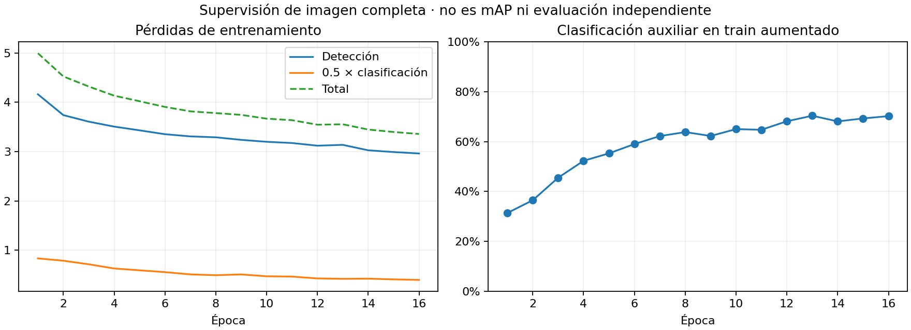
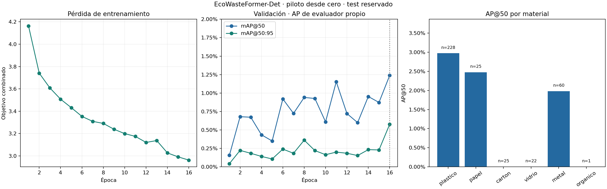
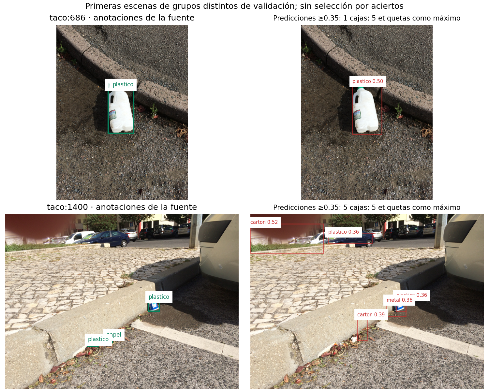

# Aprendizaje de materiales y clasificación auxiliar

**Estado: mejor mAP@50 val 1.238%; calidad todavía insuficiente.** Se conserva el test para una versión estabilizada. No se declara detección fiable ni MVP de video completado.

## Separación de presencia y material: ensayo descartado

Los diagnósticos anteriores mostraban errores de material incluso en train y muchas celdas de residuos clasificadas como fondo. Se ensayó separar un logit binario de presencia de seis logits condicionales de material. Se mantienen 438.727 parámetros y el extractor Transformer propio. Es otra formulación, no una corrección de un error demostrado de softmax.

La salida anterior usa softmax de siete clases y pérdida CE ponderada de materiales + 3×CE de fondo + Dice por material. La alternativa usa BCE media en positivos + BCE media en negativos + CE condicional de seis materiales + Dice binario de presencia. Se ignoran las celdas 255 en todos los términos. La clase se obtiene separadamente cuando la presencia alcanza 0,5, y la puntuación combina presencia y probabilidad condicional.

Una prueba comprueba que las celdas de fondo no produzcan gradientes directos en los seis logits de material de la alternativa; los positivos sí los producen. También se prueban escenas sin material, todas las celdas ignoradas y carga de checkpoints anteriores.

El diagnóstico en las mismas seis escenas train aprobó en 75 pasos. El piloto V5 obtuvo AP50 val 0.495%, por debajo del 0.989% anterior. No se adopta. Cambian pérdida e interpretación de la salida; la comparación no identifica un efecto aislado de cada término.

## Nueva supervisión de imagen completa

Se añadió una tarea auxiliar para aprender características de materiales con las etiquetas de imagen de RealWaste. Se comparten los tokens, bloques de atención y fusión con detección; un promedio de características espaciales alimenta una capa Linear de seis clases. La capa añade 582 parámetros: total 439.309. No usa convoluciones ni un modelo importado.

El nuevo modelo se inicializa aleatoriamente y entrena simultáneamente ambas tareas. No carga el clasificador anterior, el detector anterior ni pesos del diagnóstico. Las etiquetas globales actualizan el extractor y la cabeza auxiliar; no asignan materiales a píxeles ni se transforman en cajas o máscaras. Una prueba verifica ese recorrido de gradientes.

La tarea auxiliar usa exclusivamente **2714 imágenes train**. Sus grupos se verifican frente a val/test de clasificación y detección; no hay intersección. Se comprueban los hashes de manifiesto, cada imagen al construir caché y el archivo de caché antes de cargarlo. El checkpoint guarda los hashes de ambos orígenes y de la caché. No se usan imágenes val/test para entrenar la tarea auxiliar.

| Material | Fotos auxiliares train |
|---|---:|
| plastico | 649 |
| papel | 340 |
| carton | 319 |
| vidrio | 279 |
| metal | 539 |
| organico | 588 |

La detección sigue teniendo solo cinco instancias orgánicas anotadas en train y una en val. Las fotos auxiliares aportan supervisión global de orgánicos, sin aumentar ese número de instancias con cajas.

## Protocolo conjunto

Se conserva el entrenamiento de mapas softmax7 sobre imágenes TACO completas. Por cada lote de ocho escenas de detección se procesa un lote de 16 fotos de clasificación, muestreadas con reemplazo y probabilidad igual por material. El objetivo conjunto es pérdida de detección + 0,5×CE de imagen. Se suman los gradientes y se realiza un solo paso de AdamW por pareja de lotes.

Se mantiene semilla 42, learning rate 0,0005, calentamiento de dos épocas, AMP, clipping 1, máximo 16 épocas, mínimo ocho y paciencia seis por AP50 val. Se procesan 964 escenas de detección y 1.936 fotos auxiliares muestreadas por época. Hay más datos y cómputo que en el piloto base; no es una comparación a igual coste. Se guardan los estados aleatorios de ambos cargadores, CUDA, optimizador y scaler para reanudar.

La prueba conjunta memorizó las seis escenas TACO fijadas y una foto RealWaste por material en 100 pasos, cumpliendo AP50≥0,8, recall≥0,9, precisión≥0,7 y clasificación auxiliar=1. Sus pesos se descartan. Al final del piloto la accuracy auxiliar de train aumentado fue 70.2%; no es accuracy de prueba ni mAP del detector.



## Validación de detección

Se evalúan las mismas 181 imágenes completas y 361 objetos, incluidas instancias pequeñas. Mismos manifiestos, clases y evaluador propio de AP de 101 puntos, con regiones ignoradas; no se afirma equivalencia exacta con COCOeval. Se selecciona por AP50 val. El uso reiterado de val durante desarrollo impide tratarla como prueba independiente final.

| Candidato | Método | Mejor época | mAP@50 | mAP@50:95 | Recall@50 |
|---|---|---:|---:|---:|---:|
| detector_mapas_poligonos_v2 | Contornos, base | 6 | 0.989% | 0.241% | 11.1% |
| detector_mapas_recortes_v3 | Recortes uniformes | 15 | 0.989% | 0.268% | 11.9% |
| detector_mapas_recortes_v4_balanceados | Recortes balanceados | 3 | 0.613% | 0.139% | 4.7% |
| detector_mapas_v5_presencia_material | Presencia/material separados | 4 | 0.495% | 0.174% | 7.5% |
| detector_mapas_v6_auxiliar | Clasificación auxiliar conjunta | 16 | 1.238% | 0.576% | 10.5% |
| detector_mapas_v6_auxiliar_refinado | Mismos pesos V6 y reclasificación de regiones | 16 | 0.394% | 0.145% | 1.9% |

El predeterminado elegido es **detector_mapas_v6_auxiliar**, usando checkpoints/detector_mapas_v6_auxiliar_mejor.pt. El aumento frente a la base es de 0.249 puntos porcentuales en AP50. Una sola semilla no demuestra significación estadística. El valor absoluto sigue siendo muy bajo.

| Material | Objetos val | AP50 base | AP50 elegido |
|---|---:|---:|---:|
| plastico | 228 | 5.439% | 2.974% |
| papel | 25 | 0.000% | 2.475% |
| carton | 25 | 0.000% | 0.000% |
| vidrio | 22 | 0.000% | 0.000% |
| metal | 60 | 0.495% | 1.980% |
| organico | 1 | 0.000% | 0.000% |





## Reclasificación de regiones: variante descartada

Se evaluó una segunda inferencia sobre el mismo checkpoint V6: regiones conexas con probabilidad de residuo ≥0,5, mínimo dos celdas, hasta 40 propuestas y padding excluido. Cada propuesta genera un recorte cuadrado con factor de contexto 1,2 desde la foto original. La cabeza auxiliar clasifica ese recorte; la puntuación multiplica presencia media y confianza de material. Se aplica NMS por clase. Las cajas GT solo intervienen al evaluar después, no al generar propuestas o recortes.

Esta variante obtuvo AP50 0.394%; no mejora los mapas directos y no se activa por defecto. La opción --refinar queda disponible para reproducir el ensayo, con sus límites. No se presenta como mejora.

## Diagnóstico dentro de entrenamiento

Se conservan las 964 escenas completas train y los mismos 60 recortes estratificados del diagnóstico anterior. Las métricas siguientes cuentan celdas, no objetos. La accuracy condicional usa posiciones GT conocidas para comprobar material aunque la presencia falle; no representa inferencia autónoma.

| Modelo | Entrada | Accuracy material en GT | Accuracy condicional a GT | GT material confundido con fondo | IoU macro semántico |
|---|---|---:|---:|---:|---:|
| detector_mapas_poligonos_v2 | completas_train | 34.9% | 67.2% | 48.2% | 7.3% |
| detector_mapas_poligonos_v2 | recortes_train_estratificados | 4.8% | 22.5% | 76.0% | 2.1% |
| detector_mapas_v5_presencia_material | completas_train | 45.0% | 65.5% | 32.2% | 5.1% |
| detector_mapas_v5_presencia_material | recortes_train_estratificados | 10.4% | 27.5% | 50.1% | 2.9% |
| detector_mapas_v6_auxiliar | completas_train | 45.5% | 68.5% | 36.1% | 16.3% |
| detector_mapas_v6_auxiliar | recortes_train_estratificados | 10.2% | 32.3% | 69.1% | 4.9% |

## Límites y siguiente trabajo

La supervisión auxiliar mejora este resultado de validación, pero la detección sigue fallando. Varias clases mantienen AP cero y la muestra orgánica val no permite una estimación estable. La clasificación auxiliar global, la segmentación por celdas y el AP de instancias miden tareas distintas; sus porcentajes no se intercambian.

Conviene continuar con un presupuesto trazable del entrenamiento conjunto y evaluar si el ajuste de las características sigue mejorando, antes de ampliar la arquitectura. Se necesitan más anotaciones de detección orgánica diversas y escenas vacías. No se han activado la webcam ni el test; video, latencia y evaluación independiente siguen pendientes.

## Reproducción y evidencias

Pasaron 55 pruebas: pérdidas, gradientes, carga compatible, supervisión auxiliar y propuestas sin usar GT. Se conservan originales, manifiestos y todos los pilotos descartados.

```powershell
$pythonEco = Join-Path $env:USERPROFILE '.venvs\EcoWasteFormer\Scripts\python.exe'
& $pythonEco -m unittest discover -s pruebas
& $pythonEco scripts/diagnosticar_presencia_material.py
& $pythonEco scripts/entrenar_detector_mapas.py --config configuracion/entrenamiento_detector_presencia_material.json
& $pythonEco scripts/diagnosticar_auxiliar_clasificacion.py
& $pythonEco scripts/entrenar_detector_mapas.py --config configuracion/entrenamiento_detector_auxiliar.json
& $pythonEco scripts/evaluar_refinamiento.py --checkpoint checkpoints/detector_mapas_v6_auxiliar_mejor.pt --nombre detector_mapas_v6_auxiliar_refinado
```

Para repetir diagnósticos o experimentos ya existentes se deben usar nombres nuevos; los scripts protegen los resultados contra sobrescritura. Los JSON de resultados y configuración guardan los valores completos sin redondear.
