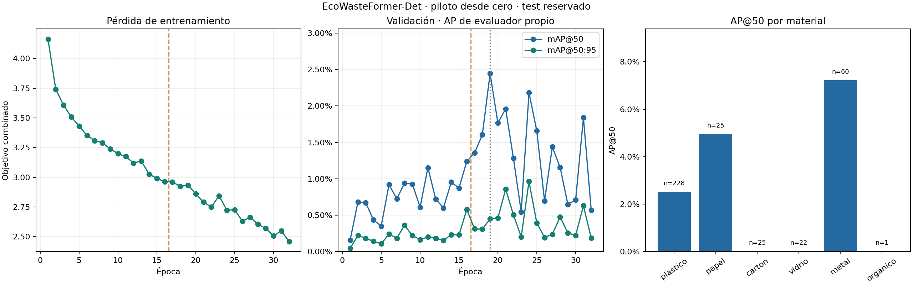
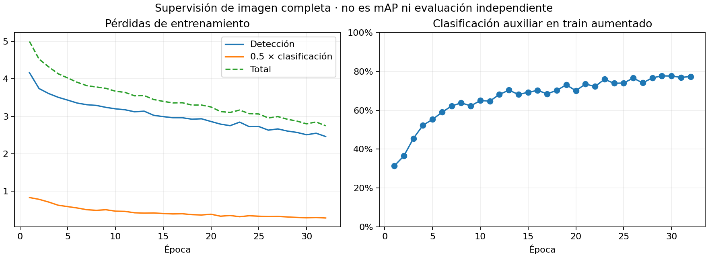
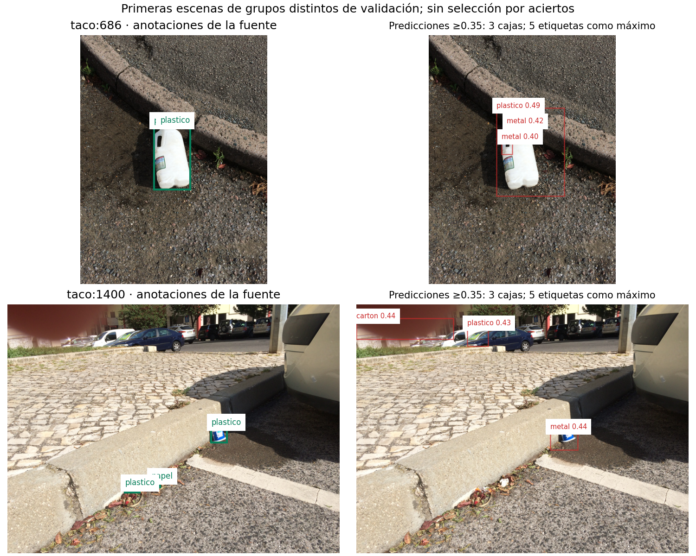

# Continuación del entrenamiento conjunto

**Estado: mejor AP50 val registrado 2.446%; calidad insuficiente para presentar detección fiable.** No se evalúa test.

## Motivo y protocolo

El piloto con clasificación auxiliar alcanzó su mejor AP50 en la última época de su presupuesto inicial (16). Su pérdida seguía descendiendo. Se amplió el mismo aprendizaje, manteniendo extractor, cabezas, pérdidas, datos, aumentos, lote, learning rate y optimizador. No se importa un modelo ni se inicia otro con pesos ajenos.

La continuación comienza en la época 17 con tope total 48, mínimo total 32 y paciencia diez por AP50 val. El calentamiento de dos épocas ya estaba cumplido: no se reinicia. El presupuesto y la parada son los únicos cambios de configuración permitidos, además del nombre del archivo de salida.

Se restauran pesos propios, optimizador AdamW, scaler, RNG CPU/CUDA, generador del cargador de detección y generador del muestreo auxiliar. Se guarda otra pareja de checkpoints y se conserva el mejor estado anterior si ninguna época nueva lo supera. Los originales no se sobrescriben.

El origen es checkpoints\detector_mapas_v6_auxiliar_ultimo.pt; SHA256 `bf5e5e7716c71693b5d8b4d23c9963b6105c5c47934a26ac354e27e91eb796c7`. El mejor origen es checkpoints\detector_mapas_v6_auxiliar_mejor.pt; SHA256 `fc5a328f298b80fa007b98410e69f25c3c1ba06281dbfc79f3fa9941dea2cedf`. Los hashes se comprobaron después del entrenamiento y siguen coincidiendo.

Las primeras 16 entradas del historial se verificaron idénticas a las del piloto original. Los hashes de manifiestos TACO, contornos, inventario, fotos auxiliares RealWaste y caché auxiliar coinciden exactamente. Se continúa con las mismas 964 escenas TACO train y 2.714 fotos RealWaste train. Las fotos globales no añaden cajas o máscaras de detección.

## Resultados acumulados

| Ejecución | Épocas acumuladas | Mejor época | mAP@50 | mAP@50:95 | Recall@50 |
|---|---:|---:|---:|---:|---:|
| Base de contornos sin auxiliar | 12 | 6 | 0.989% | 0.241% | 11.1% |
| Piloto conjunto original | 16 | 16 | 1.238% | 0.576% | 10.5% |
| Continuación del mismo piloto | 32 | 19 | 2.446% | 0.449% | 11.1% |

Se añadieron 16 épocas; las épocas iniciales no se cuentan como una ejecución independiente. El aumento frente al piloto conjunto de 16 épocas es de 1.208 puntos porcentuales en AP50. Se utiliza como predeterminado checkpoints/detector_mapas_v6_auxiliar_ext48_mejor.pt.

La evaluación conserva las mismas 181 imágenes completas, 361 objetos, seis materiales, regiones ignoradas y evaluador propio de AP interpolado. Umbral de evaluación 0,05, mínimo dos celdas por componente y filtrado del padding previos a formar regiones. No se eliminan objetos pequeños ni se seleccionan imágenes por el acierto.

| Material | Objetos val | AP50 a 16 épocas | AP50 continuación |
|---|---:|---:|---:|
| plastico | 228 | 2.974% | 2.510% |
| papel | 25 | 2.475% | 4.950% |
| carton | 25 | 0.000% | 0.000% |
| vidrio | 22 | 0.000% | 0.000% |
| metal | 60 | 1.980% | 7.217% |
| organico | 1 | 0.000% | 0.000% |







## Error en la consulta por imagen

En la primera imagen val fijada, taco:686, el modelo propone una caja de plástico demasiado amplia y dos de metal sobre partes del objeto. Con umbral de visualización 0,35, ninguna de las tres predicciones coincide con material e IoU≥0,5: tres falsos positivos y dos objetos omitidos. El resultado se conserva en resultados/ejemplo_continuacion_val_686.json y la conexión al asistente en resultados/integracion_continuacion_val_686.json. El ejemplo no se sustituye por otro favorable.

Esta imagen empeora respecto al piloto anterior aunque el AP50 medio de toda val aumente. La limitación debe tenerse en cuenta antes de presentar una demostración.

## Diagnóstico semántico de train

Se midieron las mismas 964 escenas train y 60 recortes estratificados. Resultados completos en resultados/ajuste_semantico_continuacion_train.json. El diagnóstico utiliza etiquetas GT para medir; no representa precisión de prueba ni AP de cajas.

## Límites

El AP50 es el criterio de selección y no implica que todas las métricas o clases mejoren. La accuracy auxiliar sigue siendo una medición de clasificación en train aumentado, no calidad de detección. Los resultados de validación se han utilizado repetidamente para desarrollar el método; no son una prueba final independiente ni demuestran significación estadística.

La detección orgánica sigue contando con cinco instancias train y una val; las fotos de clasificación global no sustituyen anotaciones de instancia. Los componentes pueden unir objetos próximos y perder detalles pequeños. El video fiable, los FPS, las escenas vacías y la evaluación externa siguen pendientes.

El siguiente cambio debe centrarse en la representación espacial y la localización: seguir añadiendo épocas con este mismo protocolo dejó de mejorar tras la época 19. No se presenta la ampliación del presupuesto como solución completa.

## Comprobaciones y reproducción

Pasaron 59 pruebas, incluidas las que impiden cambiar datos, optimización o peso auxiliar al continuar, reutilizar el nombre de origen o importar pesos externos por este camino. Se verifican ambas fuentes de datos y ambos generadores aleatorios.

```powershell
$pythonEco = Join-Path $env:USERPROFILE '.venvs\EcoWasteFormer\Scripts\python.exe'
& $pythonEco -m unittest discover -s pruebas
& $pythonEco scripts/entrenar_detector_mapas.py --config configuracion/entrenamiento_detector_auxiliar_ext48.json --continuar-desde checkpoints/detector_mapas_v6_auxiliar_ultimo.pt
```

Para reanudar una interrupción del mismo experimento se usa --reanudar con su archivo _ultimo.pt y la misma configuración. Para repetir se necesita otro nombre; la continuación existente y los archivos de origen se protegen contra sobrescritura.
