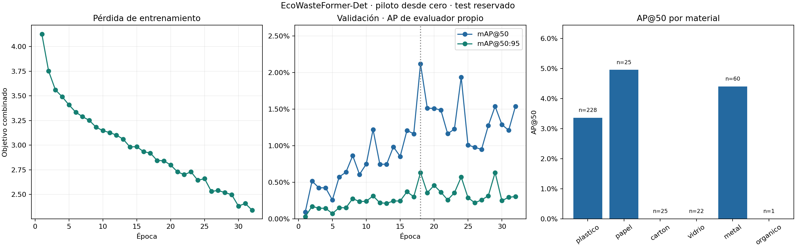
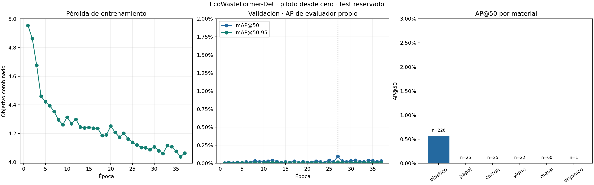
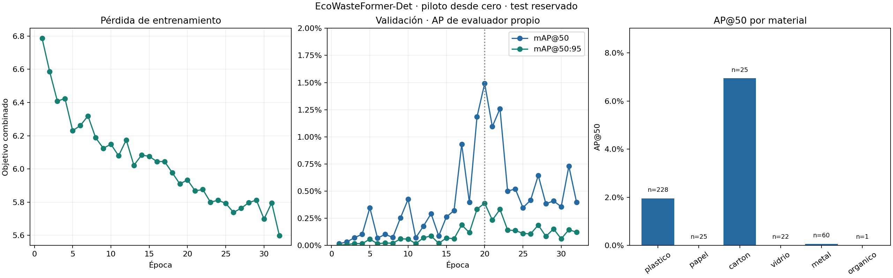

# Representación espacial y detección de instancias

Informe histórico. La selección actual se documenta en [11_mejora_clasificador_y_centros.md](11_mejora_clasificador_y_centros.md).


**Estado: mejor AP50 val registrado 2.446%; detector todavía experimental y con calidad insuficiente.** Test reservado. Se conservan todos los ensayos, incluidos los negativos.

## Ventanas alternadas en la rama local

El modelo de mapas original aplica dos bloques sobre las mismas ventanas de 8×8 tokens. Se ensayó desplazar la segunda partición cuatro tokens para comunicar vecinas. Se añade relleno explícito a los cuatro lados y una máscara que excluye sus claves de la atención. Después se recorta al campo original. No se utiliza desplazamiento circular ni se conectan bordes opuestos. La rama global se conserva.

El principio de comunicación entre ventanas se relaciona con [Swin Transformer](https://arxiv.org/abs/2103.14030). La implementación aquí es propia, sin jerarquía completa de Swin, sin importar su modelo o sus pesos. Mantiene 439.309 parámetros y ambas tareas de entrenamiento del piloto V6. Se inicializa aleatoriamente.

Las pruebas verifican comunicación entre vecinas, ausencia de conexiones entre bordes opuestos, exclusión del relleno, conservación de coordenadas y gradientes. Una consulta real con el checkpoint anterior produjo predicciones idénticas antes y después del cambio de código; la opción anterior sigue siendo compatible.

## Auditoría de la salida por componentes

Usando únicamente contornos GT de train, se rasterizó cada instancia por separado y luego se comparó con los componentes del mapa semántico conjunto. Se aplicó el mismo filtro de padding y mínimo de dos celdas de la inferencia. Este diagnóstico geométrico no mide aprendizaje ni generalización.

| Comprobación en train | Conteo |
|---|---:|
| Instancias originales | 2505 |
| Instancias que comparten componente con otra del mismo material | 1070 |
| Componentes con más de una instancia | 372 |
| Instancias fragmentadas en más de un componente | 17 |
| Instancias sin componente de al menos dos celdas | 73 |
| Máximo de objetos en una escena train | 53 |

Los grupos de casos quedan enumerados en datos/reportes/representacion_instancias_train.json. Las categorías distintas superpuestas se ignoran según la política previa; dos instancias de igual material pueden unirse aunque cada contorno sea correcto. Esto justifica probar cajas de instancia directamente. No es un límite absoluto de AP ni se usa el diagnóstico como rendimiento declarado.

## Detector propio de consultas

Se implementó un extractor visual Transformer propio con atención local/global y un decodificador de dos bloques de autoatención y atención cruzada. Hay 100 consultas aprendibles, siete logits por consulta (seis materiales y ausencia de objeto) y regresión continua de cajas. La cuadrícula inicial de referencias, un sesgo espacial gaussiano fijo y los tamaños medianos de train ayudan a inicializar las cajas. Total: 674.129 parámetros. No contiene convoluciones ni pesos reutilizados.

La asignación global uno a uno se basa en el principio de [DETR](https://arxiv.org/abs/2005.12872). El código no importa DETR ni su extractor CNN. El emparejamiento rectangular se implementó con caminos aumentantes y se comprobó frente a fuerza bruta en matrices pequeñas, incluidos costes negativos y un caso donde falla la selección voraz. Cada GT conserva una consulta distinta, incluso si dos objetos cercanos comparten material.

La pérdida usa clasificación de las parejas, penalización de consultas no emparejadas, L1 de cajas y GIoU. Las regiones fuera de alcance se ignoran para negativos; los positivos no se eliminan por coincidir con ellas. La evaluación conserva todos los GT y cuenta duplicados como falsos positivos. No se aplica NMS en estos pilotos de consultas.

V8 usa referencias de centro y negativos difíciles. V9 calcula además un centro continuo a partir del promedio espacial de la última atención cruzada. El error de centro puede llegar directamente a las proyecciones de atención desde la inicialización; una prueba comprueba ese gradiente frente al camino anterior. Ambas variantes tienen los mismos parámetros.

Una comprobación provisional de V8, época 19, eligió con GT la mejor de sus 100 cajas para cada instancia train: solo el 15,6 % alcanzó IoU≥0,5. Era una cobertura optimista, permitiendo reutilizar propuestas, y no AP. Se conserva en resultados/geometria_consultas_provisional_train.json. La dificultad aparecía en localización dentro de train, además de en clasificación y puntuaciones.

El mismo diagnóstico sobre el mejor checkpoint V10, época 20, cubre solo el 30,5 % de los 2.505 objetos train con IoU≥0,5 y obtiene IoU medio 0,336. El material de esas mejores propuestas es correcto en el 61,2 % de los objetos; el argmax incluyendo ausencia de objeto es nulo en el 99,8 %. Por eso conservar candidatas permite medir su ranking, pero no las convierte en detecciones fiables. Se guarda el hash reproducible del checkpoint en resultados/geometria_consultas_v10_train.json. Son modelos y épocas diferentes: esta comparación no aísla un cambio arquitectónico.

## Ponderación de clases y posición persistente

En una imagen de control, V9 produjo 100 consultas clasificadas como plástico; el plástico también domina las anotaciones de train. Su formulación inicial normalizaba positivos y negativos difíciles separadamente, con peso total de fondo 0,5. Ese total no crecía con el número de consultas no emparejadas.

V10 pondera materiales por inversa de la raíz de su frecuencia train, reescalada para conservar contribución esperada media uno. La CE positiva se suma y normaliza por objetos; la CE de todos los negativos válidos se suma con factor 0,1 y el mismo denominador. Así más consultas de fondo aportan más penalización. Los pesos se calculan exclusivamente con train y se guardan con el resultado.

Además, la identidad posicional aprendida se añade a Q/K en cada capa y a las consultas de atención cruzada; las claves visuales reciben su posición y V conserva contenido. Este mecanismo se contrastó con la [implementación de referencia de DETR](https://raw.githubusercontent.com/facebookresearch/detr/main/models/transformer.py), implementándolo aquí con nuestras proyecciones. No se importó el decodificador de referencia. V10 agrupa cambios de objetivo e identidad posicional; su resultado no aísla el efecto de cada cambio.

Para AP, V10 conserva las 100 candidatas y utiliza el mejor material sin exigir que supere a la clase nula; umbral de evaluación cero. Es una política de ranking similar a la [salida de referencia](https://raw.githubusercontent.com/facebookresearch/detr/main/models/detr.py). Los pilotos iniciales filtraban por argmax de clase nula y umbral 0,05; se evaluó por separado omitir ese filtro sobre sus checkpoints mejor y último. Los JSON de esas reevaluaciones conservan el hash del checkpoint y no cambian pesos ni entrenamiento.

## Datos, entrenamiento y diagnósticos

Todos los pilotos usan las mismas 964 escenas TACO train, 2.505 cajas de las seis clases y 2.714 fotos RealWaste train como clasificación auxiliar global. No se inventan cajas a partir de etiquetas globales. Se verifican los hashes de ambas fuentes y la separación por grupos frente a val/test.

Cada modelo nuevo empieza con pesos aleatorios; no carga el checkpoint anterior ni los pesos de diagnósticos. El objetivo auxiliar de imagen conserva coeficiente 0,5 y muestreo balanceado. Hay lote ocho para detección, 16 para clasificación, AdamW 0,0005, warmup dos, AMP, clipping uno, máximo 48 épocas, mínimo 32 y paciencia diez por AP50 val. Las duraciones reales difieren por parada temprana y coste de atención. V6 tiene un linaje continuado, no una repetición independiente.

Antes de cada piloto se exige memorización en las mismas seis escenas TACO fáciles y seis fotos RealWaste: AP50≥0,8, recall≥0,9, precisión≥0,7 y clasificación auxiliar=1. No mide generalización. Se conservan las comprobaciones iniciales y sus revisiones versionadas. Solo el diagnóstico correspondiente al objetivo y arquitectura final habilita el entrenamiento.

## Validación completa

Mismas 181 imágenes y 361 objetos. Evaluador propio de AP de 101 puntos con regiones ignoradas; no se presenta como COCOeval oficial. No se elimina GT por tamaño o material. Los pesos por clase, posiciones y priores provienen de train. No se evalúa test.

| Experimento | Parámetros | Épocas / mejor época | mAP@50 | mAP@50:95 | Recall@50 |
|---|---:|---:|---:|---:|---:|
| detector_mapas_v6_auxiliar_ext48 | 439309 | 32 / 19 | 2.446% | 0.449% | 11.1% |
| detector_mapas_v7_ventanas | 439309 | 32 / 18 | 2.119% | 0.634% | 10.0% |
| detector_consultas_v8 | 674129 | 32 / 17 | 0.044% | 0.006% | 6.1% |
| detector_consultas_v9_centros | 674129 | 37 / 27 | 0.095% | 0.016% | 18.6% |
| detector_consultas_v10_balance_posicion | 674129 | 32 / 20 | 1.491% | 0.389% | 13.9% |

Las políticas alternativas de ranking se registran aparte:

| Inferencia sobre pesos existentes | Época | mAP@50 | mAP@50:95 |
|---|---:|---:|---:|
| detector_consultas_v8_candidatas_mejor | 17 | 0.044% | 0.007% |
| detector_consultas_v8_candidatas_ultimo | 32 | 0.003% | 0.001% |
| detector_consultas_v9_candidatas_mejor | 27 | 0.095% | 0.017% |
| detector_consultas_v9_candidatas_ultimo | 37 | 0.036% | 0.008% |

El predeterminado queda en **detector_mapas_v6_auxiliar_ext48**, AP50 val 2.446%, checkpoint checkpoints/detector_mapas_v6_auxiliar_ext48_mejor.pt. Se elige por el criterio registrado de AP50, manteniendo la advertencia de calidad insuficiente. No se presenta una variante inferior como mejora.

| Material | Objetos val | AP50 modelo previo | AP50 elegido |
|---|---:|---:|---:|
| plastico | 228 | 2.510% | 2.510% |
| papel | 25 | 4.950% | 4.950% |
| carton | 25 | 0.000% | 0.000% |
| vidrio | 22 | 0.000% | 0.000% |
| metal | 60 | 7.217% | 7.217% |
| organico | 1 | 0.000% | 0.000% |







## Límites

La prueba de memorización, la capacidad de representar dos instancias y los gradientes correctos son condiciones de implementación; no prueban que el aprendizaje generalice. El AP sigue siendo insuficiente. Las múltiples decisiones usando val impiden tratarla como evaluación final independiente. Solo hay cinco instancias orgánicas train y una val; las fotos auxiliares no añaden cajas ni garantizan cobertura orgánica fiable.

La consulta por imagen acepta ambos tipos de checkpoint y exporta modelo, modo, coordenadas originales y advertencia experimental para el asistente. No se activó la cámara. El MVP de video fiable y la evaluación en escenas independientes siguen pendientes.

Se verificaron los cinco checkpoints principales contra sus épocas, AP e identidades de datos. Los seis manifiestos de clasificación/detección conservan sus hashes, incluidos los de test sin calcular sus métricas. Todas las épocas de consultas emparejan los 2.505 objetos train. La consulta real del modelo elegido y su integración con el asistente se ejecutaron y guardaron en resultados/ejemplo_instancias_val_686.json y resultados/ejemplo_instancias_asistente.json. El resumen reproducible está en resultados/verificacion_instancias_detector.json.

## Reproducción

Pasaron 79 pruebas: ventanas y máscaras de atención, asignación óptima, parejas distintas, ausencia de objeto, regiones ignoradas, gradientes de coordenadas, densidad de negativos, pesos de material y Q/K posicional sin modificar V.

```powershell
$pythonEco = Join-Path $env:USERPROFILE '.venvs\EcoWasteFormer\Scripts\python.exe'
& $pythonEco -m unittest discover -s pruebas
& $pythonEco scripts/auditar_representacion_instancias.py
& $pythonEco scripts/diagnosticar_auxiliar_clasificacion.py --ventanas-desplazadas --nombre diagnostico_auxiliar_ventanas
& $pythonEco scripts/entrenar_detector_mapas.py --config configuracion/entrenamiento_detector_ventanas.json
& $pythonEco scripts/diagnosticar_consultas.py --centros-atencion --posicion-por-capa --objetivo densidad_ponderada --nombre diagnostico_consultas_balance_posicion
& $pythonEco scripts/entrenar_detector_consultas.py --config configuracion/entrenamiento_detector_consultas_balance.json
```

Verificación posterior, sin entrenar ni evaluar test: `& $pythonEco scripts/verificar_instancias_detector.py`.

Los resultados existentes se protegen contra sobrescritura. Para repetir se deben usar nombres nuevos y actualizar sus rutas en la configuración. Los checkpoints guardan optimizador, scaler y generadores de ambas tareas para reanudar.
