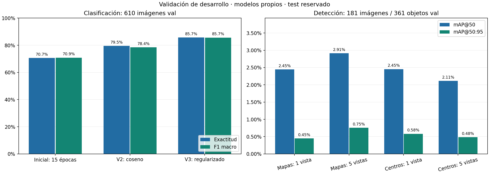
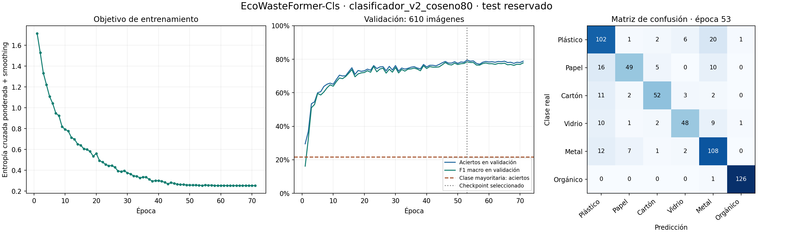
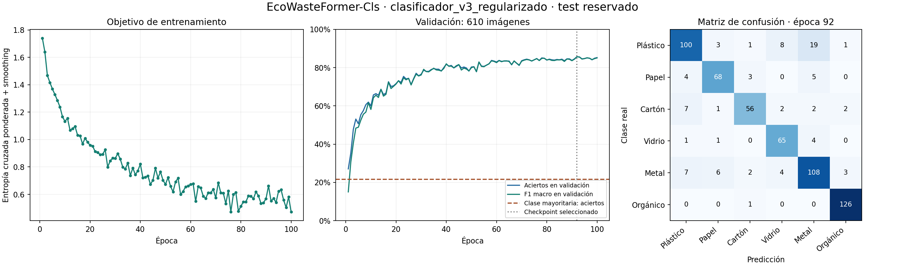
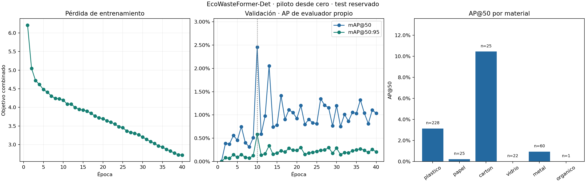

# Mejora del clasificador y detector de centros

**Clasificador elegido: clasificador_v3_regularizado, exactitud val 85.74%, F1 macro 0.857.**
**Detector elegido: detector_mapas_v6_mosaico, mAP@50 val 2.912%; calidad todavía insuficiente.**

Son entrenamientos reales de desarrollo, con pesos guardados. Test continúa reservado y no se declara completado el MVP de video.



## Clasificación

El entrenamiento anterior terminó a las 15 épocas, con su mejor F1 en la época 14. V2 conserva la arquitectura propia de 629.382 parámetros y los mismos aumentos de brillo, contraste y espejo; empieza con pesos aleatorios y entrena hasta 80 épocas con warmup cinco, decaimiento coseno hasta el 10 % del LR inicial y weight decay 0,03. Selección por F1 macro val, mínimo 40 épocas y paciencia 18.

V3 también empieza desde cero. Añade rotación de hasta 10°, desplazamiento de hasta 5 %, escala 0,9–1,1 y Mixup Beta(0,2;0,2), exclusivamente durante entrenamiento. Cada mezcla conserva los pesos y etiquetas de sus dos imágenes; no se inventa una nueva clase. Se usan hasta 100 épocas, mínimo 55 y paciencia 20. Validación e inferencia conservan letterbox RGB 224 y una sola pasada, sin aumentos ni mezcla.

Ambos emplean AdamW, LR inicial 0,0005, lote 32, suavizado de etiquetas 0,05, pesos de clase derivados exclusivamente de train, AMP y recorte de gradiente a uno. Cambian varios aspectos del entrenamiento; estos ensayos no aíslan el efecto de cada componente.

Mismas 2.714 fotos train y 610 val de RealWaste, con los grupos de procedencia anteriores. No se entrenó ni evaluó con las 615 fotos test. La exactitud de clasificación describe la imagen completa con un material predominante; no mide detección ni conteo.

| Entrenamiento | Épocas / mejor | Exactitud train | Exactitud val | F1 macro val |
|---|---:|---:|---:|---:|
| clasificador_piloto_v1 | 15 / 14 | 84.49% | 70.66% | 0.709 |
| clasificador_v2_coseno80 | 71 / 53 | 99.96% | 79.51% | 0.784 |
| clasificador_v3_regularizado | 100 / 92 | 99.71% | 85.74% | 0.857 |

Cambio del clasificador seleccionado frente al anterior: +15.08 puntos porcentuales de exactitud y +0.148 de F1 macro.

Se reprodujeron exactamente las tres matrices de confusión sobre las 610 fotos val. Frente a V1, el elegido corrige 118 errores, introduce 26 y conserva 61 errores compartidos. Las predicciones por ID, grupo, clase y puntuación están en resultados/*_predicciones_val.json y el resumen en resultados/analisis_clasificadores_11.json.

| Clase | Imágenes val | F1 anterior | F1 elegido |
|---|---:|---:|---:|
| plastico | 132 | 0.627 | 0.797 |
| papel | 80 | 0.662 | 0.855 |
| carton | 70 | 0.746 | 0.842 |
| vidrio | 71 | 0.686 | 0.867 |
| metal | 130 | 0.646 | 0.806 |
| organico | 127 | 0.885 | 0.973 |





## Detección mediante centros

Los mapas semánticos unían instancias del mismo material y las consultas anteriores aprendían mal la geometría. Se implementa una salida distinta sobre nuestro extractor Transformer local/global: seis materiales, dos candidatos de escala por material y celda, y cajas continuas en una cuadrícula de 48×48. Son 453.762 parámetros, con proyecciones lineales, atención y MLP propios; no hay convoluciones ni pesos externos o transferidos desde otro modelo.

La idea de representar objetos por centros se relaciona con [Objects as Points](https://arxiv.org/abs/1904.07850). Nuestra implementación usa el extractor Transformer del proyecto y dos escalas por material; no importa CenterNet ni sus pesos.

Se auditaron los centros de los 2.505 objetos train. Hay 22 coincidencias de material y celda y un máximo de dos objetos por combinación. Los dos candidatos conservan ambas instancias: se prefiere una escala según la mediana de tamaños train y se usa la libre ante colisión. Una colisión mayor produce error explícito. El objetivo mantiene cajas y etiquetas originales.

La salida de calor usa sigmoid por material/escala, con picos uno en los centros asignados y suavizado gaussiano de sigma entre una y cuatro celdas según ancho/alto. La pérdida focal atenúa negativos fáciles y posiciones cercanas a centros. Padding y centros de regiones desconocidas se omiten para negativos; los positivos anotados prevalecen. Regresión: L1 de centro/tamaño y GIoU, con coeficientes cinco y dos. Se normaliza por número de objetos.

Al inyectar centros y cajas GT train perfectos, el postproceso NMS 0,5 conserva 2496 de 2505 cajas. Hay nueve pérdidas por solapamiento entre anotaciones de igual material; se registran en resultados/auditoria_postproceso_centros_train.json. Es una comprobación geométrica con GT, no una predicción ni AP. Esta pérdida pequeña no explica por sí sola el bajo rendimiento aprendido.

Los tamaños iniciales de las dos escalas se calculan con train. La inferencia busca máximos locales 3×3, decodifica cajas, excluye centros en padding, recorta al contenido, aplica NMS por material a IoU 0,5 y conserva como máximo 100 cajas. La evaluación fija umbral 0,001; la visualización usa 0,35. Las puntuaciones no están calibradas.

El diagnóstico previo conserva todos los 2505 objetos train y memoriza las mismas seis escenas fáciles más seis fotos auxiliares: AP50=1.000, recall=1.000, precisión=0.700, clasificación auxiliar=1.000, a los 100 pasos. Esos pesos se descartan; no mide generalización.

El entrenamiento completo usa las mismas 964 escenas TACO train y clasificación auxiliar RealWaste train con coeficiente 0,5 y muestreo balanceado. No convierte etiquetas globales en cajas. Lotes ocho y 16 respectivamente, AdamW 0,0005, weight decay 0,01, warmup cinco, coseno hasta 10 %, AMP y clipping uno; máximo 80 épocas, mínimo 40 y paciencia 15. La selección es por mAP@50 val.

Validación completa sobre las mismas 181 imágenes y 361 objetos. Evaluador propio de AP interpolado de 101 puntos, con regiones ignoradas; no se declara equivalencia exacta con COCOeval. No se elimina GT pequeño ni de clases difíciles.

| Detector | Parámetros | Épocas / mejor | mAP@50 val | mAP@50:95 val | Recall@50 val |
|---|---:|---:|---:|---:|---:|
| detector_mapas_v6_auxiliar_ext48 | 439309 | 32 / 19 | 2.446% | 0.449% | 11.08% |
| detector_centros_v11 | 453762 | 40 / 10 | 2.455% | 0.583% | 19.94% |

## Inferencia sobre zonas ampliadas

Se evalúa la imagen completa y cuatro ventanas que cubren cada una el 65 % del ancho y alto, tomadas en las esquinas. Se redimensiona cada vista desde la imagen original; sus cajas se trasladan al sistema de coordenadas original. Se omiten fragmentos que tocan cortes internos y se combinan mediante NMS por material a IoU 0,5, máximo 100 detecciones. La imagen completa conserva cobertura de bordes. No se consultan anotaciones para proponer o elegir ventanas.

Los pesos permanecen congelados y se verifica su SHA-256 antes y después. Esta variante procesa cinco vistas por foto, aumenta el coste y se evalúa aparte del entrenamiento; la mejora no corresponde a entrenar nuevos pesos. Se conserva el umbral de evaluación original de cada modelo.

La formación de propuestas conserva ese umbral fijo, también en la consulta por imagen. El umbral visual se aplica después a las puntuaciones de las cajas resultantes. Se corrigió una inconsistencia que recortaba componentes al subir el filtro visual y se añadió una prueba que exige conservar las cajas evaluadas. La consulta real reproduce ahora las coordenadas y materiales guardados en validación, al mismo filtro de puntuación.

| Inferencia | Época de los pesos | mAP@50 val | mAP@50:95 val | Recall@50 val |
|---|---:|---:|---:|---:|
| detector_mapas_v6_mosaico | 19 | 2.912% | 0.755% | 20.50% |
| detector_centros_v11_mosaico | 10 | 2.114% | 0.483% | 31.58% |

Cambio seleccionado frente al detector anterior: +0.466 puntos porcentuales de mAP@50.

| Material | Objetos val | AP50 anterior | AP50 elegido |
|---|---:|---:|---:|
| plastico | 228 | 2.510% | 3.857% |
| papel | 25 | 4.950% | 4.950% |
| carton | 25 | 0.000% | 0.000% |
| vidrio | 22 | 0.000% | 0.000% |
| metal | 60 | 7.217% | 8.667% |
| organico | 1 | 0.000% | 0.000% |



## Selección, uso y límites

Se conservan todos los checkpoints y reportes. Configuración predeterminada: clasificador `checkpoints/clasificador_v3_regularizado_mejor.pt` y detector `checkpoints/detector_mapas_v6_auxiliar_ext48_mejor.pt`, modo mosaico_cinco_vistas. Las dos consultas por imagen leen la selección de configuracion/arquitectura.json y permiten indicar otro checkpoint explícitamente. El detector permite `--no-mosaico` para comparar una sola vista y `--mosaico` para activarlo explícitamente.

La mejora se mide en validación usada reiteradamente para decidir modelos. Una sola semilla y ese uso de val no prueban robustez estadística ni generalización independiente. La foto RealWaste de un objeto predominante difiere de escenas con basura dispersa. Solo hay cinco cajas orgánicas train y una val de detección; la clasificación auxiliar no resuelve esa falta de cobertura.

Las puntuaciones y cajas continúan siendo experimentales. No se activó cámara ni se presenta el MVP de video como completado. La integración con el asistente conserva la advertencia de calidad insuficiente.

## Verificación y reproducción

Pasaron 93 pruebas. Se comprobaron colisiones y conservación de instancias, regiones ignoradas, padding, gradientes, guardado/carga, programación de aprendizaje, aumentos, mezclas y proyección de cajas entre recortes y coordenadas originales. Las consultas reales y su integración con el asistente quedan en resultados/ejemplo_mejora_11_*.json; la verificación de hashes, selección y reproducción de cajas está en resultados/verificacion_mejora_11.json.

El ejemplo de clasificación usa la primera imagen val, Cardboard_100.jpg: V3 predice vidrio aunque la etiqueta es cartón. Se conserva ese fallo; no se elige una imagen correcta para la demostración. La exactitud general de validación no garantiza cada respuesta individual.

```powershell
$pythonEco = Join-Path $env:USERPROFILE '.venvs\EcoWasteFormer\Scripts\python.exe'
& $pythonEco -m unittest discover -s pruebas
& $pythonEco scripts/entrenar_clasificador.py --config configuracion/entrenamiento_clasificador_coseno.json
& $pythonEco scripts/entrenar_clasificador.py --config configuracion/entrenamiento_clasificador_regularizado.json
& $pythonEco scripts/diagnosticar_centros.py
& $pythonEco scripts/entrenar_detector_centros.py
```

Verificación posterior: `& $pythonEco scripts/verificar_mejora_11.py`. Para regenerar gráficos se usan graficar_clasificador.py con --nombre, graficar_detector.py con --nombre y graficar_mejora_11.py.

Para repetir entrenamientos se deben usar nombres nuevos; los resultados previos se protegen contra sobrescritura. La reanudación requiere configuración y hashes coincidentes, y restaura optimizador, scaler y estados aleatorios. Test se mantiene reservado.
