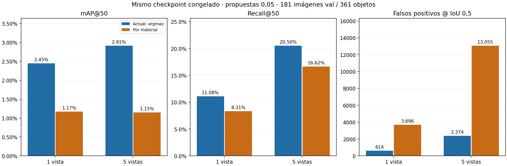
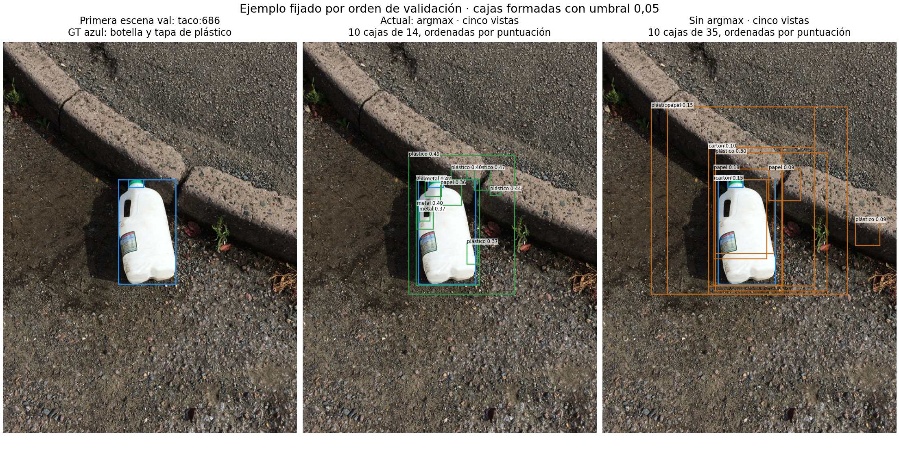

# Propuestas por material sin exigir argmax

**Resultado: con este checkpoint y el umbral fijado, quitar argmax empeora mAP@50 y recall y multiplica los falsos positivos. Se conserva el postprocesamiento actual.**

## Diseño de la comparación

Checkpoint único: `checkpoints/detector_mapas_v6_auxiliar_ext48_mejor.pt`, época 19. SHA-256 antes y después: `eb8fd00ee536ead21e3a2a0ecd5b06baad04acb2e437b22e0eac3686a7bf36b9`. No hay entrenamiento, ajuste de pesos, cambio de pérdidas ni evaluación de test.

Se comparan dos políticas usando exactamente los mismos logits de cada imagen/vista:

- Actual: una celda se admite para material c si gana el argmax de las siete clases y P(c)≥0,05.
- Variante: una celda se admite para material c si P(c)≥0,05, aunque gane fondo u otro material. Una celda puede pertenecer a varios materiales.

Se mantiene softmax sobre las siete clases; no se renormaliza excluyendo fondo. Componentes conexos de ocho vecinos, área mínima dos celdas, máscara de padding, puntuación media P(c) del componente, NMS por material IoU 0,5 y máximo 100 cajas no cambian. Los mapas siguen siendo semánticos: pueden unir instancias cercanas del mismo material.

Se compara por separado una vista y cinco vistas: imagen completa más cuatro zonas del 65 %, con las mismas reglas de corte, transformación y combinación ya registradas. No se comparan políticas con distinto número de vistas. Mismas 181 imágenes val, 361 objetos y seis materiales; evaluador propio de 101 puntos con regiones ignoradas, no COCOeval oficial.

Los umbrales se fijaron antes de medir en configuracion/experimento_propuestas_material.json. No se hizo un barrido para elegir el resultado más favorable. El filtro de puntuación de caja se aplica después de formar las propuestas; 0,35 no cambia las máscaras de celda ni las cajas.

## Resultados con puntuación de caja ≥0,05

| Vistas | Política | mAP@50 | mAP@50:95 | Recall@50 | Precisión@50 | TP | FP | FN | Ignoradas |
|---|---|---:|---:|---:|---:|---:|---:|---:|---:|
| 1 | argmax7 | 2.446% | 0.449% | 11.08% | 6.12% | 40 | 614 | 321 | 33 |
| 1 | por_material | 1.173% | 0.506% | 8.31% | 0.81% | 30 | 3696 | 331 | 65 |
| 5 | argmax7 | 2.912% | 0.755% | 20.50% | 3.02% | 74 | 2374 | 287 | 112 |
| 5 | por_material | 1.148% | 0.424% | 16.62% | 0.46% | 60 | 13055 | 301 | 237 |

TP, FP y FN se cuentan a IoU≥0,5, con asignación uno a uno y material correcto. Las ignoradas siguen las regiones fuera de alcance y no se suman a FP. Son recuentos sobre todas las imágenes, no por imagen. Las puntuaciones no están calibradas.



## Filtro de visualización ≥0,35 sobre las mismas cajas

| Vistas | Política | mAP@50 filtrado | Recall@50 | Precisión@50 | TP | FP | FN |
|---|---|---:|---:|---:|---:|---:|---:|
| 1 | argmax7 | 2.381% | 9.97% | 8.24% | 36 | 401 | 325 |
| 1 | por_material | 0.371% | 0.55% | 22.22% | 2 | 7 | 359 |
| 5 | argmax7 | 2.876% | 17.73% | 3.88% | 64 | 1585 | 297 |
| 5 | por_material | 0.495% | 0.83% | 9.09% | 3 | 30 | 358 |

La caída de FP con 0,35 en la variante no es una mejora suficiente: también desaparecen casi todos los TP. El mAP filtrado describe ese subconjunto, no sustituye el mAP principal calculado con 0,05.

## Qué se está descartando y qué se recupera

Admisiones material-celda antes de componentes y NMS, para una vista. Pueden contarse varios materiales en la misma celda; no representan objetos confirmados ni píxeles GT:

| Material | Admitidas actuales | Admitidas sin argmax | Excluidas porque gana fondo | Excluidas porque gana otro material |
|---|---:|---:|---:|---:|
| plastico | 7437 | 60447 | 49418 | 3592 |
| papel | 371 | 15163 | 9577 | 5215 |
| carton | 1280 | 23260 | 14171 | 7809 |
| vidrio | 93 | 18595 | 14970 | 3532 |
| metal | 1932 | 19465 | 10890 | 6643 |
| organico | 6 | 199 | 87 | 106 |

Los conteos completos de cinco vistas están en el JSON; las vistas solapadas repiten contenido. Admitir más celdas no garantiza un conjunto de cajas que contenga las anteriores: los componentes pueden cambiar, crecer o fusionarse y variar su puntuación media.

| Vistas | GT detectados por ambas | GT recuperados por variante | GT perdidos por variante |
|---|---:|---:|---:|
| 1 | 6 | 24 | 34 |
| 5 | 17 | 43 | 57 |

Se reprodujo la misma asignación de GT del evaluador; no se reutiliza una caja para contar dos objetos. Los IDs de casos recuperados y perdidos quedan en resultados/diagnostico_propuestas_material.json.

| Vistas / política | Mediana de puntuación | Mediana de área / contenido | Cajas con ≥80 % del contenido |
|---|---:|---:|---:|
| 1_vistas_argmax7 | 0.3895 | 0.521% | 0 |
| 1_vistas_por_material | 0.0727 | 0.694% | 18 |
| 5_vistas_argmax7 | 0.3909 | 0.231% | 0 |
| 5_vistas_por_material | 0.0730 | 0.294% | 18 |

El aumento de admisiones de baja probabilidad produce numerosas propuestas de baja puntuación y algunas cajas muy extensas. Estos resultados son compatibles con cambios de geometría y fusiones; no prueban una causa única de cada error. Aunque se recuperan algunos GT, se pierden más y crecen los FP.



El ejemplo es la primera escena val, sin seleccionarla por el resultado. GT azules, propuestas actuales verdes y propuestas de la variante naranjas; se dibujan como máximo las diez de mayor puntuación de cada condición. Las métricas incluyen todas las propuestas. Las anotaciones solo se usan para dibujar y evaluar, nunca para generarlas.

Con umbral 0,05 y softmax7, ganar argmax implica probabilidad de al menos 1/7. Al quitarlo entran celdas que antes no podían formar componentes, con puntuaciones bastante menores. Esto explica por qué quitar la condición no equivale a conservar las cajas anteriores y añadir únicamente objetos nuevos.

## AP por material, filtro 0,05

| Material | Objetos val | 1 vista actual | 1 vista variante | 5 vistas actual | 5 vistas variante |
|---|---:|---:|---:|---:|---:|
| plastico | 228 | 2.510% | 0.578% | 3.857% | 1.785% |
| papel | 25 | 4.950% | 3.295% | 4.950% | 2.058% |
| carton | 25 | 0.000% | 0.891% | 0.000% | 0.796% |
| vidrio | 22 | 0.000% | 0.000% | 0.000% | 0.007% |
| metal | 60 | 7.217% | 2.272% | 8.667% | 2.241% |
| organico | 1 | 0.000% | 0.000% | 0.000% | 0.000% |

## Verificación

Pasaron 98 pruebas. Se verifican, entre otros casos, propuestas cuando gana fondo, dos materiales sobre la misma celda, riesgo de propuestas en un mapa uniforme, padding, umbral y área mínima. El comportamiento anterior sigue siendo la opción predeterminada.

Ambas bases reproducen exactamente las 181 listas anteriores de cajas, etiquetas y puntuaciones, con delta máximo de puntuación cero. Se comparó el state_dict antes/después, se congelaron los parámetros y se comprobó ausencia de gradientes. Los hashes del checkpoint, seis manifiestos y configuración de selección permanecen intactos. No se modificó el clasificador.

El resultado completo y hashes están en resultados/mapas_v6_ab_propuestas_material.json; cada condición conserva sus predicciones por ID. La configuración predeterminada sigue en detector_mapas_v6_mosaico con argmax y el mismo checkpoint.

## Ponderación del fondo: experimento siguiente separado

La pérdida actual usa CE de material, tres veces CE de fondo y Dice. Esta comparación no identifica el coeficiente de fondo óptimo y no demuestra que deba reducirse. El fondo continúa influyendo en softmax aunque se retire la condición argmax.

Para estudiarlo con entrenamiento: ramificar el mismo checkpoint propio en un control con coeficiente tres y una variante con coeficiente uno; igualar datos, máscaras, inicialización de optimizador, semillas, orden de lotes, aumentos, pérdida auxiliar, tasa de aprendizaje y número de pasos. Mantener argmax en ambas inferencias. Comparar el mismo presupuesto final además de registrar el mejor checkpoint de cada rama. No combinar simultáneamente el cambio de pérdida con la política sin argmax. Este entrenamiento queda pendiente; no se ejecutó como parte del A/B congelado.

## Reproducción

```powershell
$pythonEco = Join-Path $env:USERPROFILE '.venvs\EcoWasteFormer\Scripts\python.exe'
& $pythonEco -m unittest discover -s pruebas
& $pythonEco scripts/comparar_propuestas_material.py --config configuracion/experimento_propuestas_material.json
& $pythonEco scripts/informar_propuestas_material.py
python scripts/graficar_propuestas_material.py
& $pythonEco scripts/verificar_propuestas_material.py
```

Para repetir el A/B se debe copiar la configuración y elegir otro nombre; los resultados se protegen contra sobrescritura. La validación se usa reiteradamente durante desarrollo, de modo que no es una prueba independiente final. Test permanece reservado; la detección sigue teniendo calidad insuficiente.
