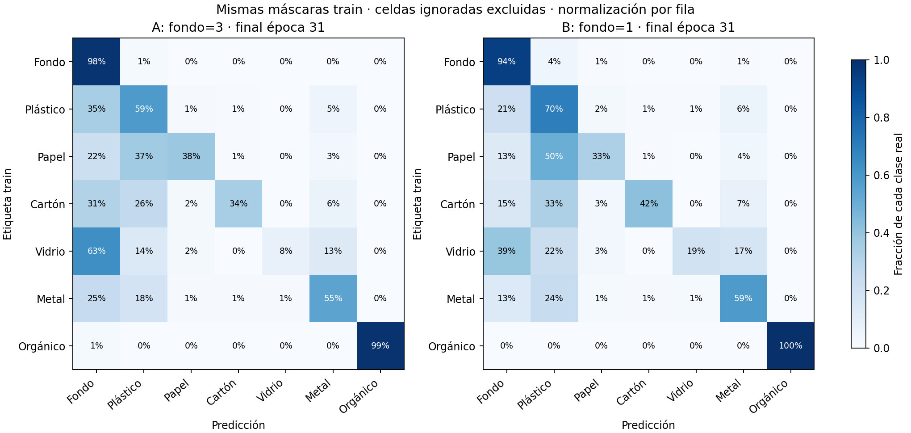
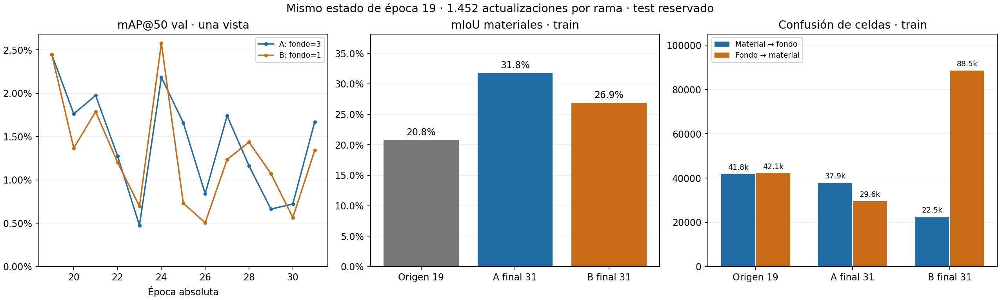
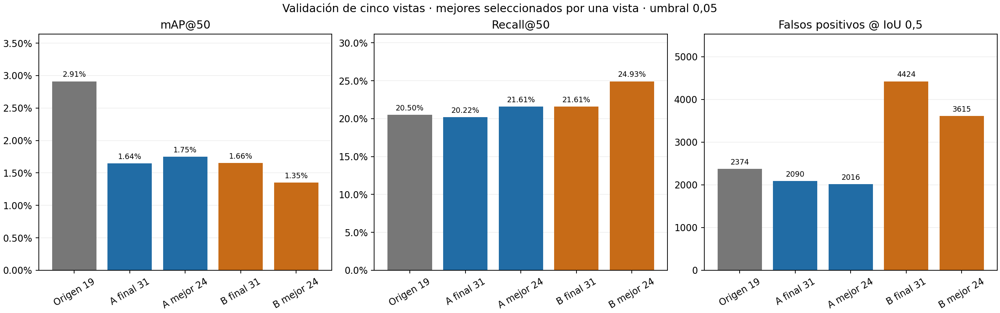

# Ablación controlada del coeficiente de fondo

**Decisión: no adoptar fondo=1 como sustituto actual. Se conserva el checkpoint original de época 19, argmax y cinco vistas.**

## Protocolo ejecutado

Dos ramas parten de `checkpoints/detector_mapas_v6_auxiliar_ext48_mejor.pt` (SHA-256 `eb8fd00ee536ead21e3a2a0ecd5b06baad04acb2e437b22e0eac3686a7bf36b9`). A mantiene coeficiente tres y B usa uno. Se restauraron y compararon por huella los pesos, todo el estado AdamW, scaler y los generadores CPU, CUDA, DataLoader de detección y muestreo auxiliar. Las cuatro huellas iniciales coinciden con el archivo original en ambas ramas.

Se mantienen extractor y cabezales, imágenes, máscaras TACO de polígonos, cobertura 1/64, ponderación por material, Dice y clasificación auxiliar RealWaste (coeficiente 0,5 y lote balanceado 16). Lote de detección ocho, AdamW y LR 0,0005 guardados. El scaler inicial es 2.048 con growth_tracker 299. No se reinicia warmup ni se crea un optimizador sin su estado aprendido.

Presupuesto prefijado: 12 épocas (20–31), 1452 actualizaciones por rama, sin parada temprana. AdamW pasa de 2.299 a 3.751 en todos sus parámetros. Se comprueba cada época que no se omitió un paso. Ambas ramas usan los mismos 11.568 ejemplos de detección y 23.232 ejemplos auxiliares muestreados durante este presupuesto.

Las trazas registran IDs/índices de ambas fuentes y parámetros de espejo, brillo y contraste de cada lote. Las huellas acumuladas y las de las doce épocas coinciden entre A y B. Evaluación semántica de train sin aumentos; val conserva argmax, máscara de padding, umbral de propuestas 0,05, componentes de dos celdas y NMS 0,5. No se utiliza la variante de propuestas sin argmax.

Se registra el checkpoint final al mismo número de pasos y el mejor de las épocas adicionales por **mAP@50 val de una vista**, criterio del entrenamiento original. Ambos mejores ocurrieron en época 24 (605 actualizaciones adicionales). También se guarda el mejor incluyendo el punto común: A conserva época 19 y B elige época 24 por ese criterio de una vista. Las cinco vistas se evalúan por separado sobre esos cuatro checkpoints; no se denomina al ganador de una vista «mejor de cinco vistas».

## Aprendizaje semántico sobre train

| Estado | mIoU siete clases | mIoU seis materiales | Material → fondo | Fondo → material |
|---|---:|---:|---:|---:|
| Origen época 19 | 31.31% | 20.78% | 41806 | 42131 |
| A final | 40.92% | 31.81% | 37909 | 29603 |
| A mejor | 36.59% | 26.80% | 42602 | 29264 |
| B final | 36.27% | 26.88% | 22496 | 88523 |
| B mejor | 35.20% | 25.54% | 25269 | 77868 |

Son celdas de mapas 48×48, no objetos. Se excluyen etiquetas 255; las matrices completas 7×7, confusión binaria y IoU de cada clase se guardan en el JSON. mIoU es la media de IoU de clases con unión no vacía. La comparación usa las mismas máscaras, sin recortes nuevos ni cambios de anotaciones.

Al mismo presupuesto B reduce material perdido como fondo (37.909 → 22.496 frente a A), pero casi triplica el fondo predicho como material (29.603 → 88.523). El mIoU de materiales de B queda por debajo de A (26,88 % frente a 31,81 %). La mejora de cobertura de material no basta para mejorar detección.



## Validación: una vista

| Estado | Época | Pasos adicionales | mAP@50 | mAP@50:95 | Recall@50 | Precisión@50 | FP |
|---|---:|---:|---:|---:|---:|---:|---:|
| Origen | 19 | 0 | 2.446% | 0.449% | 11.08% | 6.12% | 614 |
| A final | 31 | 1452 | 1.671% | 0.423% | 11.36% | 6.91% | 552 |
| A mejor | 24 | 605 | 2.184% | 1.033% | 11.63% | 7.81% | 496 |
| B final | 31 | 1452 | 1.341% | 0.415% | 10.80% | 3.32% | 1136 |
| B mejor | 24 | 605 | 2.578% | 1.256% | 12.47% | 4.87% | 879 |



## Validación: cinco vistas, mismo modo del detector predeterminado

| Estado | Época | mAP@50 | mAP@50:95 | Recall@50 | Precisión@50 | FP |
|---|---:|---:|---:|---:|---:|---:|
| Origen predeterminado | 19 | 2.912% | 0.755% | 20.50% | 3.02% | 2374 |
| A final | 31 | 1.644% | 0.487% | 20.22% | 3.37% | 2090 |
| A mejor | 24 | 1.752% | 0.685% | 21.61% | 3.72% | 2016 |
| B final | 31 | 1.655% | 0.468% | 21.61% | 1.73% | 4424 |
| B mejor | 24 | 1.351% | 0.579% | 24.93% | 2.43% | 3615 |

A igual presupuesto el mAP@50 de cinco vistas apenas cambia entre A y B (1,6445 % y 1,6552 %), ambos inferiores al 2,9123 % de origen. B obtiene cinco TP más, pero FP pasa de 2.090 a 4.424 y la precisión baja de 3,37 % a 1,73 %. Su mejor checkpoint por una vista tampoco mejora el modo de cinco vistas.



## AP individual de los seis materiales

Filtro de propuestas 0,05; mismos 361 objetos val.

| Material | Objetos | Origen, 5 vistas | A final | A mejor | B final | B mejor |
|---|---:|---:|---:|---:|---:|---:|
| plastico | 228 | 3.857% | 5.895% | 5.078% | 5.149% | 4.319% |
| papel | 25 | 4.950% | 0.245% | 1.173% | 0.471% | 2.782% |
| carton | 25 | 0.000% | 0.000% | 0.000% | 0.000% | 0.000% |
| vidrio | 22 | 0.000% | 0.000% | 0.000% | 0.000% | 0.000% |
| metal | 60 | 8.667% | 3.727% | 4.262% | 4.312% | 1.005% |
| organico | 1 | 0.000% | 0.000% | 0.000% | 0.000% | 0.000% |

| Material | Origen, 1 vista | A final | A mejor | B final | B mejor |
|---|---:|---:|---:|---:|---:|
| plastico | 2.510% | 4.452% | 3.442% | 3.853% | 3.619% |
| papel | 4.950% | 0.972% | 4.059% | 1.312% | 8.911% |
| carton | 0.000% | 0.000% | 0.000% | 0.000% | 0.000% |
| vidrio | 0.000% | 0.000% | 0.000% | 0.000% | 0.000% |
| metal | 7.217% | 4.603% | 5.602% | 2.881% | 2.935% |
| organico | 0.000% | 0.000% | 0.000% | 0.000% | 0.000% |

## Reproducibilidad y límites

Se verifican estados iniciales completos, orden, parámetros de aumentos, LR y número real de actualizaciones. La repetición numérica **no es idéntica bit a bit a la continuación histórica en AMP**: el control registra diferencias frente al historial anterior, sin ocultarlas. No se activó un modo de algoritmos deterministas estricto; las huellas de entradas no equivalen a garantizar una trayectoria numérica idéntica entre ejecuciones GPU.

La mayor diferencia del control frente al historial previo fue 0.303 puntos porcentuales de mAP@50 y 0.001864 de pérdida. Estas diferencias quedan por época en regresion_control_historico. Esta es una ablación pareada de una sola ejecución por rama, no una estimación de variabilidad con varias semillas.

La validación ya se ha usado reiteradamente durante desarrollo. Solo hay cinco objetos orgánicos train y uno val. No se afirma significación estadística ni calidad suficiente para uso fiable. El escaso aumento final de mAP de B en cinco vistas no justifica desplegarla con más del doble de FP.

## Decisiones y reproducción

- Argmax y cinco vistas: conservar.
- Propuestas sin argmax: descartar como configuración actual, conservando el A/B anterior.
- Fondo=1: no adoptar con esta evidencia; se conservan las dos ramas y todos sus checkpoints.
- Detector predeterminado y clasificador independiente: intactos; no se evaluó test.

```powershell
$pythonEco = Join-Path $env:USERPROFILE '.venvs\EcoWasteFormer\Scripts\python.exe'
& $pythonEco scripts/ablacion_fondo.py --config configuracion/ablacion_fondo.json
& $pythonEco scripts/informar_ablacion_video.py
python scripts/graficar_ablacion_fondo.py
& $pythonEco scripts/verificar_ablacion_video.py
```

La ejecución original se protege contra sobrescritura; para repetir se debe usar otro nombre de experimento. Los JSON por rama guardan los checkpoints finales, mejores durante actualizaciones y mejores incluyendo origen, además de matrices y trazas. Las evaluaciones de cinco vistas están en resultados/ablacion_fondo_ep19_{A,B}_{final,mejor}_cinco_vistas.json.
