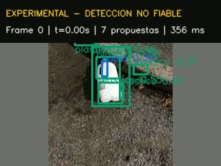

# MP4 y webcam: integración experimental

**Implementado: lectura de MP4, captura de cámara explícita, detector persistente, anotación, exportación MP4/JSONL y consulta al asistente sobre el último frame.** La cámara física no se activó en estas pruebas.

## Uso

```powershell
$pythonEco = Join-Path $env:USERPROFILE '.venvs\EcoWasteFormer\Scripts\python.exe'
& $pythonEco scripts/detectar_video.py --video 'C:\ruta\mi_video.mp4' --salida resultados/mi_video --pregunta '¿Cómo separo estos residuos?'
& $pythonEco scripts/detectar_video.py --camara 0 --salida resultados/camara_sesion1 --mostrar
```

La carpeta de salida debe ser nueva. En la ventana, q o Escape detienen la lectura; Ctrl+C también libera los recursos. La cámara solo se abre con --camara; un MP4 inexistente o ilegible nunca hace fallback a la cámara. --mostrar es explícito y sin esa opción no se abre ninguna ventana.

Opciones: --max-frames N limita la sesión; --sin-video conserva JSONL y resumen sin exportar MP4; --vistas 1 permite comparar una sola vista. El valor predeterminado sigue siendo cinco vistas y argmax, con el mismo checkpoint de época 19 y umbral de propuestas 0,05. --umbral filtra puntuaciones de cajas ya formadas; no recorta sus componentes.

## Archivos de salida

- anotado.mp4: cajas en coordenadas originales y banner visible «EXPERIMENTAL - DETECCION NO FIABLE» en cada frame; salida sin audio.
- frames.jsonl: cabecera con modelo, huella del checkpoint y parámetros; una línea por frame con tiempo, materiales, puntuaciones, cajas, latencia y advertencia; cierre con resumen.
- resumen.json: frames procesados, motivo de fin, latencia mediana/p95, FPS de procesamiento y último frame.
- asistente_ultimo_frame.json: solo cuando se especifica --pregunta; usa una instantánea identificada del último frame y conserva la advertencia del detector.

El modelo se carga una vez por sesión. No hay seguimiento de identidades ni conteo de objetos únicos acumulados. La misma botella en varios frames puede producir varias predicciones; las cantidades son por frame. El asistente no se invoca automáticamente en cada fotograma.

## Pruebas ejecutadas

Se generó un MP4 técnico de ocho frames, a partir de cuatro fotos de validación repetidas. Se procesaron los ocho con el detector real y cinco vistas; se releyeron los ocho frames del MP4 exportado, se verificaron registros y advertencias, y se ejecutó el asistente sobre el frame 7. Las cajas, materiales y puntuaciones del frame 0 coinciden exactamente con la consulta por imagen sobre ese mismo frame decodificado (7 detecciones).

Medición en ese montaje 320×240: mediana de inferencia 47.3 ms, p95 254.8 ms y 11.1 FPS de procesamiento total. Son ocho frames en entorno de desarrollo; incluyen arranque y no constituyen un benchmark de cámara ni garantía de tiempo real.



Evidencia: resultados/verificacion_video_real.json, resultados/verificacion_video_imagen.json y resultados/demo_video_experimental/. El montaje de fotos **no es un video independiente** y no se usa para afirmar precisión de detección en video.

Pasaron 109 pruebas del proyecto. Las de video cubren lectura/exportación MP4, límite de frames, modo sin ventana, cámara simulada, resolución impar, FPS ausente, rechazo de salidas existentes, archivo ausente, lectura truncada y liberación de recursos ante error de inferencia. Las pruebas de cámara reemplazan VideoCapture por una fuente simulada: no activan hardware.

## Alcance y pendientes

La integración funcional experimental de MP4/webcam queda implementada. Siguen pendientes la comprobación con una cámara física y videos independientes, calidad por clase, latencia sostenida y robustez frente a escenas nuevas. El detector mantiene mAP@50 val 2,91 %: esta integración no lo convierte en fiable.

El video exportado usa FPS nominal de la fuente (30 si no está disponible). El JSONL conserva los tiempos de captura; si la inferencia de cámara es más lenta que la adquisición, la duración/cadencia del MP4 puede diferir del tiempo de captura. No se conserva audio.
