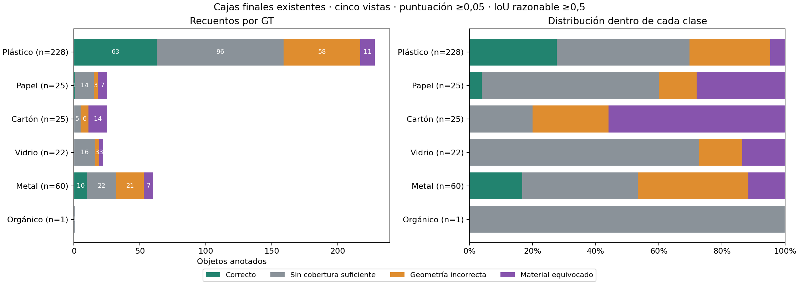
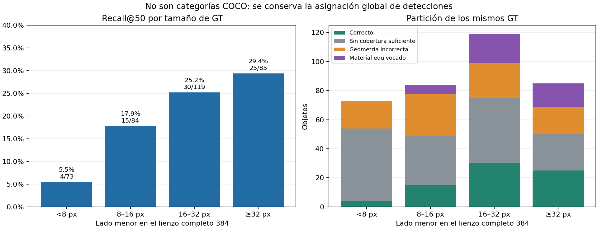
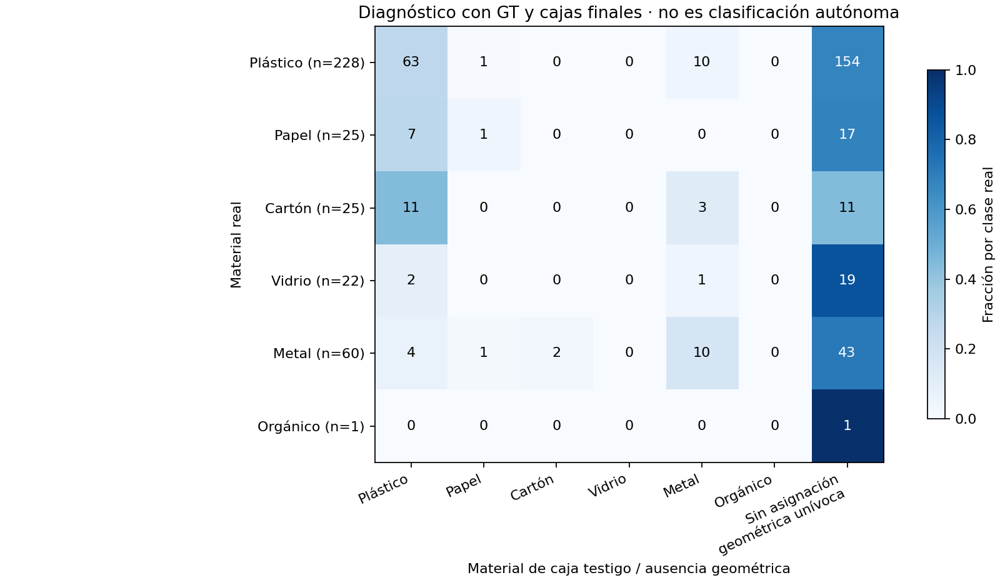
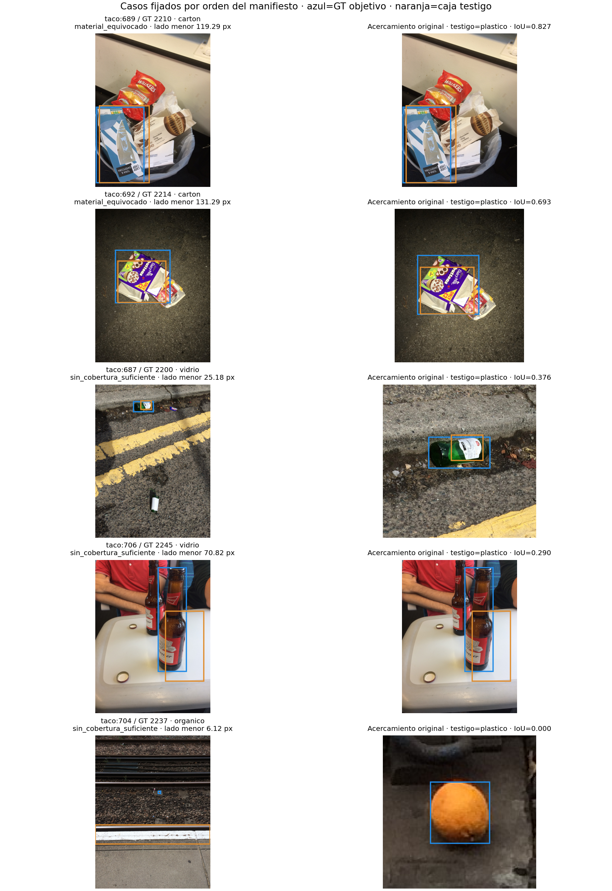

# Auditoría del detector por clase y tamaño

**No se reentrenó ni se ejecutó nuevamente el detector. Se reutilizaron exclusivamente predicciones y anotaciones guardadas, en CPU.** Se conserva el clasificador, argmax, cinco vistas, pesos y coeficiente de fondo actuales.

## Alcance y reglas prefijadas

Mismas 181 imágenes y 361 GT de validación. Se auditan los JSON existentes de una y cinco vistas del checkpoint propio de época 19. Los filtros 0,05 y 0,35 ya existían; no se probaron nuevos umbrales. La asignación reproduce exactamente TP, FP, FN e ignoradas anteriores, incluidos los recuentos de cada clase.

Primero se conserva la asignación uno a uno del evaluador, por puntuación, material e IoU≥0,5. Un GT detectado se marca correcto. Para cada GT restante:

1. **Material equivocado:** existe una caja evaluable con IoU≥0,5 y otro material, sin una caja correcta disponible.
2. **Geometría incorrecta:** no hay caja razonable disponible, pero alguna caja cubre al menos 50 % del área del GT; su IoU queda por debajo de 0,5. Se identifica si es demasiado grande, pequeña o presenta forma/desplazamiento. Una caja correcta compartida por varios GT, ya asignada a otro, se registra también aquí como conflicto de asignación.
3. **Sin cobertura suficiente:** ninguna caja final evaluable cubre 50 % del GT. Puede haber cajas parciales, pequeñas o alejadas; no significa necesariamente que el mapa interno no generara región.

Las predicciones ignoradas por las regiones fuera de alcance, según la misma regla del evaluador a IoU 0,5, no se usan para inventar cobertura. Las duplicadas y los errores de material sobre GT válido siguen contando como FP.

Es una partición operacional que prioriza geometría suficiente antes de atribuir el material. Los fallos pueden coexistir: una caja parcial también puede tener etiqueta equivocada, pero no se considera «caja razonable con material equivocado» hasta alcanzar IoU 0,5. Cada fila conserva IoU, cobertura y etiqueta del testigo para revisar esos casos combinados.

**Limitación principal:** solo están guardadas cajas finales, después de componentes, cortes de vistas, NMS y top100. La cobertura de su rectángulo no es cobertura de la máscara. No podemos separar causalmente un fallo del mapa, del filtro o de NMS sin las trazas previas, y no se hizo nueva inferencia para obtenerlas.

## Resultado del detector predeterminado: cinco vistas, puntuación ≥0,05

| Material | GT val | AP@50 existente | Correctos | Sin cobertura suficiente | Geometría incorrecta | Material equivocado |
|---|---:|---:|---:|---:|---:|---:|
| plastico | 228 | 3.857% | 63 | 96 | 58 | 11 |
| papel | 25 | 4.950% | 1 | 14 | 3 | 7 |
| carton | 25 | 0.000% | 0 | 5 | 6 | 14 |
| vidrio | 22 | 0.000% | 0 | 16 | 3 | 3 |
| metal | 60 | 8.667% | 10 | 22 | 21 | 7 |
| organico | 1 | 0.000% | 0 | 1 | 0 | 0 |

Total: 74 GT detectados, 154 sin cobertura suficiente, 91 con geometría incorrecta y 42 con material equivocado. Los últimos tres grupos suman los 287 FN existentes; no son una nueva estimación optimista de recall.



## Tamaño en la entrada del modelo

Se usa el **lado menor del bbox al redimensionar la imagen completa al lienzo de 384**: <8, [8,16), [16,32) y ≥32 píxeles. La referencia de ocho píxeles es el patch de detalle del modelo; no es un límite absoluto de detección. Estas categorías no son las de AP small/medium/large de COCO. En cinco vistas existen ampliaciones adicionales, cuyo origen no está registrado en las cajas combinadas.

| Lado menor en 384 | GT | TP | Recall@50 por GT | Sin cobertura | Geometría | Material |
|---|---:|---:|---:|---:|---:|---:|
| menos_8_px | 73 | 4 | 5.48% | 50 | 19 | 0 |
| 8_a_16_px | 84 | 15 | 17.86% | 34 | 29 | 6 |
| 16_a_32_px | 119 | 30 | 25.21% | 45 | 24 | 20 |
| 32_px_o_mas | 85 | 25 | 29.41% | 25 | 19 | 16 |

Los TP por tamaño conservan la asignación global. No se eliminan GT de otras tallas ni se recalcula un AP por tamaño que contabilice incorrectamente sus detecciones como FP. El JSON cruza clase × tamaño para todos los estados y conserva cada ID de anotación.



## Interpretación de las tres clases sin AP

**Cartón:** 14 de 25 GT tienen una caja geométricamente razonable con otro material: once como plástico y tres como metal. Son objetos de al menos 16 píxeles de lado menor. Otros seis fallan por geometría y cinco por falta de cobertura. El AP cero no se explica solamente por objetos minúsculos o ausencia total de propuestas.

**Vidrio:** 16 de 22 GT carecen de cobertura suficiente en cajas finales, tres tienen geometría incorrecta y tres una caja razonable con otro material. En train, 107/203 vidrios quedan por debajo de ocho píxeles y 133/203 por debajo de 16. Sin embargo, también faltan cajas para vidrios más grandes en val: el tamaño por sí solo no explica todos los fallos.

**Orgánico:** solo cinco GT train y uno val. El único GT val tiene lado menor 6,12 píxeles y no tiene cobertura suficiente. Un solo objeto val no permite caracterizar la clase ni esperar robustez; las fotos auxiliares RealWaste con etiqueta global no son cajas adicionales.



Esta matriz ilustra el material de la caja testigo elegida con ayuda del GT. No es una nueva métrica de clasificación autónoma: para un GT correcto se usa su pareja real; para un error de material la caja razonable de mayor IoU; los otros casos se agrupan en la última columna.

## Casos para revisión visual

Se generó datos/reportes/revision_clases_sin_ap.csv con los 48 GT de cartón, vidrio y orgánico no detectados, sus imágenes, cajas originales, diagnóstico y testigo. No son anotaciones nuevas y no se incorporan a train.



La galería usa los dos primeros cartones con error de material, los dos primeros vidrios sin cobertura y el único orgánico, en el orden del manifiesto. Se muestran imagen completa y acercamiento para inspección: azul=GT, naranja=caja testigo si existe. Las imágenes y acercamientos no se usan para entrenar ni para producir nuevas predicciones.

## Cobertura de anotaciones train/val

| Material | Instancias train | Imágenes train | Grupos de adquisición train | Train <8 px | Instancias val | Val <8 px |
|---|---:|---:|---:|---:|---:|---:|
| plastico | 1630 | 757 | 10 | 294 | 228 | 47 |
| papel | 109 | 89 | 10 | 9 | 25 | 3 |
| carton | 149 | 106 | 10 | 8 | 25 | 0 |
| vidrio | 203 | 62 | 10 | 107 | 22 | 1 |
| metal | 409 | 195 | 10 | 82 | 60 | 21 |
| organico | 5 | 4 | 1 | 2 | 1 | 1 |

Los grupos son los del manifiesto de procedencia, no una garantía de independencia por sesión real. Las máscaras y cajas existentes permanecen intactas.

## Cambios de entrenamiento que sí merece preparar

- **Cartón/material:** el candidato más directo es supervisar material sobre regiones GT de TACO usando la cabeza auxiliar y características regionales, con un control sin esa pérdida. Mantener fondo=3, cajas y postprocesamiento. Es una hipótesis de entrenamiento respaldada por el tipo de error, no una mejora ya demostrada; no se ejecutó ahora.
- **Vidrio/cobertura:** revisar primero los casos identificados y su escala. En la siguiente inferencia que ya sea necesaria, conservar propuestas antes de NMS y origen de cada vista para localizar dónde se pierden. Los recortes balanceados ya se probaron sin mejorar; esta auditoría no justifica repetirlos automáticamente ni cambiar resolución a ciegas.
- **Orgánicos/datos reales:** recopilar sesiones diversas con objetos y tamaños variados; dibujar cajas reales, revisar clase y geometría, conservar procedencia y dividir por sesión antes de entrenar. Reservar nuevas escenas independientes. No asignar la imagen completa como bbox por tener una etiqueta global y no convertir predicciones automáticas en GT sin revisión.
- **Conservar:** clasificador 85,74 % accuracy val; argmax y cinco vistas. No repetir por ahora ablaciones de fondo ni barridos de umbrales.

## Verificación y reproducción

Auditoría completada en 0.91 s de ejecución local en CPU: cero cargas de modelo, cero inferencias nuevas, cero actualizaciones y cero uso de GPU por el proceso de auditoría. Pasaron 116 pruebas del proyecto. Los recuentos reproducen las cuatro condiciones existentes (una/cinco vistas y puntuaciones 0,05/0,35), incluidas TP/FP por clase.

```powershell
$pythonEco = Join-Path $env:USERPROFILE '.venvs\EcoWasteFormer\Scripts\python.exe'
& $pythonEco scripts/auditar_clase_tamano.py
& $pythonEco scripts/informar_auditoria_camara.py
python scripts/graficar_auditoria_clase_tamano.py
& $pythonEco scripts/verificar_auditoria_camara.py
```

La ejecución existente se protege contra sobrescritura: para repetir se debe copiar la configuración con otro nombre. Evidencia completa en resultados/auditoria_clase_tamano.json y CSV por objeto. Test no se usó para seleccionar modificaciones.
