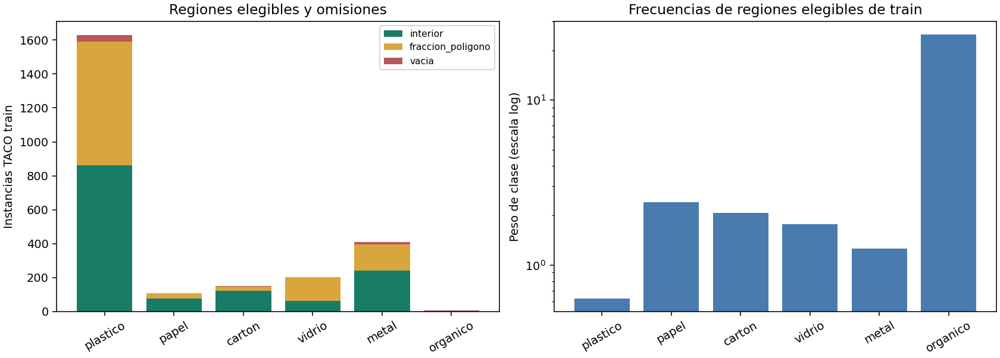
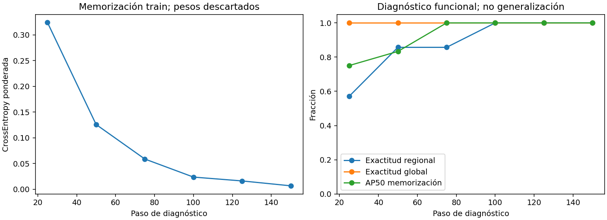
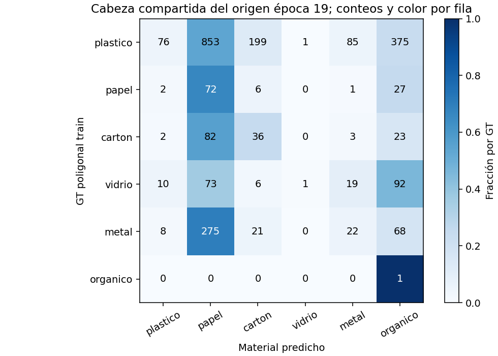

# Supervisión regional de materiales

Estado: implementación y diagnóstico aprobados; **A/B completo no iniciado**. La configuración mantiene `entrenamiento_completo_habilitado=false`. No hay checkpoints nuevos de este experimento ni resultados de generalización de B. Se conserva el detector de época 19, argmax y cinco vistas, con mAP@50 val 2,912 %.

## Implementación

Se revisaron `detector_mapas.py`, `detector.py`, `poligonos.py`, `auxiliar_clasificacion.py` y `entrenar_detector_mapas.py`. El único cambio del modelo es una opción de retorno: `modelo(x, devolver_caracteristicas=True)` entrega mapas y características fusionadas `[B,48,48,96]` del mismo forward. La llamada predeterminada conserva las operaciones anteriores.

`ecowaste/supervision_regional.py` valida los polígonos originales contra sus imágenes y anotaciones mediante `ContornosTACO`. Solo admite registros TACO **train**, con etiquetas GT de los seis materiales. RealWaste conserva exclusivamente la tarea global; no aporta regiones ni cajas artificiales.

Para cada instancia se rasterizan sus polígonos con el letterbox original a 384 px y se calcula su fracción por token de 8×8 px. El pooling prefiere tokens completamente interiores. Si no existen, utiliza las fracciones reales del polígono, sin umbral ajustado en val. Se excluye entero cualquier token que toque padding o cajas ignoradas, tenga etiqueta semántica 255 o contenga polígonos de diferentes materiales. Si no queda ninguno, la instancia se omite y se registra su ID y motivo. Los solapes entre instancias del mismo material conservan una etiqueta de material inequívoca.

Las máscaras semánticas históricas permanecen idénticas: estas exclusiones adicionales solo afectan a la nueva pérdida. No se cambia el extractor, la fusión ni el postprocesamiento. La cabeza `clasificador_auxiliar`, ya presente, recibe el vector regional promedio. Se mantienen **439.309 parámetros**, las mismas claves de estado y la carga estricta de checkpoints anteriores.

La CE se pondera con `w[c] ∝ 1/sqrt(n[c])`, donde `n[c]` cuenta exclusivamente instancias elegibles de train. Los pesos se normalizan a media por instancia uno. En cada lote: `Lregional = Σ(w[y]·CE)/Σw[y]`. Se registran cantidad, CE, numerador ponderado y contribución por material. Un lote vacío produce cero finito conectado al grafo. A calcula las estadísticas regionales sin gradiente y omite ese término del backward; B suma `0,25·Lregional`. No se hace otro forward del extractor para las regiones TACO. El lote RealWaste distinto conserva su forward global habitual.

## Cobertura de train

964 escenas; 2.505 instancias conocidas; **2.439 elegibles y 66 omitidas**. Las frecuencias incluyen el fallback fraccional.

| Material | GT | Interiores | Fraccionales | Omitidas | Peso regional |
|---|---:|---:|---:|---:|---:|
| Plástico | 1630 | 861 | 728 | 41 | 0,6284 |
| Papel | 109 | 78 | 30 | 1 | 2,4105 |
| Cartón | 149 | 122 | 24 | 3 | 2,0732 |
| Vidrio | 203 | 62 | 139 | 2 | 1,7669 |
| Metal | 409 | 241 | 153 | 15 | 1,2620 |
| Orgánico | 5 | 1 | 0 | 4 | 25,0502 |

El peso de orgánico se deriva de una sola región elegible, lo que aumenta la varianza y puede dominar un lote que la contenga. No compensa la falta de diversidad. No se añadieron ejemplos, cajas ni excepciones para recuperar esas cuatro instancias.



## Diagnóstico ejecutado

Evidencia vigente: [diagnostico_revision03.json](../resultados/supervision_regional_preparacion/diagnostico_revision03.json). Se conservan las dos ejecuciones de desarrollo anteriores. La revisión 03 incluye ambas cabezas, lotes reales 8/16, liberación de referencias GPU entre mediciones y comprobación ampliada de dependencias y entorno.

- **129 pruebas aprobadas**, sin fallos, errores ni omisiones: 116 anteriores y 13 regionales. Cubren geometría e IDs, interiores y fallback pequeño, vacíos, padding, ignoradas, mezcla de materiales, espejo de máscaras, CE ponderada y contribuciones, gradientes finitos hacia ambas tokenizaciones y la cabeza compartida, compatibilidad, inferencia y bloqueo de entrenamiento.
- La comparación con el código exacto de Git anterior a la edición cargó los mismos pesos con `strict=True`. En seis escenas train, FP32 y AMP, los logits y las cajas de una/cinco vistas coinciden exactamente. El control cero también conserva exactamente los gradientes de la pérdida anterior en la prueba unitaria.
- Memorización **FP32 de 150 pasos**, con inicialización propia aleatoria semilla 42, seis escenas TACO train (siete instancias) y seis fotos RealWaste train ya prefijadas en el diagnóstico histórico. Mantiene las tres tareas. Al final: exactitud regional 100 %, exactitud global 100 %, AP@50/recall/precisión de memorización 1,0; CE regional 0,00660. Se cumplen los criterios prefijados. **No se guardaron ni reutilizaron sus pesos.** Estos pasos pertenecen solo al diagnóstico; no son actualizaciones A/B.
- Se restauraron por separado dos modelos desde época 19 y coincidieron las huellas de pesos, AdamW, scaler y RNG CPU/CUDA/detección/auxiliar. AdamW permanece en paso **2.299**, LR **0,0005**, scaler **2.048**, growth tracker **299**. El microbenchmark no ejecutó `optimizer.step`.
- Se simularon los índices y el consumo de RNG de los aumentos para las doce épocas completas de cada rama, sin redes ni actualizaciones. Las doce huellas por época de A y B coinciden. El entrenador comprobará esas mismas huellas durante la ejecución real.
- El checkpoint origen, el clasificador independiente, la selección de arquitectura, los seis manifiestos y las predicciones históricas conservan sus SHA-256. Test no se evaluó; sus metadatos y hashes se consultan para integridad y separación, como antes.



La regresión adicional se registra en [regresion_val_revision03.json](../resultados/supervision_regional_preparacion/regresion_val_revision03.json): compara las predicciones de las 181 escenas con los archivos históricos, para una y cinco vistas. Esta comprobación usa pesos congelados y no selecciona coeficientes. Incluye un backward AMP de las tres tareas en el primer lote real de cada rama, con aumentos restaurados idénticos, gradientes finitos, clipping y pesos/AdamW intactos, sin `optimizer.step`.

| Val congelada | mAP@50 | mAP@50:95 | Recall | Precisión | TP | FP | FN |
|---|---:|---:|---:|---:|---:|---:|---:|
| Una vista | 2,446 % | 0,449 % | 11,080 % | 6,116 % | 40 | 614 | 321 |
| Cinco vistas | 2,912 % | 0,755 % | 20,499 % | 3,023 % | 74 | 2374 | 287 |

Las cajas, puntuaciones y materiales coinciden exactamente con los archivos anteriores en ambas modalidades. Cartón, vidrio y orgánico conservan AP@50 cero; aún no hay evidencia de mejora.

## Confusiones de partida: dos cabezas diferentes

Se registran ambas para evitar atribuir a la detección un cambio que solo mejore la cabeza auxiliar:

| Medición sobre 146 regiones GT de cartón train | Cartón correcto | A plástico | A metal | A fondo |
|---|---:|---:|---:|---:|
| Promedio de logits de la cabeza de mapas, argmax de siete clases | 33 | 52 | 14 | 47 |
| Cabeza auxiliar compartida sobre características regionales | 36 | 2 | 3 | No tiene fondo |

En mapas, cartón → plástico/metal suma **66/146 = 45,21 %**. En la cabeza auxiliar suma 5/146; allí predomina cartón → papel (82). La exactitud de esa cabeza aplicada regionalmente es 8,53 % sobre las 2.439 regiones: fue entrenada previamente sobre promedios de imagen completa. No son las confusiones de cajas de val ni la exactitud del clasificador independiente. El diagnóstico también conserva IoU y confusiones semánticas de píxeles train.



## Protocolo A/B preparado

Configuración: [supervision_regional_materiales.json](../configuracion/supervision_regional_materiales.json).

| Elemento | Valor fijo |
|---|---|
| Origen común | `checkpoints/detector_mapas_v6_auxiliar_ext48_mejor.pt`, época 19 |
| SHA-256 origen | `eb8fd00ee536ead21e3a2a0ecd5b06baad04acb2e437b22e0eac3686a7bf36b9` |
| A / B | Coeficiente regional 0 / 0,25 |
| Fondo / auxiliar global | 3 / 0,5 |
| Presupuesto por rama | 12 épocas (20–31), 121 pasos/época, **1.452 actualizaciones** |
| AdamW final esperado | Paso 3.751; sin saltos de scaler permitidos |
| Datos / aumentos | Mismos manifiestos y máscaras, shuffle, muestreo auxiliar balanceado, flip, brillo y contraste |
| Lotes | TACO 8 (último 4); auxiliar global 16 |
| LR y warmup | Restaurar 0,0005; no reiniciar warmup ni añadir scheduler |
| Selección del mejor | Mayor mAP@50 val de una vista, entre las doce épocas; empate exacto: primera época |
| Parada temprana | Desactivada |
| Salidas | Checkpoints experimentales `_A/B_ultimo.pt` y `_A/B_mejor.pt`; rechaza rutas existentes |

Se evaluarán el origen, los finales al mismo presupuesto y los mejores de cada rama. El origen se mantiene separado del mejor durante las doce épocas; no se sustituye por un archivo de la rama. El evaluador registra mAP@50 y @50:95, recall, precisión, TP/FP/FN, AP de seis materiales, ambas confusiones regionales train, IoU semántico, cartón → plástico/metal con caja razonable en val, tiempo y memoria GPU. Usa una/cinco vistas, argmax, puntuación 0,05, mínimo dos celdas y NMS existente; añade el resumen al umbral visual 0,35.

Los gráficos A/B y sus resultados finales se generarán **después** del entrenamiento autorizado. No existen todavía y no se presentan los diagnósticos de memorización como resultados de B. No hay adopción automática: deben revisarse conjuntamente materiales, recall, precisión, FP, confusiones y coste, no una métrica aislada.

## Coste observado del diagnóstico

RTX 4060 Laptop; PyTorch 2.14.1+cu126. Microbenchmark con los primeros lotes reales restaurados (TACO 8 / global 16), cuatro forward/backward, media de los tres últimos:

| Rama | Tiempo | Pico asignado GPU |
|---|---:|---:|
| A, regional sin gradiente | 65,1 ms | 495,0 MiB |
| B, regional 0,25 | 68,4 ms | 496,7 MiB |

Hay una llamada al extractor para TACO y otra para el lote RealWaste distinto. No incluye AdamW, aumentos, lectura, validación ni sincronización OneDrive. Es una medición breve local, no una estimación fiable de horas del experimento. Los JSON incluyen memoria reservada y tiempos sin redondear.

## Reproducción y controles

Desde la raíz, PowerShell:

```powershell
$pythonEco = Join-Path $env:USERPROFILE '.venvs\EcoWasteFormer\Scripts\python.exe'
& $pythonEco -m unittest discover -s pruebas -v
& $pythonEco scripts/supervision_regional_materiales.py
# Repetir diagnóstico usa una salida nueva para preservar la evidencia existente:
& $pythonEco scripts/diagnosticar_supervision_regional.py --salida resultados/supervision_regional_preparacion/diagnostico_repeticion.json
python scripts/graficar_supervision_regional.py
```

El segundo comando solo muestra el protocolo. `--entrenar` rechaza la configuración actual antes de cargar datos o escribir checkpoints. Cuando se autorice el A/B completo, habrá que habilitarlo explícitamente en la configuración; el entrenador exigirá diagnóstico aprobado, protocolo y hashes de código vigentes, origen y datos idénticos, y rutas nuevas. El script futuro de evaluación es `scripts/evaluar_supervision_regional.py`; también rechaza ramas ausentes o presupuestos incompletos. Ninguno invoca test ni modifica la selección predeterminada.

La evidencia incluye hashes del código y sus dependencias, polígonos, inventario, manifiestos, máscara semántica original, regiones y estados restaurados. La fuente anterior está vinculada al commit `d127560751b8caec20e98eae9cf79d0f189d15a3`. Las cachés/checkpoints locales continúan excluidos de Git; no se publicaron archivos remotos en esta fase.

El manifiesto [entrega.json](../resultados/supervision_regional_preparacion/entrega.json) reúne las huellas de los entregables, el entorno y las comprobaciones de integridad. Se genera con `scripts/cerrar_preparacion_regional.py` después de verificar los enlaces y la evidencia vigente.

## Límites metodológicos

Los tokens fusionados contienen contexto local/global. Excluir padding del pooling no elimina su posible influencia previa en la atención. El fallback fraccional no aísla píxeles de un token y puede incluir fondo; no equivale a RoIAlign de alta resolución. La pérdida de materiales puede mejorar su cabeza sin mejorar geometría, propuestas ni cajas finales: deben medirse ambas cabezas y detección completa.

Solo una región orgánica elegible y la alta proporción de fallback en vidrio limitan las conclusiones. El conjunto de validación ya se ha reutilizado para otros experimentos; no constituye evidencia independiente. El AP del proyecto usa interpolación propia de 101 puntos, no COCOeval oficial. Restaurar estados y entradas no garantiza identidad bit a bit del entrenamiento CUDA entre ejecuciones: las tres memorizaciones de desarrollo convergieron al mismo criterio con pequeñas diferencias numéricas. No se activaron nuevas opciones de determinismo que cambiasen el entrenamiento histórico. La regresión de inferencia se evalúa por separado con pesos congelados.
