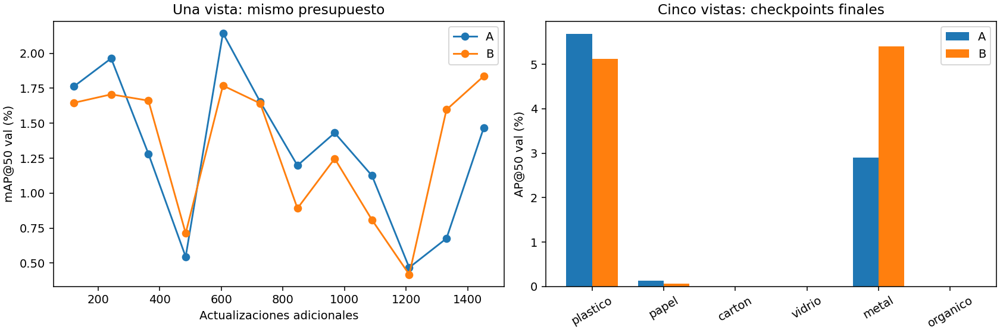
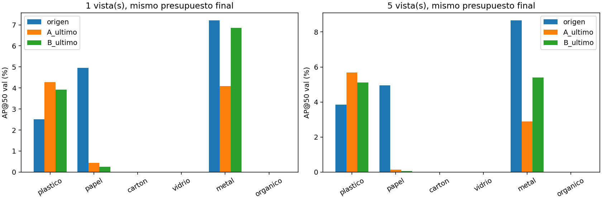
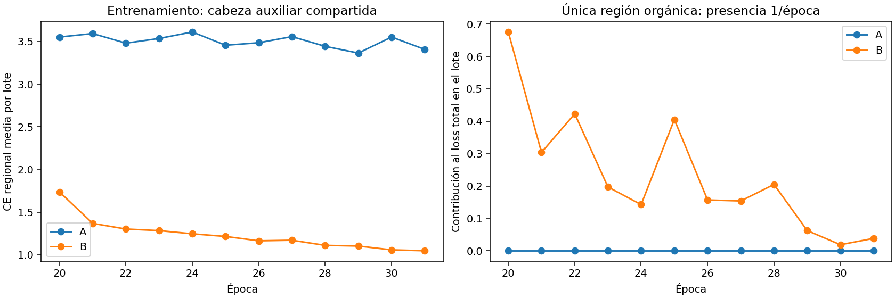

# A/B regional completo y reanudación segura

**Completadas A=0 y B=0,25: 1.452 actualizaciones por rama, 12 épocas adicionales. Test reservado; referencia original intacta.**

## Reanudación implementada y ejercitada

Pasaron **136 pruebas** sin fallos. Las siete pruebas nuevas incluyen las dos ramas y el presupuesto completo sobre un modelo pequeño CPU, interrupción dentro de una época (tres pasos descartados), recuperación del checkpoint publicado sin registro, exclusión mutua, aliases ajenos, cambios de protocolo/código/RNG y corrupción de trazas/historial.

Cada época terminada publica un checkpoint inmutable `checkpoints/supervision_regional_ep19_v1_A/B_epoca_NNN.pt` y un registro JSON inmutable en `resultados/supervision_regional_ep19_v1/rama_A/B/`. Cada registro contiene el SHA del checkpoint, huellas de los cuatro estados y SHA del registro anterior. El archivo se sincroniza antes de publicarse sin reemplazo. Un bloqueo del sistema operativo impide dos escritores sobre la misma rama y se libera al finalizar el proceso.

Un corte dentro de una época retoma la última época confirmada; se repite el trabajo no confirmado y no se cuenta dos veces en el presupuesto duradero. Si el checkpoint quedó completo pero falta su registro, `--reanudar` lo valida y completa el commit. Un temporal incompleto no se adopta. Se rechazan huecos, otra rama, código/datos/diagnóstico/protocolo distintos, pesos de clase alterados, pasos AdamW incoherentes y trazas no previstas. Los aliases `_ultimo.pt` y `_mejor.pt` son copias derivadas: solo se reemplazan si pertenecen al mismo diario; todos los checkpoints históricos permanecen disponibles.

Las ejecuciones reales CUDA de A y B se detuvieron de forma controlada al terminar época 20 (121 actualizaciones) y se reanudaron en procesos nuevos hasta época 31. Se verificaron los hashes de pesos, AdamW, scaler y RNG al restaurar. El contador final de AdamW es **3.751** en ambas ramas (2.299+1.452), LR 0,0005; no hubo reinicio de warmup ni parada temprana. Las doce trazas coinciden con el plan y entre ramas.

La identidad numérica entre continuo/reanudado se comprobó únicamente en la fixture CPU de las pruebas. No se ejecutó una segunda trayectoria CUDA completa sin interrupción, por lo que **no se afirma identidad bit a bit del entrenamiento CUDA**. La coincidencia exacta de inferencia congelada y la restauración exacta del estado serializado son comprobaciones diferentes.

## Controles regenerados

Diagnóstico nuevo: [diagnostico_revision04.json](../resultados/supervision_regional_preparacion/diagnostico_revision04.json). Verificación nueva: [regresion_val_revision04.json](../resultados/supervision_regional_preparacion/regresion_val_revision04.json). Ambos contienen las huellas vigentes; el entrenador exigió su aprobación antes de habilitarse. Se repitieron memorización train (pesos descartados), gradientes AMP e inferencia congelada de 181 escenas val con una y cinco vistas, con predicciones idénticas a las históricas.

Se comprobaron al final **318 archivos históricos** sin cambios, incluyendo V17, resultados anteriores, checkpoint de referencia, clasificador independiente y selección de arquitectura. Se mantienen fondo=3, argmax, área mínima 2, umbral 0,05, umbral visual 0,35, auxiliar global=0,5 y los seis pesos regionales train de V17.

## Detección en validación

La comparación principal usa los checkpoints finales al mismo presupuesto. El mejor se selecciona exclusivamente por mAP@50 val de una vista; los empates conservan la primera época. Se presenta aparte y puede corresponder a presupuestos anteriores distintos.

| Modelo | Época | Vistas | mAP@50 | mAP@50:95 | Recall | Precisión | TP | FP | FN | AP50 cartón |
|---|---:|---:|---:|---:|---:|---:|---:|---:|---:|---:|
| Referencia | 19 | 1 | 2.446 % | 0.449 % | 11.080 % | 6.116 % | 40 | 614 | 321 | 0.000 % |
| Referencia | 19 | 5 | 2.912 % | 0.755 % | 20.499 % | 3.023 % | 74 | 2374 | 287 | 0.000 % |
| A final | 31 | 1 | 1.467 % | 0.331 % | 11.634 % | 7.763 % | 42 | 499 | 319 | 0.000 % |
| A final | 31 | 5 | 1.453 % | 0.384 % | 20.499 % | 3.653 % | 74 | 1952 | 287 | 0.000 % |
| B final | 31 | 1 | 1.837 % | 0.416 % | 11.357 % | 7.946 % | 41 | 475 | 320 | 0.000 % |
| B final | 31 | 5 | 1.765 % | 0.483 % | 20.776 % | 3.728 % | 75 | 1937 | 286 | 0.000 % |
| A mejor | 24 | 1 | 2.144 % | 1.003 % | 11.357 % | 7.635 % | 41 | 496 | 320 | 0.000 % |
| A mejor | 24 | 5 | 1.748 % | 0.682 % | 21.053 % | 3.645 % | 76 | 2009 | 285 | 0.000 % |
| B mejor | 31 | 1 | 1.837 % | 0.416 % | 11.357 % | 7.946 % | 41 | 475 | 320 | 0.000 % |
| B mejor | 31 | 5 | 1.765 % | 0.483 % | 20.776 % | 3.728 % | 75 | 1937 | 286 | 0.000 % |

### AP@50 por material, 1 vista(s)

| Material | Referencia | A final | B final | A mejor | B mejor |
|---|---:|---:|---:|---:|---:|
| plastico | 2.510 % | 4.280 % | 3.917 % | 3.521 % | 3.917 % |
| papel | 4.950 % | 0.438 % | 0.248 % | 3.795 % | 0.248 % |
| carton | 0.000 % | 0.000 % | 0.000 % | 0.000 % | 0.000 % |
| vidrio | 0.000 % | 0.000 % | 0.000 % | 0.000 % | 0.000 % |
| metal | 7.217 % | 4.084 % | 6.856 % | 5.548 % | 6.856 % |
| organico | 0.000 % | 0.000 % | 0.000 % | 0.000 % | 0.000 % |

### AP@50 por material, 5 vista(s)

| Material | Referencia | A final | B final | A mejor | B mejor |
|---|---:|---:|---:|---:|---:|
| plastico | 3.857 % | 5.686 % | 5.115 % | 4.926 % | 5.115 % |
| papel | 4.950 % | 0.135 % | 0.064 % | 1.147 % | 0.064 % |
| carton | 0.000 % | 0.000 % | 0.000 % | 0.000 % | 0.000 % |
| vidrio | 0.000 % | 0.000 % | 0.000 % | 0.000 % | 0.000 % |
| metal | 8.667 % | 2.894 % | 5.408 % | 4.416 % | 5.408 % |
| organico | 0.000 % | 0.000 % | 0.000 % | 0.000 % | 0.000 % |

## Aprendizaje regional y confusión de cartón

Las mediciones siguientes usan polígonos GT exclusivamente de train. La cabeza auxiliar compartida tiene seis materiales; la cabeza de mapas tiene fondo y seis materiales. No se confunden estas métricas con AP de cajas.

| Modelo | Exactitud auxiliar regional | CE regional | Cartón→plástico mapas | Cartón→metal mapas | Cartón→fondo mapas | Cartón correcto mapas |
|---|---:|---:|---:|---:|---:|---:|
| origen | 8.528 % | 3.5291 | 52 | 14 | 47 | 33 |
| A_ultimo | 9.020 % | 3.6045 | 42 | 13 | 52 | 36 |
| B_ultimo | 73.883 % | 0.9461 | 44 | 12 | 53 | 35 |
| A_mejor | 8.487 % | 3.4055 | 49 | 8 | 51 | 37 |
| B_mejor | 73.883 % | 0.9461 | 44 | 12 | 53 | 35 |

En cinco vistas y presupuesto final, B−A en AP50 de cartón: **+0.000 puntos porcentuales**; en mAP50 global: **+0.312 puntos porcentuales**.

La supervisión regional no mejora AP@50 de cartón frente al control al presupuesto final.
El mAP@50 global también mejora frente al control.

La exactitud de la cabeza auxiliar regional pasa de 9.020 % a 73.883 %, pero en la cabeza de mapas cartón→plástico/metal pasa de 55/146 (37.671 %) a 56/146 (38.356 %). El número de regiones cartón correctamente clasificadas por mapas pasa de 36 a 35. **Aprender en la cabeza auxiliar no resolvió la confusión objetivo de la cabeza de mapas.**

### Auditoría de los 25 GT de cartón en val, cinco vistas

| Modelo | Correctos | Sin cobertura | Geometría incorrecta | Material equivocado | A plástico | A metal |
|---|---:|---:|---:|---:|---:|---:|
| origen | 0 | 5 | 6 | 14 | 11 | 3 |
| A_ultimo | 0 | 6 | 6 | 13 | 10 | 2 |
| B_ultimo | 0 | 5 | 6 | 14 | 12 | 1 |
| A_mejor | 0 | 6 | 5 | 14 | 10 | 3 |
| B_mejor | 0 | 5 | 6 | 14 | 12 | 1 |

La variante final sigue por debajo del mAP@50 de referencia. La pequeña ganancia de B frente a A final se acompaña de AP de cartón/vidrio/orgánico cero y deterioros en otros materiales respecto al origen. **Se conserva la referencia original; esta evidencia no justifica adoptar B como detector predeterminado.**

El JSON de evaluación conserva además IoU semántico train, confusiones completas de ambas cabezas, auditoría de cartón con caja razonable y material equivocado en val, y resúmenes al umbral visual 0,35.

## Única región orgánica

Región: `{'imagen': 'taco:92', 'id_region': 244, 'indice_train': 85, 'peso': 25.050201416015625}`. Presente exactamente una vez en cada época de cada rama: **12 presencias por rama**. Su peso **25.05020142** se conserva. Cada evento registra imagen, instancia, índice, paso, CE, denominador del lote, numerador ponderado, contribución a CE regional, contribución al loss total y si participa en el gradiente.

| Rama | Presencias | CE orgánica media | Contribución media al loss total en lotes con presencia |
|---|---:|---:|---:|
| A | 12 | 1.035885 | 0.000000 |
| B | 12 | 1.582755 | 0.231829 |

La contribución a la optimización regional de A es cero; sus mediciones se calculan sin gradiente. El peso elevado de B procede de una sola instancia y no representa diversidad ni evidencia de generalización orgánica. Cuatro de los cinco GT orgánicos siguen excluidos por la política de regiones válidas.

## Coste y reproducibilidad

| Rama | Tiempo acumulado entrenamiento y val por época | Pico GPU asignado | Pico GPU reservado |
|---|---:|---:|---:|
| A | 145.1 s | 496.7 MiB | 586.0 MiB |
| B | 143.2 s | 496.7 MiB | 586.0 MiB |

El tiempo excluye intervalos con el proceso detenido y la preparación inicial de datos; incluye validación de una vista y trabajo de registro previo al último commit. La evaluación adicional de una/cinco vistas registra su propio coste. Las diferencias dependen del estado térmico, cachés e I/O de OneDrive, además de la pérdida adicional.

```powershell
$pythonEco = Join-Path $env:USERPROFILE '.venvs\EcoWasteFormer\Scripts\python.exe'
& $pythonEco scripts/supervision_regional_materiales.py --entrenar --rama A --hasta-epoca 20
& $pythonEco scripts/supervision_regional_materiales.py --entrenar --rama A --reanudar
& $pythonEco scripts/supervision_regional_materiales.py --entrenar --rama B --hasta-epoca 20
& $pythonEco scripts/supervision_regional_materiales.py --entrenar --rama B --reanudar
& $pythonEco scripts/evaluar_supervision_regional.py
python scripts/graficar_supervision_regional.py --salida-dir resultados/supervision_regional_ep19_v1_graficas
& $pythonEco scripts/informar_supervision_regional.py
& $pythonEco scripts/verificar_entrega_regional.py
```

Son los comandos de la ejecución completada; las rutas existentes se rechazan para impedir sobrescrituras. No deben relanzarse como experimento nuevo.

## Evidencia y límites

- [Entrenamiento completo](../resultados/supervision_regional_ep19_v1.json).
- [Evaluación y métricas completas](../resultados/supervision_regional_ep19_v1_evaluacion.json).
- [Registro comparativo e integridad](../resultados/supervision_regional_reanudacion/comparacion.json).




Una sola semilla y una partición de validación ya reutilizada limitan la atribución causal y no permiten afirmar significación estadística. No se evaluó test. El AP usa el evaluador propio de 101 puntos, no COCOeval oficial. Las regiones pequeñas pueden mezclar fondo dentro de un token, y los tokens fusionados contienen contexto. La precisión del detector sigue siendo un criterio de aceptación junto a recall, AP por material, FP, confusiones y coste. **No se modifica automáticamente el checkpoint predeterminado**.
