# Auditoría de propuestas internas del detector seleccionado

**Auditoría sin entrenamiento. Se conserva el detector original de época 19; no se adopta la variante regional B.**

## Alcance e integridad

Se auditaron **181 imágenes de validación, 905 vistas y 361 GT**. Pasaron **149 pruebas** (136 anteriores y 13 nuevas). La instrumentación conservó exactamente cajas, materiales, puntuaciones y orden final de las 181 escenas. Cada vista se comprobó también contra `cajas_desde_mapas` y cada combinación contra `combinar_vistas`. Se verificaron 485 archivos protegidos: pesos, arquitectura, configuración de entrenamiento, código de producción y resultados históricos.

Se realizaron 181 forwards del modelo, cada uno con cinco vistas; 0 escenas reutilizaron logits previos de la caché. Los mismos logits alimentaron todos los análisis y regresiones. Caché local: `datos/cache/logits_auditoria_4178d5d68d65e4749545`, con hashes de tensores, checkpoint, val, código de producción y entorno. Las trazas tensoriales y logits están excluidos de Git como los demás `.pt`; se reconstruyen con el script. No hay nuevas pérdidas, entrenamiento, checkpoints ni cambios de umbrales.

La captura acepta solo ID, ruta, tamaño y hash de imagen. No recibe GT. Las anotaciones y polígonos se abren después de cerrar la captura. El análisis usa exclusivamente registros val; no se selecciona ni evalúa la partición test. El archivo TACO original contiene el índice general de anotaciones, pero solo se consultan los polígonos correspondientes a val.

## Etapas y procedencia

Se registran las celdas elegibles antes de componentes, los componentes conexos de ocho vecinos (incluidos los de área uno), el filtro de dos celdas, recorte a contenido, NMS y top100 por vista, filtros de bordes internos, proyección a imagen completa, NMS y top100 globales, salida de evaluación a 0,05 y filtro visual posterior a 0,35.

Cada propuesta conserva ID estable, imagen, vista, material, puntuación, caja local y/o global, etapa, motivo de descarte y supresor cuando corresponde. Las celdas apuntan al componente que las agrupa. `vistas.json` permite deshacer letterbox y recuperar coordenadas originales. El registro `propuestas.jsonl.gz` conserva las etapas sin depender de figuras.

El NMS original se detiene al elegir 100 cajas. Las curvas con asterisco muestran **NMS ilimitado contrafactual**, calculado solo para separar supresión y límite: el prefijo de 100 se comprueba contra producción. Una caja no examinada por alcanzar 100 no se atribuye a una supresión posterior hipotética. Los contadores de `descartes_reales` conservan esa distinción.

| Etapa | Propuestas totales | Plástico | Papel | Cartón | Vidrio | Metal | Orgánico | GT con caja correcta IoU≥0,5 |
|---|---:|---:|---:|---:|---:|---:|---:|---:|
| componentes | 4441 | 2520 | 341 | 506 | 114 | 952 | 8 | 88 |
| area_minima | 3078 | 1878 | 198 | 328 | 47 | 625 | 2 | 87 |
| recorte_contenido | 3078 | 1878 | 198 | 328 | 47 | 625 | 2 | 87 |
| nms_vista | 3078 | 1878 | 198 | 328 | 47 | 625 | 2 | 87 |
| top100_vista | 3078 | 1878 | 198 | 328 | 47 | 625 | 2 | 87 |
| bordes | 2846 | 1741 | 167 | 302 | 47 | 587 | 2 | 82 |
| nms_global | 2560 | 1544 | 153 | 283 | 47 | 531 | 2 | 74 |
| top100_global | 2560 | 1544 | 153 | 283 | 47 | 531 | 2 | 74 |
| final | 2560 | 1544 | 153 | 283 | 47 | 531 | 2 | 74 |
| visual035 | 1715 | 1166 | 47 | 194 | 5 | 303 | 0 | 64 |

El conteo de GT con caja razonable es un techo por existencia de candidato, no recall real ni AP: permite que una misma caja coincida con varios GT y no penaliza FP. Las métricas reales se calculan con la asignación habitual uno a uno. Las uniones de fragmentos también son oráculos de análisis; nunca se convierten en propuestas del detector.

Las 2.560 cajas finales incluyen 112 predicciones que el evaluador omite por regiones GT ignoradas. No se eliminan durante inferencia: por eso TP+FP=2.448 no coincide con el total de propuestas. El GT interviene en esta contabilidad solo durante el análisis.

De las 14 pérdidas de oportunidad, la primera etapa que deja al GT sin caja correcta se distribuye así: **{'nms_global': 8, 'bordes': 5, 'area_minima': 1}**. No se pierde ninguna oportunidad por top100 ni por NMS de una vista en esta validación. Esto no garantiza que relajar filtros recupere ese número de TP: también reaparecerían FP y cambiaría la competencia entre cajas.

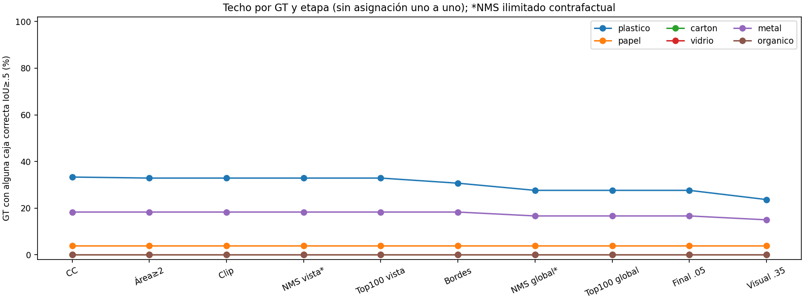

## Criterios de diagnóstico

La causa principal usa esta prioridad: TP real; pérdida en postprocesamiento si existía una caja correcta IoU≥0,5 antes de filtros y ya no existe al final; fusión sustentada por máscaras; fragmentación sustentada por máscaras; material incorrecto; ausencia de respuesta foreground; geometría insuficiente. Se separan los GT sin soporte no ambiguo. Los indicadores de fusión y fragmentación no excluyentes se guardan además de la causa principal.

- **Fusión:** el mismo componente cubre al menos 50 % de los píxeles GT de dos o más instancias útiles. Para atribuirla al GT auditado, el componente lleva su material. No basta una caja grande que encierre dos objetos.
- **Fragmentación:** al menos dos componentes del material correcto cubren cada uno ≥10 % del GT; juntos cubren ≥50 %, su envolvente tiene IoU≥0,5 y ninguno alcanza individualmente 0,5.
- **Material incorrecto:** hay una caja razonable de otro material sin caja razonable correcta, o hay respuesta FG dentro del polígono y ninguna celda del material correcto.
- **Ausencia de respuesta FG:** todas las celdas observables del polígono quedan en fondo en las vistas útiles. No equivale a que la probabilidad bruta del material sea exactamente cero.
- **Geometría insuficiente:** respuesta parcial o forma/tamaño/desplazamiento que no alcanza una caja correcta y no satisface las evidencias anteriores. Puede incluir asignación compartida sin evidencia suficiente de fusión.

La respuesta se mide con cobertura fraccional de polígonos rasterizados a 384 y reducidos a 48. Se excluyen padding, celdas con varios materiales GT y regiones ignoradas. Una vista es útil si contiene ≥80 % de la caja GT; la vista completa permanece disponible. Esto evita interpretar la falta de respuesta en un recorte que apenas ve el objeto. Se conservan respuesta correcta, respuesta FG, fondo, probabilidad GT media/máxima y probabilidad GT≥0,05 por objeto y vista.

## Diagnóstico por clase

| Material | GT | TP | Pérdida filtros | Fusión | Fragmentación | Material incorrecto | Sin FG | Geometría | GT sin soporte |
|---|---:|---:|---:|---:|---:|---:|---:|---:|---:|
| plastico | 228 | 63 | 13 | 19 | 0 | 20 | 50 | 59 | 4 |
| papel | 25 | 1 | 0 | 0 | 0 | 12 | 10 | 2 | 0 |
| carton | 25 | 0 | 0 | 0 | 0 | 20 | 1 | 3 | 1 |
| vidrio | 22 | 0 | 0 | 0 | 0 | 13 | 9 | 0 | 0 |
| metal | 60 | 10 | 1 | 2 | 0 | 22 | 18 | 6 | 1 |
| organico | 1 | 0 | 0 | 0 | 0 | 0 | 1 | 0 | 0 |

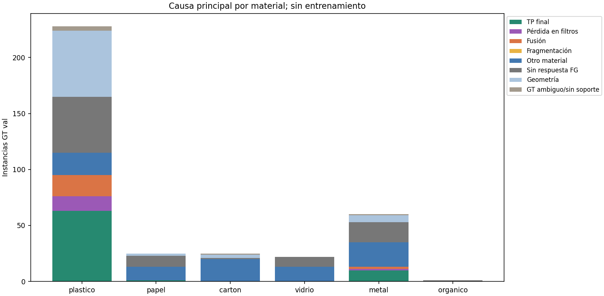

### Cartón y vidrio

**carton:** 25 GT, 0 TP. Existían 0 GT con alguna caja correcta antes de filtros y 0 al final. Causas principales: {'material_incorrecto': 20, 'ausencia_respuesta_fg': 1, 'geometria_insuficiente': 3, 'sin_soporte_gt_no_ambiguo': 1}. Indicadores adicionales: 0 fragmentación y 0 fusión.

**vidrio:** 22 GT, 0 TP. Existían 0 GT con alguna caja correcta antes de filtros y 0 al final. Causas principales: {'material_incorrecto': 13, 'ausencia_respuesta_fg': 9}. Indicadores adicionales: 0 fragmentación y 0 fusión.

La fragmentación no alcanzó el criterio conservador de confirmación en esta validación: cero uniones con cobertura e IoU suficientes. Esto no demuestra que nunca existan mapas fragmentados; los componentes dispersos que no cubren suficiente GT quedan en geometría insuficiente. Las fusiones se concentran en plástico y metal, con 29 indicadores y 21 causas principales; algunas cajas fusionadas todavía pueden contar como TP para uno de los objetos.

## Efecto del tamaño

| Lado menor a 384 px | GT | TP | Sin FG | Material incorrecto | Geometría/fusión/fragmentación | Pérdida filtros | Supera 8 px en alguna vista útil |
|---|---:|---:|---:|---:|---:|---:|---:|
| menos_8_px | 73 | 4 | 46 | 7 | 15 | 0 | 30 |
| 8_a_16_px | 84 | 15 | 21 | 22 | 22 | 2 | 0 |
| 16_a_32_px | 119 | 30 | 20 | 29 | 32 | 7 | 0 |
| 32_px_o_mas | 85 | 25 | 2 | 29 | 22 | 5 | 0 |

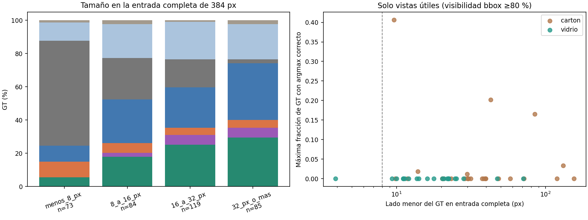

El tamaño es una asociación observacional, no una intervención causal de resolución. Las cinco vistas aumentan como máximo aproximadamente 1/0,65 la escala para un objeto contenido en un recorte. Que un objeto supere ocho píxeles no demuestra que el token sea puro ni que la clase esté aprendida. El JSON incluye el cruce de seis materiales y cuatro tamaños para evitar que la distribución de plástico determine por sí sola la conclusión.

Para cartón no hay GT menores de ocho píxeles: 12 de 25 tienen lado menor ≥32 px y 10 de esos 12 fallan por material incorrecto. En vidrio hay un GT <8 px y ocho de 8–16 px; siete de los nueve casos sin FG pertenecen a esas dos bandas. Pero los 13 vidrios ≥16 px también fallan: 11 por material y dos sin FG. **La resolución agrava la ausencia de respuesta en objetos pequeños, pero no explica por sí sola el AP cero de cartón y vidrio.**

## Qué etapa conviene investigar después

En los FN, las causas principales vinculadas a respuesta/material suman **176**; geometría/fusión/fragmentación suman **91**; pérdida real de una oportunidad de caja por filtros suma **14**. La prioridad general respaldada por esta partición es **cabeza_de_mapas**. Las categorías son diagnósticos conservadores y dependientes de sus criterios; no constituyen una prueba causal de que una modificación concreta funcionará.

Orden recomendado para el siguiente trabajo:

1. **Cabeza de mapas/representación semántica:** estudiar la respuesta espacial de las siete clases sobre GT real, especialmente cartón y vidrio. No usar la mejora de la cabeza auxiliar global de V17/V18 como sustituto de evidencia en mapas. La captura muestra cero cajas correctas de esos materiales antes de los filtros, incluso con objetos grandes.
2. **Localización de instancias:** investigar separación de componentes que mezclan objetos y geometría de regiones. Es un problema secundario importante, sobre todo en plástico; 21 FN tienen fusión como causa principal y 70 geometría insuficiente.
3. **Resolución de pequeños:** plantear una comparación controlada aparte para GT <8 px y vidrio de 8–16 px. La asociación con fondo es fuerte, pero aumentar resolución no resolvería la confusión observada en cartones grandes.
4. **Postprocesamiento:** prioridad menor para el objetivo cartón/vidrio. Top100 no está saturando ni elimina oportunidades; los filtros solo explican 14 de 287 FN, ninguno de cartón o vidrio. Mantener por ahora la política seleccionada.

No se recomienda retirar filtros, aumentar top100 ni implementar otra pérdida automáticamente. Primero deben usarse los IDs y mapas de esta auditoría para definir una sola intervención verificable, manteniendo la referencia actual y una comparación controlada.

## Ejemplos visuales

Selección determinista del primer GT por material y causa (orden ID imagen/instancia), con prioridad a cartón y vidrio. Se añaden evidencias de filtros, fragmentación y fusión cuando existen. Son ejemplos explicativos, no una estimación de prevalencia. Verde indica que el componente llegó a la salida final de alguna vista; rojo, que fue descartado. El contorno original puede extenderse fuera del contenido del recorte, incluso sobre el padding visual; el análisis excluye ese padding y usa solo la porción visible.

### taco:1499 / GT 4783: carton — ausencia_respuesta_fg

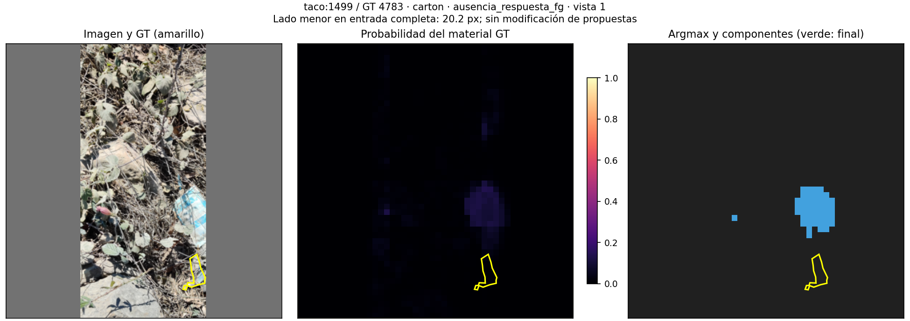

### taco:1484 / GT 4717: carton — geometria_insuficiente

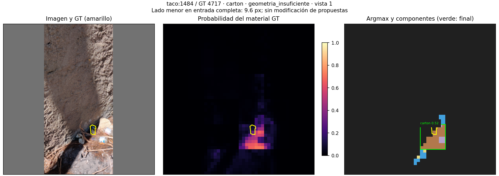

### taco:1450 / GT 4595: carton — material_incorrecto

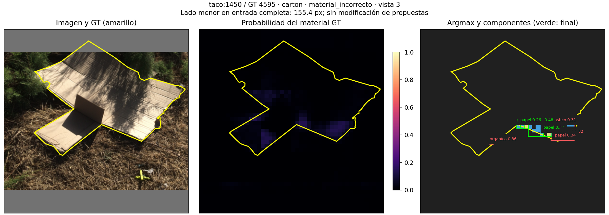

### taco:689 / GT 2209: carton — sin_soporte_gt_no_ambiguo

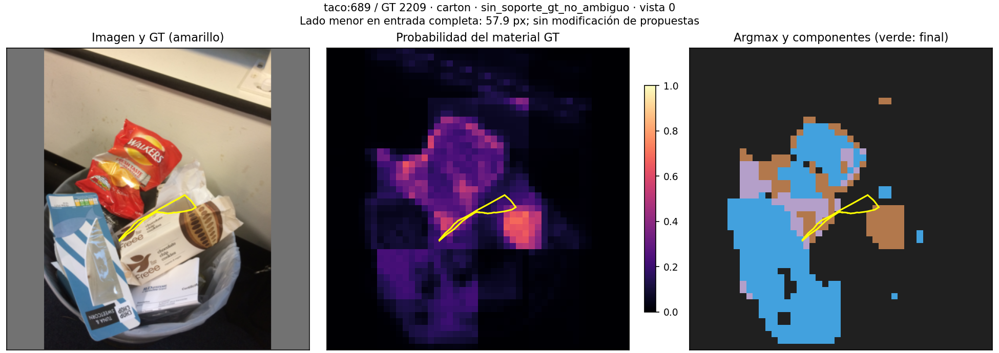

### taco:1451 / GT 4600: vidrio — ausencia_respuesta_fg

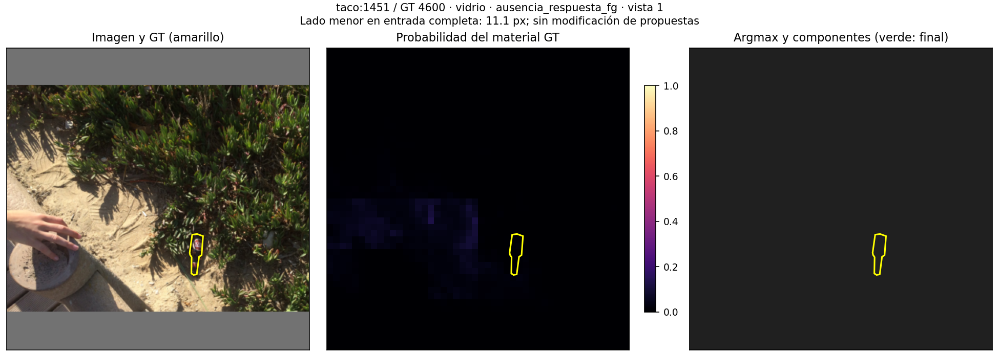

### taco:1476 / GT 4687: vidrio — material_incorrecto

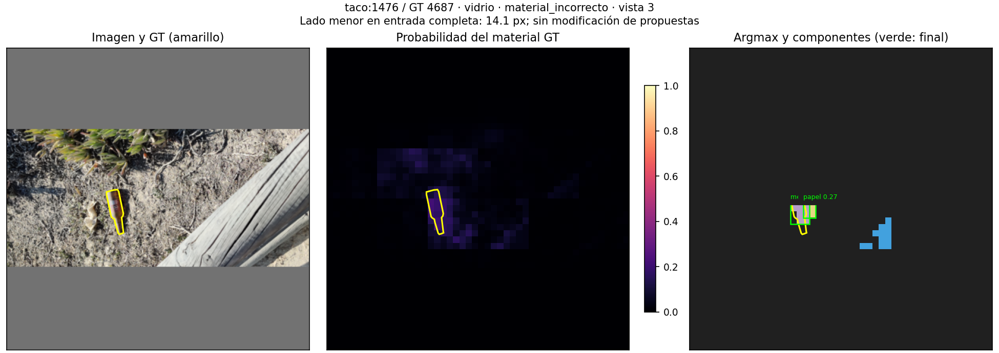

### taco:1402 / GT 4480: plastico — ausencia_respuesta_fg

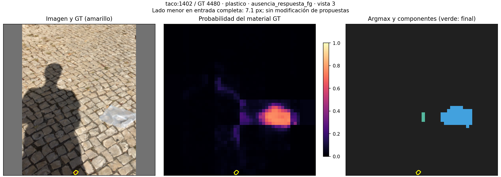

### taco:1400 / GT 4474: plastico — correcto

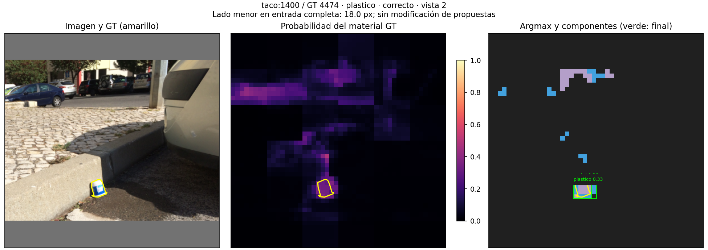

### taco:1408 / GT 4495: plastico — fusion_objetos

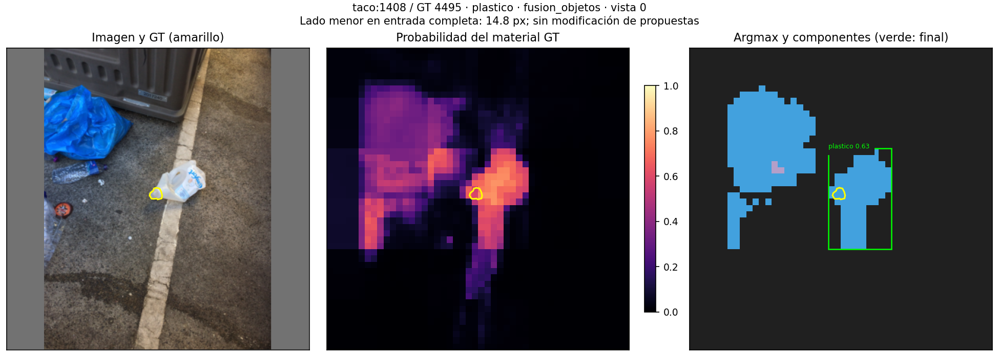

### taco:1403 / GT 4482: plastico — geometria_insuficiente

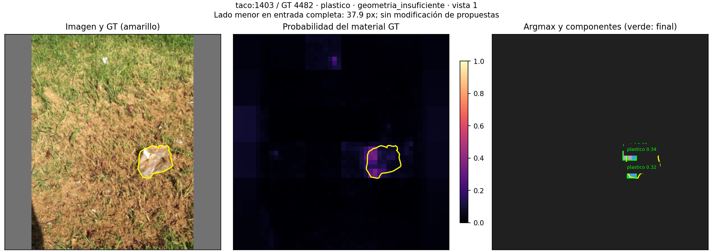

### taco:1400 / GT 4476: plastico — material_incorrecto

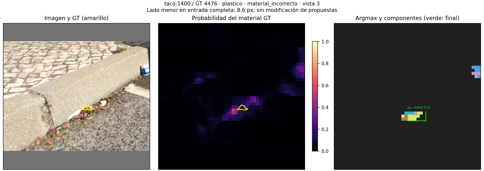

### taco:1406 / GT 4489: plastico — perdida_postprocesamiento

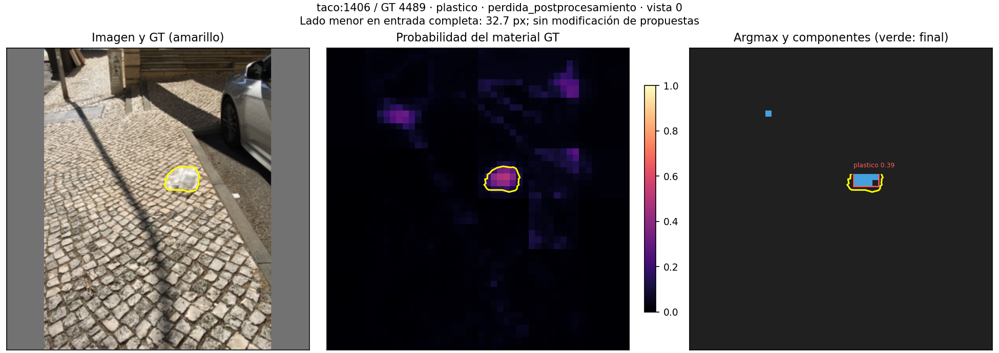

### taco:1495 / GT 4769: plastico — sin_soporte_gt_no_ambiguo

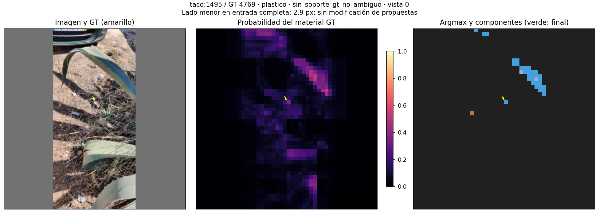

### taco:1400 / GT 4475: papel — ausencia_respuesta_fg

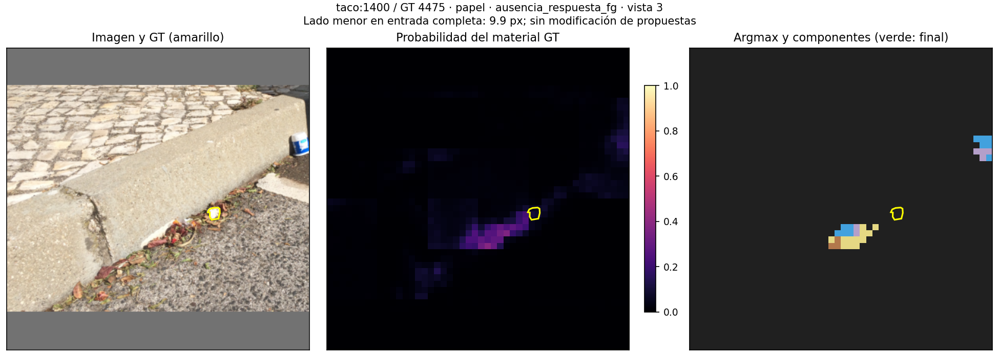

### taco:712 / GT 2264: papel — correcto

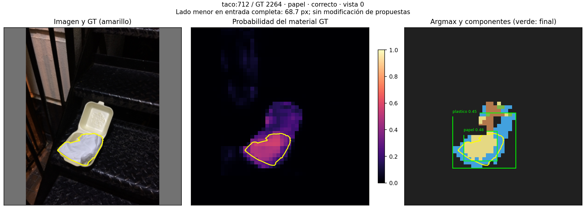

### taco:1415 / GT 4522: papel — geometria_insuficiente

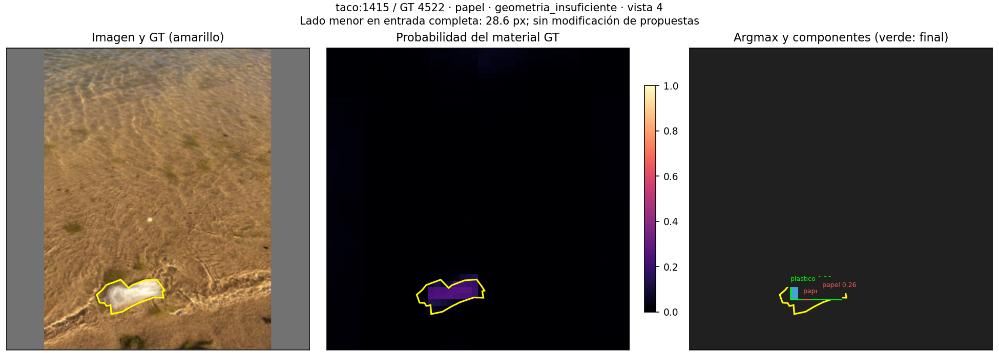

### taco:1427 / GT 4544: papel — material_incorrecto

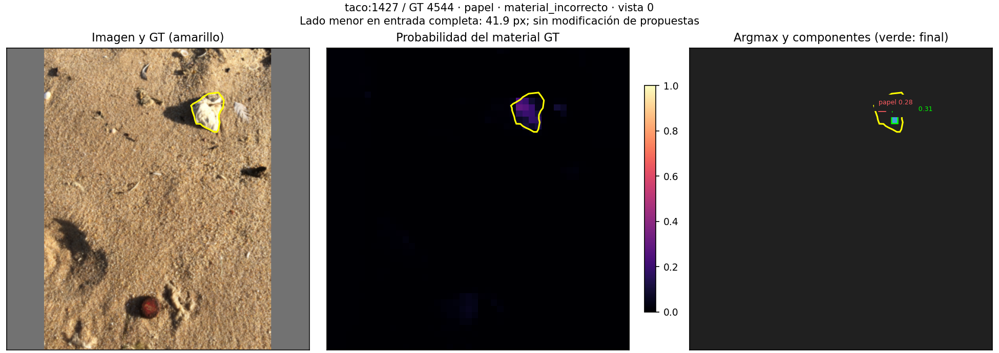

### taco:1427 / GT 4543: metal — ausencia_respuesta_fg

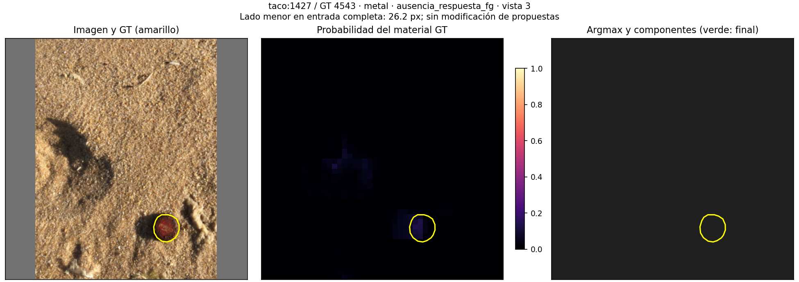

## Reproducción, métricas y límites

La salida final reproduce mAP@50 **2.912288 %**, mAP@50:95 **0.754917 %**, recall **20.498615 %**, precisión **3.022876 %**, TP=74, FP=2374, FN=287. AP50 de cartón/vidrio sigue en cero. No se modificaron pesos ni selección.

```powershell
$pythonEco = Join-Path $env:USERPROFILE '.venvs\EcoWasteFormer\Scripts\python.exe'
& $pythonEco scripts/auditar_propuestas_internas.py
& $pythonEco scripts/auditar_propuestas_internas.py --fase captura --salida resultados/auditoria_nueva
& $pythonEco scripts/auditar_propuestas_internas.py --fase analisis --salida resultados/auditoria_nueva
python scripts/informar_propuestas_internas.py
& $pythonEco scripts/verificar_propuestas_internas.py
```

Las rutas existentes se rechazan para preservar evidencia. Para repetir, usar salida nueva; la caché permite cero nuevos forwards. El análisis de trazas ya capturadas se ejecuta en CPU. El observador necesita CUDA al reproducir softmax de logits AMP para conservar exactamente el redondeo de producción. No se afirma equivalencia numérica entre backends distintos.

- [Resumen y métricas completas](../resultados/auditoria_propuestas_internas_v1/analisis.json).
- [361 objetos GT](../resultados/auditoria_propuestas_internas_v1/objetos_gt.json).
- [Tabla por objeto](../resultados/auditoria_propuestas_internas_v1/objetos_gt.csv).
- [Tabla por etapa/material](../resultados/auditoria_propuestas_internas_v1/etapas.csv).
- [Propuestas con procedencia y descarte](../resultados/auditoria_propuestas_internas_v1/propuestas.jsonl.gz).
- [Metadatos de captura y caché](../resultados/auditoria_propuestas_internas_v1/captura.json).

La validación se ha reutilizado durante el proyecto: sus resultados no son evidencia independiente ni una estimación de test. Las coincidencias de caja a IoU 0,5 y las máscaras rasterizadas no prueban por sí solas identidad física de instancias; solapes, anotaciones ambiguas y objetos pequeños limitan las atribuciones. Se conserva el caso sin soporte GT para no culpar al modelo por un diagnóstico no observable. El AP es el evaluador propio de 101 puntos, no COCOeval oficial. No se ha probado una corrección ni entrenado otra variante.
