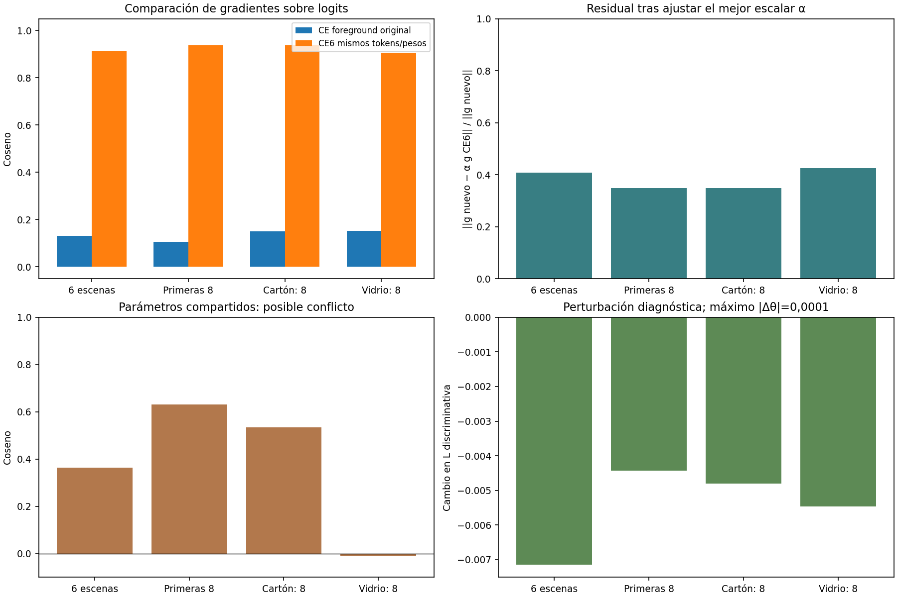
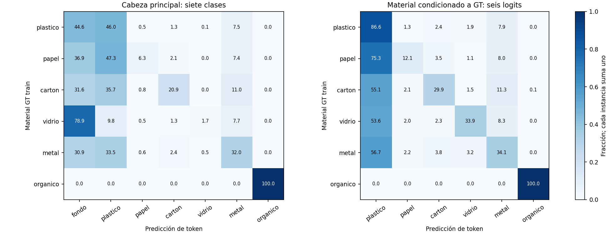
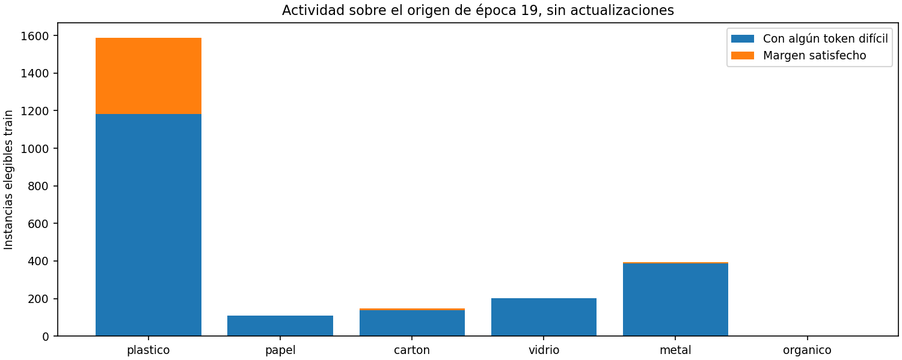
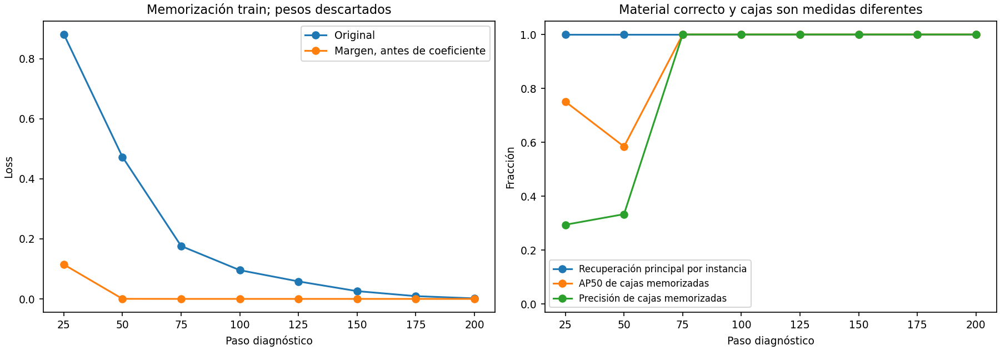

# V20: aprendizaje discriminativo en la cabeza principal de mapas

**Preparación verificada y diagnóstico train-only aprobado. No se inició A/B completo, no se volvió a evaluar val y test permanece reservado.** La referencia de época 19 y mAP50 val histórico 2,912 % continúa seleccionada.

## Revisión previa de formulaciones

| Informe | Resultado relevante | Decisión para V20 |
|---|---|---|
| 8 | Separar presencia binaria/material condicional sustituyó la pérdida e interpretación y obtuvo mAP50 0,495 %; no se adoptó. Reclasificar recortes con la cabeza auxiliar tampoco ayudó. | Mantener softmax7, la arquitectura y la interpretación de inferencia. No añadir CE6 como otra formulación de presencia/material. |
| 13 | Fondo=1 redujo FN semánticos, pero aumentó FP y no superó la referencia en cinco vistas. | Fondo=3 permanece; no repetir la ablación. |
| 17 | Pooling GT y CE regional sobre la cabeza auxiliar compartida; una sola región orgánica elegible recibía peso 25,0502. | Reutilizar únicamente la geometría validada de regiones, no el pooling ni la cabeza auxiliar como destino. Controlar los pesos nuevos. |
| 18 | B elevó exactitud auxiliar regional 9,02→73,88 %, pero cartón AP50=0 y mAP50 de cinco vistas 1,765 % < referencia 2,912 %. | La medición primaria será la cabeza principal, no el acierto de la auxiliar. |
| 19 | Cero cajas correctas IoU≥0,5 de cartón/vidrio antes de filtros; 176 FN de respuesta/material, 91 geometría/fusión y 14 filtros. | Intervenir en discriminación de mapas; conservar argmax, cinco vistas, NMS, área y umbrales. |

Los resultados históricos no se reescriben y no constituyen una nueva evaluación de V20. Las dos pérdidas que se compararán usan exactamente la arquitectura, máscaras semánticas y datos originales; la única diferencia prevista es el sumando discriminativo descrito abajo.

## Auditoría de la pérdida vigente

Para tokens válidos F de foreground, B de fondo y clases materiales presentes P:

`Lmapas = Σ(i∈F) w[y_i]·CE7(z_i,y_i) / Σ(i∈F) w[y_i] + 3·mean(i∈B) CE7(z_i,0) + mean(c∈P) Dice_c`.

Se ignora 255. La CE foreground usa softmax de siete clases, incluido fondo. No es una pérdida que ignore la confusión entre materiales:

`∂Lfg/∂z[i,k] = w[y_i]/Σ_F w[y] · (softmax7(z_i)[k] − 1[k=y_i])`.

Por tanto, en cartón GT (canal 3), plástico (1) y metal (5) ya reciben derivadas positivas si tienen probabilidad; el descenso aumenta cartón y reduce esos rivales. En vidrio GT (4), todos los otros materiales y el fondo se penalizan de la misma forma. El coeficiente 3 actúa sobre la **media** CE de fondo, no sobre la suma de todos sus píxeles.

Los pesos históricos proceden únicamente de frecuencias de celdas semánticas train: inversa de raíz, normalización por media de materiales y clamp máximo 3. Son pesos por celda, no por instancia. Una instancia grande aporta más celdas al promedio foreground. Los valores que se conservaron son:

| Material | Peso CE foreground existente | Peso exclusivo del término V20 |
|---|---:|---:|
| plastico | 0.13340366 | 1.0 |
| papel | 0.46945813 | 1.0 |
| carton | 0.31428981 | 2.0 |
| vidrio | 0.56620467 | 2.0 |
| metal | 0.30802488 | 1.0 |
| organico | 3.00000000 | 1.0 |

`Dice_c = 1 − (2Σ p_c·t_c + ε)/(Σp_c² + Σt_c² + ε)`, con probabilidades softmax7 y máscara válida. Para una clase presente, su derivada respecto a p[i,c] es `−2t[i,c]/D_c + 2p[i,c]·N_c/D_c²`. Penaliza falta de solapamiento y masa incorrecta; la cadena del softmax acopla los rivales. Solo se promedian las clases presentes en el lote: una clase ausente no añade su propio Dice, aunque sí puede recibir gradiente por el softmax de otras clases y por CE. No hay normalización por objeto ni selección explícita del rival más fuerte.

La descomposición se verificó numéricamente contra `perdida_mapas` sin modificarla. La clasificación global RealWaste conserva su CE con coeficiente 0,5; no genera cajas ni etiquetas de token.

## Pérdida candidata: margen Huber contra el rival material

Se usan exclusivamente `raw = modelo(x)`, los siete logits producidos por `modelo.cabezal`. No se extraen features para la cabeza auxiliar y no se añade ningún parámetro. Para cada token GT de material y, se define:

`r = argmax(j∈materiales, j≠y) z[j]`
`v = 1 + z[r] − z[y]`
`ρ(v) = 0 si v≤0; v²/2 si 0<v≤1; v−1/2 si v>1`.

En cada instancia se ordenan las violaciones detached de mayor a menor y se eligen como máximo `ceil(0,25·N_validos)` con v>0. Empates por índice espacial ascendente. No hay aleatoriedad, umbral de confianza ajustado en val ni deriva a través de top-k/argmax. Se promedia ρ usando cobertura GT de los tokens seleccionados y después se promedia por instancia con pesos fijos `[1,1,2,2,1,1]`. Los ceros de instancias ya fáciles **permanecen en el denominador**.

La geometría es exactamente la política de V17: preferir tokens interiores; si no existen, fallback de cobertura fraccional real. Se excluye entero cualquier token que toque padding o regiones ignoradas, tenga semántica 255 o incluya polígonos de materiales distintos. El fallback puede contener fondo dentro de un token: se registra como limitación y no se presenta como píxel puro. Los IDs y etiquetas se verifican mediante polígonos TACO originales; únicamente TACO train es admisible.

El peso doble para cartón/vidrio responde a las clases objetivo fijadas por el encargo, no a un barrido de validación. Orgánico tiene peso 1, sin inversa de frecuencia. La pendiente de ρ está acotada por 1. Si `S=Σ_instancias a_y`, la norma L1 de la derivada directa sobre logits atribuible a una instancia está acotada por `2a_y/S`, independientemente de su área, número de tokens y tamaño de la violación. Para orgánico, tras λ=0,25 la cota es `0,5/S`. No impide que el único caso difícil de un lote domine el residuo, pero elimina la amplificación de frecuencia de V17.

El término es invariante a cambiar el logit de fondo y a trasladar conjuntamente los seis logits materiales. Tiene gradiente directo cero en fondo, pero eso **no garantiza** que p(fondo) ni su logit permanezcan constantes tras actualizar parámetros compartidos. Redistribuir materiales también puede variar indirectamente la presencia. Se conserva la CE original y se deben vigilar ambas confusiones.

## Evidencia de señal adicional en train

Se comparó la derivada nueva con CE foreground vigente, pérdida de mapas completa, CE7 en exactamente los mismos tokens/pesos y CE6 condicional también en los mismos tokens/pesos. Así se separa el cambio de objetivo del cambio de selección/normalización. Para cada comparación se calcula el mejor escalar α y el residual `||g_nuevo−αg_ref||/||g_nuevo||`. No se añadieron etiquetas: la señal contiene la misma supervisión GT, redistribuida mediante otro objetivo.

| Lote train prefijado | Coseno vs CE foreground original, logits | Coseno vs CE6 mismos tokens | Residual vs CE6 | Coseno en parámetros vs CE foreground | ΔL nueva, perturbación parámetros ≤0,0001 |
|---|---:|---:|---:|---:|---:|
| 6 escenas | 0.1316 | 0.9128 | 0.4084 | 0.3635 | -0.007149 |
| Primeras 8 | 0.1063 | 0.9370 | 0.3492 | 0.6309 | -0.004425 |
| Cartón: 8 | 0.1514 | 0.9375 | 0.3480 | 0.5349 | -0.004804 |
| Vidrio: 8 | 0.1522 | 0.9053 | 0.4247 | -0.0106 | -0.005469 |

El residual 0,35–0,42 frente a CE6, aun con idénticos tokens y pesos, descarta que en estos lotes sea simplemente multiplicar esa CE por una constante. Los gradientes llegan a las dos capas de la cabeza principal y al extractor (tokenización detalle/contexto); la cabeza auxiliar no recibe gradiente de este término. El logit y la fila de parámetros finales de fondo reciben gradiente directo cero.

La perturbación diagnóstica de logits, acotada a 0,01, mejoró aproximadamente el 100 % de los márgenes GT−rival seleccionados en los cuatro lotes y no cambió el logit de fondo. También se hicieron dos perturbaciones pequeñas en parámetros completos por lote, de máximo 0,0001 y 0,00001; la nueva pérdida descendió en los cuatro lotes. Los parámetros se restauraron con copia exacta y se comprobaron sus hashes. No son pasos AdamW ni checkpoints entrenados.

**No se promete independencia universal respecto a CE.** En un límite efectivamente binario ambas direcciones pueden ser colineales; una prueba lo demuestra. En parámetros compartidos aparece un coseno ligeramente negativo (−0,0106) frente a CE foreground en el lote de vidrio: puede existir conflicto. Un descenso local del nuevo término no garantiza descenso de la pérdida original ni mejora de AP. Con empates en top-k, corregir tokens seleccionados puede dejar el objetivo igual al pasar a otros empatados.



## Cabeza principal en el origen: 964 escenas train

Se midieron las 2.439 instancias elegibles; 66 se omiten por la política de regiones. Las matrices nuevas cuentan votos de tokens ponderados por cobertura y normalizados por instancia. **No son el promedio de logits regional de V17/V18, ni las predicciones de la cabeza auxiliar, ni AP de cajas.** Recuperada significa que ≥50 % del peso GT predice su clase. Se guarda también voto modal por instancia, confusión condicional entre materiales y matriz semántica por píxel con fondo GT.

| Material | Elegibles | Recuperadas, 7 clases | Recuperadas, material condicionado | Fracción media a fondo | Fracción media a otro material | Instancias con nuevo término activo |
|---|---:|---:|---:|---:|---:|---:|
| plastico | 1589 | 769 | 1410 | 44.59 % | 9.42 % | 1181 |
| papel | 108 | 6 | 14 | 36.92 % | 56.77 % | 108 |
| carton | 146 | 30 | 44 | 31.58 % | 47.55 % | 139 |
| vidrio | 201 | 3 | 67 | 78.90 % | 19.37 % | 201 |
| metal | 394 | 127 | 135 | 30.93 % | 37.06 % | 388 |
| organico | 1 | 1 | 1 | 0.00 % | 0.00 % | 0 |

Los 139/146 cartones y 201/201 vidrios elegibles tienen algún token con margen insuficiente. La fracción de fondo de vidrio (78,90 %) sigue siendo una limitación relevante: esta pérdida se dirige al contraste entre materiales, no sustituye un tratamiento de presencia. En plástico hay 221 instancias con voto principal fondo y material condicional correcto donde el nuevo margen ya está satisfecho; ese fallo no se corrige directamente con este sumando.




### Región orgánica

La misma única instancia elegible `taco:92`, ID interno 244, conserva 40 tokens válidos. V20 le asigna peso 1; en el origen sin aumentos ya satisface el margen y aporta **cero**. En su lote ordenado, la fracción de peso es 1/22 y la cota L1 sin λ es 2/22. Con aumentos puede volver a activarse, con la misma cota. Los cuatro GT orgánicos omitidos no se recuperan artificialmente. Este caso no permite inferir robustez de detección orgánica.

## Diagnóstico y pruebas

Pasaron **165 pruebas**, sin errores ni omisiones: las 149 previas más 16 de V20. Cubren máscaras/etiquetas/flip, padding e ignore, fracciones y vacíos, selección y empates sin RNG, normalización por instancia, cota orgánica, descenso del margen correcto, no equivalencia CE, límite binario, gradientes principal/extractor, ausencia de gradiente auxiliar, extremos bfloat16, checkpoints y control A exacto.

La prueba real AMP FP16 restauró pesos, AdamW, scaler y todos los RNG de época 19 para A y B. Hubo gradientes finitos en las tres tareas y no se ejecutó `optimizer.step`: AdamW queda en 2.299, LR 0,0005, scaler 2.048 y tracker 299. La norma antes de clipping fue 6,7713 en A y 7,0999 en B. Las entradas/aumentos y estados iniciales coinciden; el cálculo del nuevo término no consume RNG. Las doce trazas previstas de 121 pasos coinciden entre ramas.

La memorización usa seis escenas TACO train (siete instancias) y seis fotos RealWaste train históricamente prefijadas. Inicialización propia aleatoria semilla 42, 200 pasos FP32, sin usar pesos de origen. Al final: siete de siete instancias recuperadas por la cabeza principal y por material condicional, accuracy global 1 y AP50/recall/precisión memorizados 1. Los pesos fueron descartados sin guardarse.

Esta memorización verifica funcionamiento, **no una ventaja frente a A**: la pérdida original también puede memorizar esas escenas. Ya en paso 25 se recuperaban siete regiones, pero la precisión de cajas era 0,294; en paso 50 seguían siete regiones y AP50 era 0,584. El aprendizaje del material y la geometría de instancias no se intercambian.



Se cargó el checkpoint original con `strict=True`, conservando 439.309 parámetros y claves. La regresión con el código anterior a V17 coincide exactamente en logits y cajas de seis escenas train, FP32/AMP y una/cinco vistas. El modelo de producción, postprocesamiento y selección no se editaron. No se hizo ninguna nueva inferencia de validación en V20.

## Comparación A/B prefijada y bloqueada

| Elemento | Protocolo |
|---|---|
| Origen | Checkpoint original propio de época 19; SHA `eb8fd00ee536ead21e3a2a0ecd5b06baad04acb2e437b22e0eac3686a7bf36b9` |
| A | Pérdida original de mapas + 0,5 CE global; nuevo término sin gradiente solo para registro |
| B | Exactamente lo anterior + **0,25 L discriminativa** |
| Presupuesto | 12 épocas (20–31), 121 actualizaciones/época, **1.452 por rama**; sin parada temprana |
| Optimización | Pesos, AdamW completo, scaler, RNG CPU/CUDA y generadores detección/auxiliar restaurados; LR 0,0005 sin reinicio de warmup |
| Datos | Mismos manifiestos, máscaras, orden, aumentos, lotes TACO 8 y auxiliar 16 balanceado |
| Mejor checkpoint | Mayor mAP50 val de una vista; empate primera época; origen separado |
| Inferencia | Argmax7, cinco vistas predeterminadas; umbral 0,05, área 2, NMS 0,5, top100; visual 0,35 |
| Estado | `entrenamiento_completo_habilitado=false`, **cero actualizaciones A/B ejecutadas** |

La operación de lote `calcular_lote` está implementada y verificada. Esta entrega prepara protocolo, estados, trazas, diagnóstico y evaluador; **no incorpora un bucle ejecutable de entrenamiento A/B completo**. El comando `preparar_v20.py --entrenar` rechaza la configuración actual antes de cargar datos. La orquestación completa, incluida la reanudación de V20 con su propio protocolo, se integrará solamente tras revisar esta evidencia; no se reutilizan checkpoints ni diarios de V18 como si fueran V20.

## Evaluación final preparada, todavía sin ejecutar

`scripts/evaluar_v20.py` exige un manifiesto de entrenamiento con 1.452 actualizaciones en ambas ramas y checkpoints con protocolo/hash V20. Hoy se bloquea antes de cargar val. Comparará origen, finales al mismo presupuesto y mejores por el criterio prefijado. Medirá mAP50/50:95, AP seis materiales, recall, precisión, TP/FP/FN, cabeza principal en train y oportunidades/geometría de cartón y vidrio con el observador de V19. Las cinco vistas se codifican sin GT y las anotaciones intervienen después. No hay adopción automática ni acceso a evaluación test.

No se ajustaron margen, fracción difícil, pesos ni coeficiente con una nueva evaluación val. Si cambian, corresponde otro protocolo y un diagnóstico nuevo. La existencia de una señal adicional local justifica preparar el ensayo, **no afirmar que aumentará el AP**. Deben vigilarse confusión con fondo, deterioros en papel/metal/plástico y geometría, además de cartón/vidrio.

## Reproducibilidad y evidencia

```powershell
$pythonEco = Join-Path $env:USERPROFILE '.venvs\EcoWasteFormer\Scripts\python.exe'
& $pythonEco scripts/preparar_v20.py
& $pythonEco -m unittest discover -s pruebas
# Una repetición de diagnóstico debe conservar la salida existente:
& $pythonEco scripts/diagnosticar_v20.py --salida resultados/v20_repeticion
# Evidencia original de esta preparación:
& $pythonEco scripts/verificar_v20.py
python scripts/informar_v20.py
```

Los scripts que escriben evidencia rechazan rutas existentes. La repetición de diagnóstico conserva sus propios JSON en la carpeta nueva; los informes de esta entrega apuntan a `v20_preparacion`. No se sobrescriben resultados anteriores. El validador auxiliar histórico consulta metadatos de grupos val/test para comprobar separación, pero solo se codifican imágenes train y no se evalúa ninguna partición retenida.

- [Configuración prefijada](../configuracion/aprendizaje_discriminativo_mapas.json).
- [Diagnóstico y gradientes completos](../resultados/v20_preparacion/diagnostico.json).
- [Matrices y recuperación principal train](../resultados/v20_preparacion/principal_train_origen.json).
- [Actividad por instancia y límites orgánicos](../resultados/v20_preparacion/actividad_train.json).
- [Verificación de máscaras, estados y bloqueo](../resultados/v20_preparacion/verificacion.json).

Se verificaron 746 archivos históricos sin cambios. La geometría regional y las máscaras semánticas coinciden por huella con V17; se guardan hashes de código, fuente, datos, estados y trazas. Los originales, los checkpoints anteriores y la selección permanecen intactos.

Límites: cuatro lotes para gradientes no estiman la distribución completa de entrenamiento; una sola semilla y escenas fáciles de memorización no dan significación estadística. El margen depende de la escala de logits; top-k determinista puede concentrarse temporalmente en posiciones empatadas. El fallback fraccional mezcla contexto dentro de tokens y los embeddings contienen atención global. Un material correcto condicionado a GT puede seguir siendo fondo en inferencia. La variante sigue siendo una hipótesis experimental y no una mejora validada.
