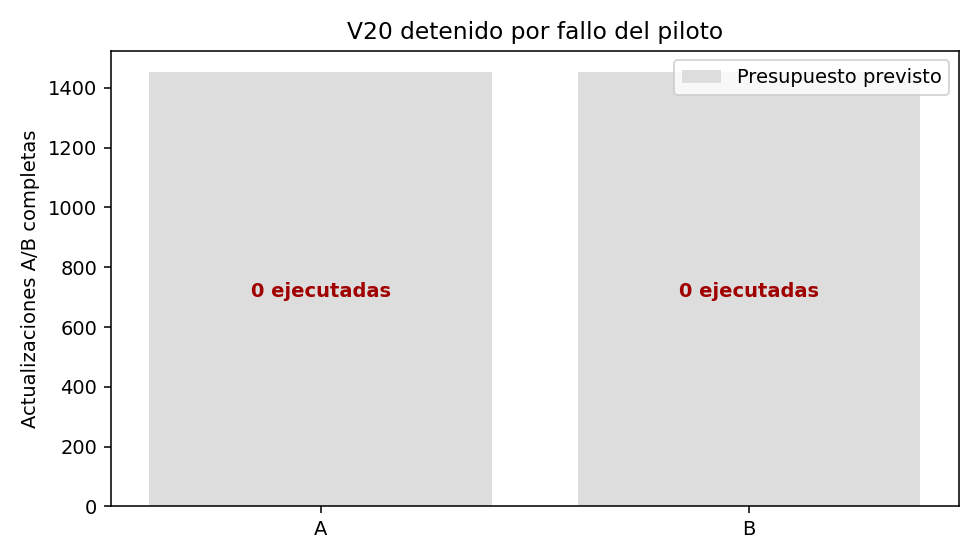
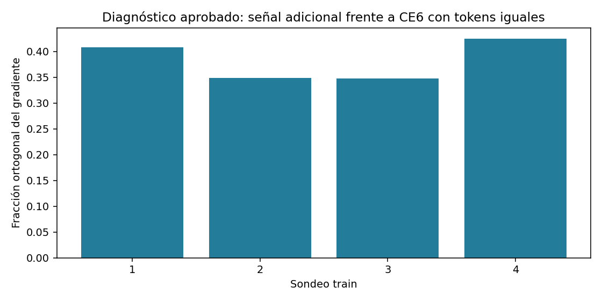
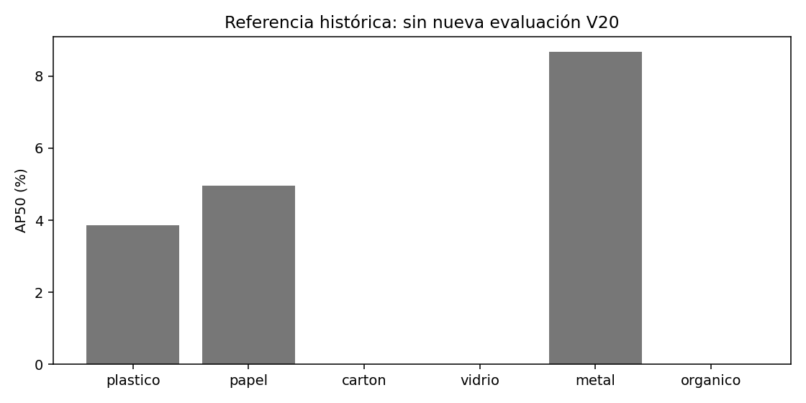

# V21: ejecución V20 detenida en el control de reanudación

**El experimento A/B completo no se ejecutó.** La prueba corta con AdamW real falló al comparar pesos de cuatro pasos continuos con 2 pasos + restauración + 2 pasos. Se detuvo V20, conforme a la condición de seguridad solicitada; no se relajaron tolerancias, no se cambió la hipótesis y no se repitió el piloto.

## Estado comprobado

| Control | Resultado |
|---|---|
| Preparación revisada | Commit 06ab77f |
| Pruebas | 171 aprobadas, ninguna omitida |
| Diagnóstico train-only regenerado | Aprobado |
| Restauración inicial e intermedia del piloto A | Huellas exactas comprobadas antes del fallo |
| Entradas de las dos trayectorias A | Cuatro trazas coincidentes, según aserción anterior al fallo |
| Comparación numérica de pesos | Fallida |
| Piloto B | No ejecutado |
| A/B completo | A: 0/1.452; B: 0/1.452 |
| Evaluación V20 una/cinco vistas | No ejecutada |
| Predeterminado e históricos | 730 archivos protegidos intactos |
| Test | Reservado |

## Implementación entregada

`scripts/entrenar_v20.py` reutiliza `calcular_lote` y restaura pesos, AdamW, scaler y RNG con las funciones V18. `ecowaste/reanudacion_v20.py` mantiene diarios y checkpoints por rama y época exclusivos de V20, publicación sin reemplazo, commits encadenados por SHA256, recuperación explícita de checkpoints completos sin commit y protección de aliases ajenos. Rechaza diferencias de protocolo, código, entradas, presupuesto, estado o región orgánica. Cada época guarda las 121 huellas de lote y todos los estados necesarios.

La fixture CPU comprueba una interrupción con tres pasos no confirmados, reanudación desde la última época completa y llegada a 1.452 actualizaciones por rama. Su identidad numérica sí se comprobó para esa fixture. Esto no demuestra equivalencia numérica del detector CUDA; la prueba real que debía cubrir ese alcance falló.

A=0 y B=0,25; margen Huber=1, fracción difícil=0,25 y pesos [1,1,2,2,1,1]. Se conserva pérdida original, fondo=3, arquitectura, tarea auxiliar global, LR=0,0005, AMP, clipping=1, estados de época 19, orden/aumentos y 12 épocas sin warmup ni parada temprana. Argmax7, cinco vistas y postprocesamiento permanecen intactos. La configuración sigue con `entrenamiento_completo_habilitado=false`; no existe JSON de aprobación del piloto.

`scripts/evaluar_v20.py` está preparado para exigir ambos diarios completos y aliases correctos, evaluar final/mejor con una/cinco vistas, archivar predicciones por imagen, logits AMP, trazas V19 y análisis GT posterior. Sus 39 dependencias locales, incluido observador, auditoría, evaluador y postprocesamiento, figuran en las huellas del diagnóstico. El generador offline de tablas y gráficas también figura en el manifiesto final. La evaluación aún no se validó de extremo a extremo con checkpoints V20, porque no existen.

## Diagnóstico regenerado, anterior al piloto

Las 171 pruebas aprobaron en el diagnóstico. Los cuatro sondeos mejoraron el margen y produjeron descenso local en parámetros. Fracciones ortogonales respecto a CE6 con idénticos tokens y pesos: 0.4084, 0.3492, 0.3480, 0.4247. La señal llega a cabeza principal y extractor; no añade gradiente directo al fondo ni usa la cabeza auxiliar. Memorización de siete instancias en seis escenas train: mAP50, recall y precisión finales de 1,0; pesos descartados. No es evidencia de generalización.

El diagnóstico tardó 87.00 s en NVIDIA GeForce RTX 4060 Laptop GPU con PyTorch 2.14.1+cu126. Verificó carga estricta y 439.309 parámetros, además de logits y cajas exactos en seis escenas train con FP32/AMP y una/cinco vistas. Esto no equivale a reproducir las 181 predicciones históricas de validación, comprobación que no se ejecutó en V20.

## Fallo y límites de la evidencia

Comando: `python scripts/probar_entrenamiento_v20.py`. Salida 1, `AssertionError` en la comparación de pesos. Criterio prefijado: `torch.testing.assert_close(rtol=1e-4, atol=1e-5)`. La condición por elemento es `|x-y| ≤ atol + rtol·|y|`.

| Dato observado en el tensor que detuvo la comparación | Valor |
|---|---|
| Elementos fuera de tolerancia | 69 / 288 (23,96 %) |
| Mayor diferencia absoluta | 0,000195428729057312; índice 168 |
| Mayor diferencia relativa | 0,011974018067121506; índice 104 |
| Actualizaciones reales del piloto | 8 en A: 4 continuas y 4 en trayectoria interrumpida/reanudada |
| Paso AdamW final en ambas trayectorias | 2.303 desde 2.299 |
| Actualizaciones B del piloto | 0 |

El script llegó a este punto después de comprobar pérdida finita, gradientes finitos, clipping y avance real de AdamW en ocho actualizaciones, restauración exacta del checkpoint intermedio y coincidencia de las cuatro huellas de entrada. Estas comprobaciones se deducen del flujo ejecutado antes de la excepción. La comparación falló antes de completar todos los tensores, AdamW y los estados finales de scaler/RNG. No se afirma identidad bit a bit.

El piloto publicaba su JSON solo al final: por ello se conserva el stderr transcrito y la incidencia, pero no se guardaron los tensores, las pérdidas por paso ni las huellas detalladas de las trayectorias fallidas. No se conoce el máximo global entre todos los parámetros ni el nombre del tensor. El temporal se eliminó por `TemporaryDirectory`; no se reutilizó ningún peso diagnóstico. Esta limitación de observabilidad debe corregirse antes de un nuevo intento.

La causa raíz no está determinada. La restauración exacta antes de continuar y las entradas coincidentes descartan varias clases de error, pero no prueban que la divergencia posterior sea exclusivamente no determinismo CUDA. Hace falta distinguir variación entre dos ejecuciones continuas de un fallo específico al reanudar.

## Región orgánica

La única región elegible es `taco:92`, ID 244, con peso 1. El diagnóstico registra su identidad y contribuciones en los sondeos; `region_organica_diagnostico.json` las conserva separadas de cualquier ejecución A/B. La región tiene 40 tokens válidos y es recuperada por el checkpoint de origen. No se entrenaron épocas completas, así que no hay presencia ni contribución observada por época A/B. El entrenador preparado exige una aparición por época y registra tokens, rivales, peso relativo, pérdida individual y contribución efectiva; en A sería cero por coeficiente.

## Métricas disponibles y comparación pendiente

Las cifras siguientes son **históricas**, copiadas del resultado V18 de la referencia original, sin nueva inferencia V20. Los valores A/B son ausentes, no ceros. No se puede concluir si B mejora la clasificación condicional, AP50 de cartón, mAP50 global, geometría u oportunidades. Tampoco se completó la comparación numérica del control A con V18.

| Estado | Vistas | mAP50 % | mAP50:95 % | Recall % | Precisión % | TP | FP | FN |
|---|---|---|---|---|---|---|---|---|
| origen (histórico) | 1 | 2.4462 | 0.4494 | 11.0803 | 6.1162 | 40 | 614 | 321 |
| origen (histórico) | 5 | 2.9123 | 0.7549 | 20.4986 | 3.0229 | 74 | 2374 | 287 |
| A_final | 1 | Pendiente | Pendiente | Pendiente | Pendiente | Pendiente | Pendiente | Pendiente |
| A_final | 5 | Pendiente | Pendiente | Pendiente | Pendiente | Pendiente | Pendiente | Pendiente |
| A_mejor | 1 | Pendiente | Pendiente | Pendiente | Pendiente | Pendiente | Pendiente | Pendiente |
| A_mejor | 5 | Pendiente | Pendiente | Pendiente | Pendiente | Pendiente | Pendiente | Pendiente |
| B_final | 1 | Pendiente | Pendiente | Pendiente | Pendiente | Pendiente | Pendiente | Pendiente |
| B_final | 5 | Pendiente | Pendiente | Pendiente | Pendiente | Pendiente | Pendiente | Pendiente |
| B_mejor | 1 | Pendiente | Pendiente | Pendiente | Pendiente | Pendiente | Pendiente | Pendiente |
| B_mejor | 5 | Pendiente | Pendiente | Pendiente | Pendiente | Pendiente | Pendiente | Pendiente |

| Referencia histórica 5 vistas | plastico | papel | carton | vidrio | metal | organico |
|---|---|---|---|---|---|---|
| AP50 % | 3.8567 | 4.9505 | 0.0000 | 0.0000 | 8.6665 | 0.0000 |

No se presentan tiempo ni memoria GPU del A/B inexistente. El piloto fallido tampoco conservó mediciones completas de coste. Una sola semilla y validación reutilizada limitarían cualquier resultado futuro; AP usa interpolación propia de 101 puntos, no COCOeval oficial.

## Evidencia reproducible y condición para continuar

Artefactos: [diagnóstico vigente](../resultados/v20_diagnostico_ejecucion/diagnostico.json), [incidencia](../resultados/v20_ejecucion/incidencia_prueba_corta.json), [métricas y ausencias](../resultados/v20_comparacion/metricas_estado.json), [CSV](../resultados/v20_comparacion/metricas.csv), [estado](../resultados/v20_comparacion/estado_experimento.json), [integridad](../resultados/v20_comparacion/manifiesto_integridad.json).

El siguiente trabajo debe aislar la discrepancia de ejecución y mejorar la captura del piloto fallido, conservando margen, coeficientes y presupuesto. Si se modifica código cubierto por las huellas, será necesario un nuevo diagnóstico en una ruta nueva. No se debe habilitar A/B hasta que un control de reanudación real quede aprobado y documentado; no corresponde ampliar la tolerancia para dar por válido este intento.

La referencia original, todos los resultados históricos y la selección se conservan. No hubo adopción automática, evaluación de test ni entrenamiento posterior al fallo.
