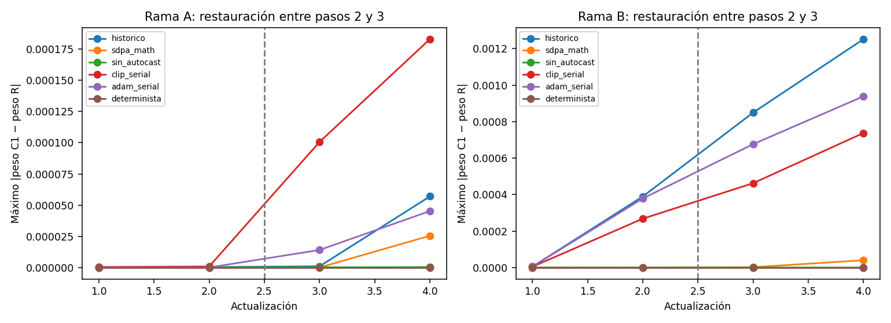
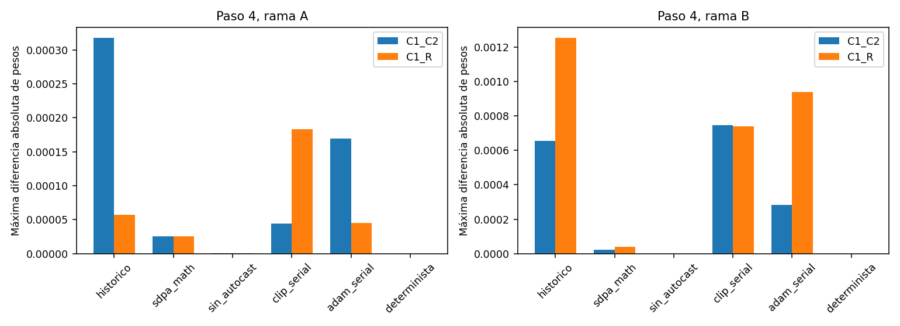
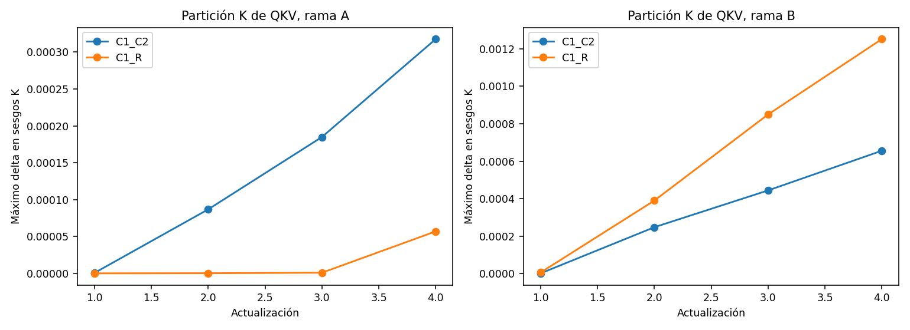

# V22: diagnóstico de reproducibilidad del piloto CUDA V20

Se localiza variabilidad numérica del backward CUDA anterior a cualquier restauración, que llega a los gradientes y es amplificada por AdamW en sesgos QKV. La recarga de los estados es exacta. No se encontró evidencia de corrupción del checkpoint ni de RNG desalineado. La identificación de un único kernel nativo como causa exclusiva requiere más aislamiento: SDPA y reducciones del extractor pueden coexistir.

**A/B completo permanece deshabilitado.** No se modificaron pérdida, coeficientes, arquitectura, presupuesto ni entrenamiento histórico. No se usaron validación ni test. No se reinterpreta el piloto fallido como aprobado.

## Protocolo fijado antes de ejecutar

Desde el mismo checkpoint propio de época 19 y sus estados AdamW/scaler/RNG se compararon C1 (cuatro pasos continuos), C2 (otra ejecución continua independiente) y R (dos pasos, guardar, nuevo proceso, restaurar y dos pasos). Se conservaron los mismos cuatro lotes train y auxiliar global, aumentos, LR y clipping. Se ejecutaron ambas ramas, A=0 y B=0,25, para verificar también la trayectoria de la pérdida discriminativa sin modificarla.

Cada trayectoria empieza en un proceso independiente; R utiliza otro proceso después del paso 2. Todos conservan checkpoint completo al terminar el paso 2, incluido el plan restante. Los artefactos son exclusivos de `resultados/v22_reproducibilidad_v20`; no se sobrescribió la incidencia ni ningún resultado histórico.

Se mantiene **rtol=1e-4, atol=1e-5**. Por elemento, el error normalizado es `|a-b|/(atol+rtol·|b|)`; superar 1 falla la tolerancia original. Se registran todos los tensores, nombres, dtypes, formas, diferencias máximas y elementos fuera de tolerancia. Los máximos relativos con referencia cero se señalan como infinitos, sin insertar NaN/Infinity en los JSON.

Criterio histórico prefijado: restauración e inputs/RNG exactos y, por tensor, etapa y actualización, error máximo normalizado C1–R ≤ max(1, error C1–C2), con cantidad de elementos fuera de tolerancia C1–R ≤ C1–C2. No se multiplican tolerancias. Es una envolvente observada conservadora, no una estimación estadística a partir de un único par continuo. Criterio determinista: ambos pares dentro de la tolerancia original en todos los pasos y estados, con restauración e inputs exactos. Pasar únicamente en modo determinista no valida el protocolo histórico.

## Controles, alcance y conservación

Diagnóstico regenerado: 177 pruebas aprobadas; gradientes y memorización train-only aprobados. Las 42 dependencias de código están registradas en las nuevas huellas. El diagnóstico anterior y su manifiesto se conservan como históricos; ya no describen el código instrumentado actual. El índice previo registró 834 archivos y autoriza cambios solo en los dos scripts instrumentados. El manifiesto nuevo identifica los hashes antes/después.

Se completaron 144 actualizaciones diagnósticas de red y 6 replays aislados de AdamW. La regeneración incluyó por separado la memorización train-only de 200 pasos con pesos descartados. Ninguna actualización corresponde al presupuesto A/B de 1.452 pasos por rama. Procesos fallidos: 0. Tiempo de orquestación, captura, procesos y análisis: 704.6 s.

## Localización antes y después de AdamW

Los archivos `paso_NN_pre.pt` se publican **antes** del step: pesos y momentos previos, logits TACO y auxiliares, pérdidas, gradientes TACO escalados, gradientes totales escalados, sin escala y con clipping, norma y huellas RNG. Los `post.pt` añaden pesos, momentos, contador, scaler y huellas posteriores. Los JSON de comparación contienen todos los parámetros y estados, no solo el primer tensor divergente.

| Rama | Etapa, primer paso C1–C2 histórico | Exacta | Máx. delta absoluto | Elementos fuera |
|---|---|---|---|---|
| A | pre.pesos | True | 0 | 0 |
| A | pre.adamw | True | 0 | 0 |
| A | pre.entradas | True | 0 | 0 |
| A | pre.logits_taco | True | 0 | 0 |
| A | pre.gradientes_taco_escalados | True | 0 | 0 |
| A | pre.logits_auxiliar | True | 0 | 0 |
| A | pre.gradientes_total_escalados | False | 0.00390625 | 380 |
| A | pre.gradientes_sin_escala | False | 1.90734863e-06 | 0 |
| A | pre.norma_antes_clip | True | 0 | 0 |
| A | pre.gradientes_clip | False | 2.81725079e-07 | 0 |
| A | post.pesos | False | 7.82310963e-07 | 0 |
| A | post.adamw | False | 2.81725079e-08 | 0 |
| B | pre.pesos | True | 0 | 0 |
| B | pre.adamw | True | 0 | 0 |
| B | pre.entradas | True | 0 | 0 |
| B | pre.logits_taco | True | 0 | 0 |
| B | pre.gradientes_taco_escalados | False | 0.00390625 | 3 |
| B | pre.logits_auxiliar | True | 0 | 0 |
| B | pre.gradientes_total_escalados | False | 0.00390625 | 254 |
| B | pre.gradientes_sin_escala | False | 1.90734863e-06 | 0 |
| B | pre.norma_antes_clip | True | 0 | 0 |
| B | pre.gradientes_clip | False | 2.68642907e-07 | 0 |
| B | post.pesos | False | 8.04662704e-07 | 0 |
| B | post.adamw | False | 2.68664735e-08 | 0 |

Una diferencia en gradientes con entradas, pesos y logits iguales nace antes de AdamW; la restauración todavía no ha ocurrido. Desde el paso 2 también pueden divergir los logits porque las actualizaciones anteriores ya cambiaron los pesos. Comparar solamente el último checkpoint no distingue estas causas.

## Resultados de las modalidades

| Modalidad | Rama | Máx. Δ pesos C1–C2 paso 4 | Máx. Δ pesos C1–R paso 4 | Fuera C1–C2 | Fuera C1–R | Recarga exacta | Todas etapas en tolerancia | Envolvente |
|---|---|---|---|---|---|---|---|---|
| historico | A | 0.000317513943 | 5.69969416e-05 | 261 | 31 | True | False | False |
| historico | B | 0.000655695796 | 0.00125201792 | 287 | 262 | True | False | False |
| sdpa_math | A | 2.54809856e-05 | 2.54809856e-05 | 0 | 0 | True | False | True |
| sdpa_math | B | 2.2046268e-05 | 4.02331352e-05 | 3 | 17 | True | False | False |
| sin_autocast | A | 4.02331352e-07 | 3.57627869e-07 | 0 | 0 | True | False | False |
| sin_autocast | B | 5.51342964e-07 | 4.24683094e-07 | 0 | 0 | True | False | False |
| clip_serial | A | 4.43160534e-05 | 0.000182911754 | 30 | 164 | True | False | False |
| clip_serial | B | 0.00074432604 | 0.000737704337 | 288 | 276 | True | False | False |
| adam_serial | A | 0.000169485807 | 4.52410895e-05 | 161 | 46 | True | False | False |
| adam_serial | B | 0.000283628702 | 0.000938676298 | 221 | 289 | True | False | False |
| determinista | A | 0 | 0 | 0 | 0 | True | True | True |
| determinista | B | 0 | 0 | 0 | 0 | True | True | True |





Las modalidades se aislaron así:

- `historico`: opciones originales registradas, AMP y defaults de SDPA/clipping/AdamW.
- `sdpa_math`: solo backend SDPA MATH.
- `sin_autocast`: solo FP32 en los forwards; conserva el scaler original para no confundir precisión con escalado.
- `clip_serial`: solo clipping con foreach=False; no cambia acumulación ni backward.
- `adam_serial`: solo foreach=False y fused=False después de comprobar restauración exacta; se documenta ese cambio diagnóstico de grupos.
- `determinista`: cuBLAS `:4096:8` antes de iniciar Python, deterministic_algorithms=True, SDPA MATH, cuDNN deterministic=True/benchmark=False, TF32 desactivado, clipping y AdamW seriales. No se aplica al entrenador histórico.

Cada `entorno_inicio.json` y `entorno_reanudar.json` registra las opciones efectivas, versiones, GPU, PID, hilos y grupos AdamW. `operadores.json` identifica las operaciones de atención y foreach observadas con profiler CPU. No identifica por sí solo cada kernel CUDA nativo. La captura y el profiler pueden afectar planificación y temporización, por lo que este ensayo no promete reproducir exactamente el valor 0,0001954 de la ejecución anterior.

## Evidencia por hipótesis

El profiler histórico registra `aten::_scaled_dot_product_efficient_attention` y su backward. En A, los gradientes TACO del primer paso coinciden y la primera diferencia aparece tras el backward auxiliar: máximo 0,00390625 escalado, 1,90735e-6 sin escala y 2,81725e-7 después del clipping. La norma de clipping inicial coincide. En B ya aparecen diferencias en el backward TACO. Por tanto, ni el archivo de reanudación ni el clipping ni el step de AdamW son necesarios para que nazca la variación.

Restringir SDPA a MATH reduce la divergencia, pero no elimina toda la variación: en el primer backward TACO A, el único gradiente distinto es `tokenizador_contexto.weight`, con máximo 0,001953125 escalado. Esto localiza un residuo en el extractor convolucional; no identifica por sí solo el kernel nativo responsable. Desactivar autocast reduce el delta final de pesos a menos de 6e-7 en estos cuatro pares, pero no cumple todas las comprobaciones por etapa. La precisión amplifica la sensibilidad y no es una explicación exclusiva.

Clipping serial y AdamW serial conservan divergencia entre trayectorias. El replay de AdamW desde entradas idénticas es exacto para ambos defaults y frente al step archivado; serial frente a default difiere solo 1,49012e-8 y sigue dentro de tolerancia. La combinación determinista elimina las diferencias en todas las etapas ensayadas. El aislamiento de reducciones internas del backward es parcial: foreach=False solo controla el clipping, no todas las reducciones CUDA del extractor.

## Sesgos QKV y amplificación

| Rama | Par | Parámetro | Partición | Máx. Δ peso paso 4 | Máx. Δ gradiente clip del paso | Índice |
|---|---|---|---|---|---|---|
| B | C1_R | detalle.1.atencion.qkv.bias | K | 0.00125201792 | 1.31523535e-07 | 98 |
| B | C1_R | detalle.0.atencion.qkv.bias | K | 0.00074904412 | 3.97095675e-07 | 112 |
| B | C1_C2 | detalle.1.atencion.qkv.bias | K | 0.000655695796 | 2.24534844e-07 | 110 |
| B | C1_C2 | detalle.0.atencion.qkv.bias | K | 0.000528259203 | 3.42671512e-07 | 96 |
| B | C1_C2 | contexto.1.atencion.qkv.bias | K | 0.000465318561 | 1.59490853e-07 | 147 |
| A | C1_C2 | detalle.0.atencion.qkv.bias | K | 0.000317513943 | 1.98740992e-07 | 156 |
| A | C1_C2 | detalle.1.atencion.qkv.bias | K | 0.000314548612 | 1.64964206e-07 | 164 |
| A | C1_C2 | contexto.1.atencion.qkv.bias | K | 0.000239819288 | 1.50836016e-07 | 156 |

La partición K ocupa el tercio central del sesgo QKV. En aritmética exacta, añadir el mismo sesgo a todas las claves añade una constante por fila a las puntuaciones y softmax la cancela. Por ello su gradiente ideal es cero; los residuos de redondeo pueden ser pequeños y sensibles al orden de las reducciones. AdamW divide el momento de primer orden por la raíz del segundo más epsilon: cuando ambos son diminutos, diferencias pequeñas de gradientes pueden convertirse en diferencias mayores de pesos. `qkv_por_particion.json` guarda valores, momentos y gradientes de las coordenadas relevantes; no se cambia ni elimina este parámetro.



La incidencia 21 no guardó el nombre ni los tensores del primer fallo. Estos ensayos muestran el mecanismo y su escala, pero no permiten reconstruir retrospectivamente todos los valores de aquel tensor ni atribuirle un nombre con certeza absoluta.

## Replay aislado de AdamW

| Rama | Comparación | Exacto | Máx. delta | Elementos fuera |
|---|---|---|---|---|
| A | dos_replays_default | True | 0 | 0 |
| A | replay_frente_actual | True | 0 | 0 |
| A | serial_frente_default | False | 1.49011612e-08 | 0 |
| B | dos_replays_default | True | 0 | 0 |
| B | replay_frente_actual | True | 0 | 0 |
| B | serial_frente_default | False | 1.49011612e-08 | 0 |

Los replays parten de los mismos pesos, momentos y gradientes recortados archivados del primer paso histórico de C1. No hay forward, backward, nuevo aumento ni actualización del modelo original. Se contrastan dos defaults, default contra el step realmente archivado y serial contra default. Un replay exacto descarta que AdamW genere espontáneamente aquella divergencia para estas entradas; no descarta su papel amplificando gradientes distintos ni garantiza equivalencia para todos los estados posibles.

## Condición de continuación y propuesta mínima

Envolvente histórica satisfecha conjuntamente en A/B: **False**. Modo determinista dentro de tolerancia en todos los pasos/estados: **True**. Identidad exacta comprobada en estos ensayos deterministas: **True**. No se extrapola esta identidad a 1.452 pasos.

La corrección mínima del control es conservar la comprobación exacta del estado recargado y añadir C1–C2 como referencia de variabilidad, con la evidencia por etapa ya implementada. El piloto histórico anterior sigue fallido. Si la envolvente histórica no pasa, este ensayo no autoriza continuar bajo ese protocolo, aunque los máximos globales de R sean menores que los de C1–C2.

Para exigir reproducibilidad numérica de trayectorias, la opción verificada es declarar explícitamente el modo determinista ensayado, regenerar diagnóstico y tratar el cambio de kernels como una modificación del protocolo de ejecución. El candidato mínimo para un próximo aislamiento es SDPA MATH más determinismo cuDNN, conservando AMP y AdamW originales; esa combinación reducida todavía no fue probada de forma aislada. Antes de proponerla para A/B debe comprobarse con el mismo C1/C2/R. No se cambia silenciosamente el entrenamiento histórico, no se amplía la tolerancia y no se adopta ningún peso diagnóstico.

Quedan abiertas la generalización a una ejecución larga, el aislamiento de cada kernel nativo residual, otros dispositivos/versiones y la distribución de variabilidad entre más pares continuos. El resultado es un diagnóstico de ejecución, no evidencia de mejora de materiales o detección.

## Artefactos y comandos

```powershell
python scripts/diagnosticar_v20.py --salida resultados/v22_reproducibilidad_v20/preparacion
python scripts/ejecutar_diagnostico_reproducibilidad_v20.py
python scripts/analizar_reproducibilidad_v20.py
# Entorno con matplotlib:
python scripts/informar_reproducibilidad_v20.py
```

Las rutas se publican sin reemplazo; repetir requiere un identificador nuevo. No ejecutar otra vez sobre esta entrega. No se genera `prueba_corta.json` de aprobación ni se habilita A/B.

Evidencia: [protocolo prefijado](../resultados/v22_reproducibilidad_v20/protocolo_ejecutado.json), [diagnóstico regenerado](../resultados/v22_reproducibilidad_v20/preparacion/diagnostico.json), [resumen completo](../resultados/v22_reproducibilidad_v20/resumen.json), [etapas](../resultados/v22_reproducibilidad_v20/evidencia_etapas.json), [CSV](../resultados/v22_reproducibilidad_v20/comparacion_por_etapa.csv), [QKV](../resultados/v22_reproducibilidad_v20/qkv_por_particion.json), [conclusión](../resultados/v22_reproducibilidad_v20/informe/conclusion.json), [integridad](../resultados/v22_reproducibilidad_v20/manifiesto_integridad.json). Los 36 checkpoints de paso 2, logits y gradientes están en los subdirectorios de modalidad/rama/trayectoria, con hashes en el manifiesto.
