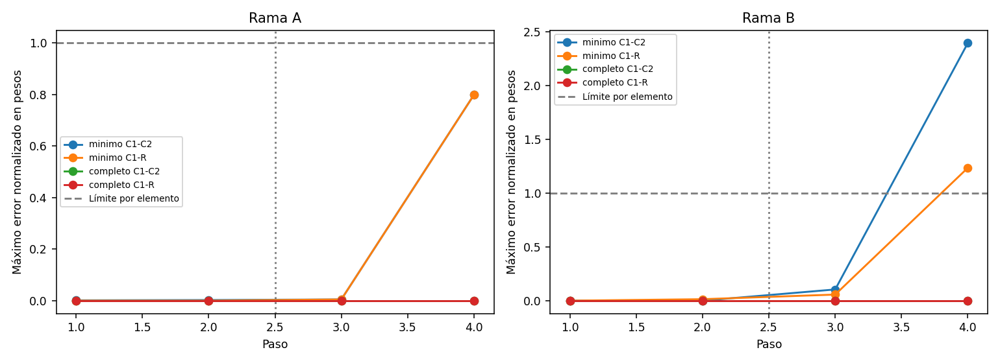
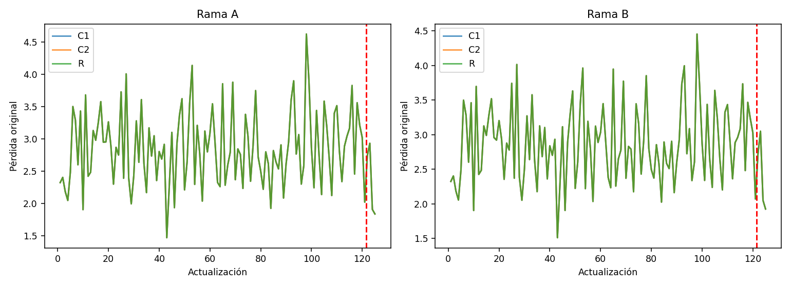

# V23: validación del backend determinista para V20

**Decisión: candidato completo.** SDPA MATH + cuDNN determinista cumple el control completo: **False**. El candidato seleccionado cumple el control corto: **True** y el control de 125 actualizaciones con límite real de época: **True**. El A/B completo sigue deshabilitado.

## Comparación de la combinación mínima

Se activaron exclusivamente SDPA MATH, `torch.backends.cudnn.deterministic=True` y `cudnn.benchmark=False`. Autocast AMP, GradScaler restaurado, AdamW con foreach/fused históricos, clipping y demás opciones se conservaron. Cada C1 y C2 empieza desde el checkpoint de época 19 en un proceso independiente; R ejecuta dos pasos, guarda el estado completo y continúa otros dos en otro proceso. Se repite con A=0 y B=0,25.

Criterio fijado antes de ejecutar: recarga e inputs/RNG exactos y ambos pares C1–C2/C1–R dentro de **rtol=1e-4, atol=1e-5 en todos los tensores y etapas**. El error normalizado es `abs(a-b)/(atol+rtol*abs(b))`; superar 1 viola la tolerancia. No se aprueba por un delta absoluto pequeño.

| Modo | Rama | Par, paso 4 | Máx. delta pesos | Elementos fuera en pesos | Máx. error normalizado pesos | Todas etapas cumplen |
|---|---|---|---|---|---|---|
| minimo | A | C1_C2 | 2.54809856e-05 | 0 | 0.799171 | False |
| minimo | A | C1_R | 2.54809856e-05 | 0 | 0.799171 | False |
| minimo | B | C1_C2 | 4.19914722e-05 | 16 | 2.39582 | False |
| minimo | B | C1_R | 1.42902136e-05 | 2 | 1.23532 | False |
| completo | A | C1_C2 | 0 | 0 | 0 | True |
| completo | A | C1_R | 0 | 0 | 0 | True |
| completo | B | C1_C2 | 0 | 0 | 0 | True |
| completo | B | C1_R | 0 | 0 | 0 | True |



La comparación completa incluye entradas, logits de mapas y auxiliar, pérdidas, gradientes escalados, sin escala y después del clipping, norma, pesos, momentos/contador AdamW, scaler y RNG. Los JSON de `corto_comparaciones` conservan todos los nombres, dtypes, máximos y elementos fuera de tolerancia; las cuatro actualizaciones no se interrumpen ante una diferencia numérica.

## Corrección al informe 22 y alcance causal

El informe 22 llamó convolucional a un residuo del extractor; esa caracterización era incorrecta. `ecowaste/detector.py` define ambos tokenizadores como `nn.Linear` sobre parches y también usa `F.interpolate(..., mode="bilinear")`. No se cambió esa arquitectura. La bandera cuDNN no garantiza determinismo de todas estas operaciones. La variación residual sigue localizada en el backward; este ensayo de selección no aísla un único kernel nativo como causa exclusiva. El informe histórico se conserva intacto y esta corrección se registra aquí.

## Configuración seleccionada y contrato de ejecución

```json
{
  "version": "v20_backend_v23_1",
  "modo": "completo",
  "sdpa": "math",
  "amp": true,
  "cudnn_deterministic": true,
  "cudnn_benchmark": false,
  "deterministic_algorithms": true,
  "tf32_matmul": false,
  "tf32_cudnn": false,
  "float32_matmul_precision": "highest",
  "CUBLAS_WORKSPACE_CONFIG": ":4096:8",
  "clip_foreach": false,
  "adam_foreach": false,
  "adam_fused": false
}
```

El candidato completo reproduce las opciones diagnósticas de V22; no altera la hipótesis de aprendizaje. cuBLAS se configura en el entorno del proceso antes de iniciar Python. El contexto numérico aplica SDPA/cuDNN/determinismo/TF32 y las opciones de AdamW/clipping declaradas, registra sus valores efectivos y restaura las opciones globales al salir. La modalidad mínima conserva los defaults históricos ajenos a sus tres cambios; los rechaza si no coinciden.

El entrenador guarda `backend_numerico` y `backend_efectivo` en cada checkpoint versionado. El diario rechaza políticas ausentes/distintas u opciones incompatibles; al reanudar se comprueba también igualdad del entorno efectivo, incluidas versiones PyTorch/CUDA/cuDNN, GPU e hilos. Cada actualización verifica las opciones vigentes. No se mezclan los diarios V23 con V18 ni con los checkpoints experimentales V20 anteriores.

## Control prolongado con mecanismos reales del entrenador

Se ejecutaron C1, C2 y R durante **125 actualizaciones reales por trayectoria y rama**: los 121 lotes de la época 20 (964 escenas, último lote de cuatro) y cuatro lotes de la época 21. C1 y C2 guardan checkpoint al final de época y continúan; R termina el proceso tras el paso 121 y restaura en otro proceso. AdamW avanza de 2.299 a 2.424. Sin warmup nuevo, sin parada temprana y sin cargar validación o test.

El control llama al mismo `ejecutar_epoca_train` y `paso_adamw` del entrenador, usa sus loaders/orden/aumentos y la restauración de pesos, AdamW, scaler y RNG. Publica la época completa con `DiarioV20`: checkpoint inmutable, registro JSON encadenado y validaciones de protocolo/datos/estados. La variante train-only del diario prohíbe métricas de validación y selección del mejor modelo. La época 21 parcial queda como evidencia diagnóstica, sin commit de época completa.

| Rama | Recarga R exacta | 125 pasos C1–C2/C1–R aprobados | Final C1–C2 exacto | Final C1–R exacto | Huellas por etapa exactas en todos los pasos |
|---|---|---|---|---|---|
| A | True | True | True | True | True |
| B | True | True | True | True | True |



Se conservan huellas SHA256 de todas las etapas de cada actualización. C1 guarda instantáneas completas de los 125 pasos; C2/R conservan los pasos 1, 2, 120, 121, 122 y 125 y cualquier paso con una huella diferente. Una discrepancia obliga a guardar y comparar todos sus tensores con la tolerancia original. Los estados finales se comparan exhaustivamente. Esta estrategia conserva evidencia sin duplicar instantáneas idénticas.

La única región orgánica elegible mantiene peso 1 y aparece una vez en la época 20 completa. Cada checkpoint conserva su contribución individual y multiplicada por el coeficiente. No se usa un valor mAP ficticio ni se selecciona un modelo en el control.

## Pruebas y rechazo de incompatibilidades

Pasan 184 pruebas, incluidas las 177 existentes. Se regeneró el diagnóstico de código antes de los ensayos y el del protocolo nuevo después de los controles. Ambos verifican la pérdida y regresión de inferencia histórica; los controles C1/C2/R validan separadamente el backend de entrenamiento. Las pruebas de memorización son train-only y sus pesos se descartan.

| Caso probado contra estado real/guardia | Rechazado | Motivo |
|---|---|---|
| otro_backend | True | Checkpoint de otro backend numérico |
| sdpa_incompatible | True | SDPA incompatible |
| cudnn_incompatible | True | Opción numérica incompatible: cudnn_deterministic |
| entorno_diferente | True | Entorno efectivo distinto del checkpoint |
| entrenamiento_deshabilitado | True | V20 completo deshabilitado: entregar y revisar primero diagnóstico train-only |

## Protocolo A/B preparado, sin habilitar

Configuración nueva: `configuracion/v20_backend_v23_1_completo_ep19.json`. Versión `v20_backend_v23_1`, identificador `v20_backend_v23_1_completo_ep19` y rutas exclusivas de checkpoints/diarios. Ambas ramas volverán a iniciar desde el origen de época 19, nunca desde los pesos diagnósticos. Se conservan 12 épocas y 1.452 pasos por rama, LR=0,0005, AMP/scaler, margen Huber=1, fracción difícil=0,25, pesos [1,1,2,2,1,1], A=0/B=0,25, fondo=3 y auxiliar global=0,5. Arquitectura, argmax, cinco vistas, umbrales y postprocesamiento no se cambian.

Se publican certificados nuevos de corto y largo, vinculados por hashes al diagnóstico y al protocolo. La guardia exige esos controles y el backend coincidente. Tanto la configuración original como la nueva mantienen `entrenamiento_completo_habilitado=false`; una invocación del entrenador se rechaza antes de entrenar. Actualizaciones del A/B completo: A=0 y B=0. Los pesos del control no son candidatos de adopción.

Comandos previstos para una futura ejecución autorizada, con la configuración todavía bloqueada:

```powershell
$env:CUBLAS_WORKSPACE_CONFIG=':4096:8'
python scripts/entrenar_v20.py --config configuracion/v20_backend_v23_1_completo_ep19.json --rama A
python scripts/entrenar_v20.py --config configuracion/v20_backend_v23_1_completo_ep19.json --rama B
# Para continuar únicamente un diario del mismo protocolo:
python scripts/entrenar_v20.py --config configuracion/v20_backend_v23_1_completo_ep19.json --rama A --reanudar
```

## Límites y evidencia

La reproducibilidad se comprobó en cuatro y 125 pasos, en esta GPU y estas versiones; no se extrapola identidad numérica a las 1.452 actualizaciones. El control no cubre el paso por validación ni la evaluación final, que no se ejecutaron en esta tarea. No aporta evidencia de mejora de AP/mAP ni de la pérdida discriminativa. La referencia original y todos los resultados históricos permanecen intactos; los cinco scripts autorizados conservan copias exactas de sus bytes anteriores.

Artefactos: [protocolo prefijado](../resultados/v23_backend_v20/protocolo_ejecutado.json), [mínimo](../resultados/v23_backend_v20/corto_minimo.json), [decisión](../resultados/v23_backend_v20/decision.json), [candidato corto](../resultados/v23_backend_v20/corto_completo.json), [control largo](../resultados/v23_backend_v20/largo_completo.json), [preparación](../resultados/v23_backend_v20/preparacion_completa.json), [rechazos](../resultados/v23_backend_v20/rechazos_reanudacion.json), [CSV](../resultados/v23_backend_v20/informe/comparacion_corta.csv), [integridad](../resultados/v23_backend_v20/manifiesto_integridad.json).
