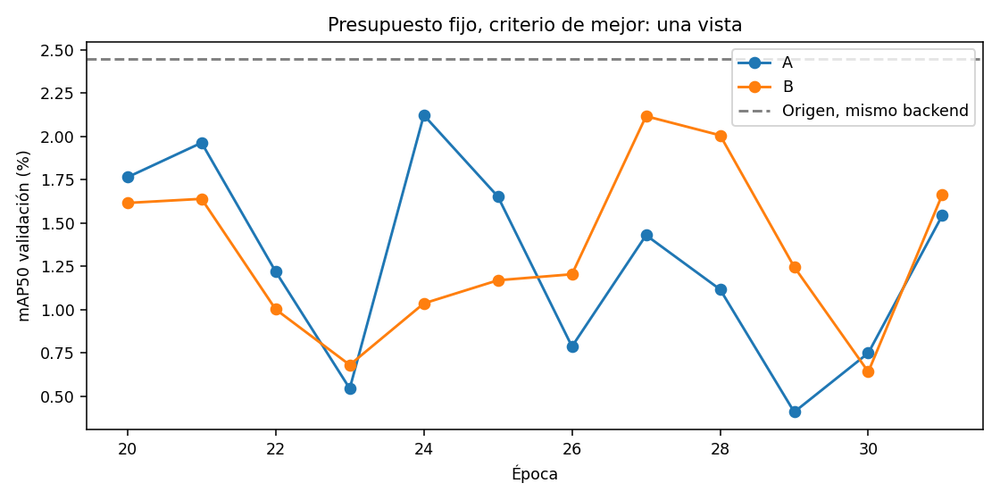
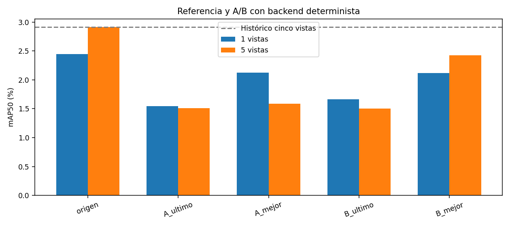
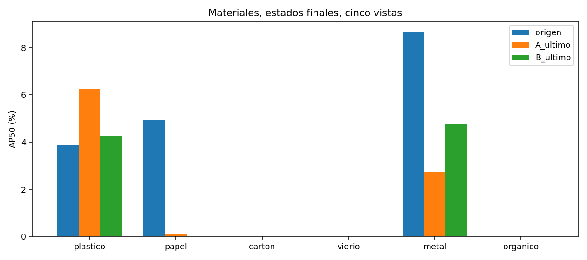
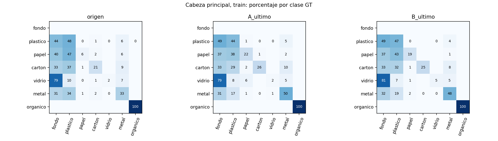
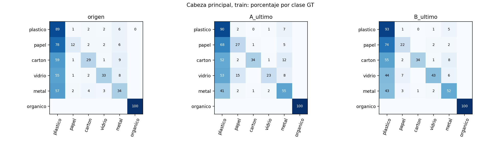
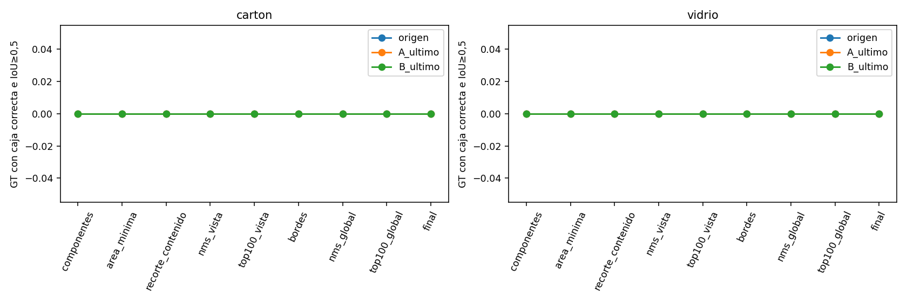
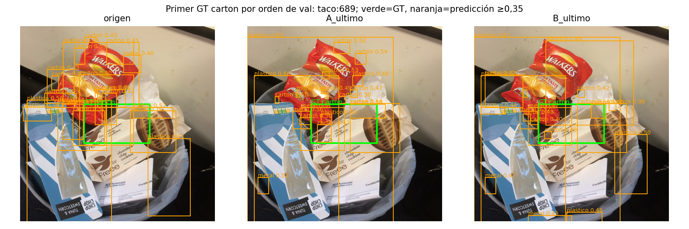
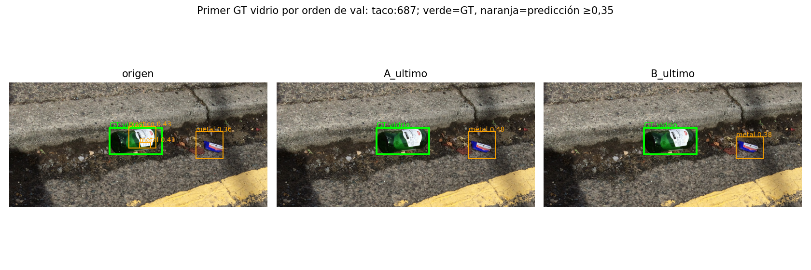
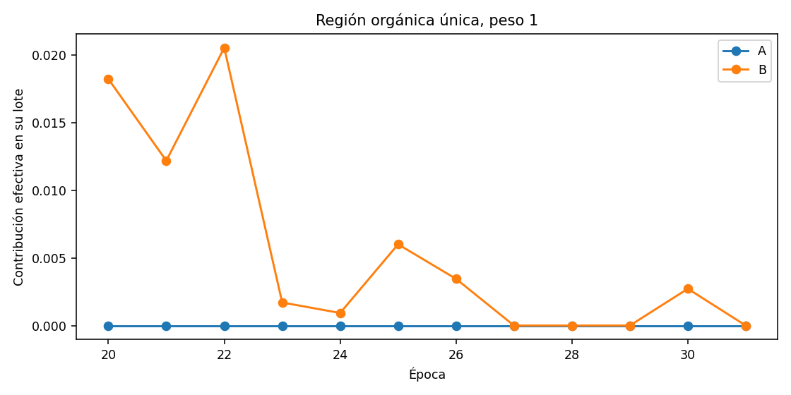

# V24: resultados V20 con evaluación numéricamente coherente

B final: mAP50 de cinco vistas 1.5013 %, A 1.5113 %, origen con el mismo backend 2.9121 % e histórico 2.9123 %. AP50 de cartón B=0.0000 %; vidrio B=0.0000 %. No se adopta automáticamente ningún checkpoint.

La decisión debe considerar conjuntamente AP por material, mAP, recall, precisión, FP, geometría y oportunidades; la recuperación condicional en train no demuestra generalización. No se recomienda adoptar B: cartón y vidrio siguen sin AP50 y ninguno de sus dos estados evaluados supera el mAP50 de la referencia. La intervención no solucionó la detección de esos materiales.

## Integración y verificaciones

`evaluar_v20.py` acepta `--config`, aplica el contexto numérico declarado durante inferencia/diagnóstico principal y verifica protocolo, hashes, origen, backend, entorno y opciones del optimizador de cada checkpoint experimental. La referencia de época 19 sin etiqueta de backend solo se admite como origen verificado por SHA256. No se cambió el modelo, la pérdida ni el postprocesamiento.

Pasan 190 pruebas. El diagnóstico train-only se regeneró en una ruta nueva. Los certificados V23 se revalidaron por alcance: entrenador, paso, modelo, pérdida, backend y reanudación conservan sus SHA256; el preparador solo amplió su lista de pruebas, comprobado por AST. La evidencia de 125 pasos no se repitió ni se reescribió. La revalidación es explícita y enlaza el manifiesto y controles originales.

Además, los checkpoints reales de época 20 de A y B reproducen exactamente las huellas de pesos, AdamW, scaler y RNG de la época 20 de los controles V23 C1. La comparación se conserva en `comparacion_epoca20_vs_control125.json`; proporciona una comprobación adicional de que la integración no alteró el aprendizaje previo a esa validación.

Hubo un fallo de codificación cp1252 en el lanzador al reenviar la salida del primer intento histórico. No había comenzado el entrenamiento. Se conservaron log y captura parcial, y se corrigió únicamente la entrada/salida del lanzador a UTF-8. La nueva comprobación histórica terminó correctamente; no se cambiaron tolerancias ni hipótesis para resolver ese incidente.

Después de completar el entrenamiento, la primera evaluación se detuvo en `bincount` ponderado CUDA del resumen regional train, operación no admitida con determinismo estricto. Se conservó su captura completa del origen. La revisión 2 realiza esa reducción GT en CPU, manteniendo el forward GPU V23 y el determinismo; no cambió modelo, pérdida ni checkpoints. Tiene diagnóstico propio con 193 pruebas aprobadas y certificado de compatibilidad explícito. Los hashes originales de entrenamiento se conservan y se distinguen de los hashes de evaluación; el certificado solo admite el cambio del evaluador y demuestra por AST que las funciones de inferencia no cambiaron. La captura del origen se reutilizó tras verificar todos sus archivos y reproducir exactamente un lote de ocho logits con el checkpoint/backend esperado. No se autoriza nuevo entrenamiento bajo los hashes de esta revisión.

## Histórica exacta y referencia bajo SDPA MATH

La regresión histórica se ejecutó en un intérprete separado con las opciones originales, incluyendo cuBLAS no configurado y SDPA histórico. Reprodujo exactamente las predicciones de las 181 imágenes en una y cinco vistas. La evaluación nueva usa el modo determinista completo V23 para origen, A y B. Las diferencias de la referencia entre backends se registran y no se tratan como fallo de integridad ni como mejora aprendida.

| Vistas | Histórico mAP50 % | Origen backend nuevo mAP50 % | Imágenes idénticas entre backends | Diferentes |
|---|---|---|---|---|
| 1 | 2.446208 | 2.446569 | 23 | 158 |
| 5 | 2.912288 | 2.912056 | 6 | 175 |

## Ejecución por etapas

A=0 y B=0,25 comenzaron desde el mismo checkpoint propio de época 19, con pesos, AdamW, scaler y RNG originales. Se conserva LR=0,0005, AMP, clipping, pérdida de fondo=3, auxiliar global=0,5, margen Huber=1, fracción difícil=0,25 y pesos [1,1,2,2,1,1]. Sin warmup nuevo, parada temprana, cambios arquitectónicos ni cambios de umbral.

| Rama, época 20 | Pasos | Validación repetida exacta | mAP50 una vista % |
|---|---|---|---|
| A | 121 | True | 1.7651 |
| B | 121 | True | 1.6167 |

Tras comprobar ambos diarios, estados, trazas y validación de época 20 se reanudaron las dos ramas hasta la 31. Cada rama completó 1.452 actualizaciones (AdamW 2.299→3.751); 12 checkpoints/commits de época inmutables y trazas cotejadas con el plan previo. El mejor checkpoint se seleccionó por mAP50 de una vista, primer empate, y se informa separado del final.

Mejores épocas: A=24, B=27. La ejecución nueva tiene identificador `v20_backend_v23_1_completo_eval24_ep19` y conserva el backend numérico V23; las configuraciones previas y checkpoints diagnósticos no se reutilizan como estados entrenados.

## Métricas de validación

| Estado | Época | Vistas | mAP50 % | mAP50:95 % | Recall % | Precisión % | TP | FP | FN |
|---|---|---|---|---|---|---|---|---|---|
| historico_original | 19 | 1 | 2.4462 | 0.4494 | 11.0803 | 6.1162 | 40 | 614 | 321 |
| historico_original | 19 | 5 | 2.9123 | 0.7549 | 20.4986 | 3.0229 | 74 | 2374 | 287 |
| origen | 19 | 1 | 2.4466 | 0.4494 | 11.0803 | 6.1256 | 40 | 613 | 321 |
| origen | 19 | 5 | 2.9121 | 0.7549 | 20.4986 | 3.0229 | 74 | 2374 | 287 |
| A_ultimo | 31 | 1 | 1.5457 | 0.3359 | 11.6343 | 7.6782 | 42 | 505 | 319 |
| A_ultimo | 31 | 5 | 1.5113 | 0.3885 | 20.7756 | 3.6425 | 75 | 1984 | 286 |
| A_mejor | 24 | 1 | 2.1235 | 0.9954 | 11.3573 | 7.6350 | 41 | 496 | 320 |
| A_mejor | 24 | 5 | 1.5896 | 0.5679 | 21.0526 | 3.6468 | 76 | 2008 | 285 |
| B_ultimo | 31 | 1 | 1.6661 | 0.4754 | 11.3573 | 7.5926 | 41 | 499 | 320 |
| B_ultimo | 31 | 5 | 1.5013 | 0.4216 | 20.2216 | 3.7668 | 73 | 1865 | 288 |
| B_mejor | 27 | 1 | 2.1176 | 0.6126 | 12.1884 | 7.6125 | 44 | 534 | 317 |
| B_mejor | 27 | 5 | 2.4283 | 0.7273 | 23.5457 | 3.8937 | 85 | 2098 | 276 |

| Estado cinco vistas | plastico | papel | carton | vidrio | metal | organico |
|---|---|---|---|---|---|---|
| origen | 3.8543 | 4.9505 | 0.0000 | 0.0000 | 8.6676 | 0.0000 |
| A_ultimo | 6.2472 | 0.1008 | 0.0000 | 0.0000 | 2.7200 | 0.0000 |
| A_mejor | 4.9298 | 1.1473 | 0.0000 | 0.0000 | 3.4608 | 0.0000 |
| B_ultimo | 4.2422 | 0.0000 | 0.0000 | 0.0000 | 4.7653 | 0.0000 |
| B_mejor | 3.6004 | 4.9505 | 0.0000 | 0.0000 | 6.0191 | 0.0000 |

## Cabeza principal y confusiones train

Se mide exclusivamente la cabeza de mapas sobre polígonos elegibles train, excluyendo padding, ignorados y mezclas ambiguas. La recuperación condicional quita fondo solo para el análisis; no es la cabeza auxiliar ni un cambio de inferencia.

| Material | Instancias | Origen recuperadas/cond. | A final recuperadas/cond. | B final recuperadas/cond. | Fondo medio origen/A/B % |
|---|---|---|---|---|---|
| plastico | 1589 | 769 / 1410 | 711 / 1432 | 746 / 1476 | 44.59 / 49.86 / 50.17 |
| papel | 108 | 6 / 14 | 23 / 29 | 21 / 24 | 36.92 / 35.72 / 36.71 |
| carton | 146 | 30 / 44 | 35 / 48 | 36 / 48 | 31.58 / 33.07 / 33.56 |
| vidrio | 201 | 3 / 67 | 5 / 49 | 8 / 87 | 78.90 / 77.89 / 80.44 |
| metal | 394 | 127 / 135 | 194 / 217 | 184 / 204 | 30.93 / 31.79 / 32.72 |
| organico | 1 | 1 / 1 | 1 / 1 | 1 / 1 | 0.00 / 0.00 / 0.00 |

Cartón→plástico/metal por voto condicional: origen 67.81 %, A 63.70 %, B 63.01 %. Son mediciones en train, no una estimación independiente de generalización.

## Oportunidades, geometría y tamaño

| Estado | Material | GT | Antes de filtros | Final | Fusión | Fragmentación |
|---|---|---|---|---|---|---|
| origen | carton | 25 | 0 | 0 | 0 | 0 |
| origen | vidrio | 22 | 0 | 0 | 0 | 0 |
| A_ultimo | carton | 25 | 0 | 0 | 0 | 0 |
| A_ultimo | vidrio | 22 | 0 | 0 | 0 | 0 |
| A_mejor | carton | 25 | 0 | 0 | 0 | 0 |
| A_mejor | vidrio | 22 | 0 | 0 | 0 | 0 |
| B_ultimo | carton | 25 | 0 | 0 | 0 | 0 |
| B_ultimo | vidrio | 22 | 0 | 0 | 0 | 0 |
| B_mejor | carton | 25 | 0 | 0 | 0 | 0 |
| B_mejor | vidrio | 22 | 0 | 0 | 0 | 0 |

Una oportunidad cuenta GT con al menos una propuesta del material correcto e IoU≥0,5; no equivale a un TP asignado uno a uno. El observador V19 exige igualdad exacta con el postprocesamiento de producción aplicado a los mismos logits. GT se consulta después de terminar la captura. El JSON de geometría incluye las ocho causas, todas las etapas y el desglose de seis materiales por tamaño.

Ejemplos ilustrativos elegidos como el primer GT de cada material por orden de val, sin seleccionar por resultado. Se muestra el mismo recorte ampliado del objeto en los tres modelos y el umbral visual existente 0,35; las métricas usan 0,05.

## Orgánico, coste y control V18

La única región orgánica elegible, taco:92/244, aparece una vez por época en cada rama y conserva peso 1. Se registra pérdida individual, tokens, rivales, fracción de peso y contribución efectiva; en A es cero por coeficiente. No se espera robustez a partir de una instancia.

| Rama | Pasos | Segundos entrenamiento/val/IO | Pico GPU asignado GiB | Pico GPU reservado GiB |
|---|---|---|---|---|
| A | 1452 | 216.91 | 0.895 | 1.045 |
| B | 1452 | 245.83 | 0.895 | 1.045 |

Las entradas de A coinciden con las de V18 en las doce épocas: True. El JSON de evaluación contiene pérdidas y diferencias de mAP por época. La ejecución histórica usaba otros kernels/opciones numéricas; no se presupone identidad de parámetros ni se atribuyen estas diferencias a la pérdida regional.

Los tiempos de captura incluyen archivos, observador y memoria GPU por una/cinco vistas; no son latencia pura de producción. Se guardan predicciones finales por imagen, logits AMP y trazas, con hashes, para futuras auditorías sin repetir inferencia. Estados final/mejor con el mismo SHA reutilizan la captura y lo declaran.

## Integridad y límites

Test permaneció reservado y el checkpoint predeterminado no se modificó. Los resultados históricos y la evidencia de 125 pasos se conservan; los dos scripts modificados tienen copia exacta previa. El manifiesto final registra código, configuración autorizada, certificados, diarios, resultados, cachés de logits/trazas y figuras. Una semilla, validación de desarrollo reutilizada y AP propio de 101 puntos limitan las conclusiones; no es COCOeval oficial ni una prueba independiente.

Artefactos: [entrenamiento](../resultados/v20_backend_v23_1_completo_eval24_ep19.json), [evaluación](../resultados/v20_backend_v23_1_completo_eval24_ep19_evaluacion.json), [referencia histórica](../resultados/v24_v20_evaluacion/referencia_historica.json), [etapa 20](../resultados/v24_v20_evaluacion/etapa20/verificacion.json), [revalidación](../resultados/v24_v20_evaluacion/revalidacion_por_alcance.json), [CSV](../resultados/v24_v20_evaluacion/informe/metricas.csv), [conclusión](../resultados/v24_v20_evaluacion/informe/conclusion.json), [integridad](../resultados/v24_v20_evaluacion/manifiesto_integridad.json).
