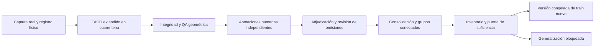

# V26: incorporación, anotación y control de nuevos datos reales

**Pipeline preparado y verificado; colección real todavía pendiente.** Hay cero imágenes nuevas recibidas, cero instancias reales aceptadas y cero regiones orgánicas nuevas utilizables. Los 1.550 objetivos de train y los 600 mínimos adicionales de generalización son planes de adquisición, no anotaciones ni datos generados. No se inició entrenamiento, inferencia o evaluación de test. Continúa seleccionado el checkpoint original de época 19.

## Decisiones tomadas desde V25

El [informe 25](25_diagnostico_datos_y_representacion.md) encontró 2.505 instancias train, pero solo cinco orgánicas y una región elegible; las otras cuatro pierden supervisión por mezcla con metal, plástico o cartón. En vidrio, 125 de 203 instancias se concentran en cinco escenas y 134 son fragmentos. Los mapas semánticos también pierden identidad entre objetos próximos. V26 se dirige a la cobertura, diversidad y coherencia de supervisión antes de gastar GPU o cambiar otra pérdida.

Se conserva la propuesta V25: 500–650 escenas train orientativas, al menos 100 escenas y 100 objetos físicos distintos en cada material prioritario, y una colección separada de 120–180 escenas para generalización. Los mínimos son puertas de suficiencia; superar los máximos orientativos de escenas no invalida fotografías útiles.



La preparación V26 no incluye un comando para entrenar ni evaluar. Congelar datos tampoco concede autorización de entrenamiento ni desbloquea generalización.

## Archivos y separación de históricos

| Elemento | Ubicación |
|---|---|
| Política de incorporación y cuotas | [incorporacion_v26.json](../configuracion/incorporacion_v26.json) |
| Protocolo independiente preregistrado | [protocolo_generalizacion_v26.json](../configuracion/protocolo_generalizacion_v26.json) |
| Esquema TACO extendido | [anotaciones_v26.schema.json](../esquemas/anotaciones_v26.schema.json) |
| Esquema de revisión humana | [revision_v26.schema.json](../esquemas/revision_v26.schema.json) |
| Plantillas, planes y bloqueo inicial | [datos/nuevos/v26](../datos/nuevos/v26) |
| Inventario pendiente y verificaciones | [resultados/v26_pipeline_datos](../resultados/v26_pipeline_datos) |
| CLI | [datos_v26.py](../scripts/datos_v26.py) |

No se modifica `datos/originales`, `datos/procesados`, `datos/normalizados`, los manifiestos históricos, modelos, entrenadores, pérdidas, inferencia ni README previo. Las funciones de escritura rechazan raíces históricas, checkpoints, código y resultados anteriores. Una salida existente no se reemplaza. Las importaciones incompletas carecen de `IMPORTADO.json` y no se consumen; una exportación incompleta carece de `CONGELADA.json` y no se acepta.

Cada paquete conserva el JSON original, copia imágenes por hash, normaliza en `coleccion.json` y publica al final un recibo con SHA256 de archivos, política, entrada y registro histórico de duplicados. No se recortan ni reparan polígonos silenciosamente. Corregir una fase humana ya publicada exige un paquete/versionado nuevo; sus revisiones anteriores quedan conservadas.

El `.gitignore` local de V26 evita subir imágenes, importaciones, tareas y expedientes privados por accidente. Las plantillas vacías y los planes sí se versionan. La herramienta no publica ni envía tareas a terceros.

## Esquema: imagen, objeto físico e instancia

Se mantiene el árbol TACO/COCO de `images`, `annotations` y `categories`, con extensiones `eco` y `physical_objects`. Los materiales canónicos son `plastico`, `papel`, `carton`, `vidrio`, `metal`, `organico`; se admiten las categorías originales TACO con el mapeo histórico. Categorías desconocidas se rechazan. `ambiguo`, `compuesto` y `fuera_alcance` se exportan como regiones ignoradas, con motivo obligatorio.

| Entidad | Campos y significado |
|---|---|
| Colección/lote | `eco.version=ecowaste_datos_reales_v26_1`, `coleccion_id` único y `tipo_datos=real` o `fixture`. No se mezclan tipos. |
| Imagen | `id`, ruta relativa, ancho/alto enteros, SHA256 de archivo; se deriva SHA de píxeles RGB y pHash. PNG/JPEG/WebP estáticos. |
| Captura | `escena_id`, `sitio_id`, `sesion_id`, `grupo_captura_id`, `secuencia_id` o null, número de fotograma si hay secuencia, dispositivo, fecha ISO con zona horaria y destino previsto. |
| Registro de objetos en captura | `eco.objetos_fisicos_ids`: identidades presentes/registradas antes de anotar. Mantienen juntos los fotogramas relacionados incluso si falta una anotación o el objeto no queda visible. |
| Procedencia | Tipo de captura, autor, referencia de adquisición, licencia, referencia de permiso y confirmación. Metadatos ausentes o permiso pendiente impiden importar datos reales. |
| Objeto físico | ID global estable, material declarado o `por_verificar`, evidencia de identidad: catálogo/ficha de adquisición. Un ID no es una detección ni una etiqueta confirmada. |
| Instancia | ID, imagen, objeto físico, material, lista de polígonos visibles y caja XYWH derivada de sus extremos. Una instancia por objeto físico e imagen; multipartes pertenecen a una sola instancia. |
| Visibilidad | `visible_only=true`, oclusión `ninguna/parcial/alta`, truncamiento y transparencia booleanos. |
| Ambigüedad/solapes | Motivo de categoría ambigua y lista `solapa_con` de otros objetos registrados. Se contrasta con intersecciones reales de máscaras, no solo con cajas. |
| Origen | Anotación humana inicial o `propuesta_automatica`. Ambas entran en cuarentena, nunca directamente en GT aceptado. |

Los IDs físicos, de sesión, sitio, escena y secuencia son globales dentro del estudio, no se reinician en cada lote. Registrar el mismo objeto con nombres nuevos rompería la agrupación; la identidad real requiere disciplina y revisión de adquisición, no puede deducirse del SHA de una foto. Un teléfono compartido no une todas sus fotos: el dispositivo se registra, mientras las uniones obligatorias se hacen por objeto, sitio, sesión, escena, grupo y secuencia.

Las coordenadas corresponden a la imagen RGB orientada. Debe normalizarse EXIF **antes** de anotar; el importador rechaza orientación pendiente, sin rotar anotaciones. No se admite RLE ni huecos sustractivos declarados en esta versión. Una lista de polígonos representa unión positiva: no usar otro polígono interior como supuesto agujero. Si se necesitan huecos, documentar una representación exacta revisada o preparar otra versión del esquema; no rellenarlos automáticamente.

La caja se calcula por extremos de los polígonos, sin inventarla desde una etiqueta de imagen. Si el archivo trae bbox, debe coincidir con tolerancia absoluta 1e-6. El área exportada es el número de píxeles de la unión visible rasterizada; se conserva el área declarada y su diferencia, porque una suma geométrica puede discrepar del relleno de píxeles. No se presenta como equivalencia bit a bit con pycocotools.

## Controles automáticos y respuesta

| Control | Comportamiento |
|---|---|
| Archivo, dimensiones y SHA | Rechazo antes de aceptar el paquete si no corresponden. Las copias verifican los bytes exactos y se publican sin reemplazo. |
| Ruta/EXIF/formato | Rechaza rutas absolutas, escapes, enlaces fuera del paquete, secuencias sin extraer y orientación EXIF pendiente. |
| IDs y referencias | Rechaza IDs repetidos, objetos sin registro o no declarados en esa captura, imagen inexistente y material desconocido. |
| Polígono | Rechaza no finitos, coordenadas fuera de imagen, longitud impar, degeneración, cruce/autocontacto y vértices repetidos. Cierre redundante se normaliza conservando geometría. |
| Duplicado de anotación | Rechaza igual material/polígono repetido entre IDs físicos distintos, incluso cambiando vértice inicial o dirección. |
| Duplicado de imagen | SHA de archivo y de píxeles: rechazo exacto dentro/entre lotes. Un histórico exacto no es adquisición real nueva. |
| Parecido perceptual | pHash con el mismo Lanczos/DCT del inventario histórico, distancia ≤4 prefijada. Candidatos nuevos se unen conservadoramente en la partición; no se eliminan por parecido. Contra históricos, un adjudicador debe justificar que son distintos. |
| Objeto pequeño | Registra lado menor a entrada letterbox 384, soporte regional y tamaño de componente; no elimina automáticamente objetos reales pequeños. |
| Solape | Intersección de máscaras, materiales y declaración recíproca. En adjudicación bloquea solape entre materiales no declarado si supera cuatro píxeles y 1 % de la máscara menor. |
| Identidad semántica | Registra componentes compartidos, fragmentación y falta de componente mínimo en 48. No modifica máscaras ni el detector para separarlos. |
| Material por objeto físico | Conflictos entre imágenes quedan bloqueados antes de congelar. Un contenido y su recipiente necesitan identidades separadas. |
| Evidencia humana | No cuentan propuestas, revisiones incompletas, personas no registradas, misma persona con aliases, versión/hash distintos o fases pendientes. |

Se reutilizan las funciones originales de letterbox, rasterización 384→48 con cobertura 1/64 y exclusión regional de padding, ignore y mezclas. Solo se analizan anotaciones; no se carga ningún checkpoint para hacer estos controles.

## Revisión humana, doble anotación y adjudicación

El registro de revisores comienza vacío. Deben darse de alta **personas reales** con `id`, `persona_id` estable, `humano=true`, `tipo=real` y roles `anotador/adjudicador`. No se crean nombres ni aprobaciones para completar el inventario. La asociación entre persona y cuenta se valida organizativamente; el CLI no es un sistema de autenticación o firma electrónica.

1. Importar en cuarentena. Exportar tareas independientes: imágenes, IDs de captura y formularios vacíos, sin materiales, máscaras o cajas propuestas. Compartir solo esa carpeta con cada anotador, no el paquete que contiene las propuestas. El aislamiento del paquete de trabajo debe acompañar al procedimiento; no es un ACL del sistema de archivos.
2. Cartón, vidrio, papel y orgánicos requieren dos anotaciones completas por personas distintas, incluyendo búsqueda de omisiones. Ambiguos también requieren doble anotación. Para imágenes restantes se usa un muestreo hash determinista de tasa 0,2; no se promete exactamente 20 % en lotes pequeños. Puede anotarse doblemente todo el resto.
3. Comparar IDs físicos presentes/ausentes, material e IoU de máscaras. IoU <0,85 o distinto material abre discrepancia; ese umbral solo señala revisión, no decide automáticamente cuál es correcta. No se promedian polígonos ni se elige la predicción más confiada.
4. Una tercera persona, distinta de los dos anotadores, adjudica las imágenes de doble anotación. En el resto el adjudicador debe ser distinto del primer anotador. Recibe las anotaciones previas, discrepancias y duplicados candidatos; publica polígonos/material final y un motivo.
5. La adjudicación exige revisión de solapes y de la imagen completa. Si un objeto registrado no tiene polígono final, se justifica individualmente como totalmente ocluido, fuera de cuadro o no residuo. La ambigüedad de un objeto visible se anota como ignore; no justifica omitirlo. Si se descubre un objeto físico aún no registrado, se crea una versión de paquete que amplíe el registro y vuelva a vincular las revisiones.

Cada evento guarda protocolo, SHA de colección/imagen, fase, persona, declaración humana, polígonos completos, motivo, fecha UTC, número y hash anterior. Un bloqueo de archivo evita dos escritores simultáneos; la publicación es atómica y no reemplaza eventos. Se rechazan huecos, alteraciones y revisiones de otra versión. La cadena y sus recibos ofrecen trazabilidad de archivos, no prueba independiente de lo observado físicamente por una persona.

Estados: `pendiente_primera` → `pendiente_segunda` cuando corresponde → `pendiente_adjudicacion` → `aceptada`. La etiqueta `aceptada` en una fixture sigue siendo solo una simulación y jamás acredita adquisición real.

## Inventario pendiente y cómo se contabiliza

| Material | Objetivo nuevo train | Aceptadas reales | Pendientes |
|---|---:|---:|---:|
| plástico | 150 | 0 | 150 |
| papel | 300 | 0 | 300 |
| cartón | 300 | 0 | 300 |
| vidrio | 250 | 0 | 250 |
| metal | 150 | 0 | 150 |
| orgánico | 400 | 0 | 400 |
| **Total train** | **1.550** | **0** | **1.550** |

`adquisicion/plan_train_1550.csv` tiene 1.550 slots de planificación; los campos de imagen, objeto físico y escena están vacíos. Un slot no es una instancia. El inventario operativo se calcula de los paquetes revisados, no del número de filas editadas en el CSV.

Se informan imágenes recibidas, estados humanos, instancias adjudicadas, escenas y objetos físicos distintos por material. Para la cuota se cuenta una combinación material/escena/objeto físico una sola vez, con máximo cinco objetos por material y escena. Así un video de un residuo no acredita cientos de adquisiciones. Para los cuatro materiales prioritarios se exigen además ≥100 escenas y ≥100 objetos físicos distintos en train.

### Puerta de 300 orgánicos utilizables

El criterio V26 es más exigente que tener una celda regional: el polígono final humano debe conservar **un componente C8 de al menos dos tokens regionales válidos en 48×48**, excluidos padding, ignore y mezclas, usando la geometría original. No se cambia la pérdida ni el postprocesamiento. La condición se registra por instancia.

Se cuenta como máximo una región por objeto y escena, cinco por escena y **tres por objeto físico** entre escenas. Para llegar a 300 no basta filmar la misma manzana. La cuota de 400 orgánicos no sustituye el mínimo de 300 utilizables. Las instancias pequeñas que no cumplen siguen anotadas y visibles en QA; no se falsifican sus polígonos para pasar el criterio.

Priorizar restos visibles fuera de envoltorios; vidrio de botellas/vasos/tarros en más escenas, sin inflar diversidad con fragmentos de una foto; cartón corrugado/impreso, roto/sucio y papel. Capturar interiores/exteriores, reflejos, transparencia, variación de luz, tamaño y cercanía. La evidencia física debe resolver composites y contenido frente a recipiente. RealWaste continúa con etiquetas globales; no se transforma en detección.

## Particiones y colección independiente bloqueada

La unión de grupos es transitiva: si A comparte objeto con B y B comparte sesión con C, los tres permanecen juntos. También se unen sitio completo, escena, grupo de captura, secuencia y candidatos perceptuales nuevos. Dos destinos previstos opuestos en el mismo componente producen error; la herramienta no rompe el grupo para satisfacer cuotas. No hay fallback a sorteo por fotograma.

Es recomendable reservar sitios/sesiones para cada destino antes de capturar, usando `destino_previsto`. Si queda `sin_asignar`, la asignación usa componentes y orden hash con semilla 2601, buscando aproximadamente 20 % de escenas para generalización sin dividir componentes. No usa AP, predicciones ni clases para elegir destinos; puede no alcanzar balance y la puerta de suficiencia lo bloqueará. La asignación se conserva al reordenar las entradas normalizadas. Versiones con metadatos o revisiones diferentes requieren plan nuevo; no se reutiliza un plan con otro digest de cohorte.

La estructura real inicial de generalización está en `datos/nuevos/v26/generalizacion_bloqueada`, con protocolo y bloqueo, **todavía sin imágenes**. Tiene un plan separado de 600 instancias mínimas, 100 por material y al menos 50 escenas con cada material, en 120–180 escenas orientativas. Esas 600 no forman parte de las 1.550 de train. Al congelar habrá un árbol `generalizacion_bloqueada/` separado de `train_nuevo/`.

Se deben incluir sitios, objetos, sesiones y secuencias no compartidos con train; conviene variar también dispositivos. Registrar varios sitios independientes: con muy pocos componentes de adquisición los intervalos y las conclusiones de generalización serán débiles. La independencia real depende de que los IDs representen las relaciones físicas correctamente.

El protocolo ya fija referencia histórica por SHA, argmax, umbrales actuales, una/cinco vistas, cinco como análisis principal, métricas por clase/globales, FP por escena, geometría, fusión y costes. Fija bootstrap pareado por componente de adquisición (2.000 réplicas, semilla 2601, 95 %), cuya interpretación exige suficientes grupos independientes. No implica una precisión estadística garantizada.

La evidencia favorable futura requiere aumento de mAP50, aumento de AP50 de cartón/vidrio/orgánicos, no caída de papel/recall y aumento máximo relativo de FP/escena de 10 %, interpretando soporte e intervalos. Son criterios previos de lectura, **sin adopción automática**. Antes de abrir la colección deben declararse candidatos y SHA bajo una autorización nueva. V26 no incluye evaluador ni comando de desbloqueo; no se seleccionan épocas, pérdidas o umbrales con esta colección.

El bloqueo es de flujo y de API, no cifrado ni un ACL: los archivos locales pueden ser leídos por quien tenga acceso al disco. `ColeccionCongelada` rechaza generalización incluso en ensayo. El conjunto test original no se abre para inferencia ni se evalúa. Se usan hashes de archivos históricos y metadatos de duplicados del inventario para preservación y evitar reutilización, sin consultar sus etiquetas para generar GT nuevo.

## Procedimiento operativo

Preparar primero los registros de captura/objetos, referencias de permiso y personas revisoras reales. Completar las plantillas en un directorio de trabajo; no importar el catálogo vacío como si fueran datos adquiridos. El validador Python es la autoridad de aceptación: JSON Schema ayuda al editor, pero no verifica geometría, archivos ni revisión humana por sí solo.

```powershell
$pyEco = Join-Path $env:USERPROFILE '.venvs\EcoWasteFormer\Scripts\python.exe'

# Rutas de ejemplo: deben contener fotografías, registro y personas reales.
& $pyEco scripts/datos_v26.py importar `
  --anotaciones datos/nuevos/v26/privado/lote001/annotations.json `
  --imagenes datos/nuevos/v26/privado/lote001 `
  --revisores datos/nuevos/v26/privado/revisores_reales.json `
  --salida datos/nuevos/v26/importaciones/lote001_v1

& $pyEco scripts/datos_v26.py tareas `
  --paquete datos/nuevos/v26/importaciones/lote001_v1 `
  --salida datos/nuevos/v26/tareas/lote001_independientes
```

Cada persona completa sus instancias por imagen: `id`, `objeto_fisico_id`, `material`, `poligonos`, `visible_only`, `oclusion`, `truncado`, `transparente`, `solapa_con` y motivo de ambigüedad cuando corresponda. Extraer **una entrada de tarea por archivo de revisión**; no pasar el contenedor entero `tareas.json` al comando `revisar`. Completar persona, declaración y cobertura; no conservar los null/false de la plantilla como si fueran aprobaciones.

```powershell
& $pyEco scripts/datos_v26.py revisar `
  --paquete datos/nuevos/v26/importaciones/lote001_v1 `
  --entrada datos/nuevos/v26/privado/revision_persona1_imagen1.json

# Tras recibir ambas anotaciones de las imágenes prioritarias:
& $pyEco scripts/datos_v26.py tareas --adjudicacion `
  --paquete datos/nuevos/v26/importaciones/lote001_v1 `
  --salida datos/nuevos/v26/tareas/lote001_adjudicacion

# Registrar la adjudicación con revisar; después consultar estados.
& $pyEco scripts/datos_v26.py estado `
  --paquete datos/nuevos/v26/importaciones/lote001_v1 `
  --salida resultados/v26_pipeline_datos/estado_lote001_r1.json
```

Para candidatos históricos parecidos, la tarea de adjudicación incluye el digest del candidato: resolver con `duplicados_resueltos=[{candidato,decision:"distinto",motivo}]` solo cuando la comprobación humana lo respalde. Un duplicado histórico exacto se rechaza en la importación real y no tiene escape por esta vía. Revisar fotos, no solo nombres o scores.

```powershell
# Añadir los demás lotes revisados en --paquetes; IDs físicos/sitios son globales.
& $pyEco scripts/datos_v26.py plan `
  --paquetes datos/nuevos/v26/importaciones/lote001_v1 `
  --salida resultados/v26_pipeline_datos/plan_coleccion_v1.json

& $pyEco scripts/datos_v26.py inventario `
  --paquetes datos/nuevos/v26/importaciones/lote001_v1 `
  --plan resultados/v26_pipeline_datos/plan_coleccion_v1.json `
  --salida resultados/v26_pipeline_datos/inventario_coleccion_v1.json

# Solo funcionará con cuotas, diversidad, revisión y 300 orgánicos suficientes.
& $pyEco scripts/datos_v26.py congelar `
  --paquetes datos/nuevos/v26/importaciones/lote001_v1 `
  --plan resultados/v26_pipeline_datos/plan_coleccion_v1.json `
  --salida datos/nuevos/v26/colecciones/coleccion_real_v1
```

La congelación vuelve a consolidar los paquetes y diarios, verifica el plan y rechaza estados inventados en memoria. Publica copias de imágenes, manifiestos y TACO separados, huella de política, copia del protocolo, entrada original y trazas de revisión en procedencia, y un recibo final con SHA de todos los archivos. El adaptador nuevo usa esas rutas explícitas y las funciones originales de transformación; no redirige `ResiduosDataset`, `ContornosTACO` ni los entrenadores históricos. Todos los marcadores conservan `entrenamiento_autorizado=false` y `evaluacion_autorizada=false`.

## Diagnóstico, pruebas e integridad

Pasaron **246 pruebas: las 201 existentes intactas y 45 nuevas**. Cubren geometría, clases, referencias, duplicados, metadata/EXIF/rutas, revisión humana por personas distintas, omisiones, eventos alterados, exclusión de fixtures, grupos transitivos, planes incompatibles, conteo de fotogramas y límite por objeto orgánico, exportación TACO, máscaras y bloqueo de generalización. Las imágenes de unit tests son fixtures temporales explícitas; no se presentan como colección nueva.

El [ensayo de integración vigente](../resultados/v26_pipeline_datos/ensayo_integracion_revision02.json) reutiliza `taco:0` y `taco:1` de train: dos fotos y tres anotaciones originales, con metadatos/revisores **simulados y marcados fixture**. Recorre seis fases de revisión, materialización TACO, lectura de tensor 3×384×384 y máscara 48×48. Comprueba rechazo de congelación real y lectura de generalización. Se elimina el directorio temporal al terminar; el inventario real sigue en cero. No hay datos sintéticos sustituyendo las 1.550 instancias.

Se conserva el primer ensayo, anterior a la ampliación de controles; la revisión 02 registra hashes del código vigente. No se alteraron geometrías históricas para superar la importación. Durante desarrollo, una prueba detectó una importación Python ausente en el adaptador de máscaras; se corrigió antes del diagnóstico final. El ensayo final y la suite completa pasan sin ese fallo.

La certificación final conserva hashes de archivos históricos, estadísticas de los 105 checkpoints y SHA del seleccionado, además del manifiesto V25. No se modificó código protegido, por lo que no se regeneraron ni ejecutaron diagnósticos que entrenan modelos históricos. V26 tiene manifiesto propio de código, plantillas, resultados y protocolo; las revisiones se rechazan con hashes/protocolo distintos.

```powershell
& $pyEco -m unittest discover -s pruebas
& $pyEco scripts/verificar_v26.py
```

Para repetir el diagnóstico de integración, usar otra ruta nueva con `ensayar_v26.py --salida ...`; las muestras temporales se descartan automáticamente. `preparar_v26.py` es inicialización de una salida vacía, no un comando para sobrescribir la preparación existente. La asignación de grupos se reproduce con los mismos IDs/metadatos; tiempos humanos, rutas de procedencia y sus hashes pueden variar entre ejecuciones y no se afirma identidad binaria de los diarios.

## Límites y siguiente acción

La geometría automática no prueba material físico, licencia, exhaustividad, independencia real de las personas ni identidad de objetos. Las referencias y declaraciones deben contrastarse durante adquisición y adjudicación. El pHash puede agrupar fotos distintas y no detecta todas las imágenes relacionadas; por eso se priorizan IDs físicos/sitios/sesiones/secuencias y no solo similitud visual. Las métricas de QA no convierten una anotación en verdad por sí solas.

La siguiente acción es **recibir y registrar fotografías reales con su evidencia física y permisos**, anotar y adjudicar las prioritarias, y consultar el inventario calculado. Mientras falten suficiencia y congelación, la colección no está lista. Después seguirá haciendo falta una autorización explícita para un experimento de entrenamiento o para abrir generalización; V26 no concede ninguna de las dos.
