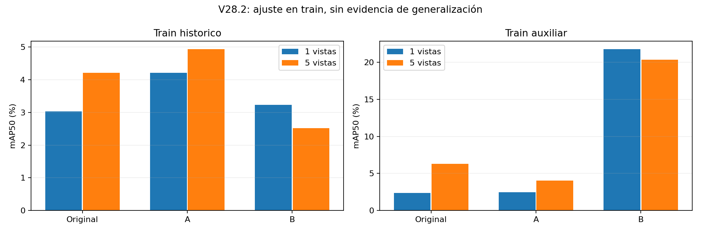
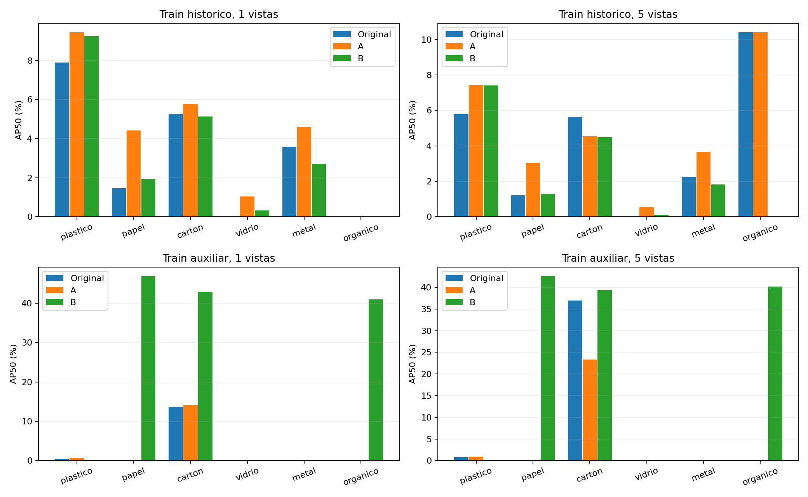
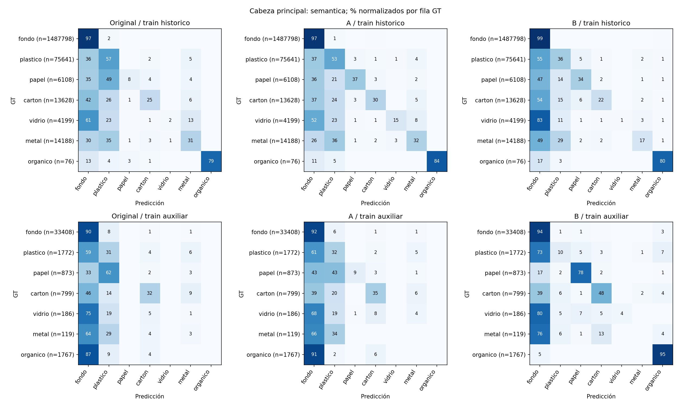
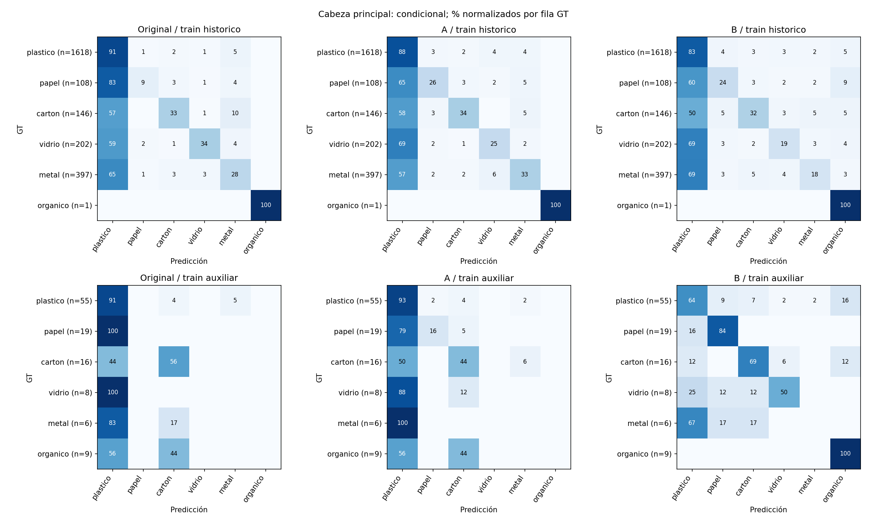
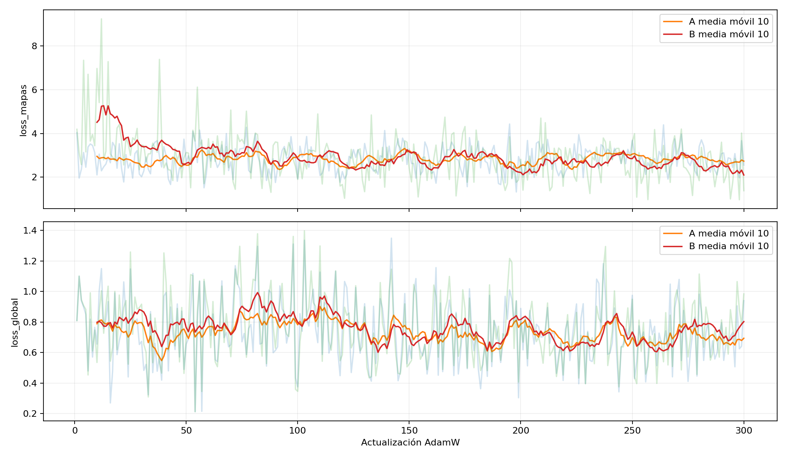

# V28.2 — Entrenamiento exploratorio con correcciones del usuario

**Piloto A300/B300 completado y verificado. No se adopta ningún checkpoint; el detector predeterminado sigue siendo el original de época19.**

## Colección y alcance de la autorización

El usuario autorizó expresamente este diagnóstico reducido sin resolver previamente las 44 imágenes señaladas en V28. Se creó una colección independiente **EXPLORATORIA, NO VALIDADA PARA ADOPCIÓN** en `datos/nuevos/v28_2/coleccion/`. La exportación V28 conserva `NO_ENTRENAR`, sus archivos y todos sus bloqueos; no se usa como atajo para entrenar la colección completa.

Se verificaron de nuevo las 28 candidatas del archivo original de suficiencia: última revisión humana completa de `juan_miguel`, cadenas válidas, contornos y materiales coincidentes con el guardado, fotografías con SHA correcto, geometría, ignore, compatibilidad 384×384/48×48 y ausencia de incidencias conocidas en la auditoría V28. No se añadieron objetos, materiales, contornos o aprobaciones humanas. La ausencia de incidencias identificadas **no certifica exhaustividad visual**.

| Material | Instancias positivas auxiliares |
|---|---:|
| Plástico | 55 |
| Papel | 19 |
| Cartón | 16 |
| Vidrio | 8 |
| Metal | 6 |
| Orgánico | 9 |
| **Total** | **113** |

Hay además tres objetos compuestos ignorados, no positivos. Son 116 registros COCO en 28 fotografías: diez WaRP, dos HPI, cinco ZeroWaste y once WasteSegCluster. No se confunden con las 256 propuestas automáticas originales ni con todas las correcciones de las 72 fotografías del editor.

La colección tiene solo tres instancias alimentarias HPI; los otros seis orgánicos son vegetación WSC. Se conserva el material guardado por el usuario y se informa esta diferencia de dominio. No se cumplen las referencias V28 de 40 imágenes y ocho instancias de metal; el usuario levantó expresamente esas condiciones solo para el piloto diagnóstico. No se modifican las cuotas oficiales V26. Aceptación V26 e independencia de revisores: **cero**.

Fuentes de evidencia: [dataset exacto](../resultados/v28_2_exploratorio/dataset.json), [reverificación](../resultados/v28_2_exploratorio/verificacion_previa_datos.json), [manifestación COCO local](../datos/nuevos/v28_2/coleccion/MANIFIESTO.json). Se preservan procedencia, revisión y hashes en cada imagen y objeto; los campos físicos desconocidos permanecen desconocidos.

Los duplicados se recomprobaron entre candidatas; se conserva el certificado V28 de coincidencias exactas/perceptuales con train/val históricos, cuyo resultado para estas candidatas es vacío. No se volvió a abrir la partición test ni se evaluó val. Un pHash distante no demuestra independencia física. Las fuentes completas se consideran grupos exclusivamente train; no se construye un holdout independiente con fotogramas potencialmente relacionados. Las escenas se contabilizan como fotografías, sin acreditar identidades físicas o sesiones desconocidas.

Las evidencias de licencia se copiaron con sus bytes y hashes. WaRP conserva la declaración CC0 del distribuidor, HPI y WSC CC BY 4.0, y ZeroWaste el alcance académico no comercial CC BY-NC de los autores, incluida la discrepancia del registro Zenodo. El conjunto combinado se limita a investigación académica no comercial y conserva atribución. No se concede permiso comercial homogéneo ni se suben fotografías de terceros a Git. Originales y revisiones históricas siguen intactos; los ejemplos con fotografías permanecen en una carpeta local ignorada por Git.

## Protocolo fijado antes de las métricas

| Elemento | V28.2 |
|---|---|
| Origen común | Checkpoint propio época 19, SHA256 `eb8fd00ee536ead21e3a2a0ecd5b06baad04acb2e437b22e0eac3686a7bf36b9` |
| Presupuesto | Exactamente 300 actualizaciones AdamW por rama; sin ampliar ni seleccionar mejor época |
| A | Ocho imágenes históricas por lote: 2.400 exposiciones |
| B | Seis históricas comunes y dos auxiliares: 1.800 históricas y 600 auxiliares |
| Auxiliar global | Lote 16 balanceado por frecuencia train, mismo plan A/B; coeficiente original 0,5 |
| Modelo | Transformer original, mapas softmax7, dimensión96, entrada384 y rejilla48; cabeza auxiliar original |
| Pérdida | CE foreground ponderada + 3·CE fondo + Dice; sin pérdidas regionales V17 o discriminativas V20 |
| Pesos de materiales | Vector histórico fijo `[0.1334036589,0.4694581330,0.3142898083,0.5662046671,0.3080248833,3.0]`, calculado solo con máscaras train históricas |
| AdamW | LR0,0005, weight_decay0,01, betas(0,9;0,999), eps1e-8, estados ep19 restaurados; sin nuevo warmup |
| Numérica | Backend completo V23: SDPA MATH, cuDNN determinista, benchmarkFalse, algoritmos deterministas, TF32False, precisión highest, cuBLAS `:4096:8`, AdamW foreach/fusedFalse, AMP y GradScaler |
| Aumentos/clipping | Flip0,5, brillo/contraste[0,85;1,15]; norma máxima1, foreachFalse |
| Muestreo | Plan inmutable de barajados cíclicos; estado RNG loader/global auxiliar ep19, semilla2801 para las dos ranuras nuevas; lote siempre8 |
| Checkpoints | 0,100,200,300 por rama, rutas y diarios exclusivos; salida de proceso y restauración en100 |
| Evaluación | Original, A300, B300; train histórico completo964 y auxiliar28, separados, una/cinco vistas |
| Postprocesamiento | Argmax7, umbral0,05, componentesC8, área≥2, NMS0,5, top100; visualización histórica0,35 |
| Selección/adopción | Ninguna; no evaluar val, test ni generalización |

La comparación estima el efecto de **sustituir el 25 % del lote a presupuesto fijo**. B recibe menos datos históricos; no aísla el beneficio de añadir imágenes manteniendo la misma exposición histórica. Las 600 exposiciones nuevas equivalen a 21,43 pasadas medias sobre 28 imágenes: existe un riesgo alto de memorización. El presupuesto es el piloto breve de ajuste y retención aprobado, no una búsqueda de hiperparámetros. No se reutilizan las 1.452 actualizaciones de V20.

El plan se materializa antes del entrenamiento y se conserva junto con su hash. Sus RNG de muestreo son copias de los estados iniciales; el cursor determina cada lote al reanudar. Los RNG efectivos torch/CUDA se restauran del checkpoint, sin nuevos sorteos del plan. Las mismas posiciones consumen los mismos aumentos A/B. La tarea global sigue usando exclusivamente el caché RealWaste train existente y validado; sus etiquetas de imagen nunca se convierten en cajas o máscaras.

Los targets auxiliares conservan los polígonos y huecos guardados, con la rasterización histórica por cobertura1/64 y la misma precedencia de positivos frente a ignore por caja. No se cambió silenciosamente la política de bordes/padding de V6 ni se recalcularon los pesos de clase con las imágenes nuevas. Los tres compuestos se tratan conservadoramente como regiones ignore por caja, sin fabricar positivos.

## Controles y reanudación

Las 310 pruebas anteriores y doce pruebas nuevas pasaron en la primera suite completa: **322**. Las nuevas verifican presupuesto, entradas compartidas, plan reproducible sin consumir RNG global, cursor de reanudación, rasterizado compatible, huecos, ignore, solapes entre materiales, rechazo de otro protocolo/rama, publicaciones inmutables, diarios discontinuos y separación de inferencia/GT.

Se ejecutaron dos actualizaciones continuas y una actualización posterior a restaurar el estado del primer paso, para cada rama, usando el mismo motor AdamW de producción. La comparación conserva rtol1e-4 y atol1e-5 e incluye entradas/aumentos, logits de ambas tareas, pérdidas, gradientes sin escala y después del clipping, norma, pesos, estado nominal de AdamW, scaler y RNG. Se comprobó restauración exacta antes de aplicar las opciones numéricas explícitas de AdamW; foreach/fusedFalse son la política V23, no un cambio de pérdida. Los pesos temporales se eliminaron al cerrar el diagnóstico.

Durante la integración se detectó que el evaluador nuevo trasladaba logits a CPU antes del softmax. Se corrigió antes del entrenamiento para procesarlos en CUDA como el flujo histórico. Se preservaron los primeros controles y se repitieron con el código definitivo en `controles_inferencia_cuda_v2/`. El entrenador rechaza los certificados iniciales desactualizados. No hubo cambio de hipótesis, pesos iniciales, pérdida o presupuesto.

Los diarios publican trazas por actualización y commits inmutables con SHA del checkpoint, del commit previo y de todas las trazas confirmadas. Los checkpoints contienen pesos, AdamW, scaler, RNG, cursor, historial, contrato y backend efectivo. La reanudación rechaza origen, datos, código, plan, rama, backend o contadores incompatibles. Los intentos parciales se conservan sin sobrescribir y solo se reanuda desde un punto confirmado de100 pasos. No hay alias que sustituya al detector seleccionado.

## Medición e interpretación prevista

La inferencia recibe solo píxeles, ID, ruta, dimensiones y hash. Se guardan logits FP16, predicciones por imagen y trazas de cinco vistas; el observador V19 exige igualdad exacta con el postprocesamiento real sobre los mismos logits. Las métricas y las consultas GT se calculan después. Se conserva softmax en CUDA tanto para una vista como para cinco.

El evaluador es el propio del proyecto, AP interpolada en101 recalls con ignore regions; no COCOeval oficial. mAP50:95 promedia umbrales0,50–0,95. TP/FP/FN, recall y precisión corresponden a IoU0,50 con umbral de puntuación0,05. Se informa AP de las seis clases, sin mezclar dominios. El original se infiere de nuevo bajo el mismo backend V23 que A y B; sus resultados pueden diferir legítimamente de la cifra histórica4,224 % train obtenida con otro backend. No se exige identidad entre backends ni se reevalúa la referencia de validación.

El soporte histórico es 2.505 positivos: 1.630 plásticos,109 papeles,149 cartones,203 vidrios,409 metales y solo cinco orgánicos. El auxiliar tiene113 positivos. AP orgánico histórico es especialmente inestable con cinco GT; una única detección puede mover sustancialmente la media macro de seis clases. No se calcularon intervalos de confianza ni se prefijó un margen estadístico de no inferioridad.

Las confusiones de la cabeza principal se miden sobre tokens válidos, y por voto mayoritario dentro de cada instancia: argmax incluyendo fondo y clasificación condicional entre los seis materiales. La mejora condicional no equivale a recuperación frente al fondo o detección con IoU suficiente. Las oportunidades por etapa cuentan GT con alguna caja de clase correcta e IoU≥0,50; permiten ver pérdidas antes/después de filtros, sin ser una asignación uno a uno ni modificar predicciones.

Los indicadores de fusión/fragmentación se calculan geométricamente a partir de cajas. No certifican identidad física ni sustituyen la revisión de contornos/oclusiones. La comparación visual usa doce imágenes escogidas antes de entrenar mediante SHA de ID: dos por dominio y clase prioritaria cartón/vidrio/orgánico, con prioridad HPI alimentaria. Se muestran las dos modalidades, cajas, material, confianza, número de omitidos y GT en un panel separado. No se escogen solo casos favorables a B.

Los paneles diagnósticos dibujan todas las cajas del umbral de evaluación0,05 para no ocultar falsos positivos; la aplicación conserva su umbral visual0,35. Cambiar el dibujo de un panel posterior no modifica ninguna predicción ni la configuración del detector.

## Resultados finales

Se completaron **300 actualizaciones reales por rama**, sin parada por métricas y sin ampliar el presupuesto. Los estados de los pasos0/100/200/300 están separados; ambas ramas se restauraron en procesos nuevos desde100. **No se adopta A ni B.** La aplicación conserva el checkpoint original de época19.

### Métricas globales

Porcentajes en mAP/AP/recall/precisión; TP/FP/FN son cantidades absolutas. Las filas de train auxiliar miden ajuste sobre las mismas fotografías utilizadas por B, no generalización.

| Train | Modelo | Vistas | mAP50 % | mAP50:95 % | Recall % | Precisión % | TP | FP | FN |
|---|---|---|---|---|---|---|---|---|---|
| historico | Original | 1 | 3.034 | 1.231 | 16.886 | 9.684 | 423 | 3945 | 2082 |
| historico | A | 1 | 4.211 | 1.919 | 17.804 | 9.407 | 446 | 4295 | 2059 |
| historico | B | 1 | 3.227 | 1.404 | 12.774 | 9.756 | 320 | 2960 | 2185 |
| historico | Original | 5 | 4.216 | 1.418 | 23.633 | 3.517 | 592 | 16239 | 1913 |
| historico | A | 5 | 4.933 | 1.787 | 25.788 | 3.461 | 646 | 18018 | 1859 |
| historico | B | 5 | 2.522 | 1.137 | 17.485 | 3.452 | 438 | 12250 | 2067 |
| auxiliar | Original | 1 | 2.352 | 0.625 | 5.310 | 2.564 | 6 | 228 | 107 |
| auxiliar | A | 1 | 2.474 | 0.729 | 7.080 | 3.509 | 8 | 220 | 105 |
| auxiliar | B | 1 | 21.763 | 10.885 | 20.354 | 10.798 | 23 | 190 | 90 |
| auxiliar | Original | 5 | 6.290 | 2.319 | 15.929 | 2.273 | 18 | 774 | 95 |
| auxiliar | A | 5 | 4.051 | 1.724 | 15.044 | 2.051 | 17 | 812 | 96 |
| auxiliar | B | 5 | 20.362 | 10.861 | 25.664 | 3.432 | 29 | 816 | 84 |



### AP50 por material

**Train historico**

| Material | Original1v | A1v | B1v | Original5v | A5v | B5v |
|---|---|---|---|---|---|---|
| plastico | 7.890 | 9.438 | 9.247 | 5.789 | 7.423 | 7.404 |
| papel | 1.449 | 4.429 | 1.943 | 1.221 | 3.027 | 1.300 |
| carton | 5.283 | 5.773 | 5.144 | 5.638 | 4.543 | 4.499 |
| vidrio | 0.000 | 1.039 | 0.330 | 0.013 | 0.538 | 0.104 |
| metal | 3.579 | 4.589 | 2.701 | 2.242 | 3.671 | 1.823 |
| organico | 0.000 | 0.000 | 0.000 | 10.396 | 10.396 | 0.000 |

**Train auxiliar**

| Material | Original1v | A1v | B1v | Original5v | A5v | B5v |
|---|---|---|---|---|---|---|
| plastico | 0.468 | 0.737 | 0.000 | 0.826 | 0.935 | 0.086 |
| papel | 0.000 | 0.000 | 46.831 | 0.000 | 0.000 | 42.550 |
| carton | 13.646 | 14.109 | 42.822 | 36.912 | 23.373 | 39.368 |
| vidrio | 0.000 | 0.000 | 0.000 | 0.000 | 0.000 | 0.000 |
| metal | 0.000 | 0.000 | 0.000 | 0.000 | 0.000 | 0.000 |
| organico | 0.000 | 0.000 | 40.924 | 0.000 | 0.000 | 40.170 |



### Recuperación de regiones y confusión con fondo

Cada celda de la tabla siguiente indica `correctas / fondo / otro material / sin tokens`, por voto de la cabeza principal incluyendo fondo, en una vista. El denominador de la clasificación condicional solo considera instancias con tokens válidos; sus matrices completas están en los JSON de análisis.

**Train historico**

| Material | Original | A | B |
|---|---|---|---|
| carton | 33 / 53 / 60 / 3 | 35 / 50 / 61 / 3 | 28 / 85 / 33 / 3 |
| vidrio | 3 / 173 / 26 / 1 | 14 / 171 / 17 / 1 | 0 / 200 / 2 / 1 |
| organico | 1 / 0 / 0 / 4 | 1 / 0 / 0 / 4 | 1 / 0 / 0 / 4 |

**Train auxiliar**

| Material | Original | A | B |
|---|---|---|---|
| carton | 7 / 8 / 1 / 0 | 6 / 6 / 4 / 0 | 9 / 6 / 1 / 0 |
| vidrio | 0 / 7 / 1 / 0 | 0 / 6 / 2 / 0 | 0 / 8 / 0 / 0 |
| organico | 0 / 7 / 2 / 0 | 0 / 6 / 3 / 0 | 9 / 0 / 0 / 0 |





**Orgánicos auxiliares por fuente**, sin cambiar sus etiquetas:

| Modelo | Fuente | Instancias | Con tokens | Voto orgánico con fondo | Voto condicional orgánico |
|---|---|---|---|---|---|
| Original | hpi | 3 | 3 | 0 | 0 |
| Original | wsc | 6 | 6 | 0 | 0 |
| A | hpi | 3 | 3 | 0 | 0 |
| A | wsc | 6 | 6 | 0 | 0 |
| B | hpi | 3 | 3 | 3 | 3 |
| B | wsc | 6 | 6 | 6 | 6 |

**Detección orgánica por fuente**, calculada offline sobre todas las imágenes HPI/WSC del auxiliar, sin inferencia nueva ni selección de casos:

| Modelo | Vistas | Fuente | GT orgánicos | TP | FP orgánicos | FN | AP50 % |
|---|---|---|---|---|---|---|---|
| Original | 1 | hpi | 3 | 0 | 0 | 3 | 0.000 |
| Original | 1 | wsc | 6 | 0 | 0 | 6 | 0.000 |
| Original | 5 | hpi | 3 | 0 | 0 | 3 | 0.000 |
| Original | 5 | wsc | 6 | 0 | 0 | 6 | 0.000 |
| A | 1 | hpi | 3 | 0 | 0 | 3 | 0.000 |
| A | 1 | wsc | 6 | 0 | 0 | 6 | 0.000 |
| A | 5 | hpi | 3 | 0 | 0 | 3 | 0.000 |
| A | 5 | wsc | 6 | 0 | 0 | 6 | 0.000 |
| B | 1 | hpi | 3 | 1 | 1 | 2 | 33.663 |
| B | 1 | wsc | 6 | 3 | 36 | 3 | 43.762 |
| B | 5 | hpi | 3 | 2 | 10 | 1 | 39.604 |
| B | 5 | wsc | 6 | 3 | 166 | 3 | 43.762 |

Las nueve regiones orgánicas auxiliares pasan el criterio geométrico de utilidad48×48 de QA. Eso no certifica su detección, exhaustividad o diversidad. Solo tres son alimentarias HPI.

### Oportunidades antes y después del postprocesamiento

Conteos `componentes antes de filtros / final`, cinco vistas; clase correcta e IoU≥0,50. Una misma propuesta puede proporcionar oportunidades para varios GT: no son TP asignados uno a uno.

| Train | Modelo | Cartón | Vidrio | Orgánico |
|---|---|---|---|---|
| historico | Original | 24 / 19 | 1 / 1 | 1 / 1 |
| historico | A | 27 / 21 | 9 / 9 | 1 / 1 |
| historico | B | 24 / 18 | 2 / 2 | 1 / 0 |
| auxiliar | Original | 9 / 9 | 0 / 0 | 0 / 0 |
| auxiliar | A | 7 / 7 | 0 / 0 | 0 / 0 |
| auxiliar | B | 9 / 9 | 0 / 0 | 7 / 5 |

| Train | Modelo | GT con indicador fusión bbox | GT con indicador fragmentación bbox | Geometría insuficiente | Material incorrecto IoU50 |
|---|---|---|---|---|---|
| historico | Original | 557 | 54 | 943 | 267 |
| historico | A | 569 | 70 | 940 | 254 |
| historico | B | 271 | 63 | 734 | 231 |
| auxiliar | Original | 28 | 0 | 44 | 19 |
| auxiliar | A | 24 | 3 | 46 | 17 |
| auxiliar | B | 14 | 0 | 40 | 13 |

Los indicadores de caja no prueban una fusión o división física real. Son un diagnóstico separado de las matrices de material y fondo y de los TP/FP oficiales del evaluador propio. Menos indicadores de fusión también pueden deberse a menos respuesta foreground y menor recall; no prueban por sí solos mejor separación.

### Curvas, tiempo y memoria

| Rama | Actualizaciones | AdamW final | s actualizaciones | s con checkpoints | GPU allocated MiB | GPU reserved MiB | Loss primeras50 | Loss últimas50 |
|---|---|---|---|---|---|---|---|---|
| A | 300 | 2599 | 49.41 | 54.06 | 916.55 | 1060.00 | 3.124072 | 3.134018 |
| B | 300 | 2599 | 46.88 | 51.53 | 916.55 | 1060.00 | 4.127628 | 2.878305 |

Los tiempos anteriores excluyen verificación de datos, construcción del modelo y carga inicial; incluyen las etapas efectivamente señaladas. La pérdida B usa otros datos y no es directamente una métrica de detección comparable con A.



| Train | Modelo | Vistas | s captura + disco + observador | GPU allocated MiB | GPU reserved MiB |
|---|---|---|---|---|---|
| historico | Original | 1 | 8.85 | 174.13 | 294.00 |
| historico | Original | 5 | 407.37 | 122.36 | 294.00 |
| historico | A | 1 | 5.92 | 174.13 | 294.00 |
| historico | A | 5 | 345.96 | 122.36 | 294.00 |
| historico | B | 1 | 5.33 | 174.13 | 294.00 |
| historico | B | 5 | 330.56 | 122.36 | 294.00 |
| auxiliar | Original | 1 | 0.38 | 173.57 | 294.00 |
| auxiliar | Original | 5 | 4.47 | 122.36 | 294.00 |
| auxiliar | A | 1 | 0.49 | 173.57 | 294.00 |
| auxiliar | A | 5 | 5.07 | 122.36 | 294.00 |
| auxiliar | B | 1 | 0.38 | 173.57 | 294.00 |
| auxiliar | B | 5 | 4.72 | 122.36 | 294.00 |

### Respuestas e interpretación

1. **Aprendizaje auxiliar:** B obtiene 29 TP frente a 17 de A y 18 del original; mAP50 20.362 % frente a 4.051 % de A. Hay una mejora de ajuste/detección en este subconjunto entrenado.

2. **AP por clase:** las tablas anteriores registran las seis clases en ambos dominios y modalidades; no se selecciona una clase favorable para declarar éxito global.

3. **carton auxiliar5v:** Original: TP9, FP162; A: TP7, FP175; B: TP9, FP118.

3. **vidrio auxiliar5v:** Original: TP0, FP0; A: TP0, FP35; B: TP0, FP11.

3. **organico auxiliar5v:** Original: TP0, FP0; A: TP0, FP1; B: TP5, FP303.

4. **Retención histórica:** B mAP50 2.522 %, A 4.933 %, original 4.216 %. Delta B−original -1.695 puntos porcentuales y B−A -2.411. No se prefijó margen de no inferioridad; estos resultados son descriptivos y no acreditan equivalencia estadística.

La caída macro con cinco vistas está muy influida por orgánico histórico: pasa de AP50 10.396 % a0, con solo cinco GT, y aporta -1.733 puntos a la variación del mAP50. No se elimina esta clase del criterio para rescatar B. Además hay una pérdida real de recall: B conserva438 TP frente a592 del original y646 de A, por lo que la retención no se resume únicamente por ese efecto de media macro.

Con una vista B alcanza mAP50 histórico3,227 % frente a3,034 % del original, pero queda por debajo de A4,211 % y su recall es12,774 % frente a16,886 % del original. La conclusión depende de la modalidad; no se cambia automáticamente el modo predeterminado de cinco vistas.

5. **Memorización/generalización:** no puede distinguirse aprendizaje transferible de memorización con esta evaluación. B vio las mismas28 imágenes unas21–22 veces y se evalúa sobre ellas; cualquier ganancia es compatible con memorización. Train histórico también es train. No hay evidencia nueva de generalización y no se abrió otro conjunto para buscarla.

6. **Falsos positivos:** B genera 816 en auxiliar y 12250 en histórico con cinco vistas; A genera 812 y 18018. La precisión y recall completos están en la tabla global.

7. **Errores persistentes:** consultar confusión con fondo/material, oportunidades y geometría anteriores. Una región clasificada condicionalmente como su material no implica una caja correcta; un indicador de fusión tampoco autoriza dividir automáticamente una anotación humana.

En auxiliar5v, B recupera14 papeles y5 orgánicos; conserva9 cartones detectados, igual que el original, y cae a un plástico frente a los nueve del original. Vidrio y metal permanecen sin TP. La ganancia de AP de cartón no equivale a encontrar más cartones en esta colección.

B produce303 FP orgánicos sobre el auxiliar completo, de los cuales127 están fuera de HPI/WSC. En HPI hay2 TP y10 FP orgánicos; en WSC3 TP y166 FP. El aprendizaje de material no ha producido una discriminación suficientemente selectiva. Las ocho instancias auxiliares de vidrio tienen voto mayoritario fondo en la cabeza principal y ninguna oportunidad correcta antes de filtros: ese fallo no se resuelve solo con NMS.

Las trazas localizan pérdidas concretas en el filtro de bordes de vistas: B tiene una oportunidad orgánica histórica hasta top100_vista y cero después de bordes; en auxiliar pasa de siete a cinco oportunidades orgánicas en esa misma etapa. El postprocesamiento no cambió; cambiaron las propuestas producidas por los pesos. Se conserva la política prefijada y no se ajustan filtros después de mirar estos resultados.

**Ejemplo prefijado HPI40:** la cabeza de B ya vota orgánico en los restos, pero en una vista produce una caja que engloba ambos restos y parte del plato, con IoU insuficiente para ambos GT. Cinco vistas recuperan un objeto y añaden varias cajas. La clasificación de material ha cambiado y la separación sigue limitada. Los FP se definen respecto al GT disponible: su exhaustividad y la granularidad de migas/manchas requieren criterio humano, no se certifican a partir de una predicción. Véase [comparación local HPI40](../datos/nuevos/v28_2/visuales_privados/11_auxiliar_organico.png).

8. **Siguiente intervención:** completar QA humana antes de otro entrenamiento. Este piloto no autoriza ampliar pasos, retocar umbrales, cambiar pérdidas o sustituir el detector predeterminado.

### Correcciones humanas de mayor utilidad

- **Comida real:** completar cobertura de HPI0,132,155,78,96 y192; revisar granularidad en HPI23 y fragmentos/solapes en54,173 y114. Hoy solo hay tres regiones alimentarias utilizables; faltan al menos cinco alimentarias para la referencia reducida de ocho, sin acreditar vegetación como diversidad alimentaria. Dibujar únicamente residuos realmente visibles y justificar ignore ambiguo.

- **Recuperar escenas de vidrio ya revisadas:** resolver las incidencias de WaRP POSAD_1_13-Sep_02-24-53, POSAD_1_13-Sep_03-20-46, Robo_25-Mar_14-39-46 y prepared_data_all_MGS_20-Oct_01-03-59. Conservan cinco objetos guardados como vidrio excluidos por QA de escena; corregir la incidencia, no aceptar automáticamente su material.

- **Cartón frente a multicapa:** adjudicar los nueve milk/juice-cardboard señalados en V28. Confirmar composición o marcar compuesto/ambiguo con motivo; no entrenar envases multicapa como cartón simple por el nombre de la fuente.

- **Cobertura de papel y descartes:** revisar ZeroWaste1001,1076,1709,2670,2688,2706/2709/2710,2843,331,588 y896. Los residuos omitidos no deben enseñarse como fondo. Aclarar descartes «error/no se distingue» y mantener relacionadas las secuencias.

- **Guardar pendientes:** completar las cuatro fotografías sin evento y el borrador indicados en V28, además de las dos discrepancias de relleno del editor. No modificar automáticamente esos contornos ni simular una segunda revisión.

La lista completa permanece en [lista de correcciones V28](../resultados/v28_validacion_anotaciones/lista_correcciones.md). No se han alterado esas revisiones. La siguiente colección requiere nueva instantánea, QA y autorización; no usar los resultados de train para presentar una mejora definitiva.

### Evidencia y cierre

Se conservan los134 eventos humanos, los731 archivos de respaldo, los105 checkpoints históricos y los datasets/resultados originales. Se produjeron ocho checkpoints nuevos exclusivos. Las restauraciones de origen e intermedias fueron exactas; las dos comparaciones diagnósticas definitivas tienen413 tensores examinados cada una, diferencia máxima0 y ningún elemento fuera de tolerancia. Esto comprueba las trayectorias cortas medidas, no una identidad universal entre hardware o versiones. Las trazas confirman las mismas anclas, tarea global y aumentos en las300 actualizaciones.

Incidencias: se corrigió la ubicación CPU/CUDA del softmax antes de producción y se regeneraron certificados conservando los anteriores. Torch emitió una advertencia al convertir pérdidas a escalares para el diario; no fue un error de entrenamiento ni cambió los gradientes o las actualizaciones. No hubo NaN, actualización omitida ni ampliación de presupuesto.

- [Métricas JSON y protocolo](../resultados/v28_2_exploratorio/metricas.json).

- [Tabla global y AP de ambas modalidades CSV](../resultados/v28_2_exploratorio/metricas_comparativas.csv).

- [Imágenes, distribución, procedencia y hashes CSV](../resultados/v28_2_exploratorio/imagenes_y_hashes.csv).

- [Curvas y pérdidas por actualización CSV](../resultados/v28_2_exploratorio/curvas_entrenamiento.csv).

- [Índice de doce comparaciones visuales locales](../resultados/v28_2_exploratorio/visuales.json). Fotografías privadas en `datos/nuevos/v28_2/visuales_privados/`, ignoradas por Git; las imágenes GT están separadas de la inferencia.

- [322 pruebas finales](../resultados/v28_2_exploratorio/pruebas_finales.json) y su log completo.

- [Controles definitivos](../resultados/v28_2_exploratorio/controles_inferencia_cuda_v2/controles.json).

- [Verificación final de estados, presupuesto e integridad](../resultados/v28_2_exploratorio/verificacion_final.json).

- [Manifiesto final de integridad](../resultados/v28_2_exploratorio/manifiesto_integridad.json).

Predicciones finales, logits y trazas de cada modelo/dominio están bajo `resultados/v28_2_exploratorio/evaluacion/`. Permiten auditoría posterior sin repetir inferencia. Los campos efectivos del backend, versiones y hashes quedan ligados al protocolo. **Se mantiene el detector original; no se evalúan val, test o generalización y no se inicia ningún entrenamiento adicional.**


## Reproducción local

Usar el entorno ML del proyecto, no el entorno CPU del editor. Las publicaciones son inmutables: ejecutar un comando sobre resultados existentes debe verificar/reanudar o rechazar la repetición, nunca borrar evidencia.

```powershell
python scripts/verificar_datos_v28_2.py
python scripts/entrenar_v28_2.py --controles
python scripts/entrenar_v28_2.py --rama A --hasta 100
python scripts/entrenar_v28_2.py --rama B --hasta 100
python scripts/entrenar_v28_2.py --rama A --hasta 300
python scripts/entrenar_v28_2.py --rama B --hasta 300
python scripts/evaluar_v28_2.py
python scripts/probar_suite_v28_2.py
python scripts/verificar_final_v28_2.py
```

La generación de figuras usa `scripts/informar_v28_2.py` con el entorno local que dispone de Matplotlib; no carga modelos ni entrena. Para una réplica desde cero se requiere otra ubicación/versionado explícito de resultados, los mismos datos congelados y el entorno registrado. Los comandos anteriores documentan la ejecución realizada y no autorizan otro presupuesto.
