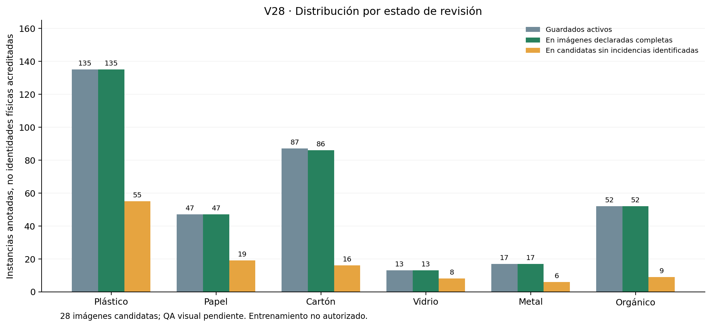

# V28: validación de anotaciones y preparación del entrenamiento

**Se recuperaron 134 eventos válidos de `juan_miguel`: 68 imágenes con guardado, 67 marcadas completas y una en borrador. Cuatro imágenes no tienen revisión guardada. El trabajo se respaldó íntegramente y no se modificó ningún contorno.**

Hay 361 registros finales guardados: **356 objetos activos y cinco descartados**. Los 67 guardados completos contienen 355 activos: 350 de los seis materiales y cinco compuestos. No se usan las 256 propuestas iniciales como recuento de objetos humanos.

**Decisión: todavía no iniciar el piloto.** Los conteos brutos por material superan ocho objetos, pero la inspección encuentra omisiones y decisiones de material pendientes. Tras los filtros conservadores quedan 28 imágenes candidatas, seis metales y solo tres regiones alimentarias HPI. Falta liberar al menos 12 imágenes y dos instancias metálicas para alcanzar la referencia 40/ocho; la prioridad orgánica exige además completar restos alimentarios, no sustituirlos por vegetación ambigua. Estos déficits pueden resolverse revisando imágenes ya disponibles; no implican capturar obligatoriamente 12 imágenes nuevas.

## Recuperación y respaldo

Proyecto activo inspeccionado: `datos/nuevos/v27_2/proyecto/seleccion_72/`.

Antes de interpretar o exportar se creó [el respaldo verificado](../resultados/v28_validacion_anotaciones/respaldo_verificado.json):

`datos/nuevos/v28/respaldos/20261122T221021Z_451eef43/proyecto/`

Son **731 archivos**, incluidos proyecto, índice de propuestas, todos los recibos SAM y los 134 eventos humanos. Se comprobaron SHA de cada archivo y la igualdad de origen, copia y origen posterior. Se tomó el bloqueo de guardado del editor para obtener la instantánea; en Windows el byte de `registro.lock` se conservó separadamente mientras el SO mantenía el bloqueo, sin vaciarlo. El primer intento detectó la restricción de lectura del archivo bloqueado antes de copiar; el respaldo verificado posterior contiene todos los bytes y no perdió revisiones.

Los logs se copiaron como los bytes observados de archivos activos, sin exigir que dejen de crecer. Las fotografías siguen en sus ubicaciones originales; la exportación de auditoría tiene copias con SHA idéntico. No se regeneraron imágenes, propuestas o revisiones del proyecto activo.

| Estado real del proyecto | Imágenes |
|---|---:|
| Con al menos un guardado humano | 68 |
| Último guardado asistido con cobertura completa | 67 |
| Último guardado asistido como borrador | 1 |
| Sin ningún guardado asistido | 4 |
| Eventos humanos | 134 |
| Identificador en todos los eventos | `juan_miguel` |
| Eventos de revisión independiente | 0 |
| Cadenas inválidas / eventos huérfanos | 0 / 0 |
| Datos formalmente aceptados V26 | 0 |

No se recupera un estado completo antiguo para ocultar un borrador posterior. Se usa el **último evento asistido** de cada imagen. Las cuatro sin diario se registran sin anotaciones humanas finales, aunque sus propuestas automáticas originales siguen conservadas.

Faltan estos guardados completos, con su número en el desplegable del editor:

| Nº | Imagen | Estado |
|---:|---|---|
| 22 | `warp:SPB_25-Mar_11-23-03` | Borrador; un objeto cartón guardado |
| 42 | `zerowaste:1823` | Sin revisión guardada |
| 43 | `zerowaste:1896` | Sin revisión guardada |
| 44 | `zerowaste:219` | Sin revisión guardada |
| 56 | `zerowaste:41` | Sin revisión guardada |

Se buscó una exportación con el nombre estándar del editor en Downloads; no se encontró. Se localizó también el proyecto inicial de 80 imágenes, pero no una segunda colección de revisiones que recuperase esos cuatro guardados. La búsqueda fue acotada a esas ubicaciones, no a todo el disco.

Los [logs respaldados](../resultados/v28_validacion_anotaciones/incidencias_guardado_logs.json) contienen **134 respuestas 200 y 256 rechazos 400** de `/api/guardar`. Las respuestas 200 coinciden con la cantidad de eventos persistidos. Los logs no contienen los cuerpos rechazados ni sus motivos: no permiten reconstruir esos cambios ni demostrar si fueron errores de geometría, campos, conflictos u otra causa. El último GET cercano es solo contexto, no prueba del contenido de un POST. No se encontraron cadenas rotas que indiquen corrupción de los guardados existentes.

## Cuántos objetos se anotaron

Comparando cada último guardado con sus propuestas efectivas originales —incluidas las máscaras SAM iniciales— se observan:

| Comparación | Registros |
|---|---:|
| Objetos añadidos respecto a las propuestas | **124** |
| Propuestas con contorno cambiado | 26 |
| Propuestas reclasificadas | 40 |
| Propuestas con cambio de contorno o material, sin doble conteo | **59** |
| Descartadas, con el motivo conservado | 5 |
| Confirmadas sin cambio de coordenadas/material | 174 |
| Originales borradas sin registro de descarte | 0 |

Estas categorías se solapan: no deben sumarse. Confirmar una propuesta mediante revisión completa es trabajo humano, pero no se presenta como modificación geométrica. La mera conversión inicial de una caja a máscara SAM tampoco se cuenta como corrección humana.

### Distribución por material

| Material | Objetos en imágenes completas | Con contornos individuales válidos | Imágenes completas distintas | Borrador o discrepancia de máscara |
|---|---:|---:|---:|---:|
| Plástico | 135 | 135 | 47 | 1 |
| Papel | 47 | 47 | 25 | 0 |
| Cartón | 86 | 86 | 25 | 1 |
| Vidrio | 13 | 13 | 11 | 0 |
| Metal | 17 | 17 | 13 | 0 |
| Orgánico | 52 | 52 | 19 | 1 |
| **Seis materiales** | **350** | **350** | No sumar entre clases | **3** |

El cartón del borrador añade un activo guardado: **87 cartones y 356 activos** si se incluyen borradores. Los 355 activos de imágenes completas incluyen además **cinco compuestos** en cuatro imágenes; hay cero ambiguos, fuera de alcance o sin clasificar activos. Los cinco descartes se conservan aparte, sin contarlos como positivos.

«Contornos válidos» significa anillos numéricos, dentro de imagen, sin cruces o degeneración. Dos máscaras tienen una diferencia entre reglas de relleno, aunque sus anillos individuales sean válidos. Por ello hay **348 positivos de seis clases sin esa discrepancia**, no 350 máscaras sin incidencias. La última columna solo cuenta borrador/discrepancia numérica; **no es el total de omisiones o decisiones visuales pendientes**.

Las tablas verificables están en [tabla_informe_materiales.json](../resultados/v28_validacion_anotaciones/tabla_informe_materiales.json), [distribucion.csv](../resultados/v28_validacion_anotaciones/distribucion.csv) y [objetos.json](../resultados/v28_validacion_anotaciones/objetos.json).



## Controles geométricos y de representación

Se comprobaron correspondencias imagen/evento/proyecto por SHA, IDs, materiales, contornos cíclicos, cajas derivadas a tolerancia 1e-6, motivos, regiones vacías, huecos, componentes, solapes, duplicados, letterbox 384 y rejilla 48. No se escribieron geometrías normalizadas en los diarios humanos. El cierre de un polígono puede ser implícito, como en el editor y COCO: no hace falta repetir el primer vértice.

Dos discrepancias técnicas de relleno:

| Imagen | Objeto en editor | Diferencia | Interpretación |
|---|---:|---:|---|
| `warp:Monitoring_photo2_04-Mar_00-17-58` | 2 | 4 píxeles de 71.218 | Paridad even-odd del editor frente a unión menos huecos del exportador V27.2 |
| `hpi:114` | 1 | 7 píxeles de 27.848 | La misma diferencia de convención en bordes/anillos |

Son diferencias pequeñas de rasterización, **no evidencia de que el objeto entero esté mal dibujado**. Se preservan contornos y ambas máscaras en el COCO de auditoría. No se amplió una tolerancia para aprobarlas ni se pide redibujar todo por unos píxeles; debe fijarse explícitamente la interpretación antes de un dataset entrenable.

Hay avisos automáticos visuales en **13 imágenes**. Para fragmentación se registran todos los componentes y se señala más de un componente significativo, definido como área ≥máximo(4 píxeles, 1 % del área de máscara). Un componente desconectado puede ser oclusión legítima; no se transforma automáticamente en otro objeto. Los solapes se señalan con más de cuatro píxeles y más del 1 % de la máscara menor, siguiendo el criterio existente V26. Ninguna de estas señales prueba por sí sola un error humano.

En **31 imágenes** varias instancias del mismo material pueden compartir un componente en 48×48. Esto es un límite de representación de la cabeza semántica, distinto de una anotación equivocada. No se fusionaron instancias GT para acomodarlas al modelo. Oclusión, material real y pertenencia física no se deducen de una caja o de un componente; los metadatos no publicados siguen desconocidos.

No aparecieron candidatos exactos o pHash≤4 contra train/val históricos ni entre las 72 fotos. Eso no demuestra independencia: ZeroWaste 2706/2709/2710 comparten escena y objetos visibles. Se conserva esa relación y la agrupación por fuente; ninguna de estas fotos se usa como evaluación externa independiente.

## Regiones orgánicas

Hay **52 instancias etiquetadas orgánico**: 43 HPI, seis WSC y tres WaRP. Se calculó cobertura en 384 y tokens 48 excluyendo padding completo/parcial, ignoradas y mezcla de materiales. Se prefiere interior del polígono y se exige un componente C8 de al menos dos tokens, conforme al diagnóstico regional existente.

| Conteo | Regiones |
|---|---:|
| Geométricamente potenciales en imágenes declaradas completas | **49** |
| De ellas HPI, restos alimentarios | **40** |
| En las 28 candidatas sin incidencias identificadas | **9** |
| De ellas HPI | **3** |
| Aceptadas formalmente V26 | **0** |

Estos 49 no acreditan cobertura exhaustiva, identidad física o aceptación para entrenar. Las 12 HPI tienen guardados completos y máscaras, pero varias muestran alimento visible sin contorno. En HPI 0 faltan restos alargados junto al puré; en 132 queda comida beige/filamentosa; en 155 quedan restos morados; en 192 quedan restos claros por encima de la región inferior. Hay observaciones concretas también en 114, 173, 78 y 96. HPI 23 requiere confirmar la granularidad de una instancia que agrupa rodajas.

Con la pérdida de mapas original, un residuo visible sin máscara se convierte en supervisión de fondo. Eso puede penalizar que el detector lo reconozca después. Completar esas regiones o conservar un ignore justificado es más útil que entrenar inmediatamente con falsos negativos de anotación.

Las cuatro propuestas WSC originalmente Organic pasaron de `sin_asignar` a decisiones de `juan_miguel` en eventos guardados: **no fueron aceptadas automáticamente**. Eso no las convierte en sobras alimentarias ni acredita por sí mismo que toda vegetación fotografiada sea residuo. La taxonomía histórica incluye Vegetation, pero el mínimo alimentario del piloto no debe llenarse con vegetación ambigua.

## Decisiones visuales y taxonómicas pendientes

La [lista concreta para el editor](../resultados/v28_validacion_anotaciones/lista_correcciones.md) agrupa **44 imágenes** con número en el desplegable, IDs de objetos cuando existen y motivos. Es una lista de corrección **o decisión**, no la afirmación de que 44 imágenes tengan polígonos rotos.

Prioridades para aprovechar el trabajo guardado:

1. Completar el borrador y recuperar/guardar las cuatro ZeroWaste sin eventos. No se sustituyen por sus propuestas originales como supuesto trabajo humano.
2. Completar alimentos visibles sin máscara en HPI, usando cajas/clics SAM; mantener una granularidad coherente entre restos conectados y piezas distintas. Si algo visible no puede anotarse con certeza, conservar una región ignorada justificada en vez de enseñarla como fondo.
3. Revisar papel impreso omitido en ZeroWaste, especialmente 1001, 1076, 1709, 2670, 2688, 2706/2709/2710, 2843, 331, 588 y 896. Hay omisiones reconocibles aunque el checkbox de cobertura esté marcado.
4. Resolver **nueve anotaciones `milk-cardboard`/`juice-cardboard`** guardadas como cartón, papel o plástico sin motivo que resuelva la composición. La taxonomía del proyecto excluye envases multicapa de cartón simple. La fuente puede tener errores: confirmar composición o marcar compuesto/ambiguo con motivo; no reemplazar automáticamente una decisión humana por la etiqueta del proveedor.
5. Confirmar posibles fragmentaciones, oclusiones y solapes. En WaRP POSAD 03:20:46, objeto 7, hay contradicción con la fuente bottle-green/plástico y la etiqueta humana orgánico. En la pieza porosa de WaRP MGS 20-Oct, objeto 7, debe aclararse resto alimentario frente a espuma/esponja.
6. Precisar los cinco motivos de descarte. Dos dicen «error» y tres variantes de «no se distingue». Si era una propuesta falsa debe explicarse; si sigue habiendo residuo visible ambiguo se necesita una máscara ignore, no eliminar su supervisión como si fuera fondo.

Las observaciones visuales del asistente no son una revisión humana independiente ni nuevas anotaciones GT. Se conservaron únicamente como decisiones pendientes. La inspección de contactos tampoco certifica la exhaustividad de cada píxel de las otras imágenes.

Las **11 cajas WaRP inicialmente pendientes ya tienen contornos humanos guardados y válidos**, con sus cambios de material registrados. Algunas requieren todavía decisión de material/contexto, pero ninguna sigue siendo solo una caja. La comprobación por ID está en [comprobaciones_especificas.json](../resultados/v28_validacion_anotaciones/comprobaciones_especificas.json).

## Exportación auxiliar conservada

Se creó una colección **de auditoría**, sin aprobación QA ni habilitación de entrenamiento:

`datos/nuevos/v28/colecciones/auditoria_usuario_v28_1_1d4f127a7626/`

Contiene **67 fotografías con bytes originales, 355 instancias COCO —350 de seis materiales y cinco ignoradas compuestas—**, anotaciones originales, revisiones humanas con bytes exactos, descartes, contornos/huecos finales, procedencia, licencias y manifiestos. No incluye las cuatro sin guardado ni el borrador como anotaciones completas. Todo el trabajo de las 68 guardadas permanece además en el respaldo íntegro.

Archivos principales: `annotations.json`, `anotaciones_fuente_originales.json`, `correcciones_humanas_finales.json`, `descartes_humanos.json`, `revisiones/`, `LICENCIAS_Y_PROCEDENCIA.json`, `MANIFIESTO.json` y `MANIFIESTO_COMPLEMENTO_LICENCIAS.json`. Las máscaras con huecos usan RLE COCO; se conservan sus anillos y la alternativa del editor en los dos casos de discrepancia. No se inventaron cajas o máscaras desde etiquetas globales.

**`QA_PENDIENTE.json` y el COCO indican NO_ENTRENAR.** No es una colección final congelada para entrenamiento. Los campos de identidad física, sitio, sesión, captura y dispositivo siguen como `null`. El estado es corregida por un usuario, no revisión independiente ni aceptación V26. Las cuotas oficiales continúan en 1.550 train, 600 generalización y ≥300 orgánicos utilizables pendientes.

Licencias: WSC y HPI conservan CC BY 4.0; WaRP conserva la declaración CC0 del distribuidor original; ZeroWaste conserva el alcance CC BY-NC de autores y la discrepancia del registro. La colección no tiene permiso comercial homogéneo irrestricto. Se copiaron las evidencias originales de licencia/procedencia junto a los datos. Fotografías, respaldos y correcciones están ignorados por Git y no se redistribuyeron.

## ¿Alcanza para el experimento?

Los controles puramente automáticos dejaban 53 candidatas con 98 plásticos, 40 papeles, 58 cartones, diez vidrios, 12 metales y 27 orgánicos. **La revisión visual y taxonómica reduce esa lista a 28**, antes de afirmar que los datos están listos.

| Material | Objetos en candidatas sin incidencias identificadas | Faltan hasta ocho |
|---|---:|---:|
| Plástico | 55 | 0 |
| Papel | 19 | 0 |
| Cartón | 16 | 0 |
| Vidrio | 8 | 0 |
| Metal | 6 | **2** |
| Orgánico | 9 | 0 por etiqueta; **solo tres HPI alimentarios** |

Faltan **12 imágenes liberadas de incidencias** para llegar a 40; cinco regiones alimentarias verificadas para el mínimo prioritario de ocho HPI/comida equivalente. No es necesario completar las cuotas V26 para un exploratorio, pero tampoco usar las cifras brutas para ignorar problemas de cobertura. Las 28 son candidatas sin observaciones identificadas bajo esta auditoría, no una certificación de exhaustividad o independencia física.

Esta es la instantánea V28.1. Si el usuario guarda nuevas correcciones, se debe respaldar y auditar como otra revisión; no sobrescribir esta evidencia ni aplicar automáticamente observaciones visuales antiguas a una imagen corregida.

## Protocolo A/B propuesto y deshabilitado

La [configuración exacta propuesta](../configuracion/entrenamiento_auxiliar_v28_propuesto.json) conserva barreras de autorización y un hash de datos todavía `null`. No se implementó ni ejecutó un entrenador V28 sobre esta colección no aprobada. Se prepara la especificación; el adaptador de datos, sus controles de gradientes/reanudación y las trazas deberán verificarse después de resolver QA y obtener autorización expresa.

| Elemento | Propuesta fijada antes de ejecutar |
|---|---|
| Origen común | Checkpoint original ep19, SHA `eb8fd00ee536ead21e3a2a0ecd5b06baad04acb2e437b22e0eac3686a7bf36b9` |
| Arquitectura | Transformer/mapas softmax7, entrada384, dimensión96, auxiliar global original |
| Estados | Pesos, AdamW, scaler y RNG torch/CUDA/loaders/auxiliar del origen, con huellas comprobadas antes de actualizar |
| Presupuesto | **300 actualizaciones AdamW por rama**, 600 en total; sin parada temprana por métricas |
| Lote A | Ocho históricas: seis anclas comunes y dos ranuras de control históricas |
| Lote B | Las mismas seis anclas históricas y dos imágenes auxiliares revisadas |
| Efecto estimado | Sustituir el 25 % del lote a igual presupuesto; no adición con igual exposición histórica |
| LR / optimizador | 0,0005, AdamW betas(0,9;0,999), eps1e-8, weight_decay0,01; clipping1 |
| Warmup/scheduler | Ninguno nuevo; continuación de la fase estable del origen |
| Scaler | Restaurado: scale2048 y growth_tracker299, además del resto de su estado |
| Pérdida | Original foreground + 3·fondo + Dice; auxiliar global0,5 con lote16; sin pérdidas V17/V20 |
| Pesos de materiales | Vector histórico fijo `[0.1334036589,0.4694581330,0.3142898083,0.5662046671,0.3080248833,3.0]`; no recalcularlo con auxiliares |
| Numérica | Backend completo V23: SDPA MATH, cuDNN determinista, benchmarkFalse, algoritmos deterministas, TF32False, precisiónhighest, CUBLAS `:4096:8`, foreach/fusedFalse, AMP |
| Orden/aumentos | Streams registrados; anclas y auxiliar global iguales A/B; stream nuevo auxiliar semilla2801; flip0,5 y brillo/contraste[0,85;1,15] por posición iguales |
| Datos nuevos | 40–60 fotos QA resuelta, ≥ocho polígonos por material, prioridad alimentaria explícita; fuente/grupos conocidos unidos |
| Checkpoints | Pasos0,100,200,300 en rutas exclusivas V28 con hash de datos e ID de ejecución; no sobrescribir |
| Comparación principal | Checkpoints finales al mismo paso300; sin escoger mejor sobre val histórica |

**Justificación del presupuesto:** dos ranuras nuevas por 300 pasos son 600 exposiciones, equivalentes a diez–15 pasadas medias sobre 40–60 fotos. Es un piloto breve de capacidad y retención, no un entrenamiento final. A ve 2.400 imágenes históricas y B 1.800 históricas más 600 auxiliares: esta diferencia debe constar al interpretar causalmente. Se mantiene LR/AdamW del origen para no mezclar un cambio de optimización, sin elegir valores por validación. No se reutilizan automáticamente las 1.452 actualizaciones de V20.

Se inspeccionó el checkpoint en CPU: época19, contador AdamW2299, configuración y estados esperados. Se guardaron sus huellas. Eso no significa que ya se haya restaurado un entrenador V28 o comprobado identidad numérica de una ejecución nueva. La reanudación deberá restaurar también cursores de los streams, aumentos, historial y contador de pasos; no se afirmará identidad bit a bit sin medirla.

### Evaluación y criterio de interpretación

Después de una futura autorización, comparar referencia original, A300 y B300 en **train histórico completo y el auxiliar train seleccionado**, con una y cinco vistas. Fijar y guardar las listas antes de inferencia. Registrar mAP50/50:95, AP de seis clases, recall, precisión, TP/FP/FN, FP por100 imágenes, confusión material/fondo, recuperación por instancia, IoU semántico, geometría/fusión, tiempo y memoria. Guardar predicciones y trazas por imagen. GT solo entra al análisis, nunca al forward de detección.

Se mantienen argmax7, fondo3, umbral0,05, visual0,35, conectividad8, área mínima2, NMS0,5 y top100. Test y generalización siguen bloqueados; no se usa otra vez val histórica para seleccionar variantes. La referencia se debe medir bajo el mismo backend numérico que A/B; las métricas históricas de otro backend no garantizan predicciones idénticas.

El criterio descriptivo propuesto exige mejora de mAP50 auxiliar y AP50 cartón/vidrio frente a A, conservación de mAP50 histórico y ausencia de empeoramiento de recall, precisión y FP/100 auxiliares. Si no se cumplen todas las condiciones, informar el tradeoff, sin rescatar solo una métrica. Si mejora la clasificación condicional pero no AP/oportunidades de detección, declarar que la intervención no solucionó la detección. Ningún resultado implica adopción automática.

Detener por integridad, datos/backend distintos, no finitos, actualización omitida por scaler, exceso de presupuesto o reanudación incompatible. No detener anticipadamente por desempeño. Sin una colección nueva independiente, las conclusiones son sobre **aprendizaje/capacidad de ajuste train**, no generalización. El modelo original permanece predeterminado.

## Pruebas e integridad

Se mantienen las **292 pruebas anteriores** y se añaden **18**: respaldo incluyendo bloqueo, no confundir propuestas con humanos, último borrador, deltas, contornos/huecos, discrepancia de relleno, tokens/padding/mezclas, representación de instancias y barreras de autorización. La suite final de **310 pruebas** y su resultado real quedan en `resultados/v28_validacion_anotaciones/pruebas_finales.json` y su log.

El manifiesto V28 registra código, configuración, tablas, gráficas, respaldo y exportación. Se verifica de nuevo la integridad histórica, el checkpoint original y las estadísticas de los 105 checkpoints; las revisiones del usuario se comparan con su respaldo. No se cambió el código de V27.2 ni se sobreescribieron resultados anteriores. Las pruebas usan figuras descartables; no generan revisiones ficticias sobre estas fotos.

```powershell
$pyEco = Join-Path $env:USERPROFILE '.venvs\EcoWasteFormer\Scripts\python.exe'
& $pyEco scripts/verificar_preparacion_v28.py
```

La siguiente acción útil es resolver las decisiones de la lista y guardar los cambios en el mismo editor. La siguiente auditoría debe conservar esta versión y volver a medir la suficiencia antes de congelar datos y solicitar la autorización de ejecución.
