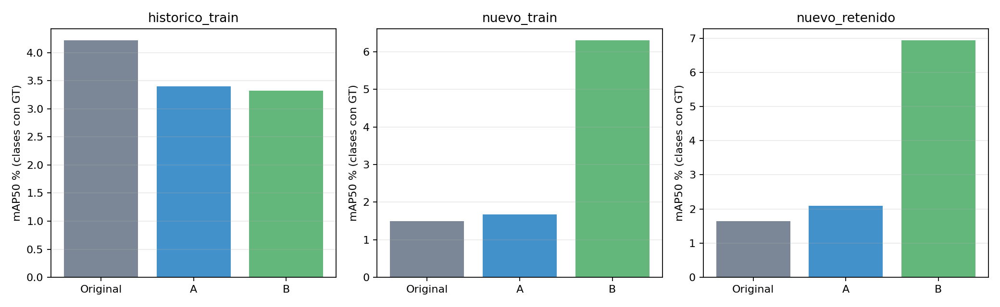
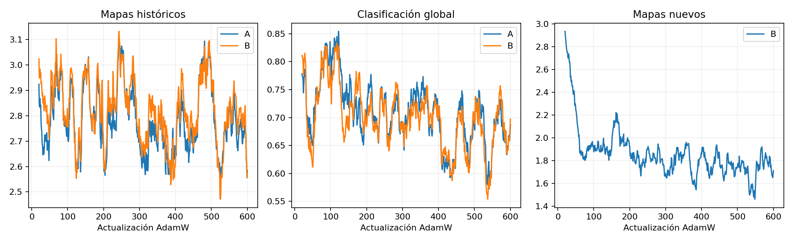
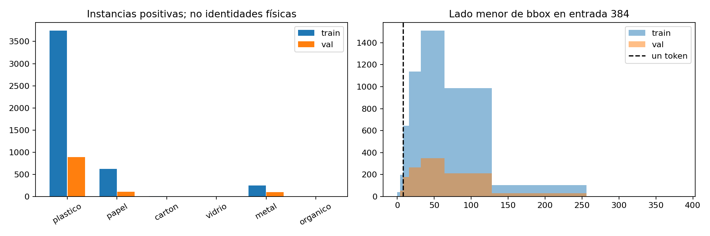

# V29 — PackWISE v2 y CLICK: entrenamiento controlado de datos

Experimento autorizado por el usuario. Se conservan el Transformer, la pérdida original, el checkpoint predeterminado y los históricos. No se usa test ni se desbloquea generalización.

## Fuentes y colección

[PackWISE v2, Fraunhofer](https://fordatis.fraunhofer.de/handle/fordatis/463.2): ZIP completo verificado con MD5 publicado; train/val originales 410/88 imágenes y 4669/990 instancias. Se preservan RLE y huecos. [CLICK v2](https://data.mendeley.com/datasets/htcvvz6fm2/2): COCO train/val originales 901/113 imágenes y 1802/221 instancias; los autores declaran corrección de propuestas SAM en Label Studio. Licencias oficiales CC BY 4.0. La descripción de CLICK conserva una frase de licencia pendiente, aunque la ficha oficial publica CC BY; se conserva esa discrepancia.

Las anotaciones se atribuyen a los autores. No constituyen decisiones del usuario, revisión independiente de EcoWasteFormer ni aceptación formal V26. Los datos originales permanecen en `datos/nuevos/v29/externos`; la colección congelada, COCO, máscaras, hashes y procedencia están en `datos/nuevos/v29/coleccion`. Las fotos están excluidas de Git. CLICK se extrae selectivamente por HTTP Range: se verifican CRC ZIP y SHA256 por archivo. Su SHA256 del ZIP completo permanece declarado, no verificado, porque no se descarga el archivo íntegro.

| Cohorte | Imágenes | Plástico | Papel | Cartón | Vidrio | Metal | Orgánico | Ignore |
|---|---:|---:|---:|---:|---:|---:|---:|---:|
| train | 1050 | 3745 | 623 | 6 | 0 | 250 | 0 | 1353 |
| val | 240 | 887 | 108 | 0 | 0 | 95 | 0 | 339 |

Se ignoran categorías sin correspondencia material suficiente: multicapa, recubiertos de aluminio, tapas sin material, vasos/envases de papel potencialmente laminados, paper-other amplio y objetos indefinidos. No se convierten etiquetas globales en cajas. Las cajas finales se derivan de las máscaras, conservando también las cajas originales.

Se reagrupan únicamente los train y val públicos en un protocolo nuevo: nuestras cohortes no equivalen a los splits publicados por los proveedores. Test permanece cerrado. PackWISE se agrupa por secuencia completa: Vollstrom1/2 para train y Vollstrom6 prevista para retención. CLICK se agrupa en bloques de veinte nombres, con selección determinista anterior a métricas. Esta agrupación heurística no demuestra independencia física. Coincidencias exactas y candidatos perceptuales unen grupos; si conectan train y retención, el componente entero se reserva para train. Coincidencias con train/val históricos excluyen el grupo nuevo. Los errores geométricos excluyen la imagen completa, evitando enseñar un objeto conocido como fondo. Véase `mapeo_y_agrupacion.json`.

**Estas fuentes no aportan nuevas regiones de vidrio u orgánico y el cartón es muy escaso. No completan las cuotas V26 ni solucionan por sí solas las clases deficientes.** Las instancias sin un componente de dos celdas en 48×48 se contabilizan por material en el manifiesto: una fotografía de alta resolución no garantiza que el objeto resulte representable en la entrada actual. Se inspeccionaron visualmente siete ejemplos con superposiciones y un detalle de cartón; esto es inspección del agente, sin cambiar etiquetas, y no revisión humana exhaustiva. Véase `inspeccion_visual_agente.json`.

## Protocolo fijado antes de medir

A/B parten de época 19 con pesos, AdamW, scaler y RNG restaurados. Backend V23 completo, AMP, LR 0.0005, clipping 1, fondo 3, pesos históricos por material y clasificación global de 16 imágenes con coeficiente 0.5. Sin warmup nuevo, nuevas pérdidas, cambio de resolución, parada temprana, selección por validación o adopción automática.

Cada rama realiza 600 actualizaciones: 4800 exposiciones históricas idénticas (ocho por paso). B añade dos imágenes PackWISE y dos CLICK por actualización, 2400 exposiciones nuevas en total. Se aplica a ese microbatch la misma pérdida original, con contribución prefijada 0.5; la rama A no recibe este microbatch. B tiene más cómputo y exposición total: la comparación mide el efecto de añadir esa supervisión conservando la exposición histórica, no una comparación de FLOPs iguales. Un RNG privado para los aumentos/dropout nuevos evita desplazar el flujo histórico. Checkpoints exclusivos en pasos 0, 100, 300 y 600.

El presupuesto busca unos pocos recorridos de cada fuente nueva y limita la adaptación desde época 19. No se reutilizan por defecto los 1452 pasos de V20 ni se amplía el presupuesto tras observar resultados. Solo se evalúa el paso final.

## Controles y reproducibilidad

Las pruebas cubren COCO RLE/polígonos, huecos, padding, ignore, mezclas, geometría equivalente C/Fortran, duplicados, aislamiento del RNG y rechazo de protocolos/rutas/test incompatibles. Antes del presupuesto se comparan C1, C2 y R (2+guardar+restaurar+2), cuatro AdamW reales por trayectoria y rama: entradas, logits, pérdidas, gradientes, clipping, pesos, AdamW, scaler y RNG. Restauración exacta y tolerancia fija rtol=1e-4, atol=1e-5. Los pesos diagnósticos se descartan. La igualdad bit a bit solo se informa si queda registrada en cada comparación.

## Métricas finales

Inferencia con argmax, umbral 0.05, área mínima 2, NMS 0.5, top100, una y cinco vistas. El evaluador propio interpola 101 recalls y maneja ignore; no es COCOeval oficial. mAP promedia las clases que tienen GT: revisar soportes y AP por material. Los valores de las cohortes nuevas no se comparan directamente con el 2.912 % histórico de validación. No se ha vuelto a usar esa validación para ajustar el piloto.

| Dominio | Modelo | Vistas | mAP50 | mAP50:95 | Recall | Precisión | TP | FP | FN |
|---|---|---:|---:|---:|---:|---:|---:|---:|---:|
| historico_train | Original | 1 | 3.034 % | 1.231 % | 16.886 % | 9.684 % | 423 | 3945 | 2082 |
| historico_train | Original | 5 | 4.216 % | 1.418 % | 23.633 % | 3.517 % | 592 | 16239 | 1913 |
| nuevo_train | Original | 1 | 1.574 % | 0.570 % | 13.754 % | 12.077 % | 636 | 4630 | 3988 |
| nuevo_train | Original | 5 | 1.489 % | 0.514 % | 22.837 % | 5.469 % | 1056 | 18254 | 3568 |
| nuevo_retenido | Original | 1 | 1.867 % | 0.698 % | 13.486 % | 11.826 % | 147 | 1096 | 943 |
| nuevo_retenido | Original | 5 | 1.637 % | 0.589 % | 22.752 % | 5.452 % | 248 | 4301 | 842 |
| historico_train | A | 1 | 4.058 % | 1.757 % | 18.323 % | 11.074 % | 459 | 3686 | 2046 |
| historico_train | A | 5 | 3.397 % | 1.500 % | 24.990 % | 3.905 % | 626 | 15404 | 1879 |
| nuevo_train | A | 1 | 1.515 % | 0.575 % | 12.846 % | 11.184 % | 594 | 4717 | 4030 |
| nuevo_train | A | 5 | 1.667 % | 0.592 % | 21.215 % | 4.961 % | 981 | 18794 | 3643 |
| nuevo_retenido | A | 1 | 2.226 % | 0.675 % | 14.771 % | 13.100 % | 161 | 1068 | 929 |
| nuevo_retenido | A | 5 | 2.091 % | 0.684 % | 23.211 % | 5.479 % | 253 | 4365 | 837 |
| historico_train | B | 1 | 3.777 % | 1.629 % | 18.204 % | 11.041 % | 456 | 3674 | 2049 |
| historico_train | B | 5 | 3.323 % | 1.548 % | 25.309 % | 3.902 % | 634 | 15613 | 1871 |
| nuevo_train | B | 1 | 5.667 % | 2.401 % | 24.027 % | 25.807 % | 1111 | 3194 | 3513 |
| nuevo_train | B | 5 | 6.301 % | 2.875 % | 33.261 % | 11.379 % | 1538 | 11978 | 3086 |
| nuevo_retenido | B | 1 | 5.996 % | 2.437 % | 23.486 % | 25.049 % | 256 | 766 | 834 |
| nuevo_retenido | B | 5 | 6.932 % | 2.977 % | 32.477 % | 11.434 % | 354 | 2742 | 736 |

| Dominio, cinco vistas | Modelo | plastico | papel | carton | vidrio | metal | organico |
|---|---|---:|---:|---:|---:|---:|---:|
| historico_train | Original | 5.789 % | 1.221 % | 5.638 % | 0.013 % | 2.242 % | 10.396 % |
| historico_train | A | 11.504 % | 0.782 % | 5.876 % | 0.184 % | 2.040 % | 0.000 % |
| historico_train | B | 9.636 % | 1.781 % | 6.408 % | 0.238 % | 1.879 % | 0.000 % |
| nuevo_train | Original | 5.107 % | 0.656 % | 0.000 % | sin GT | 0.194 % | sin GT |
| nuevo_train | A | 6.224 % | 0.421 % | 0.000 % | sin GT | 0.023 % | sin GT |
| nuevo_train | B | 16.907 % | 8.298 % | 0.000 % | sin GT | 0.000 % | sin GT |
| nuevo_retenido | Original | 4.544 % | 0.140 % | sin GT | sin GT | 0.229 % | sin GT |
| nuevo_retenido | A | 6.131 % | 0.008 % | sin GT | sin GT | 0.133 % | sin GT |
| nuevo_retenido | B | 20.091 % | 0.704 % | sin GT | sin GT | 0.000 % | sin GT |

| Rama | Actualizaciones | Tiempo de entrenamiento confirmado | Máxima memoria GPU asignada |
|---|---:|---:|---:|
| A | 600 | 86.24 s | 916.6 MiB |
| B | 600 | 103.86 s | 916.6 MiB |

AP por material, costes y métricas por fuente: `tabla_comparativa.csv` y `metricas.json`. Las matrices de confusión, oportunidades antes/después del postprocesamiento y los indicadores de fusión/fragmentación están en cada `analisis.json`. Los indicadores de cajas no certifican identidad física ni errores de anotación. Se conservan logits, predicciones por imagen y trazas de cinco vistas para auditorías sin repetir inferencia.

Los ejemplos se escogen por primer ID por material/dominio antes de inferencia, nunca por mejora de B. GT se muestra en un panel separado. Véase `visuales.json`; fotos comparativas locales en `datos/nuevos/v29/privado/visuales`.

## Interpretación

- historico_train, cinco vistas: Original 4.216 %; A 3.397 %; B 3.323 %. B−A: -0.074 puntos porcentuales.
- nuevo_train, cinco vistas: Original 1.489 %; A 1.667 %; B 6.301 %. B−A: +4.634 puntos porcentuales.
- nuevo_retenido, cinco vistas: Original 1.637 %; A 2.091 %; B 6.932 %. B−A: +4.841 puntos porcentuales.

Una mejora en nuevo_train demuestra ajuste; no demuestra generalización. La cohorte retenida ofrece evidencia exploratoria limitada por la procedencia compartida y los grupos heurísticos CLICK. La retención histórica debe juzgarse junto con las ganancias nuevas y los falsos positivos; una métrica aislada no justifica adoptar B.

Para mejorar cartón, vidrio y orgánicos siguen siendo necesarias instancias reales específicas, con escenas/objetos distintos y máscaras revisadas. Es preferible completar las propuestas visuales ya disponibles de esas clases o incorporar otra fuente compatible, antes de repetir pérdidas o entrenamientos con escaso soporte. No se deben reclasificar envases multicapa como cartón para inflar cuotas.

## Reproducción

1. Descargar/verificar fuentes con `fuentes_v29.py` y `descargar_cohortes_v29.py` (sin extraer test).
2. `python scripts/preparar_v29.py`; congelar el recibo QA con `--congelar ruta/cache.json` en un destino nuevo.
3. En entorno CUDA: `python scripts/probar_v29.py` y `python scripts/entrenar_v29.py --controles`.
4. `python scripts/entrenar_v29.py --rama A --hasta 100`, después `--hasta 300` y `--hasta 600`; repetir B. El diario conserva protocolo y restaura todos los estados.
5. `python scripts/evaluar_v29.py`; generar tablas/figuras con este script en el entorno que tiene matplotlib.
6. `python scripts/verificar_v29.py`: comprobar presupuestos, huellas, históricos y cerrar el manifiesto de integridad.

Los resultados existentes nunca se sobrescriben. Para repetir el experimento, utilizar una versión y rutas nuevas. Se conserva el checkpoint predeterminado original.

## Lectura final de los resultados

Las siguientes diferencias se calculan sobre el mismo presupuesto y las mismas imágenes de cada cohorte. Se expresan en puntos porcentuales; son resultados de una semilla, sin prueba de significación ni garantía de independencia física.

| Cohorte, cinco vistas | B−A mAP50 | B−Original mAP50 | B−A mAP50:95 |
|---|---:|---:|---:|
| historico_train | -0.074 | -0.893 | +0.048 |
| nuevo_train | +4.634 | +4.812 | +2.282 |
| nuevo_retenido | +4.841 | +5.294 | +2.293 |

B supera a A en la métrica agregada de la cohorte nueva retenida. La ganancia proviene principalmente de plástico: AP50 B=20.091 %, A=6.131 %, Original=4.544 %. Papel alcanza 0.704 % y metal permanece en 0 % con B. Esto apoya una mejora parcial, sin acreditar mejora global de seis clases ni atribuir el efecto exclusivamente a calidad de datos: B recibe más imágenes y cómputo.

B queda por debajo de la referencia original en mAP50 de train histórico. A también debe compararse con esa referencia: no debe atribuirse toda caída al dato nuevo cuando continuar el entrenamiento histórico también altera el resultado.

El promedio histórico es sensible a la clase orgánica: solo hay cinco GT. La referencia logra un TP y AP50=10.396 %, mientras A y B tienen cero TP y AP50=0 %. Al promediar seis clases, esa pérdida aporta −1.733 puntos de mAP50, parcialmente compensados por otras clases. B aumenta TP totales de 592 a 634 y reduce FP de 16239 a 15613 frente al original, aunque su mAP50 agregado baja. No corresponde describirlo como un deterioro uniforme de todas las clases ni ocultar la pérdida del único acierto orgánico.

Papel también muestra un límite de transferencia: B obtiene AP50=8.298 % en train nuevo y 0.704 % en la cohorte retenida. Sus composiciones y grupos difieren; esta brecha merece revisión y no demuestra por sí sola un mecanismo exclusivo de memorización.

**Decisión: mantener el checkpoint original como predeterminado y conservar A/B como experimentales.** La cohorte retenida no contiene cartón, vidrio u orgánico; no se puede concluir que se resolvieron sus fallos históricos de validación. Train nuevo solo añade seis instancias de cartón y ninguna positiva de vidrio u orgánico. La CE softmax sí aplica presión negativa a esos logits en otras clases y en fondo: ausencia de positivos no equivale a ausencia de gradiente.

El siguiente esfuerzo debe priorizar fuentes con instancias fiables de cartón, vidrio y restos alimentarios, y una colección independiente con procedencia/objetos/sesiones verificables. Antes de otro entrenamiento conviene contrastar en las trazas si la cabeza recupera material pero pierde geometría o separación de instancias. No se recomienda repetir otra pérdida ni ampliar este presupuesto para forzar una mejora.

### Recuperación desde la cabeza principal

Voto mayoritario sobre tokens GT válidos en una vista; se excluyen objetos sin tokens, padding, ignore y mezclas. “Con fondo” exige que el material gane a fondo; “condicional” compara solo seis materiales. Estas cifras proceden de `modelo.cabezal`, no de la cabeza auxiliar global.

| Cohorte | Modelo | Material | Instancias con tokens | Recuperadas con fondo | Recuperadas condicionales |
|---|---|---|---:|---:|---:|
| historico_train | Original | plastico | 1618 | 678 | 1468 |
| historico_train | Original | papel | 108 | 4 | 10 |
| historico_train | Original | carton | 146 | 33 | 48 |
| historico_train | Original | vidrio | 202 | 3 | 69 |
| historico_train | Original | metal | 397 | 105 | 111 |
| historico_train | Original | organico | 1 | 1 | 1 |
| historico_train | A | plastico | 1618 | 777 | 1500 |
| historico_train | A | papel | 108 | 7 | 13 |
| historico_train | A | carton | 146 | 32 | 49 |
| historico_train | A | vidrio | 202 | 17 | 83 |
| historico_train | A | metal | 397 | 82 | 87 |
| historico_train | A | organico | 1 | 1 | 1 |
| historico_train | B | plastico | 1618 | 785 | 1511 |
| historico_train | B | papel | 108 | 8 | 11 |
| historico_train | B | carton | 146 | 35 | 43 |
| historico_train | B | vidrio | 202 | 14 | 79 |
| historico_train | B | metal | 397 | 80 | 90 |
| historico_train | B | organico | 1 | 1 | 1 |
| nuevo_train | Original | plastico | 3729 | 1002 | 3493 |
| nuevo_train | Original | papel | 619 | 11 | 12 |
| nuevo_train | Original | carton | 6 | 0 | 0 |
| nuevo_train | Original | metal | 244 | 6 | 4 |
| nuevo_train | A | plastico | 3729 | 1098 | 3543 |
| nuevo_train | A | papel | 619 | 16 | 36 |
| nuevo_train | A | carton | 6 | 0 | 0 |
| nuevo_train | A | metal | 244 | 1 | 1 |
| nuevo_train | B | plastico | 3729 | 3090 | 3618 |
| nuevo_train | B | papel | 619 | 168 | 166 |
| nuevo_train | B | carton | 6 | 0 | 0 |
| nuevo_train | B | metal | 244 | 0 | 0 |
| nuevo_retenido | Original | plastico | 887 | 240 | 835 |
| nuevo_retenido | Original | papel | 107 | 0 | 0 |
| nuevo_retenido | Original | metal | 94 | 5 | 4 |
| nuevo_retenido | A | plastico | 887 | 268 | 835 |
| nuevo_retenido | A | papel | 107 | 2 | 0 |
| nuevo_retenido | A | metal | 94 | 2 | 2 |
| nuevo_retenido | B | plastico | 887 | 727 | 866 |
| nuevo_retenido | B | papel | 107 | 5 | 5 |
| nuevo_retenido | B | metal | 94 | 0 | 0 |

### Oportunidades y geometría de las cajas

Una oportunidad es una GT con alguna propuesta del material correcto e IoU≥0.5; permite que una propuesta cubra varias GT y no equivale a TP. Fusión/fragmentación son indicadores de cajas, sin adjudicación visual de identidad.

| Cohorte | Modelo | Oportunidades tras componentes | Oportunidades finales | Geometría insuficiente | Material erróneo con IoU≥0.5 | Indicadores de fusión |
|---|---|---:|---:|---:|---:|---:|
| historico_train | Original | 665 | 598 | 943 | 267 | 557 |
| historico_train | A | 704 | 631 | 947 | 249 | 604 |
| historico_train | B | 710 | 637 | 956 | 240 | 629 |
| nuevo_train | Original | 1150 | 1065 | 1932 | 414 | 614 |
| nuevo_train | A | 1116 | 992 | 1966 | 283 | 608 |
| nuevo_train | B | 1794 | 1547 | 2272 | 351 | 2265 |
| nuevo_retenido | Original | 283 | 249 | 443 | 98 | 126 |
| nuevo_retenido | A | 281 | 255 | 439 | 67 | 153 |
| nuevo_retenido | B | 415 | 359 | 506 | 88 | 489 |

### Reproducibilidad, incidencias y lectura de los artefactos

- Suite completa: 428 casos únicos, conservando los 409 anteriores. El caso COCO omitido en el entorno CUDA se ejecuta además en la batería CPU de 19 casos; no se suman como casos únicos distintos.
- Las trayectorias diagnósticas C1/C2/R de cuatro pasos coinciden bit a bit en las comparaciones registradas de A y B. Esta observación no acredita identidad bit a bit universal de 600 pasos. El control A del paso 300 también coincide por huellas de pesos, AdamW, scaler y RNG con V28.2; véase `comparacion_control_historico_paso300.json`.
- Las 600 entradas y aumentos históricos coinciden entre A y B. Las confirmaciones por paso y sus hashes son la autoridad del presupuesto y de la reanudación.
- Los campos legacy `epoca=19`, `mejor_epoca` y `mejor_map` en los checkpoints experimentales describen el origen heredado por compatibilidad. No son nuevas métricas de validación. La identidad efectiva del experimento está en `v29.rama/paso/contrato` y `metricas.json`; véase `checkpoints_y_metadatos.json`.
- La evaluación se pausó y reanudó. El coste registrado de B/nuevo_train corresponde al intento que cerró la captura, con relectura de logits y trabajo restante; no incluye todo el intento previo ni el intervalo de pausa. No constituye una medición aislada de latencia ni un total acumulado de evaluación. Los tiempos de entrenamiento corresponden a las etapas confirmadas completas.
- La referencia histórica train se reutiliza con comprobación de pesos, entradas, metadatos, backend y hashes de capturas V28.2. No se vuelve a medir el 2.912 % de la validación histórica ni se evalúa test.
- El evaluador propio maneja ignore mediante cajas conservadoras; los RLE originales y sus huecos permanecen en COCO y en las máscaras de entrenamiento. Los consumidores externos deben respetar el contrato `ignore` y no entrenar su categoría como un séptimo material.
- En los ejemplos visuales se dibujan las GT positivas; los objetos ignorados pueden verse sin caja GT en ese panel. Las predicciones proceden de una inferencia previa sin GT.
- Las incidencias de descarga, el ajuste de entorno de la suite y la exportación parcial por ruta relativa se conservan en `incidencias_operativas.json`. No se modificó la hipótesis, el presupuesto, el modelo ni la tolerancia para alterar resultados.
- El estado final de integridad se consulta en `integridad_final.json` y su recibo. El test original y la colección de generalización siguen reservados. Las anotaciones de autores no se contabilizan como aceptación V26 ni como revisiones del usuario.

### Gráficas y referencias

- Roming, L.; Rüger, S.; Kalb, M.; Beutler, F. PackWISE, versión 2. [DOI: 10.24406/fordatis/420.2](https://doi.org/10.24406/fordatis/420.2). CC BY 4.0; conservar también el README original.
- Baishya, M. CLICK Trash Dataset, versión 2. [DOI: 10.17632/htcvvz6fm2.2](https://doi.org/10.17632/htcvvz6fm2.2). CC BY 4.0 según la ficha oficial de Mendeley; discrepancia descriptiva archivada.
