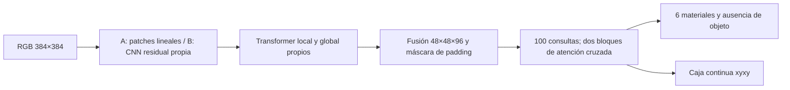
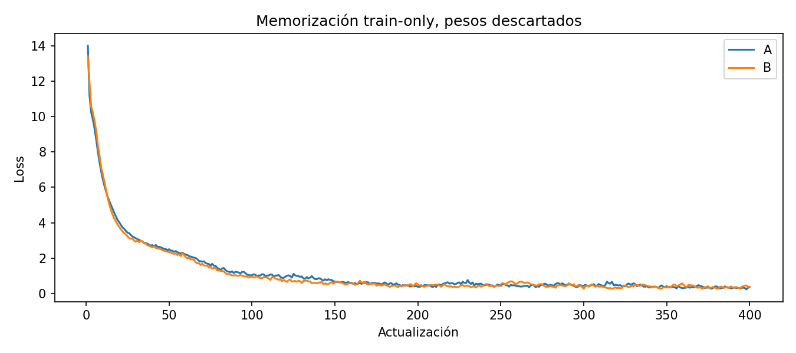
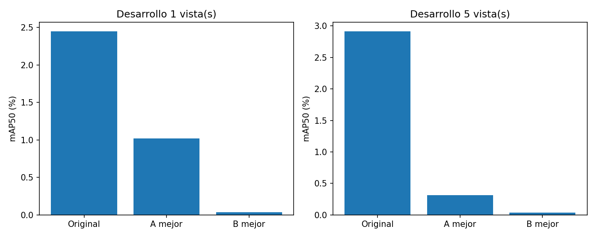
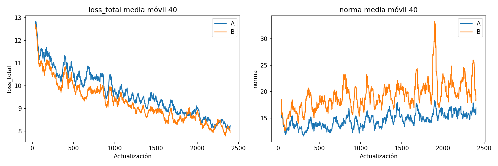
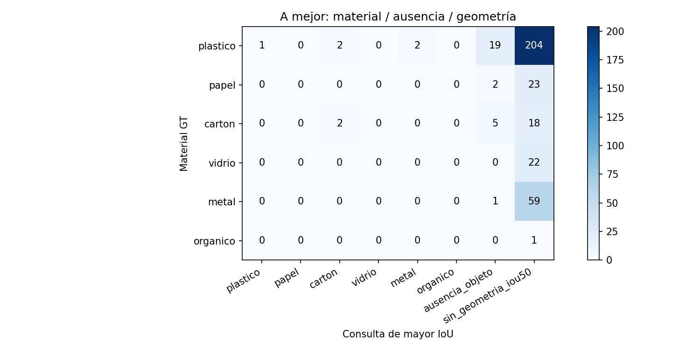
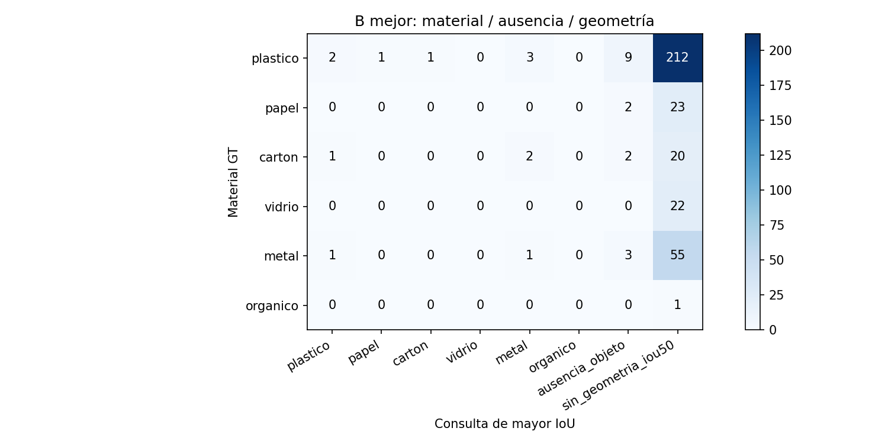

# V31 — detección por instancias con CNN + Transformer propios

**Resultado: experimento no adoptado.** Ambas ramas completaron 2400 actualizaciones. En desarrollo, cinco vistas, A obtuvo 0,3156 % y B híbrido 0,0374 % mAP50 frente a 2,9121 % de la referencia. La implementación y reanudación superaron los controles, pero la calidad de detección empeoró. Se conserva el modelo original; no se inicia otro entrenamiento.

El usuario corrigió el objetivo: mejorar el detector, conservando el clasificador independiente. No se inició entrenamiento del clasificador ni se modificaron sus pesos. Esta fase implementa y prueba detección por instancia propia; no importa modelos ni pesos preentrenados de terceros o época 19.

## Problema e hipótesis

V30 mejoró el ajuste frente a su control pero quedó por debajo del detector original en desarrollo: 1,192 % frente a 2,912 % mAP50 cinco vistas. Sus confusiones materiales persistían y los mapas 48×48 perdían supervisión de objetos pequeños; solo una región orgánica tenía tokens interiores elegibles. Separar instancias no soluciona por sí solo ese problema de datos/material, por lo que se establece un control de extractor con la misma cabeza y supervisión por objeto.

La hipótesis es que las cajas GT pueden supervisar directamente localización y material por objeto, incluidos aquellos que no producen una región semántica suficiente. No se reconstruyen instancias mediante componentes ni se crean cajas desde etiquetas globales. Se conserva que solo hay cinco orgánicos históricos y que el vidrio se concentra en pocas escenas.

## Arquitectura

Se reutilizan las capas propias de V30, Bloque/Atencion y la cabeza de consultas propia. A tiene 674129 parámetros y B 1068905. La CNN B usa Conv2d/GroupNorm/SiLU/residuales y está inicializada aleatoriamente. Se comparten las inicializaciones aleatorias de los parámetros compatibles entre A/B. El Transformer afecta las características que usan los clasificadores y regresores, con gradientes comprobados.

La asignación uno a uno y la predicción de conjuntos se relacionan con [End-to-End Object Detection with Transformers](https://arxiv.org/abs/2005.12872), sin descargar su código/modelo/pesos ni ResNet. La implementación de asignación es la del proyecto. La posición y las proyecciones Q/K/V son propias; se excluye padding de atención y se conservan regiones ignore en la pérdida.

Cien consultas bastan para los máximos train verificados: 53 objetos históricos y 62 nuevos. No se trunca GT. Cajas subtoken conservan sus cuatro coordenadas y su material. La inferencia de una vista no aplica componentes ni NMS; cinco vistas conserva el filtro de bordes y NMS 0,5 entre propuestas combinadas, que también puede suprimir objetos muy solapados: se evalúa por separado.

## Datos y protocolo

| Fuente | Imágenes train | Objetos GT |
|---|---:|---:|
| TACO histórico | 964 | 2505 |
| PackWISE/CLICK congelados V29 | 1050 | 4624 |
| Total | 2014 | 7129 |

Los conteos conjuntos son 5375 plástico, 732 papel, 155 cartón, 203 vidrio, 659 metal y 5 orgánico. No se añadieron nuevas fotos ni se acredita mayor diversidad física por sobremuestrear. Se mantienen las licencias/procedencia, las etiquetas de autores, polígonos/RLE originales y cajas derivadas de máscaras de V29. Ninguna propuesta IA pendiente se convierte en revisión humana o aceptación V26. No se incorpora aún WaRP completo ni se afirma que la colección sea mayor.

A/B comparten 8 imágenes históricas + 2 PackWISE + 2 CLICK y 16 ejemplos globales RealWaste por actualización. La clasificación global es una tarea auxiliar interna del detector con coeficiente 0,5: no modifica el clasificador independiente y no crea cajas. El microbatch nuevo usa coeficiente 0,5.

Se reutiliza la pérdida de consultas densidad_ponderada ya implementada en V10: CE positiva ponderada por material, CE de ausencia de objeto con factor 0,1, L1 de caja con factor 5 y GIoU con factor 2; normalización por objetos asignados. No se añade otra pérdida discriminativa V20. Pesos calculados exclusivamente con GT train, cap final 10: [0.6321366429328918, 1.7129498720169067, 3.722496747970581, 3.252761125564575, 1.8053337335586548, 10.0].

El muestreo histórico usa el promedio de pesos de los materiales presentes por imagen, normalizado y limitado a peso 3. No se interpreta ese peso como nuevas imágenes ni garantía de probabilidad exactamente triple tras normalizar. Los priores de tamaño se calculan únicamente de cajas train; son estadísticas globales, no GT por imagen en inferencia.

Semilla 3101, AdamW LR 0,0005, weight decay 0,01, AMP con GradScaler inicial 1024, clipping 1. Backend V23 completo: SDPA MATH, cuDNN determinista, benchmark false, algoritmos deterministas, TF32 false, CUBLAS_WORKSPACE_CONFIG=:4096:8 y foreach/fused false.

Presupuesto máximo fijo 2400 actualizaciones por rama desde cero. Checkpoints 0/400/800/1600/2400. Puerta train a 400: caída media de loss ≥10 % entre primeras/últimas 40 actualizaciones. Si se supera, se completa el presupuesto sin parada por métricas de desarrollo ni ampliación por resultados bajos. Mejor checkpoint por mAP50 desarrollo una vista entre 800/1600/2400, empate al primero; se reporta también el final.

A/B aíslan el extractor dentro de esta familia de consultas. Frente a V30 cambian cabeza/objetivo y muestreo, por lo que no se atribuye toda diferencia histórica únicamente a la CNN o a la cabeza. Una semilla no permite afirmar robustez estadística.

## Controles técnicos y aprendizaje pequeño

La suite tiene 472 casos, preservando los 457 anteriores y añadiendo 15. Un codec omitido en el entorno ML se comprueba en una batería CPU de 19 pruebas (no se suman como casos nuevos). Se cubren gradientes, vacío, padding, dos objetos cercanos, cajas subtoken, flips/inversa, guardado/carga y rechazo de protocolo/rama/presupuesto/preentrenados.

C1 y C2 independientes de cuatro AdamW, y R dos pasos + guardar/restaurar + dos: entradas, salidas, losses, gradientes antes/después de clipping, pesos, AdamW, scaler y RNG; tolerancia rtol=1e-4/atol=1e-5 y restauración de estados exigida. Exactitud observada de las ocho comparaciones por rama: {'A': True, 'B': True}. No se afirma identidad bit a bit universal entre versiones/hardware.

Memorización: ocho escenas train, mínimo ID por clase y escenas con objetos cercanos, 24 GT. Cuatrocientos pasos descartables por rama, sin aumentos, mismas cajas originales. Gates prefijados mAP50≥0,7, recall≥0,6 y al menos un TP de cada material. GT solo se usa en pérdida y análisis; la inferencia recibe imagen y geometría de padding.

| Rama | mAP50 | mAP50:95 | TP | FP | FN | Aprobada |
|---|---:|---:|---:|---:|---:|---|
| A | 100.000 % | 87.975 % | 24 | 0 | 0 | True |
| B | 96.333 % | 84.194 % | 22 | 2 | 2 | True |

Se descartan esos pesos; el resultado solo demuestra capacidad de ajuste de esas escenas, no generalización. Los ejemplos de orgánico subtoken quedan supervisados por sus cajas, aunque ello no añade comida distinta ni garantiza que otros alimentos sean reconocibles.

## Evaluación final y selección

Inferencia sin GT, umbral 0,05, ausencia de objeto descartada, top100, una y cinco vistas en desarrollo/retención. Train completo se mide con una vista para diagnóstico; no se inventa un mAP train cinco vistas. Evaluador propio de 101 recalls con ignore bbox, no COCOeval oficial.

Desarrollo histórico: 181 fotos/361 GT, usado previamente por el proyecto y para seleccionar estos checkpoints. Retenido V29: 240 fotos/1090 GT, solo plástico/papel/metal, independencia física no demostrada y ya observado en V29/V30. Test y colección de generalización V26 permanecen reservados. No se usa el retenido para seleccionar checkpoints.

| Variante | Dominio | Vistas | mAP50 | mAP50:95 | Recall | Precisión | TP | FP | FN |
|---|---|---:|---:|---:|---:|---:|---:|---:|---:|
| A final | historico_train | 1 | 3.087 % | 0.824 % | 4.711 % | 2.857 % | 118 | 4012 | 2387 |
| A final | nuevo_train | 1 | 0.660 % | 0.130 % | 13.430 % | 7.532 % | 621 | 7624 | 4003 |
| A final | desarrollo | 1 | 1.022 % | 0.247 % | 0.831 % | 0.413 % | 3 | 724 | 358 |
| A final | desarrollo | 5 | 0.316 % | 0.068 % | 2.216 % | 0.264 % | 8 | 3024 | 353 |
| A final | externo_retenido | 1 | 0.656 % | 0.190 % | 10.550 % | 6.534 % | 115 | 1645 | 975 |
| A final | externo_retenido | 5 | 0.840 % | 0.184 % | 19.817 % | 4.239 % | 216 | 4880 | 874 |
| A mejor | desarrollo | 1 | 1.022 % | 0.247 % | 0.831 % | 0.413 % | 3 | 724 | 358 |
| A mejor | desarrollo | 5 | 0.316 % | 0.068 % | 2.216 % | 0.264 % | 8 | 3024 | 353 |
| A mejor | externo_retenido | 1 | 0.656 % | 0.190 % | 10.550 % | 6.534 % | 115 | 1645 | 975 |
| A mejor | externo_retenido | 5 | 0.840 % | 0.184 % | 19.817 % | 4.239 % | 216 | 4880 | 874 |
| B final | historico_train | 1 | 1.596 % | 0.336 % | 5.988 % | 2.761 % | 150 | 5283 | 2355 |
| B final | nuevo_train | 1 | 1.128 % | 0.201 % | 15.117 % | 7.211 % | 699 | 8995 | 3925 |
| B final | desarrollo | 1 | 0.035 % | 0.005 % | 0.831 % | 0.353 % | 3 | 846 | 358 |
| B final | desarrollo | 5 | 0.037 % | 0.006 % | 3.324 % | 0.370 % | 12 | 3229 | 349 |
| B final | externo_retenido | 1 | 1.101 % | 0.251 % | 13.945 % | 6.504 % | 152 | 2185 | 938 |
| B final | externo_retenido | 5 | 1.184 % | 0.233 % | 21.927 % | 4.045 % | 239 | 5670 | 851 |
| B mejor | desarrollo | 1 | 0.035 % | 0.005 % | 0.831 % | 0.353 % | 3 | 846 | 358 |
| B mejor | desarrollo | 5 | 0.037 % | 0.006 % | 3.324 % | 0.370 % | 12 | 3229 | 349 |
| B mejor | externo_retenido | 1 | 1.101 % | 0.251 % | 13.945 % | 6.504 % | 152 | 2185 | 938 |
| B mejor | externo_retenido | 5 | 1.184 % | 0.233 % | 21.927 % | 4.045 % | 239 | 5670 | 851 |
| Original referencia | desarrollo | 1 | 2.447 % | 0.449 % | 11.080 % | 6.126 % | 40 | 613 | 321 |
| Original referencia | desarrollo | 5 | 2.912 % | 0.755 % | 20.499 % | 3.023 % | 74 | 2374 | 287 |
| Original referencia | externo_retenido | 1 | 1.867 % | 0.698 % | 13.486 % | 11.826 % | 147 | 1096 | 943 |
| Original referencia | externo_retenido | 5 | 1.637 % | 0.589 % | 22.752 % | 5.452 % | 248 | 4301 | 842 |

| Mejor checkpoint, desarrollo | Paso | Vistas | plastico | papel | carton | vidrio | metal | organico |
|---|---:|---:|---:|---:|---:|---:|---:|---:|
| A | 2400 | 1 | 0.052 % | 0.000 % | 6.082 % | 0.000 % | 0.000 % | 0.000 % |
| A | 2400 | 5 | 0.020 % | 0.113 % | 1.752 % | 0.000 % | 0.009 % | 0.000 % |
| B | 2400 | 1 | 0.198 % | 0.000 % | 0.000 % | 0.000 % | 0.009 % | 0.000 % |
| B | 2400 | 5 | 0.153 % | 0.000 % | 0.065 % | 0.000 % | 0.006 % | 0.000 % |

## Coste y checkpoints

| Rama | Actualizaciones | Segundos de bucle | Pico GPU |
|---|---:|---:|---:|
| A | 2400 | 1152.58 | 907.2 MiB |
| B | 2400 | 1299.80 | 1241.9 MiB |

Tiempos de captura incluyen lectura y postproceso; no se presentan como FPS de cámara. Pesos y estados nuevos viven en checkpoints/v31_instancias/A y B, guardados sin reemplazar originales, con hashes de confirmaciones, plan, fuentes, datos, versiones y backend.

## Interpretación

- A, mejor paso 2400: mAP50 1v 1.022 % y 5v 0.316 %. Comparar también AP individual, FP y geometría; no adoptar solo por el promedio.
- B, mejor paso 2400: mAP50 1v 0.035 % y 5v 0.037 %. Comparar también AP individual, FP y geometría; no adoptar solo por el promedio.

Las causas geométricas (sin caja, material equivocado a IoU50, geometría insuficiente, posibles fusiones/fragmentos) están en cada analisis.json. Son indicadores de cajas, no adjudicación de identidad física. La clase orgánico tiene solo un GT en desarrollo: una mejora allí puede mover mucho el macro y no demuestra generalización alimentaria. No se afirma mejora de seis clases desde el retenido de tres.

La interpretación cuantitativa y el diagnóstico por objeto aparecen al final, sin cambios en entrenamiento, umbrales o presupuesto. El resultado se conserva explícitamente como negativo. No se inicia otra pérdida o búsqueda automática.

## Aplicación e integridad

scripts/detectar_instancias_v31.py permite cargar explícitamente un checkpoint propio para foto, MP4 o webcam solicitada, con seis materiales, orgánico/inorgánico, cajas, confianza y consulta al asistente propio. Las detecciones se calculan con CNN/Transformer en B, sin GT ni SAM. Se mantiene la advertencia experimental; no se declara cámara física probada en esta fase ni se modifica la aplicación predeterminada.

La selección original continúa en configuracion/arquitectura.json. El clasificador de 85,74 % no se reentrenó ni se sustituyó. No se borraron resultados V26–V30, revisiones humanas ni propuestas IA. La nueva exclusión Git de datos/nuevos/v31 protege futuros visuales de terceros; el .gitignore anterior se conserva.

Reproducción en una ubicación nueva: scripts/instancias_v31.py --fase pruebas/preparar/controles/memorizar; entrenar A/B hasta400 y luego2400 solo si pasa puerta train; evaluar checkpoints800/1600/2400 con el evaluador congelado o resultados/v31_instancias/evaluar_rama.py; generar este informe y ejecutar scripts/verificar_instancias_v31.py. Las publicaciones son inmutables y rechazan sobrescritura.

Integridad final: resultados/v31_instancias/integridad.json y recibo_integridad.json; pruebas, diagnóstico, estados, diarios y hashes quedan ligados al protocolo. Integridad aprobada no significa un modelo fiable ni adopción automática.

## Interpretación cuantitativa y diagnóstico por objeto

Con cinco vistas, B alcanza 0.037 % frente a 0.316 % del control A y 2.912 % de la referencia. Diferencia B−original: -2.875 puntos porcentuales; B−A: -0.278. Se usan los mejores checkpoints seleccionados por el criterio de una vista ya fijado, no una búsqueda posterior del mejor resultado de cinco vistas.

AP50 mayor que la referencia en: carton. B produce 12 TP, 3229 FP y 349 FN sobre 361 objetos de desarrollo; precisión 0.370 % y recall 3.324 % al umbral 0,05. Esos FP deben considerarse junto al AP, y la precisión operativa a otro umbral no se estima cambiándolo tras los resultados.

El híbrido no supera simultáneamente al control y a la referencia en esta comparación. Se conserva como experimento no adoptado; no se amplían pasos, no se retocan umbrales y no se encadenan nuevas pérdidas para forzar una mejora.

### Ajuste train por material, final 2400, una vista

| Rama / dominio | plastico | papel | carton | vidrio | metal | organico |
|---|---:|---:|---:|---:|---:|---:|
| A / historico_train | 0.513 % | 3.568 % | 3.924 % | 0.034 % | 0.085 % | 10.396 % |
| A / nuevo_train | 2.253 % | 0.388 % | 0.000 % | sin GT | 0.000 % | sin GT |
| B / historico_train | 0.961 % | 1.006 % | 4.513 % | 0.110 % | 0.446 % | 2.537 % |
| B / nuevo_train | 3.655 % | 0.854 % | 0.000 % | sin GT | 0.003 % | sin GT |

La mejora train mide ajuste y puede incluir memorización. El retenido externo no tiene GT de cartón, vidrio ni orgánico; esos AP se dejan sin GT. Su origen ya fue observado por el proyecto y no se demuestra independencia de objeto/sesión.

### Material, ausencia de objeto y geometría

El análisis adicional toma por cada GT la consulta raw de mayor IoU, sin utilizar su clase para elegirla. Si ninguna llega a IoU50 se registra «sin geometría»; en caso contrario se distingue material correcto, material incorrecto y ausencia de objeto. No es matching uno a uno ni reemplaza AP. La matriz condicional se restringe a objetos con geometría IoU50 y siempre escoge entre seis materiales, por lo que debe leerse junto a su denominador.

| Mejor / desarrollo 1v | Material GT | Correcto | Material erróneo | Ausencia objeto | Sin geometría IoU50 |
|---|---|---:|---:|---:|---:|
| A | plastico | 1 | 4 | 19 | 204 |
| A | papel | 0 | 0 | 2 | 23 |
| A | carton | 2 | 0 | 5 | 18 |
| A | vidrio | 0 | 0 | 0 | 22 |
| A | metal | 0 | 0 | 1 | 59 |
| A | organico | 0 | 0 | 0 | 1 |
| B | plastico | 2 | 5 | 9 | 212 |
| B | papel | 0 | 0 | 2 | 23 |
| B | carton | 0 | 3 | 2 | 20 |
| B | vidrio | 0 | 0 | 0 | 22 |
| B | metal | 1 | 1 | 3 | 55 |
| B | organico | 0 | 0 | 0 | 1 |

### Efecto del tamaño, final 2400, una vista

Área bbox en lienzo letterbox 384; pequeño <32², mediano <96², grande resto. Desglose posthoc descriptivo, no AP COCO por área original. Consulta raw mayor IoU, no asignación uno a uno.

| Rama | Dominio | Tamaño | GT | Alguna consulta raw IoU50 | Material correcto en consulta de mayor IoU |
|---|---|---|---:|---:|---:|
| A | historico_train | pequeno | 1375 | 26 | 7 |
| A | historico_train | mediano | 831 | 193 | 34 |
| A | historico_train | grande | 299 | 158 | 70 |
| A | nuevo_train | pequeno | 1588 | 18 | 1 |
| A | nuevo_train | mediano | 2433 | 838 | 346 |
| A | nuevo_train | grande | 603 | 357 | 263 |
| A | desarrollo | pequeno | 239 | 6 | 0 |
| A | desarrollo | mediano | 108 | 23 | 2 |
| A | desarrollo | grande | 14 | 5 | 1 |
| B | historico_train | pequeno | 1375 | 30 | 7 |
| B | historico_train | mediano | 831 | 167 | 37 |
| B | historico_train | grande | 299 | 165 | 94 |
| B | nuevo_train | pequeno | 1588 | 30 | 1 |
| B | nuevo_train | mediano | 2433 | 828 | 446 |
| B | nuevo_train | grande | 603 | 301 | 249 |
| B | desarrollo | pequeno | 239 | 3 | 0 |
| B | desarrollo | mediano | 108 | 20 | 2 |
| B | desarrollo | grande | 14 | 5 | 1 |

B carece de geometría IoU50 para 2143/2505 GT históricos train (85,55 %), 3465/4624 nuevos train (74,94 %) y 333/361 desarrollo (92,24 %), aun antes de filtrar por material, confianza o ausencia de objeto. No se explica exclusivamente por generalización: también hay bajo ajuste geométrico sobre train.

La diferencia por tamaño es fuerte: B tiene alguna consulta IoU50 para solo 30/1375 objetos pequeños históricos train (2,18 %), frente a 165/299 grandes (55,18 %). En desarrollo son 3/239 pequeños (1,26 %), 20/108 medianos y 5/14 grandes. Estas fracciones descriptivas no aíslan material, oclusión ni procedencia, y no demuestran que aumentar resolución por sí solo mejore AP.

Las 28 instancias de desarrollo que sí tienen una consulta IoU50 se reparten en 16 con ausencia de objeto, 9 con material equivocado y 3 correctas en la consulta de mayor IoU. La escasez de cajas razonables limita primero; también quedan problemas de material/confianza después.

### Oportunidades antes y después del postproceso, cinco vistas

| Rama | Material | Antes de bordes | Después de bordes | Después NMS/top100 |
|---|---|---:|---:|---:|
| A | plastico | 4 | 2 | 2 |
| A | papel | 1 | 1 | 1 |
| A | carton | 4 | 3 | 3 |
| A | vidrio | 0 | 0 | 0 |
| A | metal | 2 | 2 | 2 |
| A | organico | 0 | 0 | 0 |
| B | plastico | 9 | 8 | 8 |
| B | papel | 0 | 0 | 0 |
| B | carton | 2 | 2 | 2 |
| B | vidrio | 0 | 0 | 0 |
| B | metal | 2 | 2 | 2 |
| B | organico | 0 | 0 | 0 |

Una oportunidad exige alguna caja correcta a IoU50; no garantiza TP tras asignación uno a uno. Se verificó que recombinar los raw reproduce todas las cajas finales guardadas, sin otra inferencia ni cambios al postproceso. En B, cartón conserva 2 oportunidades y vidrio 0 antes/después; NMS/top100 no explica su pérdida principal. El AP50 cartón de B 5v es solo 0,0653 %, frente a 0 % histórico: ese valor aislado no compensa la caída global.

### Geometría y separación, mejor checkpoint cinco vistas

| Rama | Material | Correcto | Material erróneo IoU50 | Geometría insuficiente | Sin caja correcta solapada | Indicador fusión | Indicador fragmentos |
|---|---|---:|---:|---:|---:|---:|---:|
| A | plastico | 2 | 13 | 27 | 186 | 9 | 0 |
| A | papel | 1 | 0 | 5 | 19 | 1 | 0 |
| A | carton | 3 | 1 | 6 | 15 | 5 | 1 |
| A | vidrio | 0 | 0 | 8 | 14 | 3 | 0 |
| A | metal | 2 | 4 | 6 | 48 | 1 | 0 |
| A | organico | 0 | 0 | 0 | 1 | 0 | 0 |
| B | plastico | 8 | 14 | 45 | 161 | 9 | 1 |
| B | papel | 0 | 2 | 4 | 19 | 1 | 1 |
| B | carton | 2 | 6 | 5 | 12 | 6 | 0 |
| B | vidrio | 0 | 0 | 5 | 17 | 0 | 1 |
| B | metal | 2 | 4 | 15 | 39 | 2 | 2 |
| B | organico | 0 | 0 | 0 | 1 | 0 | 0 |

Los indicadores de fusión/fragmentación se basan en cobertura de cajas y pueden marcar objetos anidados; no certifican identidad física ni segmentación.

### Exposición orgánica real

| Imagen train | Cajas orgánicas | Veces por rama |
|---|---:|---:|
| taco:68 | 1 | 38 |
| taco:72 | 1 | 76 |
| taco:81 | 2 | 59 |
| taco:92 | 1 | 43 |

Las cinco cajas tienen supervisión en asignación, incluso las subtoken; no hay nuevas instancias orgánicas en PackWISE/CLICK. Repetirlas no aumenta diversidad. Desarrollo solo tiene un orgánico, por lo que su AP no valida reconocimiento alimentario amplio.

### Curvas y ejemplos

La selección visual se fijó antes de evaluar: menor ID de desarrollo que contiene cada material. Seis entradas corresponden a cinco fotos distintas (papel y cartón comparten escena). Las comparativas GT aparte/original/A/B usan todas las cajas guardadas a 0,05; no se escogieron por éxito de B. Permanecen privadas en datos/nuevos/v31/privado/ejemplos para respetar licencias. El índice y hashes están en ejemplos_visuales.json.

### Decisión y siguiente intervención

El modelo original sigue predeterminado. La prioridad técnica que respalda esta prueba es mejorar la localización de objetos pequeños, antes de otra pérdida de materiales o cambios de NMS. Un candidato posterior sería conservar características CNN más finas (p. ej. 96×96 frente a 48×48) hacia la misma cabeza por instancias, aislando esa resolución en un control y midiendo primero cajas pequeñas sobre train. Es una hipótesis, no una mejora demostrada, y requiere verificar memoria, padding y capacidad de ajuste antes de otro presupuesto grande. No se implementa ni entrena aquí.

La memorización casi perfecta de ocho escenas demuestra capacidad representacional limitada a esas escenas, pero no que el régimen actual optimice bien una colección diversa. Deben auditarse además matching, gradientes de cajas y ausencia de objeto por tamaño sobre train antes de atribuir el fallo solo a datos o solo a la CNN. Los experimentos de centros y consultas V10 ya tuvieron AP insuficiente: no se propone repetirlos sin un control nuevo.

La siguiente adquisición debe concentrarse en objetos reales distintos de vidrio, restos alimentarios y cartón, con cajas o polígonos por instancia y oclusiones/ignore coherentes. PackWISE/CLICK aumentan principalmente plástico y papel y no resuelven esa carencia. Completar las correcciones humanas pendientes y congelar una pequeña evaluación nueva por grupos sigue siendo necesario, sin abrir test ni generalización V26; añadir datos por sí solo no queda demostrado como solución al bajo ajuste geométrico actual. No se inicia otro experimento en esta fase.

### Velocidad e integración ejecutadas

Foto prefijada, cinco calentamientos y veinte repeticiones por modelo/vistas, mismo backend V23, umbral visual 0,35 y propuestas 0,05. Incluye conversión del frame, letterbox, red y postproceso; excluye disco, dibujo y captura física. Una foto repetida no representa toda la aplicación ni la distribución de escenas.

| Modelo | Vistas | Mediana ms | Pico GPU MiB | Salida estable 20 repeticiones |
|---|---:|---:|---:|---|
| Original | 1 | 93.57 | 58.5 | True |
| Original | 5 | 338.93 | 129.2 | True |
| A | 1 | 159.22 | 54.4 | True |
| A | 5 | 339.62 | 125.1 | True |
| B | 1 | 152.69 | 55.4 | True |
| B | 5 | 284.56 | 126.7 | True |

Se ejecutó foto y MP4 con B paso 2400, códigos de salida: {'foto': 0, 'video': 0}. El MP4 son seis repeticiones de una foto real, exclusivamente comprobación de E/S y forward real; no se presenta como video independiente ni prueba física de webcam. Los archivos se guardan privados y sus hashes están en aplicacion.json.

Carga experimental explícita (sin cambiar la aplicación predeterminada): `python scripts/detectar_instancias_v31.py --foto "ruta/foto.jpg" --checkpoint checkpoints/v31_instancias/B/2400.pt --salida "datos/nuevos/v31/privado/mi_foto" --vistas 1`. La salida debe ser nueva. Para MP4 se sustituye `--foto` por `--video`; cámara solo cuando el usuario la solicite mediante `--camara 0 --mostrar --max-frames 300`.

Se verificaron 5012 archivos de evidencia Original reutilizada (métricas, logits, trazas y predicciones), contra sus hashes guardados, sin recalcular métricas con otro backend. El hash del clasificador permanece 0bb9fb2ffdad655cd3fa30e27ae66254e02b1280e11fe4b7eaa8284e6c81aed4 y el del detector original eb8fd00ee536ead21e3a2a0ecd5b06baad04acb2e437b22e0eac3686a7bf36b9.

Un verificador auxiliar inicialmente intentó leer la sección benchmark histórica como otro dominio y produjo KeyError antes de emitir certificado. Se corrigió únicamente ese lector y la denominación de externo_retenido del informe; la repetición terminó aprobada. El renderizador se adaptó a categorías ignoradas (`clase=null`) y reanudó su salida parcial tras comprobar identidad de bytes, sin sobrescribirla ni cambiar GT. No fueron fallos del entrenamiento ni alteraciones del código congelado.

El análisis de oportunidades rechazó inicialmente la reproducción CPU porque softmax CPU/CUDA difiere hasta 1,7881393e-7 en puntuación. Se conservaron las predicciones originales y se repitió solo softmax/postproceso con CUDA como en la captura: todas las cajas, etiquetas y puntuaciones finales de ambas ramas coincidieron exactamente. Se guardan las diferencias CPU/CUDA por imagen/vista; no se amplió ninguna tolerancia para aprobar.
