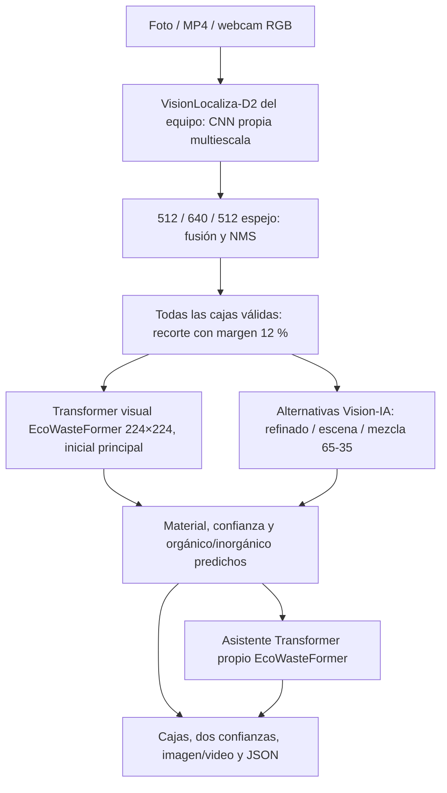
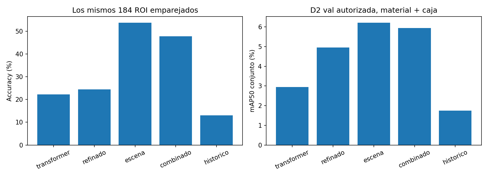
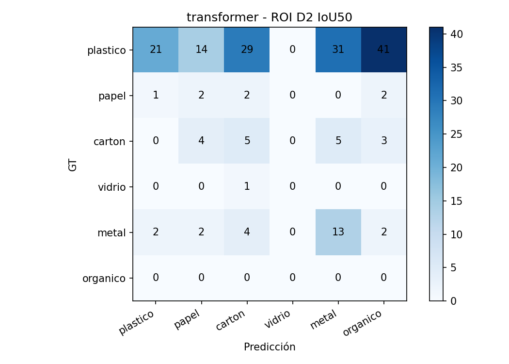

# Integración Vision-IA D2 + Transformer — EcoWasteFormer

**Estado: integración funcional implementada, sin entrenamiento.** Fotografía, MP4 real, cámara física con ventana, alternativas de clasificación y asistente ejecutados. El nuevo punto de entrada usa D2 + Transformer por defecto. El detector histórico, su selección y todos los modelos anteriores permanecen intactos. Funcionar técnicamente no demuestra precisión suficiente: sobre los 184 recortes D2 emparejados con GT material en la cohorte autorizada, el Transformer acierta 22,28 % y la CNN de escenas 53,80 %.

## Arquitectura y aportes



Es una cascada de modelos del mismo equipo, no un modelo híbrido reentrenado de extremo a extremo. El Transformer visual determina el material de cada ROI en el modo principal; D2 determina exclusivamente las cajas y confianza de localización. La alternativa d2-vision usa CNN visuales y conserva el Transformer del asistente: no se presenta como clasificación visual Transformer.

Vision-IA se localizó realmente en `Desktop/Nueva carpeta (2)/Vision-IA`, no en las rutas sugeridas. Se leyó y copió código/pesos; no se importaron sus módulos desde su carpeta, ni se ejecutó entrenamiento ni scripts que escribieran allí. La autorización del usuario corresponde a pesos entrenados por un integrante del mismo grupo académico. No autoriza pesos preentrenados externos. No se descargó ningún modelo ni se incorporó YOLO, SAM, DINO o servicios de detección.

| Componente | Autoría/procedencia | Parámetros |
|---|---|---:|
| VisionLocaliza-D2 | Integrante Vision-IA, CNN propia; conv/BN/ReLU, strides 8/16/32 | 630370 |
| Clasificador Transformer principal | EcoWasteFormer, pesos propios existentes | 629382 |
| Clasificador refinado / B histórico | Vision-IA, VisionCNN-v1 | 89686 cada uno |
| Clasificador de escenas | Vision-IA, VisionResidual-v2, 160 px | 606210 |
| Asistente de intenciones y recomendaciones | EcoWasteFormer, checkpoint propio existente | Se conserva |

PyTorch proporciona operaciones matemáticas; OpenCV/Pillow/NumPy proporcionan imagen, geometría y video. Streamlit y la interfaz de Vision-IA no son dependencias de la aplicación integrada.

## Organización y archivos

- `ecowaste/vision_equipo/`: arquitecturas, preprocesamiento, detector y fusión extraídos, con namespace propio; sin colisiones con app/training/utils.
- `ecowaste/integracion_d2.py`: carga verificada, mapeo de clases, banco de clasificadores, todos los recortes y asistente.
- `ecowaste/aplicacion_integrada.py`: foto/MP4/webcam, visualización, preguntas y exportación.
- `scripts/ejecutar_ecowaste.py`: nuevo punto de entrada seleccionable.
- `configuracion/integracion_d2.json`: D2 + Transformer inicial; no modifica configuracion/arquitectura.json ni scripts anteriores.
- `scripts/incorporar_vision_d2.py`, `preparar_evaluacion_d2.py`, `probar_integracion_d2.py`, `evaluar_integracion_d2.py`, `comprobar_aplicacion_d2.py`: preparación, controles y evidencia reproducible.
- `pruebas/test_integracion_d2.py`: pruebas nuevas.
- `.gitignore`: conserva sus entradas y añade exclusión de fotos/videos privados de esta integración; bytes anteriores respaldados.

Se archivaron las fuentes consultadas, incluida la clasificación y estabilidad temporal, en resultados/integracion_d2/fuentes. No se copió todo Vision-IA. No se adoptó primary_detection/ObjectTracker: seleccionan un solo objeto. El motor recorre todas las propuestas finales, hasta el límite original de 100. No existe seguimiento de identidad ni estabilización temporal oculta: etiqueta instantánea y etiqueta estabilizada (null) permanecen diferenciadas.

## Pesos y procedencia

| Archivo del equipo | SHA-256 |
|---|---|
| checkpoints/vision_equipo/detector_D2.pth | `060e15526da7077c8517b67593901f3fee41774fdcee776f8158437fc81106e8` |
| checkpoints/vision_equipo/classifier_materials.pth | `368ab8c3d2a1b9858db9d7483aeda66817f012cc4cdce11b16ae86eac448de7b` |
| checkpoints/vision_equipo/classifier_scene.pth | `487f5dcb0b2c5fe7d6edc2cf902e5b115fa4ad2952111d4a8cac663097c2d6fd` |
| checkpoints/vision_equipo/classifier_B.pth | `10f25c75048b45459247e3a7cc51204e2c6413ac7735be0a46821622cd4d931c` |
| checkpoints/clasificador_v3_regularizado_mejor.pt | `0bb9fb2ffdad655cd3fa30e27ae66254e02b1280e11fe4b7eaa8284e6c81aed4` |
| checkpoints/asistente_v1.pt | `c3715738f189da6094474779481ccf9a1fe83058b6315c318626e618a0c68ae9` |

El manifiesto original de ejecución está copiado junto a los pesos. Se valida SHA antes de cargar, arquitectura VisionLocaliza-D2, procedencia random/pretrained=false/official_detector_components=false y state_dict estricto. La ruta del detector seleccionada debe coincidir con el SHA del manifiesto. D2 es continuación de entrenamiento propio del equipo desde una inicialización aleatoria; no se afirma haberlo entrenado desde cero durante esta integración. Los metadatos históricos /content/drive/... se conservan como procedencia y nunca se usan para resolver archivos de ejecución.

## Preprocesamiento e inferencia fieles

D2 usa RGB uint8, letterbox OpenCV con relleno 114 y tensor RGB/127,5−1. Vistas 512 sin espejo, 640 sin espejo y 512 con espejo. Se espeja la imagen redimensionada dentro del letterbox, se resta padding, se invierten las escalas X/Y redondeadas y se deshace el espejo en coordenadas originales. Se recortan cajas al lienzo, se rechazan no finitas y lados menores de 2 px.

Cada vista decodifica propuestas desde 0,001 (máximo 1500 candidatos) y NMS 0,45 hasta 100. La fusión original asocia cajas de vistas diferentes a IoU 0,50, promedia coordenadas por score, usa score 0,6×máximo+0,4×media para acuerdos y factor 0,78 para propuestas aisladas; aplica NMS final 0,45 y umbral 0,27. No se simplificó esta política a concatenar vistas.

El ROI expande cada lado un 12 % de su dimensión, mínimo 16 px, y se amplía a cuadrado sin recortar el objeto. Cerca de bordes se desplaza dentro de la foto; si no cabe un cuadrado se conserva el rectángulo completo como en Vision-IA. La caja de detección y la del ROI se guardan por separado.

El Transformer recibe RGB, letterbox de EcoWasteFormer a 224×224 y valores [0,1]. Su forward aplica (x−0,5)/0,5 internamente: no se normaliza dos veces y no recibe BGR ni tensores D2. VisionCNN-v1 conserva su resize RGB128 y normalización del checkpoint. VisionResidual-v2 conserva letterbox160, relleno128 y su normalización. Se respeta inference_hflip cuando figure en el checkpoint.

La correspondencia de clases se verifica y reordena explícitamente antes de mezclar probabilidades: organicos→organico; plástico/papel/cartón/vidrio/metal conservan su identidad. La mezcla es 65 % refinado + 35 % escena, sin mezclar con el Transformer ni con B histórico. El modo historico es una opción separada.

CPU float32, dos hilos, es la configuración inicial fiel al original. CUDA float32 se probó en una foto real y queda seleccionable. La identidad exacta observada se limita a la regresión CPU, no se atribuye universalmente a CUDA u otra versión. No hay AMP ni entrenamiento en esta fase.

## Interfaz, salidas y asistente

Foto: original.png, anotada.jpg, detecciones.json y opcional asistente.json. Cada objeto conserva bbox original, ROI, material, categoría operativa, probabilidades, confianza D2, confianza material y score conjunto no calibrado. La visualización muestra D y C separados y «?» en baja confianza (<0,65). No se crean cajas si D2 no devuelve propuestas.

Video/cámara: anotado.mp4, frames.jsonl y resumen.json; opcional entrada_capturada.mp4. Se mantienen los modelos en memoria durante toda la sesión. Q/Escape detienen; A consulta el asistente sobre ese último fotograma con la pregunta fijada mediante --pregunta. Se libera cámara, writer y ventanas en finally. El resumen registra latencia, FPS de procesamiento, frames, modelos y hashes. No se exporta audio ni se inventan objetos únicos o track IDs.

Se conserva Asistente/asistente_v1.pt de EcoWasteFormer y sus plantillas/reglas documentadas. Solo se usan detecciones reales; las clasificaciones de baja confianza se señalan y se excluyen de recomendaciones específicas. Una confianza alta también puede estar equivocada. El asistente no demuestra limpieza, composición interna, aprovechabilidad ni peligrosidad.

En las seis preguntas de comprobación sobre una fotografía real respondió resumen y separación, y se abstuvo en cuatro formulaciones por su vocabulario/umbral. No se simula comprensión completa. La pregunta «¿En qué recipiente los deposito?» produjo orientación condicional real; se recomienda esa formulación para la demo. Las respuestas completas e intenciones están en aplicacion_casos_reales.json.

## Pruebas y ejecuciones reales

Suite final: 498 pruebas, conservando las 472 anteriores y añadiendo 26. La única omisión de codec del entorno ML se cubre con 19 casos existentes en el entorno CPU con pycocotools; no se suman como pruebas nuevas. Ambas baterías terminaron con returncode 0. Los logs vigentes son pruebas_revision02.json y su directorio homónimo; se conservan las baterías anteriores.

Regresión CPU contra las fuentes originales archivadas y ejecutadas en memoria: cuatro fotografías reales (TACO201–204), siete detecciones; cajas, scores y ROI idénticos. Preprocesamiento y probabilidades de refinado/escena/B coincidieron exactamente en esos recortes; la mezcla reproduce exactamente 65/35. Las imágenes diagnósticas negro/blanco/gris dieron cero detecciones, sin fingir que son fotos reales.

| Caso real | Foto | GT objetos | Propuestas D2 |
|---|---|---:|---:|
| varios_objetos_GT | taco:201 | 3 | 2 |
| objetos_cerca_borde | taco:202 | 3 | 1 |
| un_objeto_GT | taco:203 | 1 | 2 |
| objetos_proximos | taco:204 | 5 | 2 |
| foto_sin_propuestas_D2 | taco:208 | 1 | 0 |

Los casos se eligieron por cantidad/proximidad/borde GT y menor ID, sin elegir aciertos. La foto sin propuestas tiene un GT omitido: demuestra el manejo de salida vacía, no una escena sin basura. Los cuatro clasificadores alternativos se ejecutaron sobre la misma foto real; todos mantuvieron las mismas cajas.

| Ejecución real CPU | Frames | FPS procesamiento | Latencia mediana | Fin |
|---|---:|---:|---:|---|
| webcam_fisica_fuera_aislamiento | 12 | 8.06 | 87.06 ms | limite_frames |
| webcam_ventana_real | 8 | 4.22 | 173.49 ms | limite_frames |
| mp4_real_transformer | 12 | 5.32 | 179.14 ms | fin_archivo |

La cámara física se abrió y se comprobó también con ventana visible fuera del aislamiento. Esas sesiones terminaron por límite de frames; Q/Escape comparten la rama de salida implementada, y la prueba automatizada comprueba Q y liberación. No se afirma haber pulsado físicamente ambas teclas. El MP4 procede de la captura real de cámara, no de fotos repetidas ni detecciones sintéticas. Los FPS son muestras cortas de este equipo; no prometen una velocidad universal.

El modo original se ejecutó sobre foto real y conservó su checkpoint. En la revisión de cierre se corrigió su presentación: conserva su único score S, sin inventar confianzas independientes de detector y clasificador. La prueba nueva y la ejecución recuperacion_original_revision02 lo verifican. D2 sí muestra D y C separados. hibrido-v30 solo se admite con un checkpoint compatible con sus controles existentes; no hay un final V30 aprobado para adoptarlo, por lo que no se fuerza su carga ni se eluden sus bloqueos.

Se ejecutó además un paquete aislado que contiene código, configuración, pesos propios y una foto extraída de la cámara. Cwd es su raíz y se retira PYTHONPATH externo. La inferencia, exportación y asistente terminaron correctamente sin la carpeta del compañero ni rutas absolutas de su máquina. El paquete vigente está en datos/nuevos/integracion_d2/portabilidad/paquete_revision02 y su inventario en portabilidad_revision02.json; el primero también se conserva.

## Evaluación separada por tarea y procedencia

Se detectó un cruce que el hash binario no revelaba: las 181 fotos de EcoWaste val son train de D2 a menor resolución. Se cruzaron IDs TACO y nombres originales, no solo hashes. La cohorte D2 val autorizada tiene 186 fotos: intersección entre val de D2 y train/val autorizado de EcoWaste. Se excluyeron otras 11 sin abrirlas porque no estaban en esos manifiestos autorizados. No se evaluó ningún test.

D2 val autorizada contiene 629 instancias genéricas, 451 materiales objetivo (311 plástico,10 papel,50 cartón,7 vidrio,73 metal,0 orgánico). D2 aprendió una clase genérica residuo, no las seis etiquetas finales. Las métricas de localización incluyen anotaciones genéricas de otros materiales; en la tarea conjunta esas regiones quedan ignore.

La cohorte ya se usó en desarrollo de Vision-IA y no demuestra independencia física ni evaluación final. La segunda cohorte es diagnóstico de EcoWaste val conocido por D2, no generalización D2. No se comparan 27 % genérico y 2,912 % histórico multiclase como si fueran la misma tarea; tampoco se presenta la nueva cohorte como comparación causal de entrenamiento con el detector anterior.

Todas las cifras siguientes se calculan con las predicciones de aplicación umbral0,27: AP truncado por ese umbral, evaluador propio 101 puntos, IoU0,50:0,95. El score conjunto prefijado es scoreD2×probabilidad_material, no calibrado. No se ajustaron umbrales ni se cambió automáticamente de clasificador después de observar resultados.

| Cohorte | Imágenes | GT genéricos | mAP50 localización | mAP50:95 | Recall | Precisión | TP | FP | FN |
|---|---:|---:|---:|---:|---:|---:|---:|---:|---:|
| d2_val_autorizada | 186 | 629 | 27.30 % | 16.12 % | 32.91 % | 51.62 % | 207 | 194 | 422 |
| ecowaste_val_conocida_por_d2 | 181 | 586 | 38.40 % | 23.75 % | 43.86 % | 59.91 % | 257 | 172 | 329 |

### d2_val_autorizada: clasificación y resultado conjunto

| Clasificador | ROI emparejados | Accuracy ROI | mAP50 conjunto | mAP50:95 | Recall | Precisión | TP | FP | FN |
|---|---:|---:|---:|---:|---:|---:|---:|---:|---:|
| transformer | 184 | 22.28 % | 2.95 % | 1.80 % | 9.09 % | 10.96 % | 41 | 333 | 410 |
| refinado | 184 | 24.46 % | 4.95 % | 3.02 % | 10.20 % | 12.30 % | 46 | 328 | 405 |
| escena | 184 | 53.80 % | 6.22 % | 3.71 % | 21.95 % | 26.47 % | 99 | 275 | 352 |
| combinado | 184 | 47.83 % | 5.95 % | 3.35 % | 19.51 % | 23.53 % | 88 | 286 | 363 |
| historico | 184 | 13.04 % | 1.75 % | 1.00 % | 5.32 % | 6.42 % | 24 | 350 | 427 |

| AP50 conjunto | plastico | papel | carton | vidrio | metal | organico |
|---|---:|---:|---:|---:|---:|---:|
| transformer | 4.67 % | 3.20 % | 2.39 % | 0.00 % | 4.48 % | sin GT |
| refinado | 6.33 % | 6.23 % | 1.87 % | 0.00 % | 10.34 % | sin GT |
| escena | 18.57 % | 0.54 % | 8.69 % | 0.00 % | 3.27 % | sin GT |
| combinado | 15.13 % | 1.89 % | 4.08 % | 0.00 % | 8.64 % | sin GT |
| historico | 0.99 % | 4.33 % | 1.89 % | 0.00 % | 1.55 % | sin GT |

### ecowaste_val_conocida_por_d2: clasificación y resultado conjunto

| Clasificador | ROI emparejados | Accuracy ROI | mAP50 conjunto | mAP50:95 | Recall | Precisión | TP | FP | FN |
|---|---:|---:|---:|---:|---:|---:|---:|---:|---:|
| transformer | 216 | 12.96 % | 1.75 % | 1.27 % | 7.76 % | 7.39 % | 28 | 351 | 333 |
| refinado | 216 | 15.28 % | 2.75 % | 1.81 % | 9.14 % | 8.71 % | 33 | 346 | 328 |
| escena | 216 | 51.39 % | 10.29 % | 6.55 % | 30.75 % | 29.29 % | 111 | 268 | 250 |
| combinado | 216 | 39.35 % | 7.63 % | 4.81 % | 23.55 % | 22.43 % | 85 | 294 | 276 |
| historico | 216 | 8.80 % | 1.01 % | 0.62 % | 5.26 % | 5.01 % | 19 | 360 | 342 |

| AP50 conjunto | plastico | papel | carton | vidrio | metal | organico |
|---|---:|---:|---:|---:|---:|---:|
| transformer | 4.08 % | 0.78 % | 1.54 % | 0.00 % | 4.13 % | 0.00 % |
| refinado | 4.62 % | 0.68 % | 6.46 % | 0.99 % | 3.73 % | 0.00 % |
| escena | 24.17 % | 9.32 % | 3.20 % | 8.81 % | 16.26 % | 0.00 % |
| combinado | 14.83 % | 3.50 % | 5.02 % | 8.98 % | 13.46 % | 0.00 % |
| historico | 0.00 % | 0.92 % | 2.16 % | 0.00 % | 2.98 % | 0.00 % |

En D2 val hay 184 recortes emparejados IoU50 con material conocido. La clasificación condicional usa un matching genérico común a todos los clasificadores; la evaluación conjunta usa matching por clase y score conjunto. Puede asignar otras parejas entre cajas solapadas: el número de aciertos condicionales y TP conjunto no siempre coincide. Se guardan matches y todas las probabilidades por imagen para auditarlo sin repetir inferencia.

El 85,74 % de accuracy del Transformer en imágenes completas no se transfiere a ROI: aquí acierta 41/184 (22,28 %). La escena acierta 99/184 (53,80 %) y la mezcla88/184 (47,83 %). Todos fallaron el único vidrio bien localizado de esa muestra. No hay GT orgánico en D2 val; el único orgánico de EcoWaste val es train de D2. No se afirma detección orgánica robusta.

El Transformer confundió 41 de los136 plásticos emparejados con orgánico y solo acertó21. Hay cambios de dominio y errores severos; ni la confianza alta ni una alternativa CNN garantizan material correcto. La CNN de escenas fue la opción más favorable en esta comparación de desarrollo, pero sigue con precisión limitada. Se ofrece el cambio explícito --clasificador escena, manteniendo Transformer como inicial por instrucción del usuario.

## Errores corregidos y limitaciones

- Se localizaron rutas reales distintas a las indicadas y se eliminó toda dependencia de ellas durante ejecución.
- La primera extracción AST omitió decoradores dataclass; se corrigió antes de la inferencia y se verificó contra las fuentes. Se conserva el incorporador inicial y las dos huellas de extracción.
- Windows impidió abrir la cámara dentro del aislamiento; con acceso autorizado fuera de él se realizaron captura y visualización reales.
- Se detectó contaminación de particiones por versiones reducidas de TACO y se separaron cohortes. Se bloquea test por hash y nombre TACO, incluso cambiando mayúsculas de extensión.
- Se validó además que un --config no pueda apuntar silenciosamente a otro checkpoint D2.
- El asistente conserva abstenciones y limitaciones lingüísticas; no se sustituyó por reglas de Vision-IA ni se inventaron respuestas.
- Una clase genérica y NMS antes del material pueden omitir residuos solapados. Los recortes con margen pueden incluir otro objeto. No se garantiza cobertura exhaustiva ni seguimiento temporal.
- No se entrenó, no se abrió test, no se desbloqueó generalización, no se modificaron anotaciones humanas, no se borraron resultados y no se hizo push.

## Ejecución desde Visual Studio Code / PowerShell

```powershell
Set-Location 'C:\Users\JUAN M\OneDrive\Desktop\proyecto final IA\EcoWasteFormer'
$pythonEco = 'C:\Users\JUAN M\.venvs\EcoWasteFormer\Scripts\python.exe'

# Webcam: principal inicial D2 + Transformer; Q/Esc sale, A consulta
& $pythonEco scripts/ejecutar_ecowaste.py --camara 0 --motor d2-transformer --pregunta "¿En qué recipiente los deposito?"

# Alternativa de escenas (selección explícita y reversible)
& $pythonEco scripts/ejecutar_ecowaste.py --camara 0 --motor d2-vision --clasificador escena --pregunta "¿En qué recipiente los deposito?"

# Fotografía con todas las detecciones y asistente
& $pythonEco scripts/ejecutar_ecowaste.py --foto "C:\ruta\foto.jpg" --mostrar --pregunta "¿En qué recipiente los deposito?"

# MP4; el resultado se guarda automáticamente en una sesión nueva
& $pythonEco scripts/ejecutar_ecowaste.py --video "C:\ruta\video.mp4" --pregunta "¿Qué residuos aparecen en la imagen?"

# Combinación original, sin editar código
& $pythonEco scripts/ejecutar_ecowaste.py --foto "C:\ruta\foto.jpg" --motor d2-vision --clasificador combinado

# Recuperación del detector original
& $pythonEco scripts/ejecutar_ecowaste.py --camara 0 --motor original

# GPU opcional (foto comprobada; las pruebas de cámara de este informe fueron CPU)
& $pythonEco scripts/ejecutar_ecowaste.py --foto "C:\ruta\foto.jpg" --dispositivo cuda
```

Sin --salida se crea una carpeta única en datos/nuevos/integracion_d2/sesiones. Para indicar destino, usar una carpeta nueva con --salida. --sin-ventana y --max-frames N permiten comprobar la cámara sin GUI; --guardar-entrada conserva también la grabación sin cajas. Las fotografías y videos privados no se incluyen en Git.

## Evidencia y reproducción

resultados/integracion_d2 conserva fuentes, hashes, cohortes, capturas sin GT, métricas, matrices, casos, portabilidad y logs. Los checkpoints nuevos están en checkpoints/vision_equipo. El cierre vigente es integridad_revision02.json/recibo_integridad_revision02.json, generado con verificar_integracion_d2.py --revision revision02. Verifica código, salidas, pesos y preservación; no declara mejora científica por aprobar integridad. Se conserva el primer certificado y su informe en informe_cierre_inicial.md; la revisión corrige únicamente la presentación del score original y añade sus pruebas y nuevo paquete. Predicciones D2, métricas, pesos y certificados históricos no se reescribieron.

Para reproducir en un destino vacío: incorporar_vision_d2.py --origen ..., preparar_evaluacion_d2.py --origen ..., probar_integracion_d2.py --fase suite y --fase referencia, evaluar_integracion_d2.py --cohorte ..., comprobar_aplicacion_d2.py y este generador. Las salidas rechazan sobrescritura; para nuevos experimentos se debe versionar la raíz de resultados. El entrenamiento anterior V31 no se repite.




