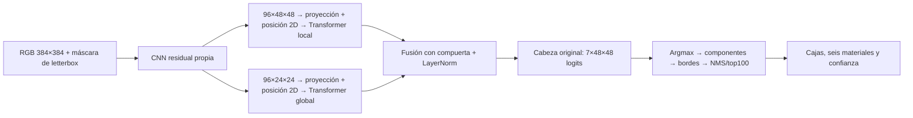

# V30 — CNN + Transformer propio: piloto controlado y decisión de parada

**Resultado:** arquitectura implementada desde cero, controles técnicos y memorización aprobados; entrenamiento detenido en 800 actualizaciones por rama por no superar el criterio de desarrollo prefijado. No se ejecutaron las 1600 actualizaciones restantes. No se adopta B ni se sustituye el detector original.

## Autorización académica y componentes

El usuario comunica autorización docente para CNN y la restricción «Solo debes utilizar modelos, nada de herramientas ni modelos preentrenados». Se implementan CNN y Transformer propios con capas básicas de PyTorch. No se cargan ResNet, YOLO, RT-DETR, SAM, EfficientNet, modelos de autores o pesos externos. El checkpoint de época 19 solo es referencia: no inicializa A ni B. Reutilizarlo como inicialización de otra arquitectura requeriría autorización adicional.

Se actualizó [01_decisiones_y_requisitos.md](01_decisiones_y_requisitos.md). Sus bytes anteriores se conservan con SHA256 `30df8614ea377ac54088d6bc3cbe1436d51279ed2e62b24ca2a93bb793ee38dc`. No se inventa una autorización docente individual de cada dataset.

| Tipo | Componentes | Función |
|---|---|---|
| Modelos propios | CNN residual, Transformer visual, fusión, cabeza semántica, alternativa de consultas, clasificador y asistente propios | Aprendizaje e inferencia local |
| Operaciones matemáticas | PyTorch Conv2d/Linear/GroupNorm/LayerNorm/SDPA, AMP, GradScaler, AdamW; NumPy | Cálculo y diferenciación; ningún detector preentrenado |
| E/S, geometría y medición | Pillow, OpenCV, codec COCO, evaluador propio, Matplotlib | Imágenes/video, máscaras, postproceso y gráficos; no sustituyen el reconocimiento neuronal |
| Auxiliares históricas | SAM/SAM 2 y editor local; asistencia declarada por autores CLICK | Anotación con procedencia; no intervienen en la inferencia ni se ejecutan en V30 |

Se mantienen separados propuestas IA pendientes, correcciones del usuario, anotaciones externas de autores, revisión independiente y aceptación V26. No se reetiquetó ni se simuló revisión humana.

## Evidencia anterior e hipótesis

V25 documentó bajo rendimiento incluso en train, 502/2505 objetos históricos de lado menor a ocho píxeles de entrada, 107/203 vidrios bajo ese tamaño y solo cinco orgánicos en cuatro escenas. Cartón y vidrio no se explican únicamente por objetos pequeños. V28.2 mejoró ajuste auxiliar pero debilitó train histórico; V29 mejoró el retenido de tres clases principalmente en plástico y mantuvo metal AP cero. Consultas V8–V10 y centros V11 ya mostraron dificultades de material/localización: no se repiten sus entrenamientos.

Hipótesis nueva: una CNN propia con campo receptivo compartido podría producir características visuales más útiles que la tokenización RGB lineal. A/B conservan bloques Transformer, cabeza principal de mapas, pérdida y postproceso para aislar ese cambio. La comparación con el original tiene distinta historia de entrenamiento; el control causal de tokenizador es A contra B.

## Arquitectura y formas

CNN: Conv2d 3×3 stride 2, canales 24/48/96, GroupNorm(8), SiLU y residuales en stride 8/16. Se reutilizan Q/K/V y Bloque propios, posición seno/coseno, dos bloques locales en ventanas 8×8 y dos globales en 576 tokens, fusión con compuerta y cabeza principal original. No se importa una arquitectura completa de terceros.

48×48 conserva el control de resolución. Hacer globales sus 2304 tokens multiplicaría por 16 los pares de atención frente a 576; por eso se conserva atención local en detalle y contexto 24×24. La CNN amplía campo receptivo, pero no elimina la cuantización ni separa por sí sola instancias tocantes del mismo material.

| Modelo | Parámetros | CNN | Bloques Transformer |
|---|---:|---:|---:|
| A | 439309 | 0 | 299136 |
| B | 834085 | 468504 | 299136 |

A usa proyecciones lineales de patches RGB y B CNN. Ambos inicializan aleatoriamente, con semilla 3001 y parámetros comunes de Transformer/cabeza iguales antes de aprender. Ambos usan la misma máscara geométrica nueva, para que la exclusión de padding no sea una variable exclusiva de B. El original mantiene su camino histórico. Se comprobó equivalencia del control sin padding dentro de tolerancia.

Padding: se anulan píxeles antes de CNN y características por escala; se excluyen claves inválidas de atención y salidas inválidas. GroupNorm incluye los ceros en sus estadísticas: no es normalización enmascarada. Las regiones ignore no se convierten en padding; se conservan en la pérdida original. Flatten respeta filas/columnas. Los flips transforman imagen, GT y máscara geométrica juntos. Ablacionar los bloques Transformer cambia los logits; se comprobaron gradientes no nulos en CNN, detalle, contexto y cabeza.

### Alternativa por instancia

`ecowaste/detector_hibrido_instancias.py` implementa CNN+Transformer y consultas propias, reutilizando únicamente código de atención cruzada/asignación uno a uno. Predice cajas y siete logits (seis materiales y ausencia). Excluye padding de la atención cruzada. Las pruebas cubren forward/backward, vacío y conservación de dos cajas próximas del mismo material sin componentes conexos/NMS. **No se entrenó ni se atribuyen métricas a esta variante.** Cambiar también la cabeza durante A/B impediría atribuir resultados a CNN.

## Datos, permisos y límites

| Cohorte | Imágenes | Plástico | Papel | Cartón | Vidrio | Metal | Orgánico |
|---|---:|---:|---:|---:|---:|---:|---:|
| Train histórico TACO | 964 | 1630 | 109 | 149 | 203 | 409 | 5 |
| Train nuevo V29 | 1050 | 3745 | 623 | 6 | 0 | 250 | 0 |
| Desarrollo histórico | 181 | 228 | 25 | 25 | 22 | 60 | 1 |
| Retenido externo V29 | 240 | 887 | 108 | 0 | 0 | 95 | 0 |

Colección V29 congelada, con 1353 ignore train y 339 ignore retenido. [PackWISE v2](https://fordatis.fraunhofer.de/handle/fordatis/463.2) y [CLICK v2](https://data.mendeley.com/datasets/htcvvz6fm2/2), CC BY 4.0 según fichas verificadas en V29. Se conserva la discrepancia textual de licencia CLICK y la declaración de asistencia SAM por sus autores; no se cargan sus modelos. TACO conserva sus licencias/procedencias históricas. No se descargaron fuentes ni modelos nuevos en V30.

Se preservan RLE/huecos, polígonos, ignore, grupos y hashes. Las etiquetas globales RealWaste solo aportan clasificación auxiliar train; no se transforman en cajas. Multicapa y materiales ambiguos permanecen ignorados; no se convierte vegetación viva en cajas de restos alimentarios. No se incorporan las propuestas IA pendientes del editor ni las colecciones V28 bloqueadas. La colección pública sigue con cero aceptaciones formales V26.

El retenido externo utiliza secuencias PackWISE y bloques heurísticos CLICK: su independencia física no está demostrada y ya fue inspeccionado en V29. No es una prueba final independiente. No tiene cartón, vidrio ni orgánicos: no permite afirmar mejora en seis clases. Test original y generalización V26 permanecen cerrados.

## Protocolo previo a resultados

A y B: ocho históricas comunes + dos PackWISE + dos CLICK por actualización; 16 ejemplos globales RealWaste balanceados. Mismos orden, aumentos horizontales/brillo/contraste, arquitectura Transformer, 384×384, pérdida CE foreground + 3×CE fondo + Dice, pesos por material calculados solo en train histórico, microbatch nuevo con coeficiente 0,5 y tarea global 0,5. Sin pérdidas V17/V20. AdamW LR 0,0005, weight decay 0,01, clipping 1, AMP, backend V23 completo.

Se fijó un máximo de 2400 actualizaciones por rama desde cero, unas veinte exposiciones del histórico y nueve del nuevo. Checkpoints 0/200/800/1600/2400. No se reutilizó el presupuesto de continuación V20. Puertas: primero diagnóstico de memorización; después caída de loss ≥10 % al paso 200; después una evaluación de una vista en desarrollo al paso 800, con B mAP50≥1 % y recall≥5 %. No ampliar si falla.

La configuración conserva el campo `parada_por_metricas_val=false`, heredado del plan sin early stopping, junto con la puerta explícita `puerta_800`. La ejecución **sí condicionó el avance a esa única evaluación prefijada de desarrollo**; por tanto no se presenta como entrenamiento sin selección por validación. No hubo búsqueda de épocas/umbrales ni cambio del criterio tras observar resultados.

Resultado real: 800 AdamW por rama, 6400 exposiciones históricas, 3200 nuevas y 12800 globales por rama. No se ejecutan los restantes 1600 ni se aprende de los datos retenidos. B usa más parámetros y cómputo: no es un control de FLOPs iguales. Una semilla y una CNN no permiten concluir sobre toda arquitectura híbrida.

## Incidencia AMP y reproducibilidad

La preparación r1 se detuvo al paso 49 de memorización A: pérdida 1,399219 y logits finitos, un parámetro con gradientes no finitos. Sobre exactamente esos pesos/entradas, AMP escala 1024 mantuvo los mismos logits y dio gradientes finitos; FP32 también finito. Se identifica overflow del backward escalado a 65536. No se desactivó el control de no finitos ni se amplió tolerancia.

La revisión 02 fija init_scale=1024 en ambas ramas, conservando GradScaler, FP16, pérdida, LR, modelo y presupuesto. Se conserva r1 con configuración, certificados, incidente y 72 archivos de código congelado. Todos los pesos de diagnóstico se descartaron. No se afirma identidad numérica entre la trayectoria r1 y r2.

Backend: SDPA MATH, cuDNN determinista/benchmark false, algoritmos deterministas, TF32 false, CUBLAS_WORKSPACE_CONFIG=:4096:8, AdamW/clipping foreach false y fused false. Reanudación verifica backend, pesos, AdamW, scaler, RNG torch/CUDA/Python/NumPy, plan, presupuesto, historial y cadena de commits/trazas. Referencias: [reproducibilidad PyTorch](https://github.com/pytorch/pytorch/blob/main/docs/source/notes/randomness.md), [GroupNorm](https://docs.pytorch.org/docs/stable/generated/torch.nn.GroupNorm.html).

Suite: 457 casos, retorno cero (428 anteriores + 29 nuevos), con un skip de codec en ese entorno cubierto por batería CPU de 19 casos. C1/C2/R: cuatro actualizaciones reales por trayectoria/rama; R guarda/restaura tras dos. rtol=1e-4 y atol=1e-5 originales.

| Rama | Comparaciones C2/R contra C1 | Exactas observadas | Pesos diagnóstico |
|---|---:|---|---|
| A | 8 | True | descartados |
| B | 8 | True | descartados |

Esa exactitud solo corresponde a las trayectorias cortas comprobadas; no se afirma bit a bit universal para hardware/versiones o para todos los pasos de producción. Las reanudaciones reales 200→800 restauraron exactamente sus estados. Las 800 huellas de entradas de A/B coinciden.

### Ajuste pequeño train-only

Ocho escenas por mínimo ID por material y escenas con dos objetos del mismo material a distancia de centros ≤0,20 del lienzo. 240 pasos por rama, sin aumentos; gates ≥35 % caída loss, ≥50 % accuracy foreground y ≥30 % por material.

| Rama | Caída loss | Accuracy foreground al último forward de entrenamiento |
|---|---:|---:|
| A | 95.322 % | 92.185 % |
| B | 99.904 % | 99.900 % |

| Material | Tokens GT | Accuracy final A | Accuracy final B |
|---|---:|---:|---:|
| plastico | 143 | 79.720 % | 100.000 % |
| papel | 6 | 100.000 % | 100.000 % |
| carton | 1456 | 96.223 % | 99.863 % |
| vidrio | 320 | 94.063 % | 100.000 % |
| metal | 8 | 100.000 % | 100.000 % |
| organico | 76 | 100.000 % | 100.000 % |

Ambos aprobaron. Esto demuestra ajuste semántico, no generalización, exhaustividad de GT ni separación garantizada de objetos tocantes. Las fusiones de instancias siguen siendo una limitación conocida de componentes.

## Resultados reales del piloto detenido

Argmax, umbral 0,05, área mínima dos celdas, NMS 0,5, top100 y bordes históricos. Inferencia sin GT y análisis posterior. AP propio a 101 recalls con ignore bbox; no es COCOeval oficial. mAP promedia solo clases con GT. Desarrollo se usó repetidamente antes; no se etiqueta independiente. Original train/nuevo/retenido reutiliza capturas V29 con hashes, pesos e inputs comprobados; desarrollo original se mide ahora bajo V23, sin exigir igualdad entre backends con el 2,912 % histórico.

| Dominio | Modelo | Vistas | mAP50 | mAP50:95 | Recall | Precisión | TP | FP | FN |
|---|---|---:|---:|---:|---:|---:|---:|---:|---:|
| historico_train | Original | 1 | 3.034 % | 1.231 % | 16.886 % | 9.684 % | 423 | 3945 | 2082 |
| historico_train | Original | 5 | 4.216 % | 1.418 % | 23.633 % | 3.517 % | 592 | 16239 | 1913 |
| historico_train | A | 1 | 1.057 % | 0.426 % | 13.932 % | 12.289 % | 349 | 2491 | 2156 |
| historico_train | A | 5 | 0.754 % | 0.282 % | 20.120 % | 4.646 % | 504 | 10343 | 2001 |
| historico_train | B | 1 | 3.361 % | 1.317 % | 17.645 % | 15.934 % | 442 | 2332 | 2063 |
| historico_train | B | 5 | 2.816 % | 1.102 % | 24.551 % | 6.547 % | 615 | 8779 | 1890 |
| nuevo_train | Original | 1 | 1.574 % | 0.570 % | 13.754 % | 12.077 % | 636 | 4630 | 3988 |
| nuevo_train | Original | 5 | 1.489 % | 0.514 % | 22.837 % | 5.469 % | 1056 | 18254 | 3568 |
| nuevo_train | A | 1 | 5.942 % | 2.531 % | 24.113 % | 29.173 % | 1115 | 2707 | 3509 |
| nuevo_train | A | 5 | 6.261 % | 2.870 % | 32.742 % | 13.060 % | 1514 | 10079 | 3110 |
| nuevo_train | B | 1 | 6.651 % | 2.871 % | 25.476 % | 37.314 % | 1178 | 1979 | 3446 |
| nuevo_train | B | 5 | 6.909 % | 3.181 % | 32.461 % | 19.755 % | 1501 | 6097 | 3123 |
| desarrollo | Original | 1 | 2.447 % | 0.449 % | 11.080 % | 6.126 % | 40 | 613 | 321 |
| desarrollo | Original | 5 | 2.912 % | 0.755 % | 20.499 % | 3.023 % | 74 | 2374 | 287 |
| desarrollo | A | 1 | 0.512 % | 0.173 % | 10.249 % | 9.069 % | 37 | 371 | 324 |
| desarrollo | A | 5 | 0.401 % | 0.126 % | 16.066 % | 4.290 % | 58 | 1294 | 303 |
| desarrollo | B | 1 | 0.605 % | 0.171 % | 11.911 % | 9.620 % | 43 | 404 | 318 |
| desarrollo | B | 5 | 1.192 % | 0.403 % | 23.269 % | 5.749 % | 84 | 1377 | 277 |
| externo_retenido | Original | 1 | 1.867 % | 0.698 % | 13.486 % | 11.826 % | 147 | 1096 | 943 |
| externo_retenido | Original | 5 | 1.637 % | 0.589 % | 22.752 % | 5.452 % | 248 | 4301 | 842 |
| externo_retenido | A | 1 | 6.104 % | 2.702 % | 23.853 % | 31.980 % | 260 | 553 | 830 |
| externo_retenido | A | 5 | 7.192 % | 3.392 % | 31.651 % | 14.929 % | 345 | 1966 | 745 |
| externo_retenido | B | 1 | 7.213 % | 3.220 % | 25.963 % | 39.197 % | 283 | 439 | 807 |
| externo_retenido | B | 5 | 8.462 % | 4.181 % | 33.486 % | 22.365 % | 365 | 1267 | 725 |

| Dominio, cinco vistas | Modelo | plastico | papel | carton | vidrio | metal | organico |
|---|---|---:|---:|---:|---:|---:|---:|
| historico_train | Original | 5.789 % | 1.221 % | 5.638 % | 0.013 % | 2.242 % | 10.396 % |
| historico_train | A | 3.457 % | 0.118 % | 0.951 % | 0.000 % | 0.000 % | 0.000 % |
| historico_train | B | 10.532 % | 0.000 % | 5.568 % | 0.000 % | 0.793 % | 0.000 % |
| nuevo_train | Original | 5.107 % | 0.656 % | 0.000 % | sin GT | 0.194 % | sin GT |
| nuevo_train | A | 18.543 % | 6.501 % | 0.000 % | sin GT | 0.000 % | sin GT |
| nuevo_train | B | 21.560 % | 6.077 % | 0.000 % | sin GT | 0.000 % | sin GT |
| desarrollo | Original | 3.854 % | 4.950 % | 0.000 % | 0.000 % | 8.668 % | 0.000 % |
| desarrollo | A | 2.178 % | 0.229 % | 0.000 % | 0.000 % | 0.000 % | 0.000 % |
| desarrollo | B | 7.045 % | 0.000 % | 0.000 % | 0.000 % | 0.110 % | 0.000 % |
| externo_retenido | Original | 4.544 % | 0.140 % | sin GT | sin GT | 0.229 % | sin GT |
| externo_retenido | A | 21.287 % | 0.289 % | sin GT | sin GT | 0.000 % | sin GT |
| externo_retenido | B | 24.724 % | 0.663 % | sin GT | sin GT | 0.000 % | sin GT |

## Aprendizaje material/fondo y geometría

Las matrices por celda e instancia se guardan en cada analisis.json. El voto condicional entre materiales excluye fondo y no equivale a una detección. Los indicadores de fusión/fragmentación se obtienen de cajas contra GT tras inferencia; no certifican identidad física ni permiten corregir anotaciones automáticamente.

| Dominio | Modelo | GT sin caja correcta solapada | Geometría insuficiente | Material incorrecto IoU50 | Indicadores fusión |
|---|---|---:|---:|---:|---:|
| historico_train | Original | 703 | 943 | 267 | 557 |
| historico_train | A | 1054 | 714 | 233 | 427 |
| historico_train | B | 800 | 826 | 265 | 533 |
| nuevo_train | Original | 1222 | 1932 | 414 | 614 |
| nuevo_train | A | 567 | 2184 | 360 | 2190 |
| nuevo_train | B | 633 | 2187 | 303 | 2170 |
| desarrollo | Original | 144 | 101 | 42 | 50 |
| desarrollo | A | 174 | 97 | 32 | 46 |
| desarrollo | B | 135 | 90 | 52 | 38 |
| externo_retenido | Original | 301 | 443 | 98 | 126 |
| externo_retenido | A | 185 | 479 | 81 | 456 |
| externo_retenido | B | 172 | 467 | 86 | 452 |

## Tiempo y memoria

| Rama | AdamW reales | Tiempo de bucles | Pico asignado GPU | SHA256 checkpoint 800 |
|---|---:|---:|---:|---|
| A | 800 | 209.64 s | 903.8 MiB | 065e159dd178ceba83b61bd0bd4cccbe30a3d1f081e791fff024e916fca35a93 |
| B | 800 | 272.80 s | 1237.1 MiB | f419ef0ab33115a47474fcb77f20c84854415ac95725493de0c5ea8a4283ba91 |

| Modelo | Latencia 1v | Latencia 5v |
|---|---:|---:|
| Original | 23.00 ms | 92.52 ms |
| A | 25.25 ms | 79.74 ms |
| B | 29.54 ms | 40.64 ms |

Benchmark con sincronización CUDA, doce mediciones tras cuatro calentamientos, IDs prefijados; incluye modelo/postproceso, excluye disco/letterbox y no acredita FPS sostenidos de webcam. Los costes de captura se registran aparte e incluyen archivos.

## Decisión e interpretación

Puerta de 800: A 0.512 %, B 0.605 % mAP50 de una vista. B recall 11.911 %: cumple recall pero falla mAP50≥1 %. **No continuar entrenamiento, no integrar B como detector seleccionable y no adoptar.** No se baja el umbral de aceptación ni se reinterpretan cinco vistas posthoc para aprobar la puerta de una vista.

La CNN sí aporta capacidad de ajuste en las ocho escenas: B alcanza casi todos los tokens materiales. El piloto no demuestra una mejora útil fuera de ese ajuste. El resultado negativo tampoco prueba que una CNN sea inadecuada: solo mide esta arquitectura, datos, semilla y 800 actualizaciones. No se conoce el resultado del presupuesto 2400 porque deliberadamente no se ejecutó. La referencia original tiene más historial de aprendizaje, por lo que su ventaja no estima aisladamente un efecto CNN.

- historico_train, 5v: B−A +2.061 puntos porcentuales; B−Original -1.401.
- nuevo_train, 5v: B−A +0.648 puntos porcentuales; B−Original +5.420.
- desarrollo, 5v: B−A +0.791 puntos porcentuales; B−Original -1.720.
- externo_retenido, 5v: B−A +1.270 puntos porcentuales; B−Original +6.825.

No se inicia otra variante de pérdida ni una cadena automática de entrenamientos. Antes de un siguiente protocolo: comprobar en las matrices si el fallo dominante sigue siendo material/fondo; aportar ejemplos reales diversos de vidrio, cartón y alimentos, hoy escasos; si ya existe respuesta material suficiente pero dominan fusiones/geometría, ensayar la cabeza por consultas propia en un control separado sobre el mismo extractor. No se promete que cambiar la cabeza solucione falta de material.

## Aplicación y límites

El motor y la aplicación anteriores permanecen intactos. Se prepararon MotorHibrido y demostrar_v30.py para foto/MP4/webcam y asistente, con carga del modelo propio y backend explícito, pero su habilitación exige un resultado final aprobado; el piloto detenido no crea metricas.json de producción ni supera esa condición. No se atribuyen pruebas físicas de cámara o calidad de video al nuevo híbrido. La alternativa de volver al original se conserva por defecto.

Las comparaciones visuales usan mínimo ID por material/dominio según regla publicada antes de capturar; GT separado, predicciones a score≥0,35 para legibilidad y métricas a ≥0,05. No se eligen solo mejoras de B. Las fotografías son locales, excluidas de Git: datos/nuevos/v30/privado/visuales.

## Archivos, reproducción e integridad

Código propio nuevo: ecowaste/backbone_cnn.py, detector_hibrido.py, detector_hibrido_instancias.py, experimento_v30.py y video_v30.py. Configuración ejecutada: configuracion/entrenamiento_hibrido_v30_revision02.json. Resultados: resultados/v30_hibrido_revision02/. La r1 permanece separada en resultados/v30_hibrido/.

Evidencia: protocolo.json y plan.pt congelados; pruebas.json; controles/reanudacion.json y memorizacion.json; diarios con checkpoints 0/200/800, traces por paso y hashes; piloto_800/puerta.json; metricas_piloto.json; tabla_metricas_piloto.csv; logits y predicciones por imagen; análisis material/fondo/geometría; visuales.json y gráficas. La inferencia no recibe anotaciones GT.

La evaluación adicional se ejecuta con evaluar_piloto_detenido.py, reutilizando las funciones de evaluación congeladas sin modificar el entrenador ni autorizar pasos nuevos. El informe/figuras usa informar_piloto_detenido.py sin cargar modelos. El cierre verificar_v30.py verifica la parada a 800, datos, modelos previos, revisiones, código y hashes; integridad.json y recibo_integridad.json. Integridad aprobada significa archivos coherentes, no gate de calidad aprobado.

Las publicaciones no reemplazan archivos existentes. Para replicar usar un checkout/directorio de resultados distinto con los mismos datos, código y versiones. No relanzar sobre estos históricos ni aprobar revisiones ajenas. Se conserva el checkpoint original, test sin evaluar, generalización bloqueada y cero aceptación V26 nueva.

